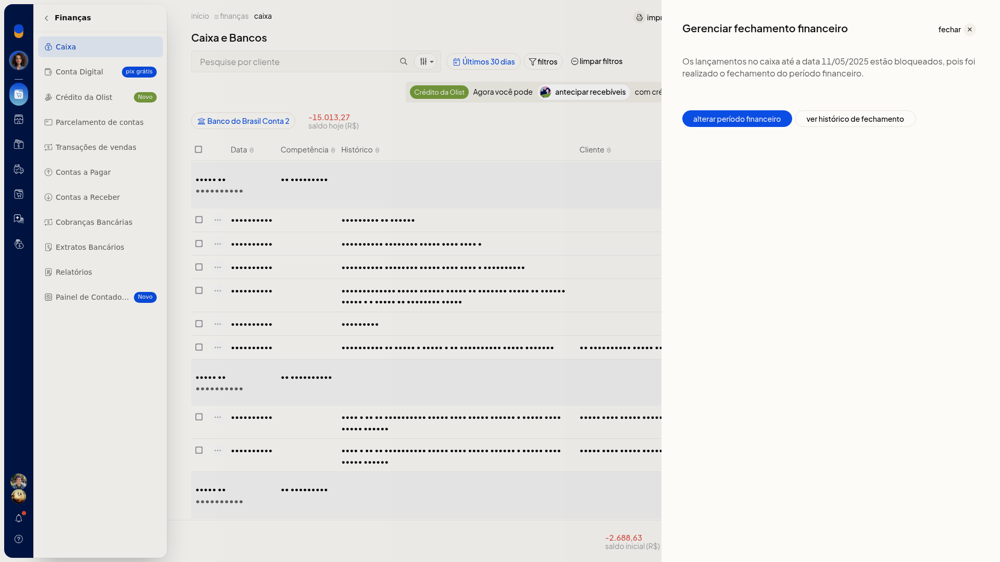
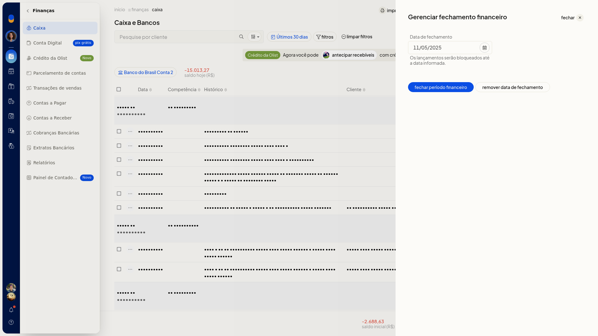
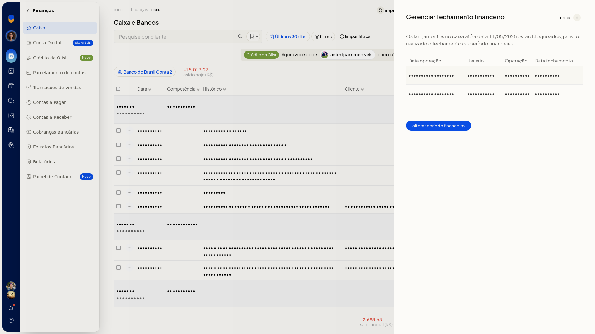
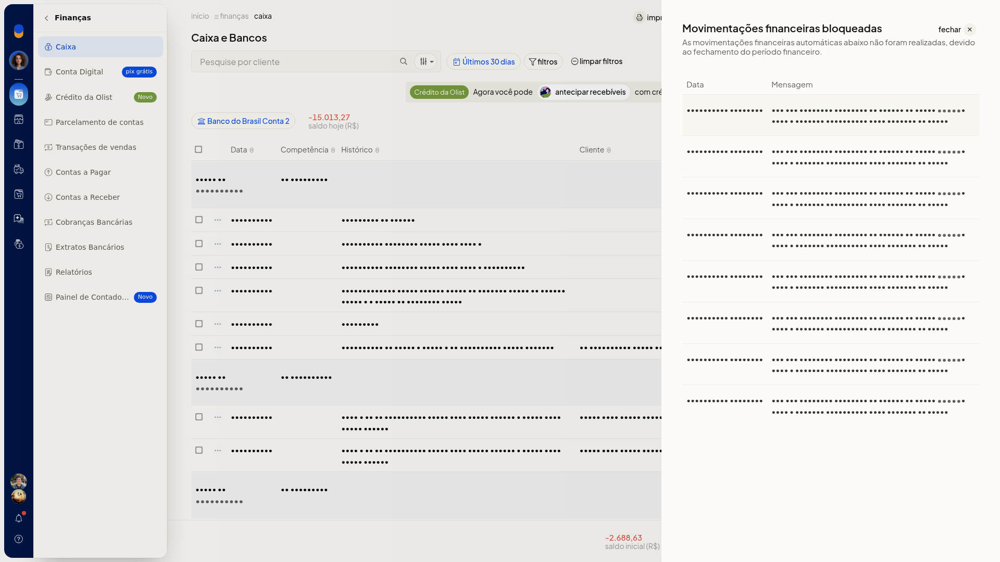

# Fechamento financeiro

## Importante
- Enquanto houver data de fechamento, os lançamentos do caixa ficam bloqueados até essa data.
- Estornos automáticos de contas de uma venda não são realizados quando o período financeiro está fechado na data do movimento.

## Instruções
### Alterar a data de fechamento

1. Acesse **Finanças > Caixa**.
2. Clique em **Mais ações** e selecione **Gerenciar fechamento financeiro**. O painel informa que os lançamentos no caixa estão bloqueados até a data de fechamento exibida.

   

3. Clique em **Alterar período financeiro**.
4. No campo **Data de fechamento**, digite a data no formato DD/MM/AAAA. O campo não é obrigatório. A tela informa que os lançamentos serão bloqueados até a data informada.

   

   

5. Clique em **Fechar período financeiro** para bloquear os lançamentos até a data informada. Para retirar a data de fechamento, clique em **Remover data de fechamento**.

### Consultar o histórico de fechamento

1. Acesse **Finanças > Caixa**.
2. Clique em **Mais ações** e selecione **Gerenciar fechamento financeiro**.
3. Clique em **Ver histórico de fechamento**. A tabela mostra **Data operação**, **Usuário**, **Operação** e **Data fechamento**, com as operações de **Fechamento**.

   

### Consultar movimentações bloqueadas

1. Acesse **Finanças > Caixa**.
2. Clique em **Mais ações** e selecione **Movimentações financeiras bloqueadas**. O painel avisa que as movimentações financeiras automáticas não foram realizadas por causa do fechamento do período.

   

3. Confira a tabela com as colunas **Data** e **Mensagem**. As mensagens indicam que não foi possível estornar as contas de uma venda porque o período financeiro está fechado na data.

## Resultado
Com uma data de fechamento definida, os lançamentos do caixa ficam bloqueados até essa data. No histórico, as operações de **Fechamento** aparecem com **Data operação**, **Usuário**, **Operação** e **Data fechamento**. Em **Movimentações financeiras bloqueadas**, cada linha traz a data e a mensagem do estorno que não ocorreu.
