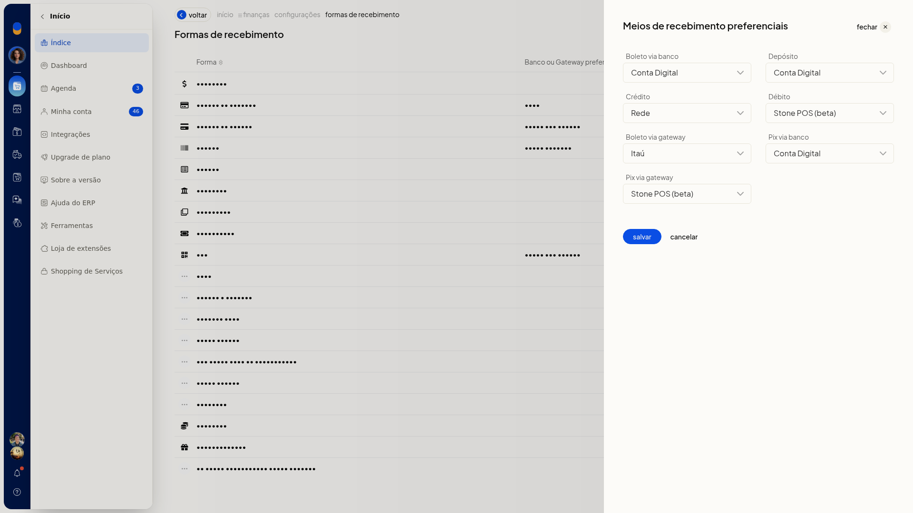
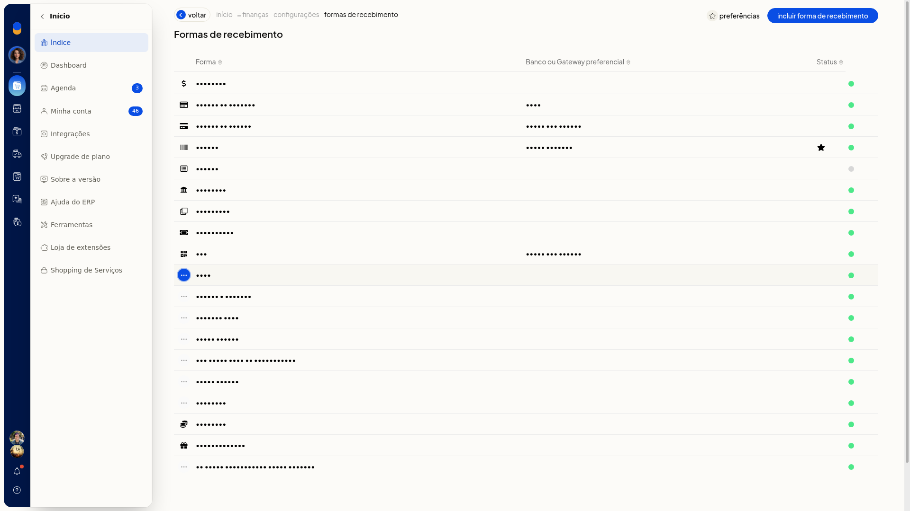
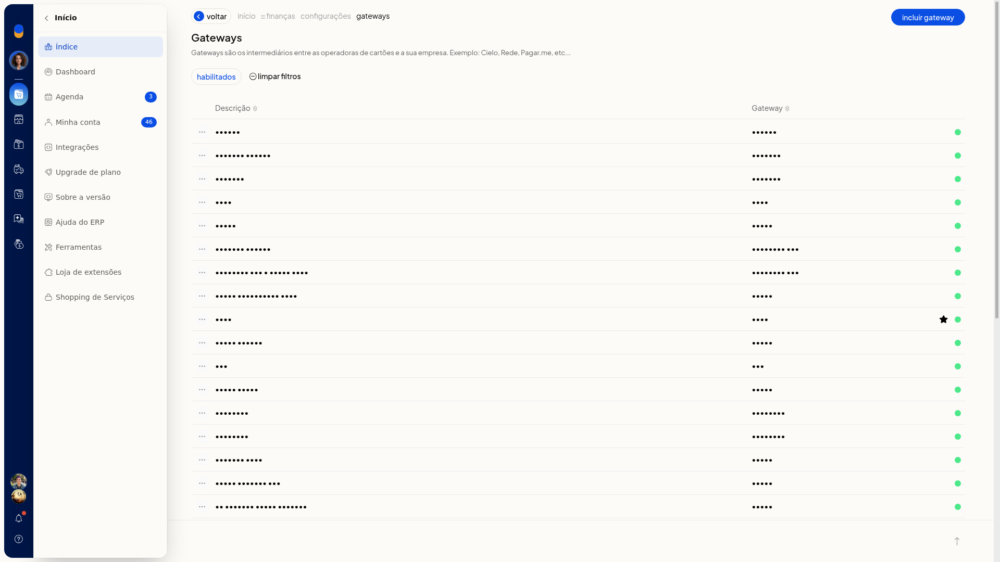
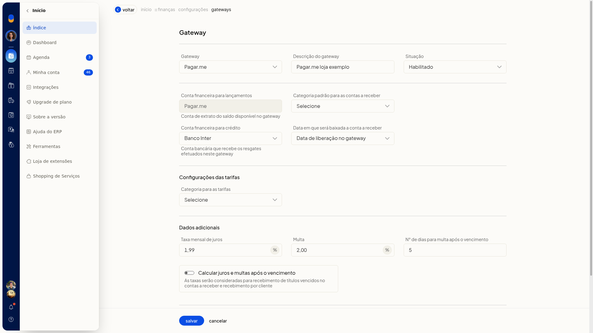
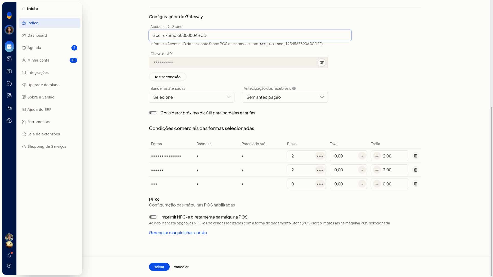

# Banco Inter

No ERP da Olist, o Banco Inter não tem tela própria em Finanças. Ele aparece como conta financeira já cadastrada e como opção de boleto.

Você pode defini-lo como banco preferencial de boleto, usá-lo como conta de destino ou de tarifas de uma forma de recebimento e indicá-lo como conta que recebe os resgates de um gateway.

## Pré-requisitos
- A conta financeira do Banco Inter já precisa existir quando o crédito ou as tarifas forem lançados nela.
- Se a opção não aparecer para você, peça acesso ao administrador da conta.

## Importante
- O Banco Inter não é um item do hub de Finanças. Ele só aparece como conta financeira ou como opção de boleto.
- O Banco Inter aparece em **Boleto via banco** e em **Boleto via gateway**. Nas opções vistas, ele não entra em depósito, crédito, débito nem Pix.

## Instruções
**Boleto preferencial**

1. Acesse **Configurações > Configurações ERP > Finanças > Formas de recebimento**.
2. Clique em **Preferências**. Se o primeiro clique mostrar só a dica **Configurar meios de recebimento preferenciais**, clique em **Preferências** de novo.
3. No painel **Meios de recebimento preferenciais**, selecione **Banco Inter** em **Boleto via banco**, em **Boleto via gateway** ou nos dois. Cada meio fica associado ao banco ou gateway que o ERP deve usar de preferência.

   

**Conta na forma de recebimento**

1. Acesse **Configurações > Configurações ERP > Finanças > Formas de recebimento**.
2. Clique em **Incluir forma de recebimento**.
3. Se o **Destino** for **Conta financeira**, escolha **Banco Inter**.
4. Se a **Tarifação** for **Em dia específico**, escolha **Banco Inter** na conta financeira das tarifas e informe o dia, a categoria, a **Tarifa fixa**, a **Taxa** e a **Taxa adicional por parcela**.
5. Clique em **salvar**. A forma fica gravada com destino, tarifas e antecipação definidos.

   

**Conta de crédito do gateway**

1. Acesse **Configurações > Configurações ERP > Finanças > Cadastro de gateways**.
2. Clique em **Incluir gateway**.
3. Em **Conta financeira para crédito**, selecione **Banco Inter**. Essa é a conta bancária que recebe os resgates efetuados no gateway.

   

   

   

## Resultado
A lista de formas de recebimento mostra cada forma com o banco ou gateway preferencial e o status. No painel **Meios de recebimento preferenciais**, cada meio tem o seu seletor.

## Informações adicionais
- Em **Boleto via gateway**, as opções vistas são Banco Inter e Pagar.me.
- Em **Boleto via banco**, Banco Inter aparece junto das demais contas e gateways já disponíveis para boleto.
