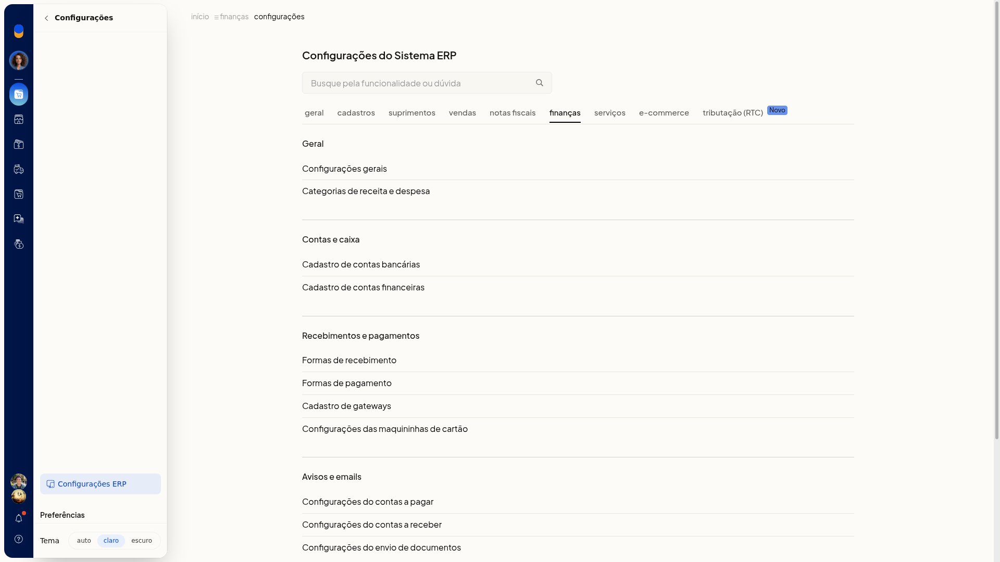
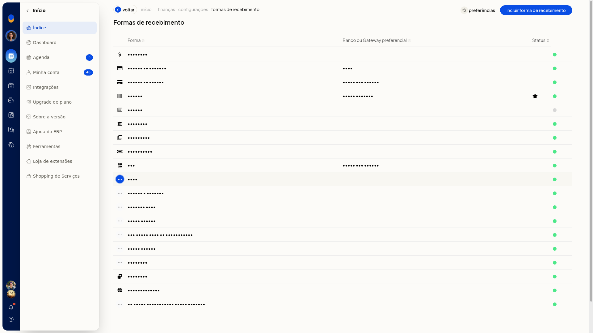
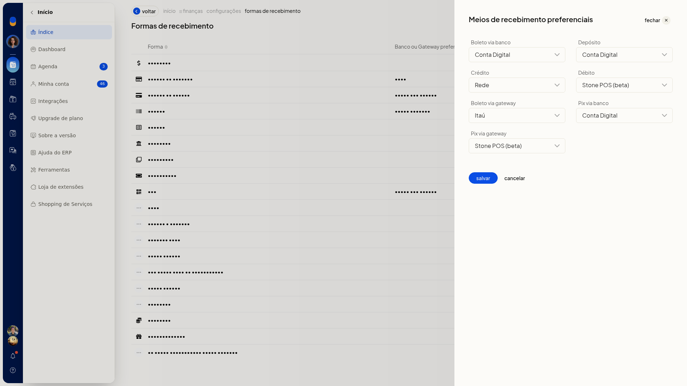
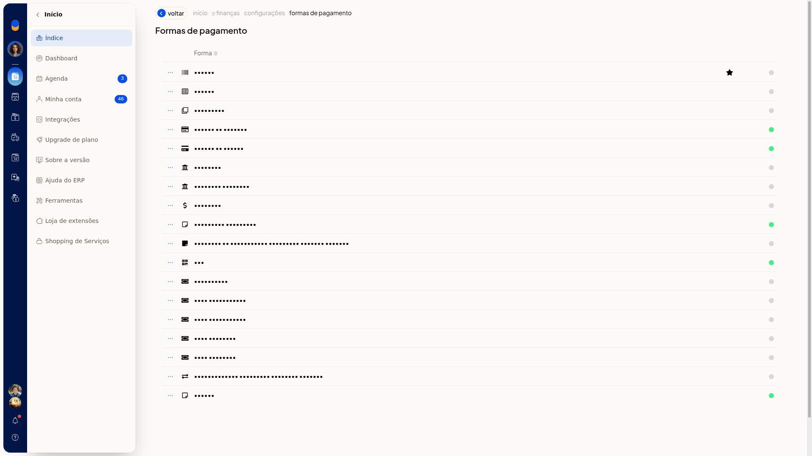
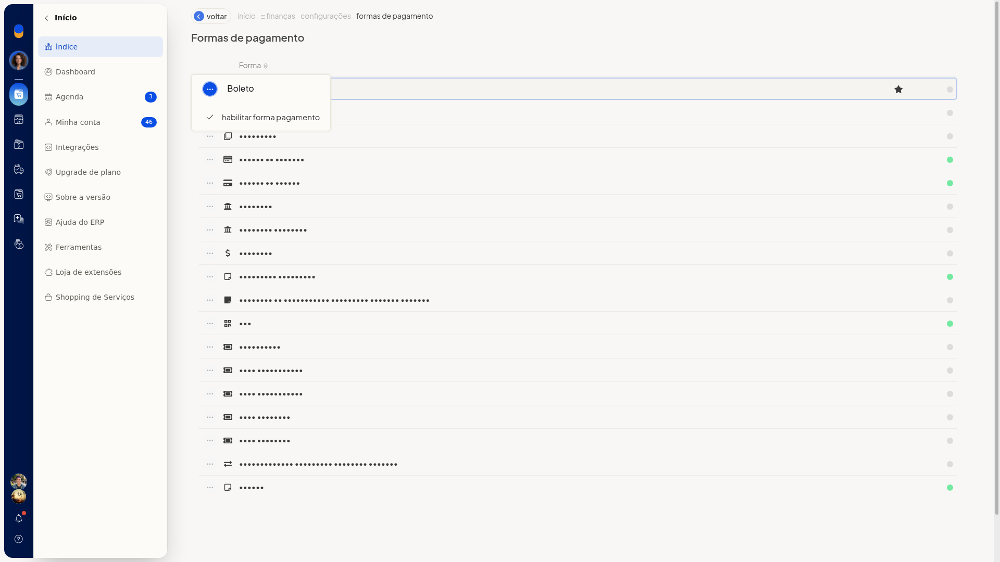

# Formas de recebimento e de pagamento

## Importante
- Em **Formas de pagamento** não há botão para incluir uma nova forma nesta tela.
- Banco Inter não é um item próprio deste caminho. Ele aparece como conta financeira e como opção de boleto.
- Os campos da forma de recebimento não são obrigatórios.

## Instruções
### Incluir uma forma de recebimento

1. Acesse **Configurações > Configurações ERP > Finanças > Formas de recebimento**. A lista mostra as colunas **Forma**, **Banco ou Gateway preferencial** e **Status**, além de **Incluir forma de recebimento** e **Preferências**.

   

2. Clique em **Incluir forma de recebimento**.
3. Informe a **Descrição**, a **Situação** (**Habilitada** ou **Desabilitada**), **Validar limite de crédito** (**Validar** ou **Não validar**), o **Destino** (**Contas a receber** ou **Conta financeira**) e a **Tarifação** (**Sem taxas**, **Em dia específico**, **No dia da transação**, **Dia seguinte** ou **No dia do pagamento**). Há também o campo de tipo de pagamento da NF-e. Uma opção é **Pagamento Instantâneo (PIX)**.

   

4. Em antecipação, escolha **Sem antecipação** ou **Antecipado**. Em **Antecipado**, informe a **Forma de cálculo das taxas** (**Juros simples** ou **Valor presente**) e os **Dias para recebimento**.
5. Se a tarifação for **Em dia específico**, informe o **Dia**, a conta financeira das tarifas, a categoria, a **Tarifa fixa**, a **Taxa** e a **Taxa adicional por parcela**. Banco Inter aparece entre as contas financeiras.
6. Se o destino for **Conta financeira**, escolha a conta.
7. Clique em **salvar** para gravar a forma com destino, tarifas e antecipação definidos.

### Definir o banco ou gateway preferencial

1. Em **Formas de recebimento**, clique em **Preferências**. Se o primeiro clique mostrar só a dica **Configurar meios de recebimento preferenciais**, clique de novo para abrir o painel.
2. No painel **Meios de recebimento preferenciais**, escolha o banco ou gateway de cada meio: **Boleto via banco**, **Depósito**, **Crédito**, **Débito**, **Boleto via gateway**, **Pix via banco** e **Pix via gateway**. Banco Inter aparece em **Boleto via banco** e em **Boleto via gateway**. Pagar.me aparece em boleto e crédito. Stone POS (beta) aparece em crédito, débito e Pix.

   

### Consultar as formas de pagamento

1. Acesse **Configurações > Configurações ERP > Finanças > Formas de pagamento**.
2. Confira a lista das formas já cadastradas. Não há botão **Incluir** nesta tela. As formas vistas são **Boleto**, **Cheque**, **Crediário**, **Cartão de crédito**, **Cartão de débito**, **Depósito**, **Depósito Bancário**, **Dinheiro**, **Duplicata Mercantil**, **Programa de fidelidade/Cashback/Crédito Virtual**, **Pix**, **Vale-troca**, **Vale Alimentação**, **Vale Combustível**, **Vale Presente**, **Vale Refeição**, **Transferência bancária/Carteira Digital** e **Outros**.

   

3. No menu da linha, use **Ações** ou **habilitar forma pagamento** para controlar a habilitação da forma.

   

## Resultado
A lista de formas de recebimento mostra cada forma com o banco ou gateway preferencial e o status. O painel **Meios de recebimento preferenciais** mostra um seletor para cada meio. Em formas de pagamento, você vê as formas disponíveis e o controle de habilitação na própria linha. Não há cadastro de nova forma nessa tela.

## Informações adicionais
- Não há importação por planilha neste caminho.
- Em **Depósito**, a opção vista foi **Conta Digital**.
