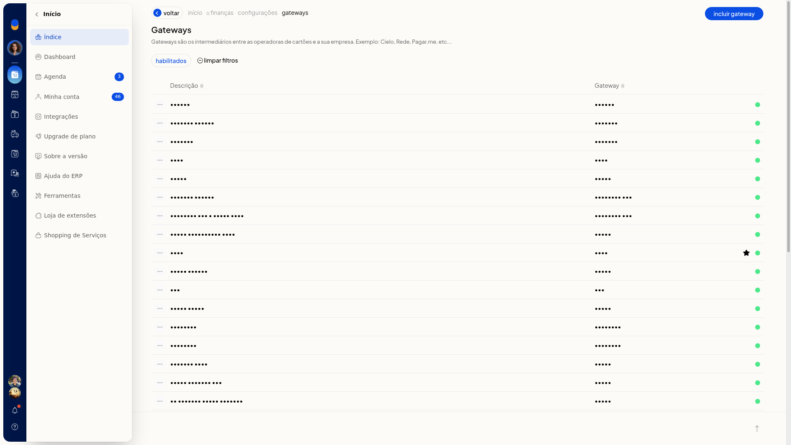
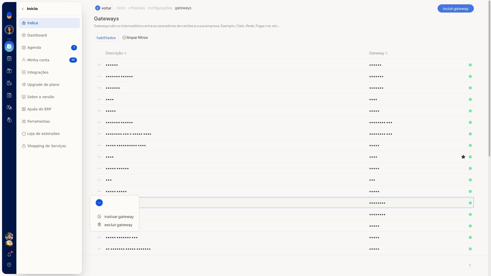
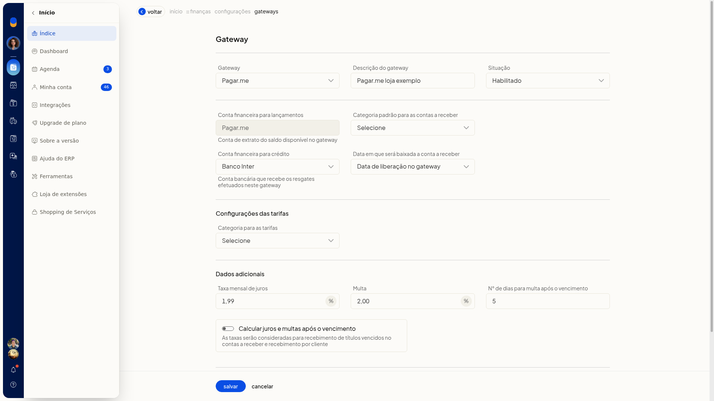
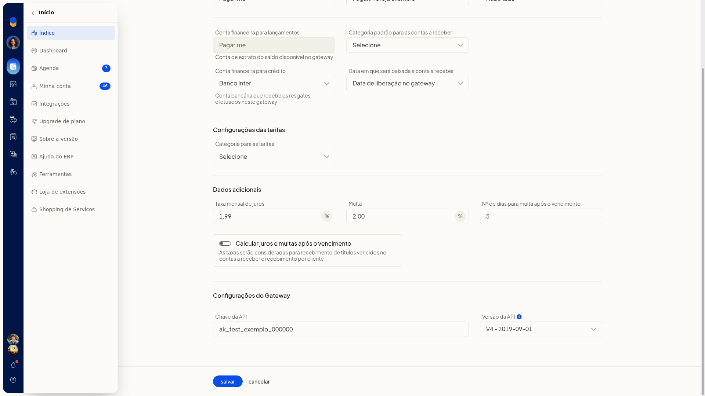
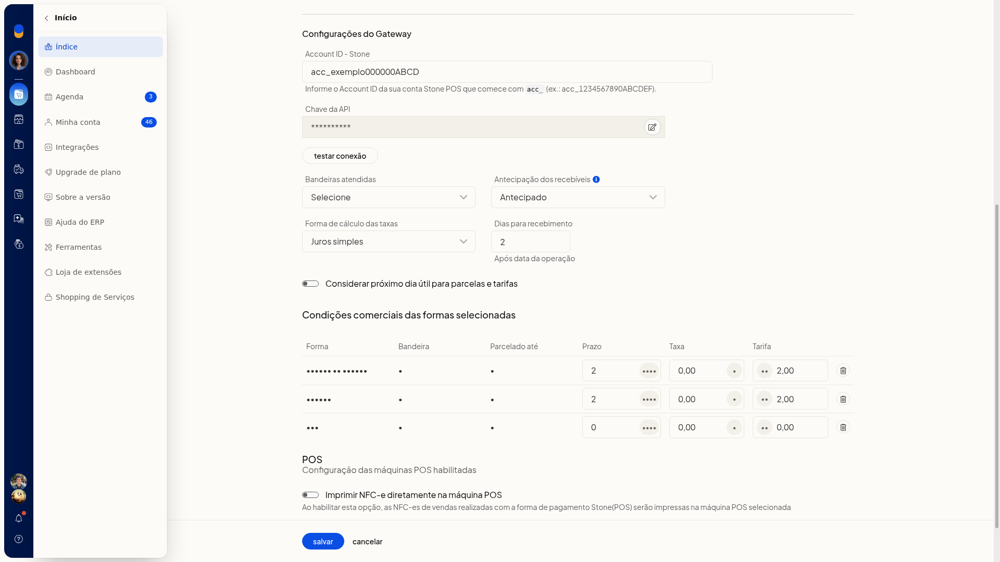
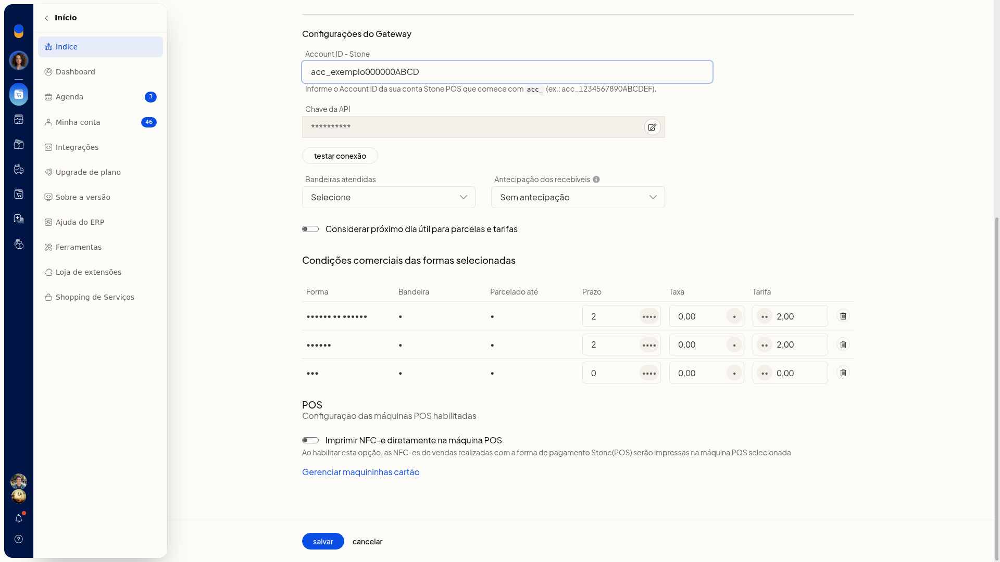

# Gateways de pagamento (Pagar.me e outros)

No ERP da Olist, o cadastro de gateways conecta a empresa aos meios de pagamento, em especial Pagar.me e Stone POS. Você informa as credenciais, a conta que recebe os resgates e as regras de juros, multa, baixa e antecipação.

A tela fica em **Configurações > Configurações ERP > Finanças > Cadastro de gateways**. No campo **Gateway** também entram Pagar.me 2.0, Wirecard, Cielo, Rede, Getnet, SafraPay, PagBank, Vero, Bin, Sicredi, Caixa, Sipag, PicPay, Redeflex e Outro.

## Pré-requisitos
- Para Pagar.me: chave da API e a versão da API da conta.
- Para Stone POS: Account ID que comece com acc_ e a chave da API da conta Stone.
- Se a opção não aparecer para você, peça acesso ao administrador da conta.

## Importante
- O **Account ID - Stone** precisa começar com acc_.
- **Inativar gateway** e **Excluir gateway**, no menu da linha, desativam ou removem o gateway. Use só quando quiser esse efeito.
- Banco Inter não é um gateway nesta tela. Ele aparece como conta financeira para crédito.

## Instruções
1. Acesse **Configurações > Configurações ERP > Finanças > Cadastro de gateways**. A lista mostra **Descrição** e **Gateway**, o filtro habilitados e **Incluir gateway**.

   

2. No menu da linha de um gateway já cadastrado, as opções são **Ações**, **Inativar gateway** e **Excluir gateway**.

   

3. Clique em **Incluir gateway**.
4. Em **Gateway**, selecione **Pagar.me** ou **Stone POS**. Os campos abaixo não estão marcados como obrigatórios.

#### Pagar.me

5. Preencha **Descrição do gateway** e **Situação** (**Habilitado** ou **Desabilitado**). A conta de extrato é sugerida com o nome do gateway.
6. Escolha a **Categoria padrão para as contas a receber**, a **Conta financeira para crédito** e a **Categoria para as tarifas**. Banco Inter está entre as contas de crédito.
7. Em **Data em que será baixada**, escolha **Data de liberação no gateway** ou **Data de pagamento da conta a receber (beta)**.

   

8. Informe a **Taxa mensal de juros** e a **Multa** em percentual, o **N° de dias para multa** e, se quiser, marque **Calcular juros e multas**.
9. Informe a **Chave da API** e a **Versão da API**: **V4 - 2019-09-01**, **V3 - 2017-08-28**, **V2 - 2017-07-17** ou **V1 - 2013-03-01**.
10. Clique em **Salvar** para gravar o gateway Pagar.me.

   

#### Stone POS

5. Informe a descrição, a situação e a **Conta financeira para lançamentos**. Essa conta é o extrato do saldo disponível no gateway.
6. Escolha a **Categoria padrão para as contas a receber** e a **Conta financeira para crédito**, a conta bancária que recebe os resgates deste gateway. Banco Inter está nessa lista.
7. Em **Baixar contas a receber automaticamente**, escolha **Manual**, **Data de vencimento da conta a receber** ou **Data da efetivação da venda**.
8. Em configurações do gateway, informe o **Account ID - Stone** (começa com acc_) e a **Chave da API**. O botão **Testar conexão** fica na tela.
9. Escolha as **Bandeiras atendidas** e a **Antecipação dos recebíveis**: **Sem antecipação** ou **Antecipado**. Em **Antecipado**, informe a **Forma de cálculo das taxas** (**Juros simples** ou **Valor presente**) e os **Dias para recebimento**, contados após a data da operação.

   

10. Use o interruptor **Considerar próximo dia útil para parcelas e tarifas** se quiser esse ajuste. A seção **Condições comerciais das formas selecionadas** lista **Forma**, **Bandeira**, **Parcelado até**, **Prazo**, **Taxa** e **Tarifa**.
11. Em POS, o interruptor **Imprimir NFC-e diretamente na máquina POS** faz as NFC-e da forma Stone(POS) saírem na máquina selecionada. O link **Gerenciar maquininhas cartão** abre as maquininhas.
12. Clique em **Salvar** para gravar o gateway Stone POS.

   

## Informações adicionais
- A lista de gateways mostra a descrição e o gateway, com o filtro habilitados.
- **Inativar gateway** aparece apenas para gateways habilitados. **Ativar gateway** aparece apenas para gateways desabilitados.
- Neste caminho não há importação por planilha.
