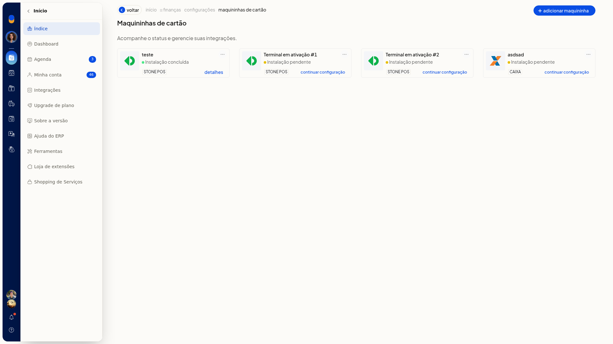
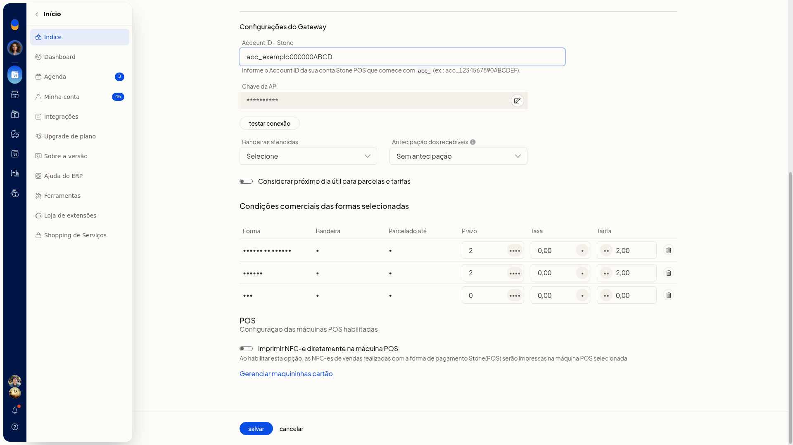
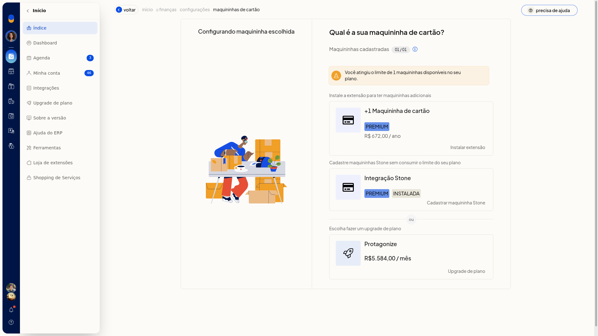
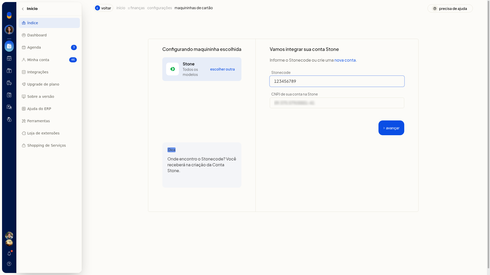
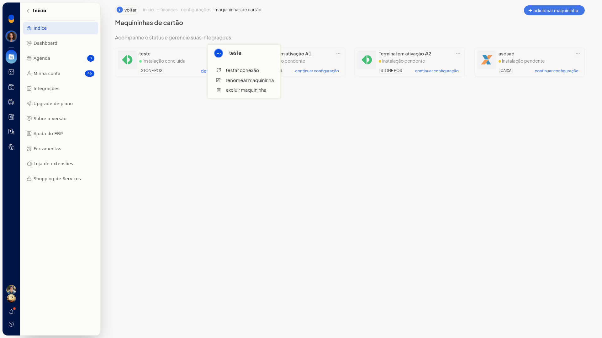
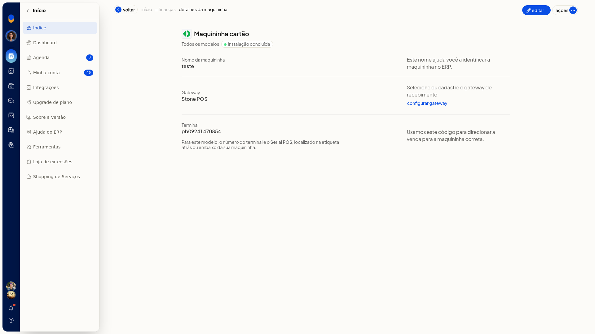
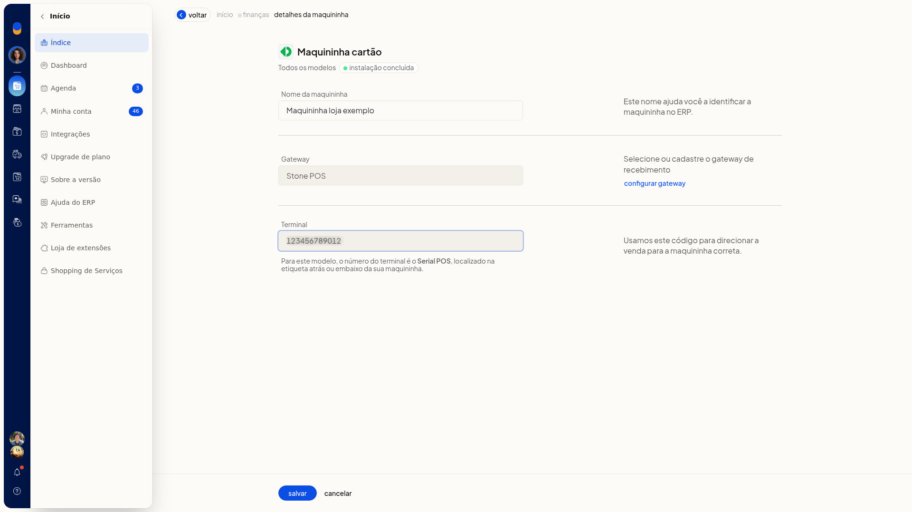

# Maquininhas de cartão

Nas configurações de Finanças do ERP da Olist, você acompanha as maquininhas de cartão ligadas ao gateway Stone POS. Dá para cadastrar uma maquininha Stone com o Stonecode, ver a opção de instalação por extensão e ajustar o nome e o terminal de uma máquina já concluída.

A tela fica em **Configurações > Configurações ERP > Finanças > Configurações das maquininhas de cartão**. No formulário do gateway Stone POS, o link **Gerenciar maquininhas cartão** abre a mesma lista.

## Pré-requisitos
- Para cadastrar a maquininha Stone, tenha o Stonecode recebido na criação da conta Stone e o CNPJ dessa conta.
- Se a opção não aparecer para você, peça acesso ao administrador da conta.

## Importante
- **Escolher outra** volta à mesma tela, com **Instalar extensão**, **Cadastrar maquininha Stone** e **Upgrade**.
- **excluir maquininha** é uma ação destrutiva. Use só quando quiser remover a máquina.

## Instruções
### Cadastrar maquininha Stone

1. Acesse **Configurações > Configurações ERP > Finanças > Configurações das maquininhas de cartão**. Se o gateway Stone POS já estiver aberto, acesse o link **Gerenciar maquininhas cartão**.

   

   

2. Na lista, clique em **adicionar maquininha**.

   

3. Clique em **Cadastrar maquininha Stone**.
4. Informe o **Stonecode**. A tela indica que ele é obtido na criação da conta Stone. Confira o **CNPJ de sua conta na Stone**, que pode já vir preenchido.

   

5. Clique em **Avançar** para seguir o cadastro.

### Editar nome e terminal

1. Na lista, abra o menu da máquina já concluída. As opções são **testar conexão**, **renomear maquininha** e **excluir maquininha**.

   

2. Abra **Detalhes**. A tela mostra o status **Instalação concluída**, o gateway Stone POS, **Editar**, **Ações** e **Configurar gateway**.

   

3. Clique em **Editar**.
4. Ajuste **Nome da maquininha** e **Terminal** com os dados da máquina. O campo **Gateway** também aparece nesse formulário.

   

5. Clique em **salvar** para gravar o nome e o terminal.

## Resultado
A lista pode mostrar máquinas com instalação concluída e máquinas ainda pendentes. Em **Detalhes**, a maquininha já configurada aparece com o status **Instalação concluída** e o gateway Stone POS.

## Informações adicionais
- Na inclusão, além de **Cadastrar maquininha Stone**, a tela oferece **Instalar extensão** e **Upgrade**.
- No gateway Stone POS, o interruptor **Imprimir NFC-e diretamente na máquina POS** faz com que as NFC-e da forma Stone(POS) sejam impressas na máquina selecionada.
- Em **Detalhes**, o link **Configurar gateway** leva de volta à configuração do gateway da máquina.
