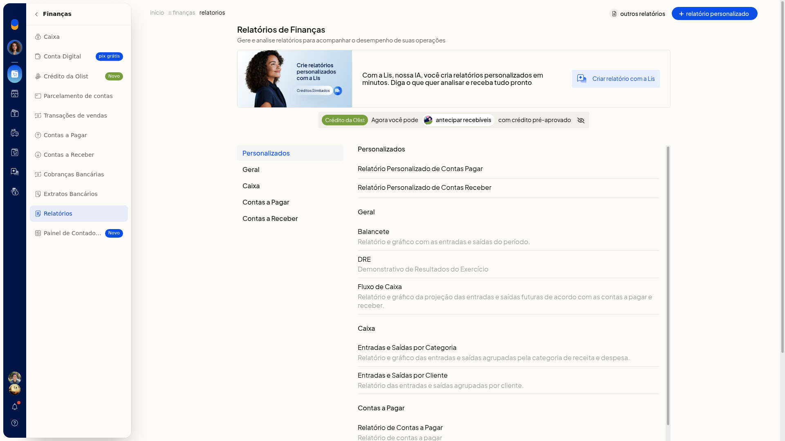
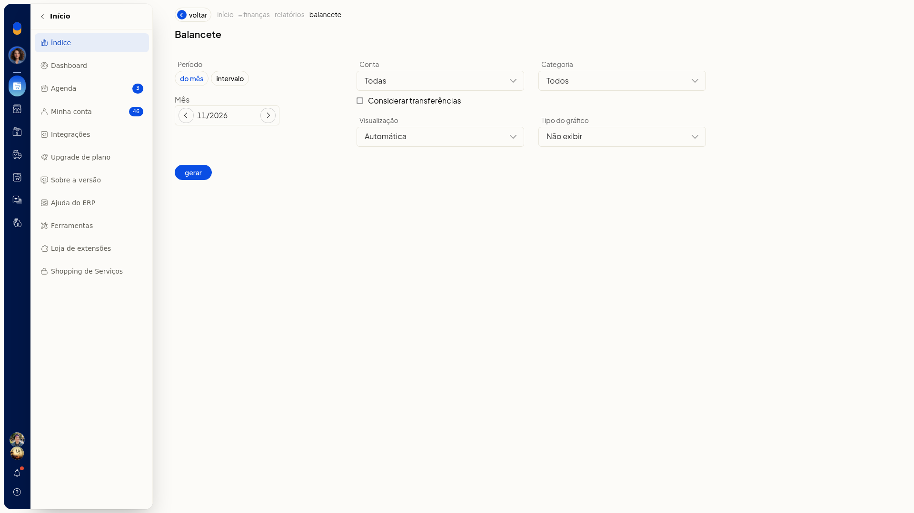
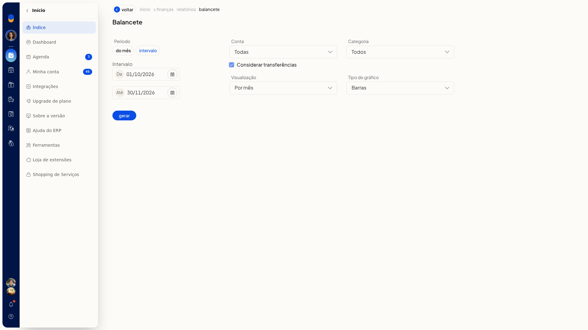
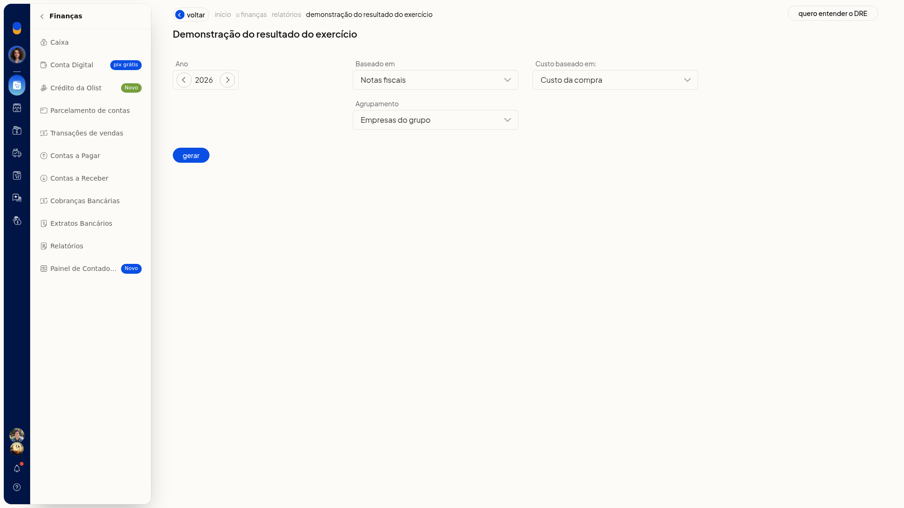
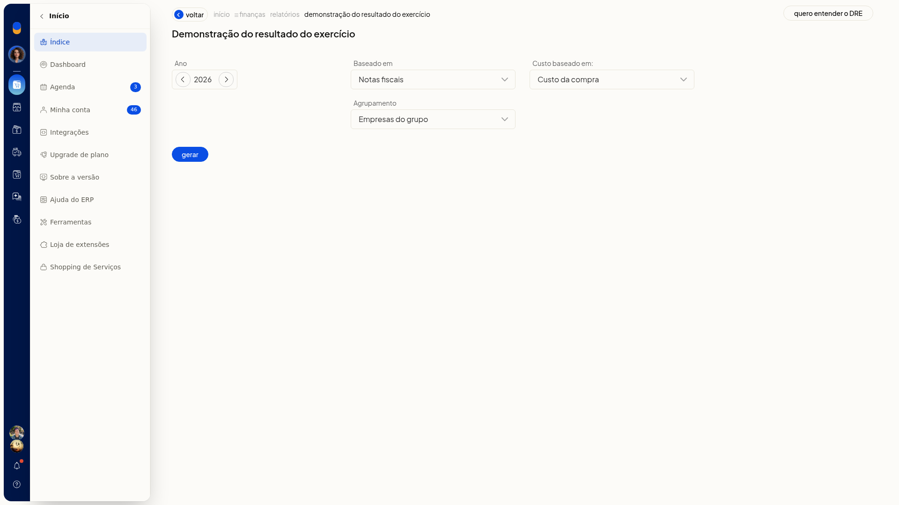
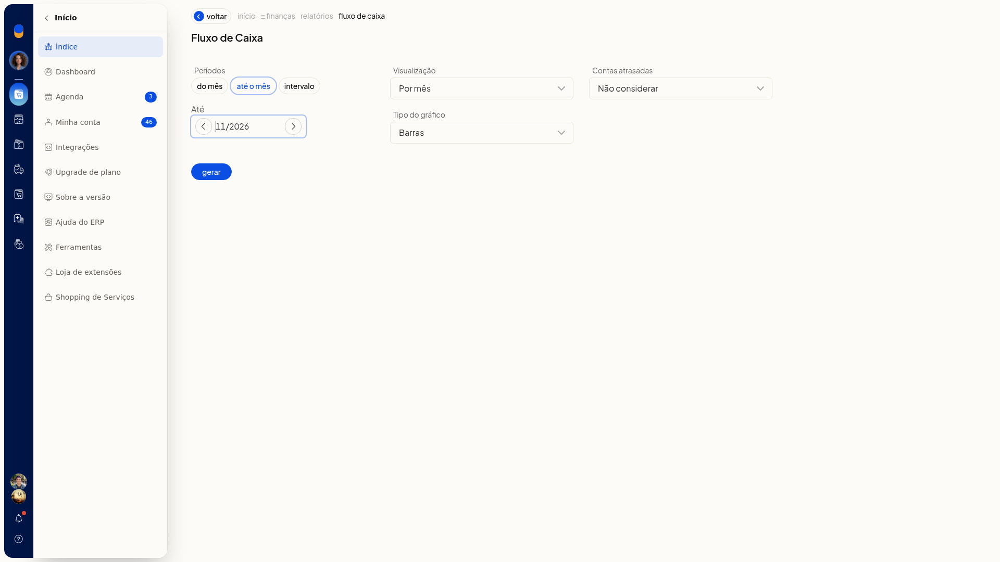
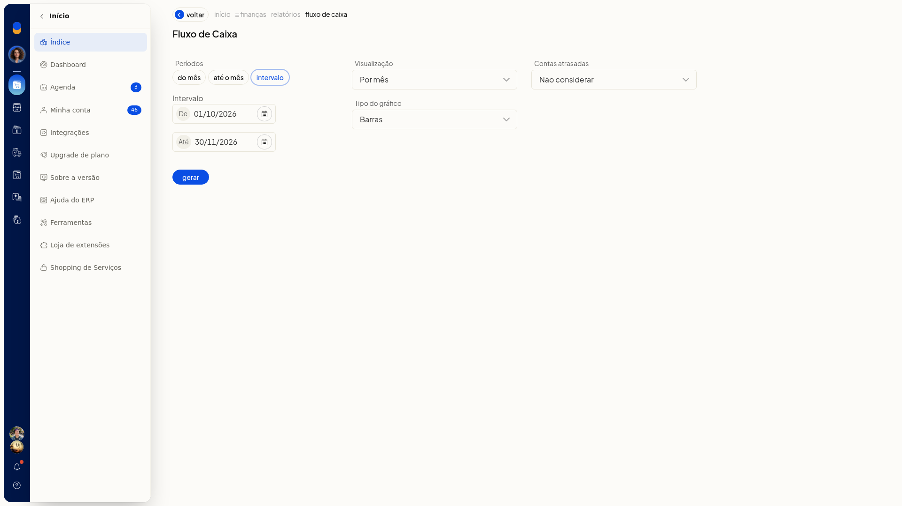
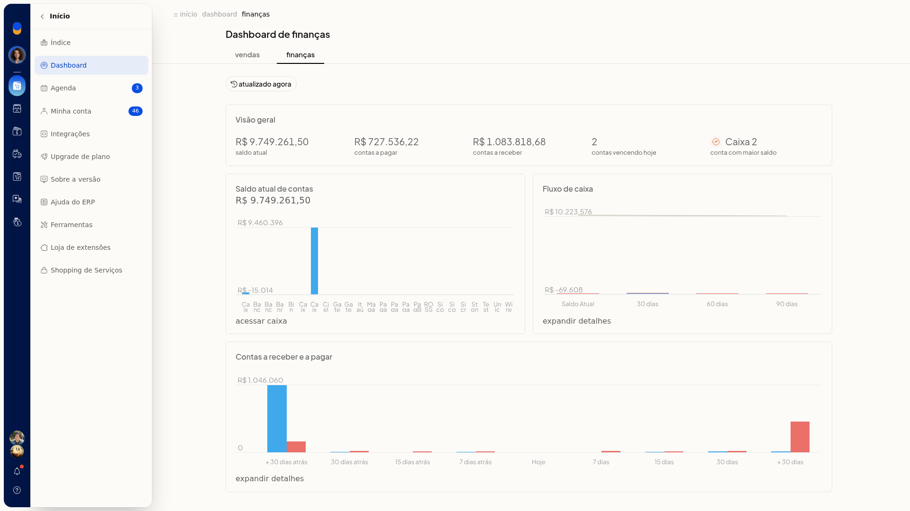
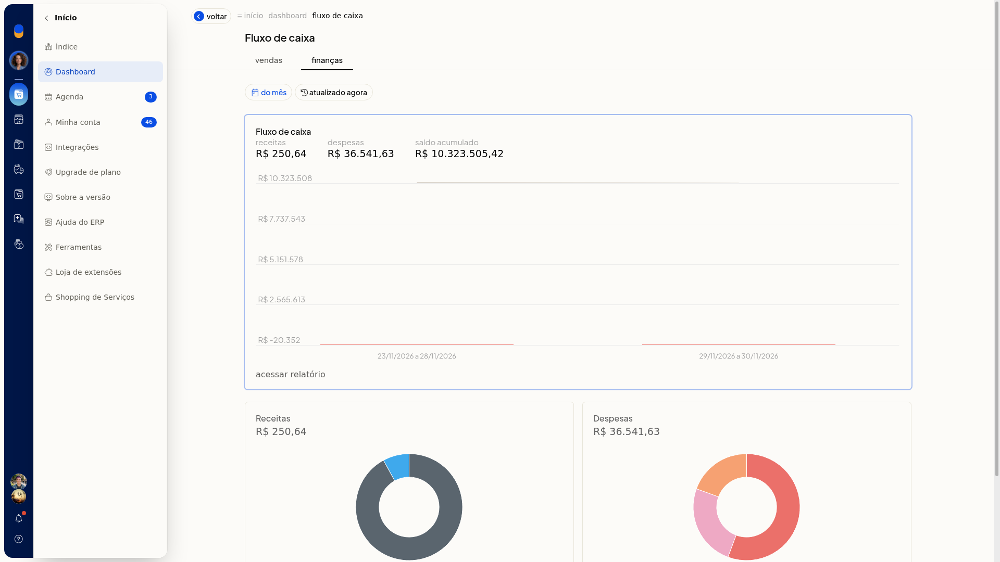

# Relatórios financeiros: DRE, fluxo de caixa e balancete

No ERP da Olist, você acompanha o resultado e o caixa da operação por três relatórios da seção Geral: o Balancete, o DRE e o Fluxo de Caixa. O Balancete reúne entradas e saídas do período, com gráfico opcional. O DRE é o Demonstrativo de Resultados do Exercício. O Fluxo de Caixa projeta entradas e saídas futuras conforme as contas a pagar e a receber.

Os três ficam em **Finanças > Relatórios**. No dashboard de Finanças também há indicadores de saldo, contas e fluxo, com atalho para o mesmo Fluxo de Caixa.

## Importante
- O Fluxo de Caixa é uma projeção conforme as contas a pagar e a receber.
- No DRE, a base do demonstrativo é notas fiscais ou pedidos de venda.
- Nos três relatórios, os campos de filtro não são obrigatórios.

## Instruções
### Como consultar o balancete

1. Acesse **Finanças > Relatórios**.
2. Na seção **Geral**, clique em **Balancete**. A descrição na lista é relatório e gráfico com as entradas e saídas do período.

   

3. Escolha o período **Do mês** ou **Intervalo**.

   

4. Em **Do mês**, informe o **Mês** no formato mês/ano, como 11/2026. Em **Intervalo**, informe **De** e **Até** no formato DD/MM/AAAA.
5. Se quiser, selecione **Conta** (**Todas** ou uma conta já cadastrada) e **Categoria** (**Todos** ou uma categoria já cadastrada), marque **Considerar transferências** e escolha **Visualização** e **Tipo do gráfico**. Em **Visualização**, as opções são **Automática**, **Por dia**, **Por semana** ou **Por mês**. Em **Tipo do gráfico**, as opções são **Não exibir**, **Linhas** ou **Barras**.

   

6. Clique em **Gerar** para gerar o relatório de entradas e saídas do período.

### Como consultar o DRE

1. Acesse **Finanças > Relatórios**.

   

2. Na seção **Geral**, clique em **DRE**. A descrição na lista é Demonstrativo de Resultados do Exercício.

   

3. Informe o **Ano** com quatro dígitos, como 2026.
4. Em **Baseado em**, escolha **Notas fiscais** ou **Pedidos de venda**.
5. Em **Agrupamento**, escolha **Empresas do grupo** ou a empresa listada na conta.
6. Em **Custo baseado em**, escolha **Custo da compra** ou **Custo médio**. A lista também tem a opção **Selecione**. Se quiser ajuda sobre o demonstrativo, acesse o link **Quero entender o DRE**.

   

7. Clique em **Gerar** para gerar o demonstrativo do exercício.

### Como consultar o fluxo de caixa

1. Acesse **Finanças > Relatórios**.
2. Na seção **Geral**, clique em **Fluxo de Caixa**. A descrição na lista é relatório e gráfico da projeção das entradas e saídas futuras de acordo com as contas a pagar e receber.
3. Escolha **Do mês**, **Até o mês** ou **Intervalo**.
4. Em **Do mês** ou **Até o mês**, informe o **Mês** no formato mês/ano, como 11/2026. Em **Intervalo**, informe **De** e **Até** no formato DD/MM/AAAA.

   

5. Escolha **Visualização**, **Tipo do gráfico** e, em **Contas atrasadas**, **Considerar no saldo inicial** ou **Não considerar**. Em **Visualização**, as opções são **Automática**, **Por dia**, **Por semana** ou **Por mês**. Em **Tipo do gráfico**, as opções são **Não exibir**, **Linhas** ou **Barras**.

   

6. Clique em **Gerar** para gerar a projeção de fluxo de caixa.

### Como abrir o fluxo de caixa pelo dashboard

1. Abra o dashboard pelo item **Início** do menu lateral e selecione a aba **Finanças**. Se a opção não aparecer para você, peça acesso ao administrador da conta.
2. No widget **Fluxo de caixa**, veja o saldo e os horizontes de 30, 60 e 90 dias. A mesma aba mostra visão geral de saldo, contas a pagar, contas a receber, contas vencendo hoje e conta com maior saldo, além de saldo por conta.

   

3. Use **expandir detalhes** para o gráfico de receitas, despesas e saldo acumulado e para os agrupamentos de receitas e despesas. No período do fluxo, as opções são do mês, até o mês ou do intervalo. **Aplicar** confirma a escolha e **Cancelar** descarta.

   

4. Clique em **acessar relatório**. Abre a mesma tela de filtros do Fluxo de Caixa, com **Do mês**, **Até o mês** ou **Intervalo**. Clique em **Gerar** para gerar a projeção.

## Informações adicionais
- No Balancete, **Do mês** mostra **Mês** e **Intervalo** mostra **De** e **Até**.
- No Fluxo de Caixa, **Do mês** e **Até o mês** mostram **Mês**. **Intervalo** mostra **De** e **Até**.
- **Voltar** devolve o catálogo **Relatórios de Finanças**, com as seções **Personalizados**, **Geral**, **Caixa**, **Contas a Pagar** e **Contas a Receber**.
