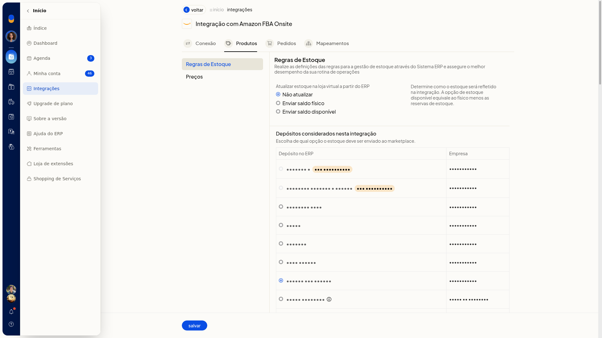
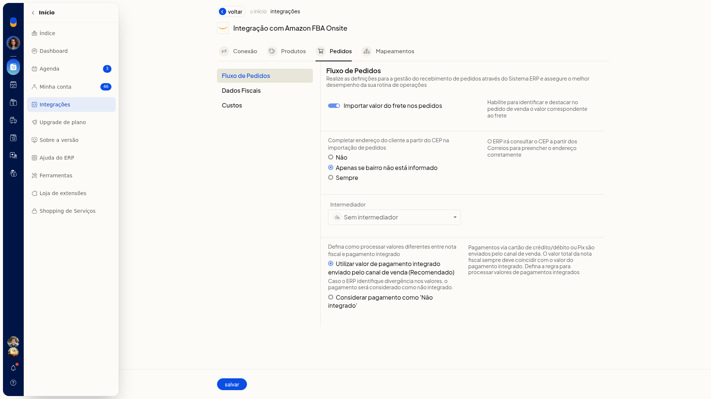
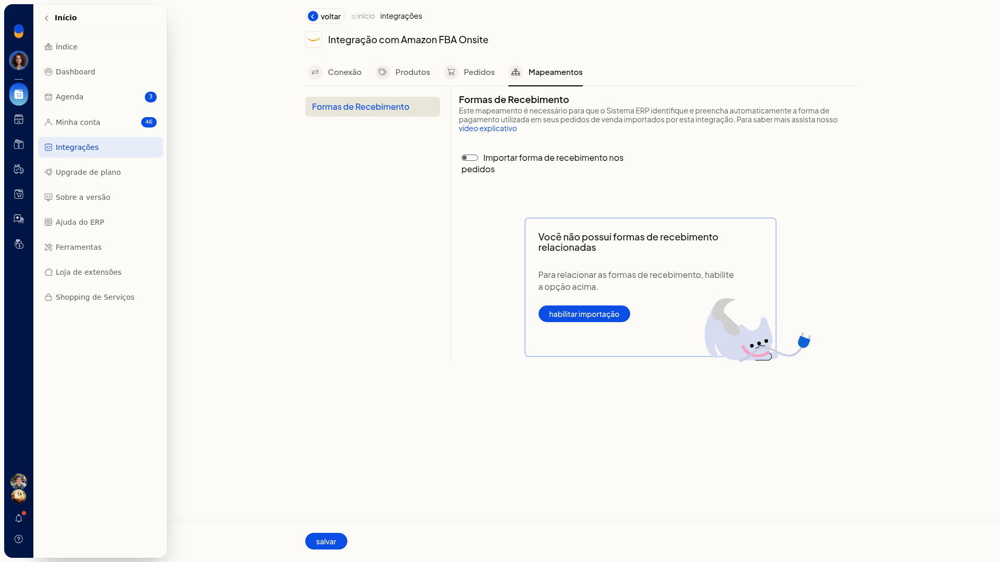

# Amazon FBA (Classic, Onsite e envios inbound)

A Amazon FBA Classic e a Amazon FBA Onsite são canais da integração Amazon no ERP da Olist. Com eles, você configura estoque, preços, fluxo de pedidos, dados fiscais, custos e formas de recebimento da operação FBA.

Os dois canais ficam em **Início > Integrações**. Com o canal instalado, abra **gerenciar** no card. As abas são **Conexão**, **Produtos**, **Pedidos** e **Mapeamentos**. Nessas abas não há item de envio inbound.

## Pré-requisitos
- O canal **Amazon FBA Classic** ou **Amazon FBA Onsite** precisa estar instalado para você abrir **gerenciar**.

## Importante
- Não há opção de envio inbound nem de título de anúncio com IA nos submenus da Amazon FBA Classic e da Amazon FBA Onsite.
- Só é possível relacionar formas de recebimento depois de habilitar **Importar forma de recebimento nos pedidos**.
- O menu do card inclui **Inativar integração**, **Excluir todos os anúncios no ERP** e **Excluir integração**. Não escolha essas opções se a intenção for apenas configurar.
- **Excluir todos os anúncios no ERP** só aparece para o administrador da conta, e somente quando esse recurso foi liberado para a empresa.

## Instruções
### Instalar o canal

1. Acesse **Início > Integrações**.
2. Adicione uma integração e localize no catálogo **Amazon FBA Classic** ou **Amazon FBA Onsite**.
3. Inicie a instalação do canal desejado.
4. Em **Conexão**, informe **Nome da integração no ERP**, se quiser identificar a integração, e conclua a autenticação com a Amazon. O nome não é obrigatório. O canal instalado passa a aparecer em **Minhas Integrações** com **gerenciar**.

### Amazon FBA Classic

1. Acesse **Início > Integrações**.
2. No card **Amazon FBA Classic**, clique em **gerenciar**.
3. Use as abas **Conexão**, **Produtos**, **Pedidos** e **Mapeamentos**. Não há aba **Outros**.
4. Em **Produtos**, abra **Regras de Estoque** ou **Preços**. O submenu traz só esses dois itens.
5. Em **Preços**, escolha **Preço fixo**, **Conforme lista de preços** ou **Conforme regras de preço**.
 - **Lista** não é obrigatório. Se usar lista de preços, selecione a lista do ERP.
 - Em **Conforme regras de preço**, **percentual** não é obrigatório. Informe número com vírgula e duas casas decimais. A base disponível é **Base simples**.
 - Na regra por faixa de peso, preencha **Valor fixo**, **adicional**, **De**, **Até** e **frete**. Nenhum desses campos é obrigatório. **Valor fixo**, **adicional** e **frete** são valores em reais. **De** é o peso inicial e **Até** o peso final da faixa, em kg. Para gravar a faixa, clique em **Salvar** no diálogo.
6. Em **Pedidos**, abra **Fluxo de Pedidos**, **Dados Fiscais** ou **Custos**. Não há item de envio inbound.

   

7. Em **Mapeamentos**, abra **Formas de Recebimento**. É o único item desse submenu. Para relacionar uma forma, habilite **Importar forma de recebimento nos pedidos**.

### Amazon FBA Onsite

1. Acesse **Início > Integrações**.
2. No card **Amazon FBA Onsite** já instalada, clique em **gerenciar**.
3. Use as abas **Conexão**, **Produtos**, **Pedidos** e **Mapeamentos**. Não há aba **Outros**.
4. Em **Produtos**, abra **Regras de Estoque** ou **Preços**. O submenu traz só esses dois itens.

   

5. Em **Pedidos**, abra **Fluxo de Pedidos**, **Dados Fiscais** ou **Custos**. Não há item de envio inbound.

   

6. Em **Mapeamentos**, abra **Formas de Recebimento**. Com **Importar forma de recebimento nos pedidos** desligado, a tela mostra **Você não possui formas de recebimento relacionadas**, pede para habilitar a opção acima e oferece **habilitar importação** e o link **vídeo explicativo**. Clique em **habilitar importação** para passar a relacionar as formas. O mapeamento só é preenchido depois dessa habilitação.

   

## Resultado
Com o canal instalado, **gerenciar** abre **Conexão**, **Produtos**, **Pedidos** e **Mapeamentos**. Na Amazon FBA Onsite, **Formas de Recebimento** permanece com a mensagem de que não há formas relacionadas até você habilitar a importação.

## Informações adicionais
### Envios inbound não aparecem nestes canais

A Amazon FBA Classic e a Amazon FBA Onsite não trazem item de envio inbound em **Produtos**, **Pedidos** ou **Mapeamentos**.

### Os submenus são mais curtos que os da Amazon ERP

- Em **Produtos**, só há **Regras de Estoque** e **Preços**.
- Em **Pedidos**, só há **Fluxo de Pedidos**, **Dados Fiscais** e **Custos**.
- Em **Mapeamentos**, só há **Formas de Recebimento**.
