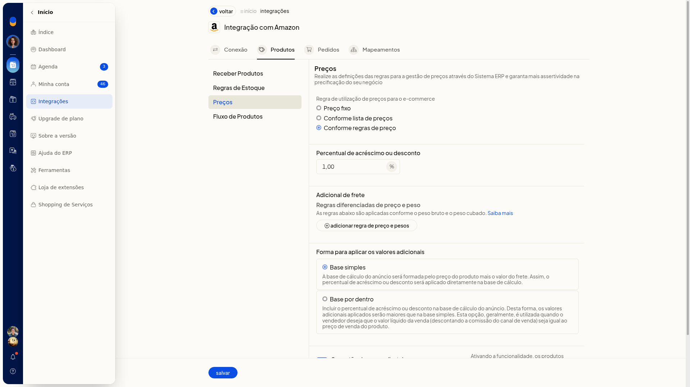

# Amazon: preços competitivos

No ERP da Olist, a integração com a Amazon define o preço enviado à loja por valor fixo, lista de preços ou regras de preço. Na Amazon ERP, você também marca a sugestão de preços em **Produtos > Preços**.

## Pré-requisitos
- O canal **Amazon ERP** precisa estar instalado para abrir **gerenciar**.

## Instruções
1. Acesse **Início > Integrações**.
2. No card **Amazon ERP**, clique em **gerenciar**.
3. Abra a aba **Produtos**.
4. Clique em **Preços**.
5. Em **Conforme regras de preço**, informe o **percentual** com vírgula e duas casas decimais. O campo não é obrigatório.
6. Escolha **Base simples** ou **Base por dentro**.
7. Marque **Sugestão de preços (beta)**. O controle não é obrigatório.

   
