# Integração com a Amazon

A integração com a Amazon liga a sua conta na Amazon ao ERP da Olist. Com ela, você importa produtos e pedidos, envia estoque e preços e relaciona situações, recebimentos, fretes e categorias.

No catálogo há três canais: **Amazon**, **Amazon FBA Classic** e **Amazon FBA Onsite**. Depois de instalado, cada um é configurado em **Início > Integrações**, no card, em **gerenciar**, nas abas **Conexão**, **Produtos**, **Pedidos** e **Mapeamentos**. O Amazon Ads é uma autenticação dentro da conexão da Amazon, não outro canal.

## Importante
- Para o ERP preencher a forma de pagamento dos pedidos importados, habilite **Importar forma de recebimento nos pedidos** e relacione as formas.
- O código de recebimento ou de frete só entra na linha quando você clica em **Selecionar**.
- Destacar uma categoria na árvore não a atribui. Confirme a seleção.
- Com a reserva de estoque da conta ligada, a ajuda de **Lançamento de estoque para saídas** não recomenda o lançamento automático ao salvar o pedido.
- O menu do card tem **Inativar integração**, **Excluir todos os anúncios no ERP** e **Excluir integração**. Não escolha essas opções se a intenção for só consultar.

## Instruções
### Como instalar o canal

1. Acesse **Início > Integrações**.
2. Clique em **adicionar integração**.
3. Localize **Amazon**, **Amazon FBA Classic** ou **Amazon FBA Onsite**.
4. Inicie a instalação do canal desejado.
5. Na etapa **Conexão**, informe o **Nome da integração no ERP** e conclua a autenticação com a Amazon. O canal instalado passa a aparecer em **Minhas Integrações** com **gerenciar**.

### Como consultar a conexão da Amazon

1. Acesse **Início > Integrações**.
2. No card **Amazon ERP**, clique em **gerenciar**.
3. Abra a aba **Conexão**.
4. Confira o **Nome da integração no ERP** e o status dos cards **Amazon ERP** e **Autenticação Amazon Ads**. Para só consultar, não clique em **Salvar** nem inicie uma nova autenticação.

### Como configurar produtos da Amazon

1. No **gerenciar** da **Amazon ERP**, abra **Produtos**.
2. Abra **Receber Produtos**.
3. Em **Ao importar produtos**, escolha **Importar imagens como anexos** ou **Apenas importar a URL externa das imagens**.

   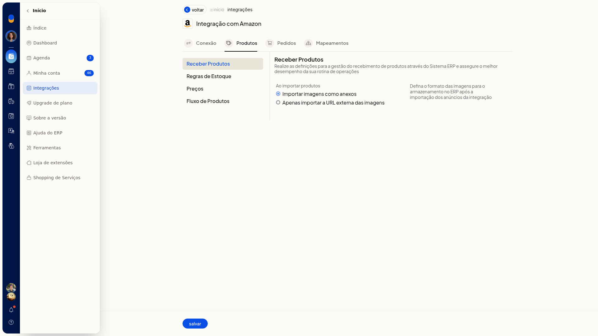

4. Abra **Regras de Estoque**.
5. Em **Atualizar estoque na loja virtual a partir do ERP**, escolha **Não atualizar**, **Enviar saldo físico** ou **Enviar saldo disponível**.
6. Na tabela de depósitos, defina quais depósitos entram na conta. A tabela traz **Todos** e **Próprios**. A tela também mostra um aviso sobre depósitos de empresa conectada que não recebem dados.

   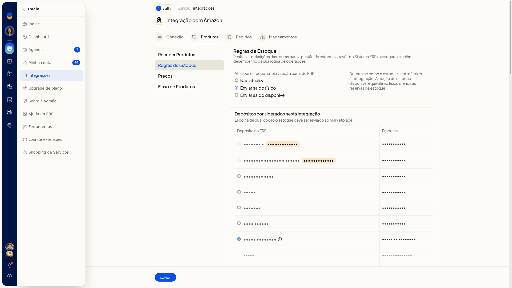

7. Em **Lançamento de estoque para saídas**, escolha uma opção:
 - **Usar configuração padrão da conta**
 - **Manual**
 - **Automático ao autorizar a nota fiscal**
 - **Automático ao salvar a nota fiscal**
 - **Automático ao salvar o pedido**
 - **Automático ao marcar pedido como enviado**
8. Marque **Utilizar estoque de segurança** se quiser usar o estoque de segurança.

   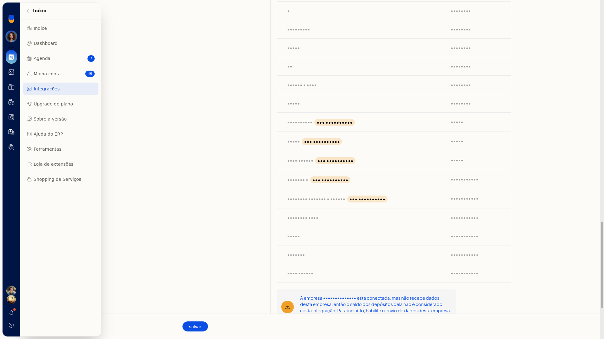

9. Abra **Preços**.
10. Defina o preço enviado. Em **Conforme regras de preço**, informe o **percentual** com vírgula e duas casas decimais e escolha **Base simples** ou **Base por dentro**.
11. Marque **Sugestão de preços (beta)** se quiser usar a sugestão de preços.

   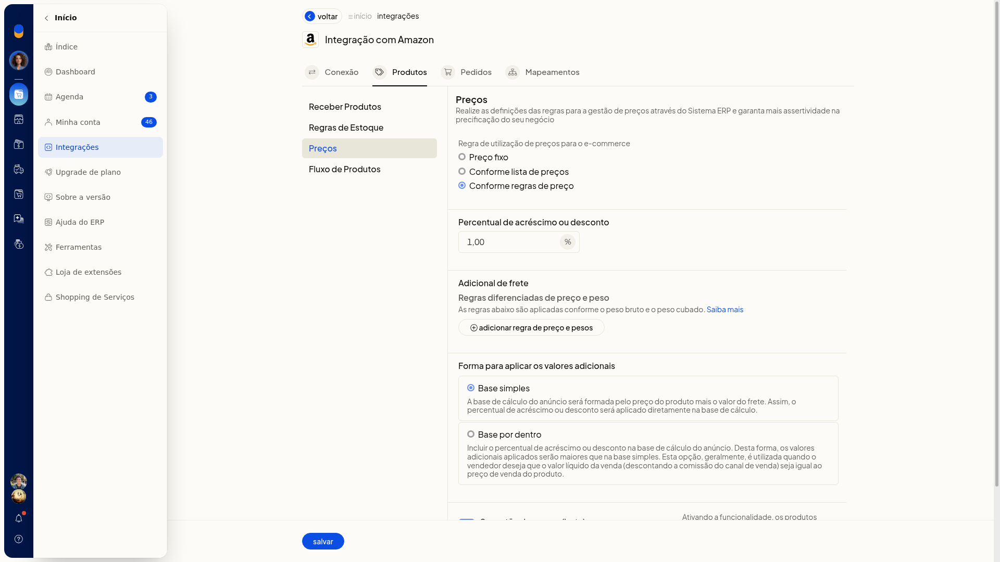

12. Abra **Fluxo de Produtos**.
13. Marque **Enviar dias para preparação ao sincronizar** se quiser enviar os dias de preparação na sincronização dos produtos.
14. Clique em **Salvar** para gravar produtos, estoque, preço e dias de preparação.

   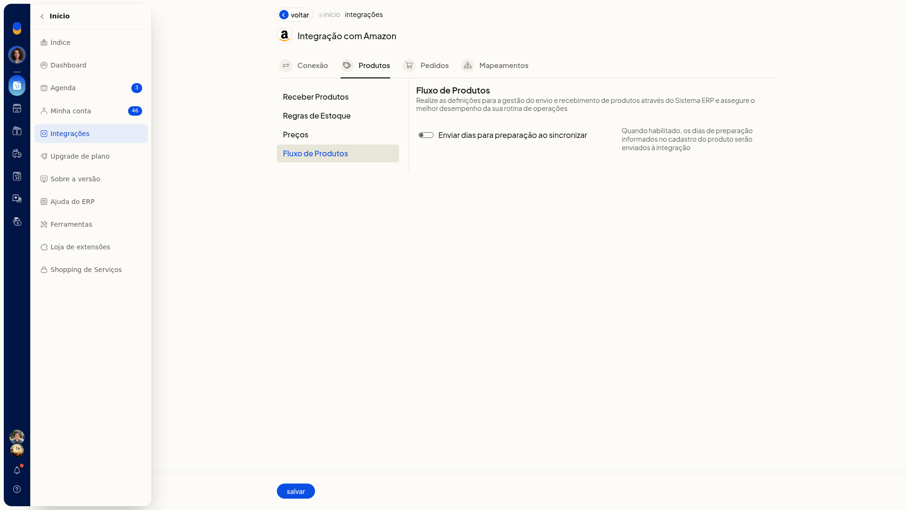

### Como configurar pedidos e custos da Amazon

1. No **gerenciar** da **Amazon ERP**, abra **Pedidos**.
2. Abra **Fluxo de Pedidos**.
3. Ajuste a entrada do pedido:
 - **Importar valor do frete**: ligue para importar o frete do pedido.
 - CEP: escolha **Não**, **Apenas se bairro não está informado** ou **Sempre**.
 - DBA: escolha **Formato PDF fornecido pela Amazon** ou **Impressora térmica**.
 - **Enviar rastreamento ao alterar situação para enviado**: ligue para enviar o rastreamento nessa troca de situação.
 - Intermediador: a opção **Sem intermediador** está na tela.
 - Divergência de pagamento: escolha **Utilizar valor de pagamento integrado (Recomendado)** ou **Considerar pagamento como Não integrado**.

   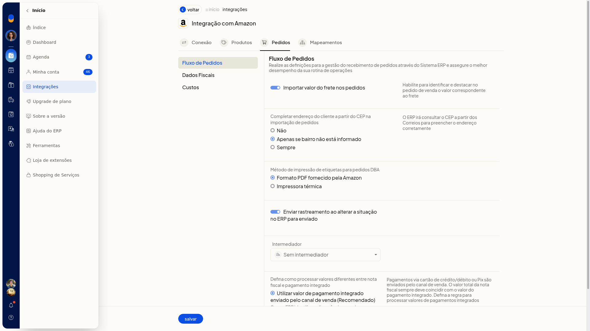

4. Abra **Dados Fiscais**.
5. Em **Envio NFe**, escolha **Automático ao autorizar nota fiscal** ou **Manual**.
6. Em **natureza**, selecione a natureza de operação, como **Venda de mercadorias**.
7. Marque **Definir natureza diferente para contribuintes ICMS** se quiser outra natureza para contribuintes de ICMS.

   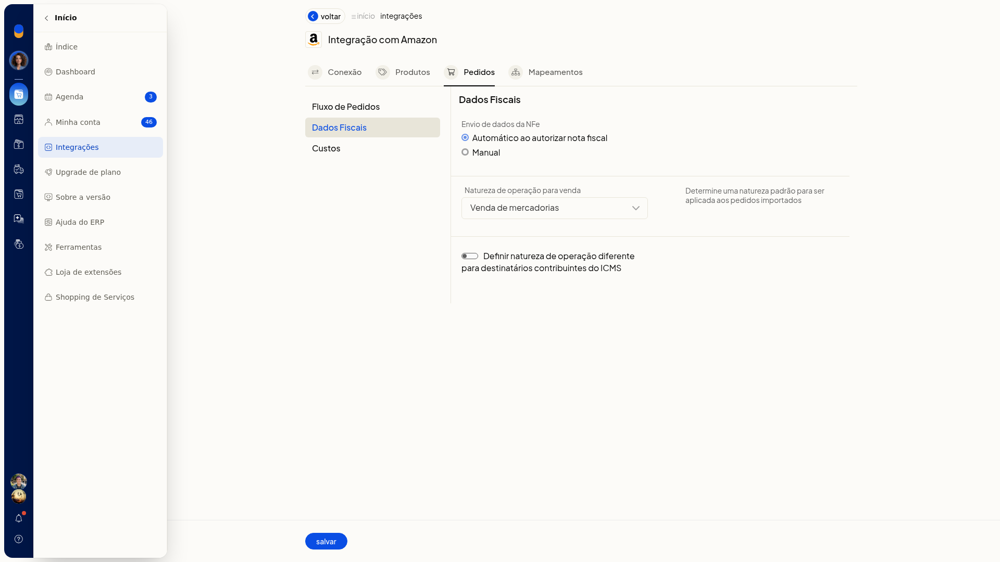

8. Abra **Custos**.
9. Na tabela, use **Editar**, **Remover** ou **adicionar**. As colunas são **Categoria**, **Taxa (%)**, **Valor mínimo de comissão por unidade (R$)** e **Ações**.

   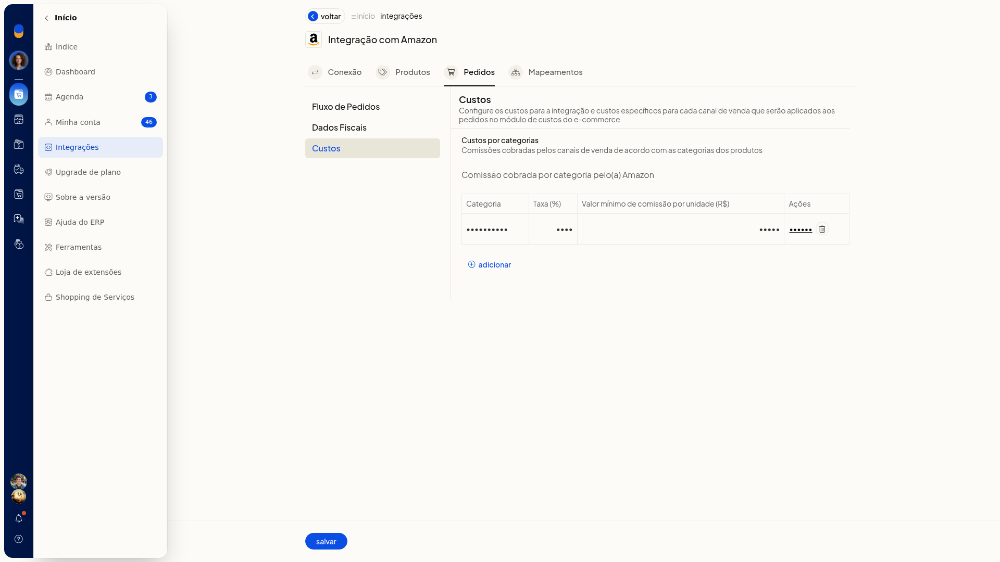

10. Para uma nova comissão, clique em **adicionar**, escolha a **Categoria**, informe a **Taxa (%)** com vírgula e o **Valor mínimo de comissão por unidade (R$)** em reais com vírgula.
11. Confirme para gravar a comissão. Clique em **Cancelar** para fechar sem alterar a tabela. Em seguida, clique em **Salvar** na tela para gravar pedido, nota e custos.

   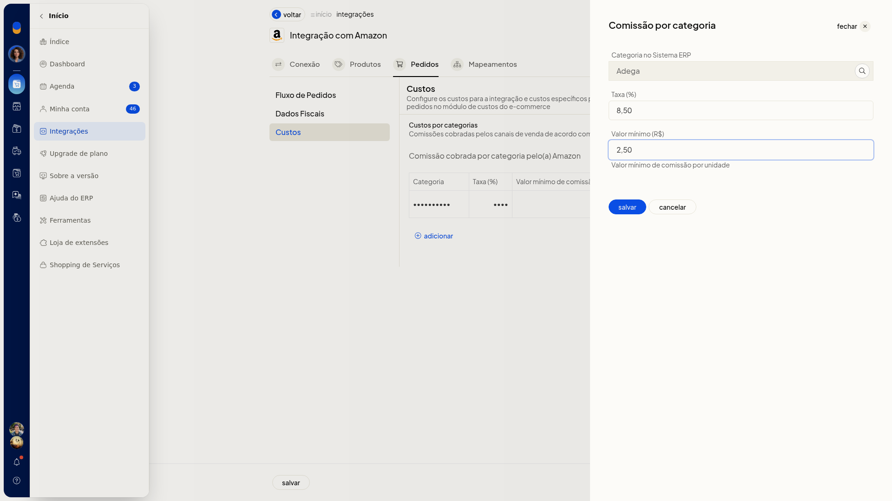

### Como mapear dados da Amazon

1. No **gerenciar** da **Amazon ERP**, abra **Mapeamentos**.
2. Abra **Situações de Pedidos**.
3. Ligue **Permite retroceder situação dos pedidos na sincronização de situações** somente se quiser que a sincronização volte a situação do pedido.
4. Relacione cada situação da Amazon com uma situação do ERP. O seletor traz **Selecione**, **Em aberto**, **Faturado**, **Cancelado**, **Aprovado**, **Preparando envio**, **Enviado**, **Entregue**, **Pronto para envio**, **Dados incompletos**, **Não entregue** e **Em devolução**.
5. Use **adicionar situações padrão** ou **adicionar mapeamento de situação** quando precisar incluir linhas. O mapeamento visto na tela é:
 - **Pending/Pendente** para **Em aberto**
 - **Unshipped/Pagamento autorizado** para **Faturado**
 - **PartiallyShipped/Parcialmente enviado** para **Pronto para envio**
 - **Shipped/Enviado** para **Enviado**
 - **Canceled/Cancelado** para **Cancelado**
 - **InvoiceUnconfirmed/Nota pendente** para **Enviado**
 - **PendingAvailability/Pedido realizado (pré-ordem)** para **Faturado**

   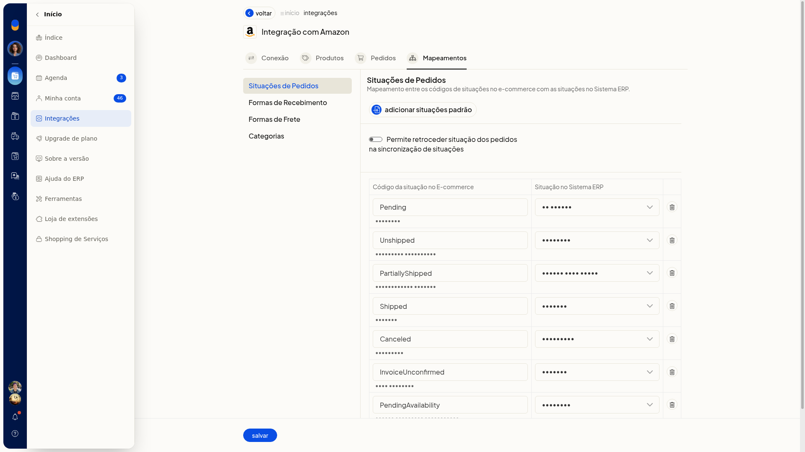

6. Abra **Formas de Recebimento**.
7. Com **Importar forma de recebimento nos pedidos** desligado, a tela mostra **Você não possui formas de recebimento relacionadas** e o botão **habilitar importação**. Há também o link **vídeo explicativo**.
8. Ligue **Importar forma de recebimento nos pedidos** para exibir a forma padrão, a categoria financeira e a tabela. Ao escolher uma forma como Pix, informe **Meio** (**Banco** ou **Gateway**) e **Meio de recebimento**.

   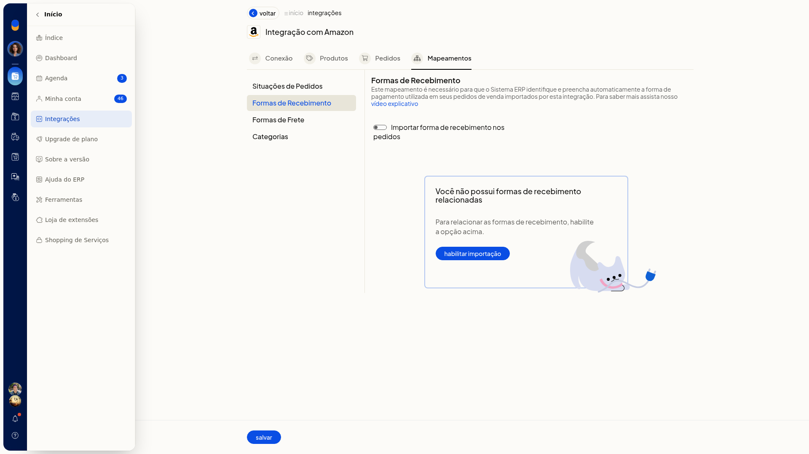

9. Abra **Formas de Frete**.
10. Inclua uma forma, como **Retirar pessoalmente**, e informe o **Código da forma de frete** no diálogo.
11. Clique em **Selecionar** para o código entrar na linha. **Cancelar** fecha o diálogo sem preencher a linha.

   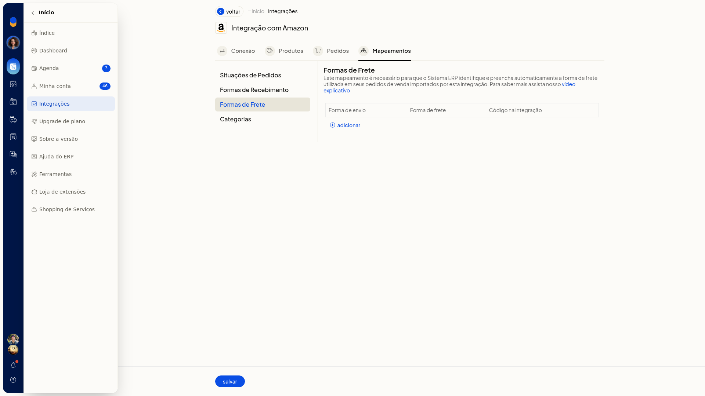

12. Abra **Categorias**.
13. No seletor em árvore, destaque a categoria e confirme a atribuição. Fechar o seletor sem confirmar não atribui a categoria destacada.
14. Clique em **Salvar** para gravar situação, recebimento, frete e categoria.

   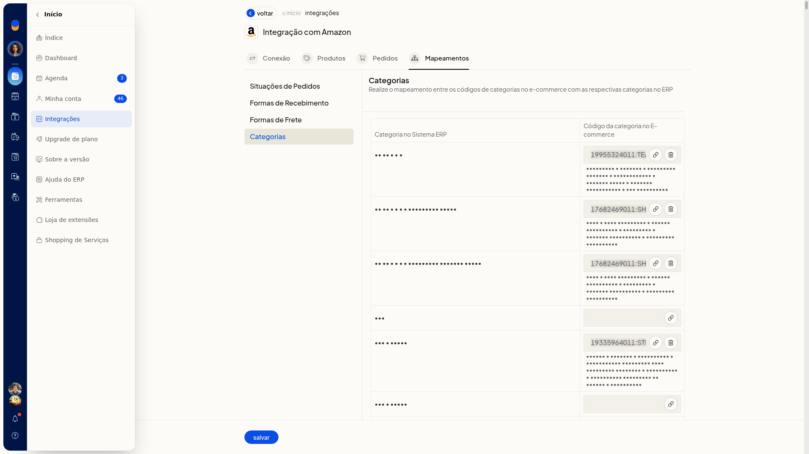

### Como relacionar a forma de recebimento

1. Com **Importar forma de recebimento nos pedidos** ligado, abra o relacionamento da forma, por exemplo **Cartão de crédito**.
2. Informe o **Código da forma de recebimento** no diálogo.

   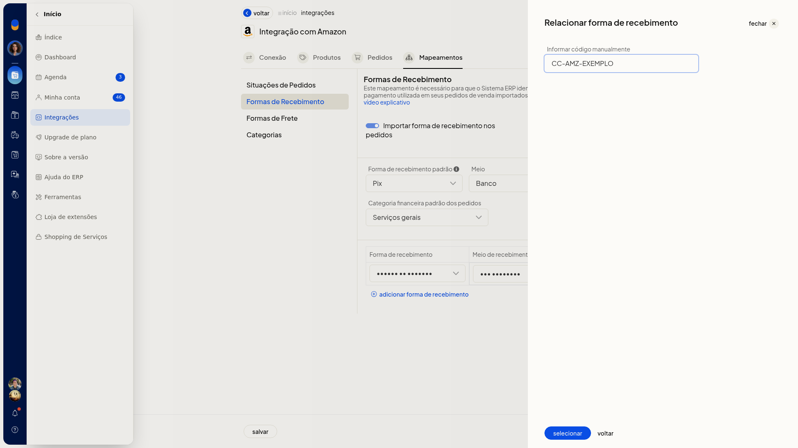

3. Para descobrir o código por um pedido, use a busca por pedido no mesmo diálogo, em vez do código manual.
4. Clique em **Selecionar** para o código passar para a linha. **Cancelar** fecha o diálogo e volta ao mapeamento sem preencher a linha.

### Como configurar a Amazon FBA Classic

1. Acesse **Início > Integrações**.
2. No card **Amazon FBA Classic**, clique em **gerenciar**.
3. Use as abas **Conexão**, **Produtos**, **Pedidos** e **Mapeamentos**. Não há aba **Outros**.
4. Em **Produtos**, abra **Regras de Estoque** ou **Preços**. Não há **Receber Produtos** nem **Fluxo de Produtos**.
5. Em **Preços**, escolha uma forma:
 - **Preço fixo**
 - **Conforme lista de preços**, e selecione a **Lista**
 - **Conforme regras de preço**, com **percentual** em vírgula e duas casas e **Base simples**
6. Na regra de preço, informe **Valor fixo** e **adicional** em reais. Na faixa de peso, informe **De** e **Até** em kg e **frete** em reais.
7. Clique em **Salvar** na faixa de peso para gravar a regra. Fechar o diálogo sem **Salvar** não grava a faixa.
8. Em **Pedidos**, abra **Fluxo de Pedidos**, **Dados Fiscais** ou **Custos**. Não há envio inbound nem título de anúncio com IA.

   

9. Em **Mapeamentos**, abra **Formas de Recebimento** e relacione as formas depois de habilitar a importação.
10. Clique em **Salvar** para gravar estoque, preço, pedidos e recebimento.

### Como configurar a Amazon FBA Onsite

1. Acesse **Início > Integrações**.
2. No card **Amazon FBA Onsite** já instalado, clique em **gerenciar**.
3. Use as abas **Conexão**, **Produtos**, **Pedidos** e **Mapeamentos**. Não há aba **Outros**.
4. Em **Produtos**, configure só **Regras de Estoque** e **Preços**.

   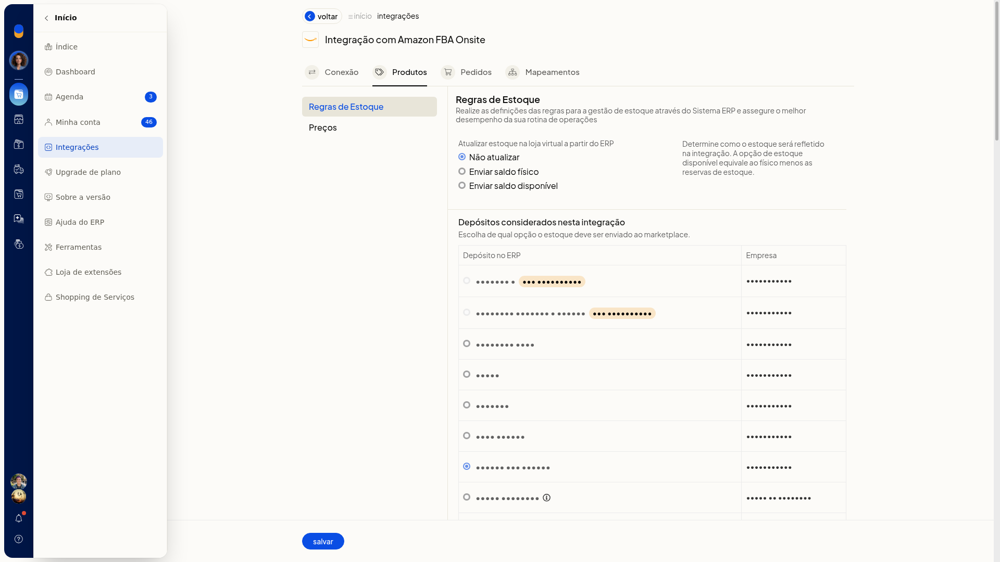

5. Em **Pedidos**, configure só **Fluxo de Pedidos**, **Dados Fiscais** e **Custos**.

   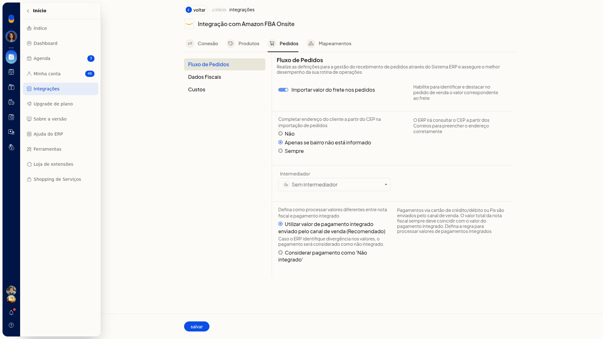

6. Em **Mapeamentos**, abra **Formas de Recebimento**.
7. Com a importação desligada, a tela mostra **Você não possui formas de recebimento relacionadas**. Clique em **habilitar importação** e relacione as formas. O link **vídeo explicativo** também está na tela.
8. Clique em **Salvar** para gravar a configuração.

   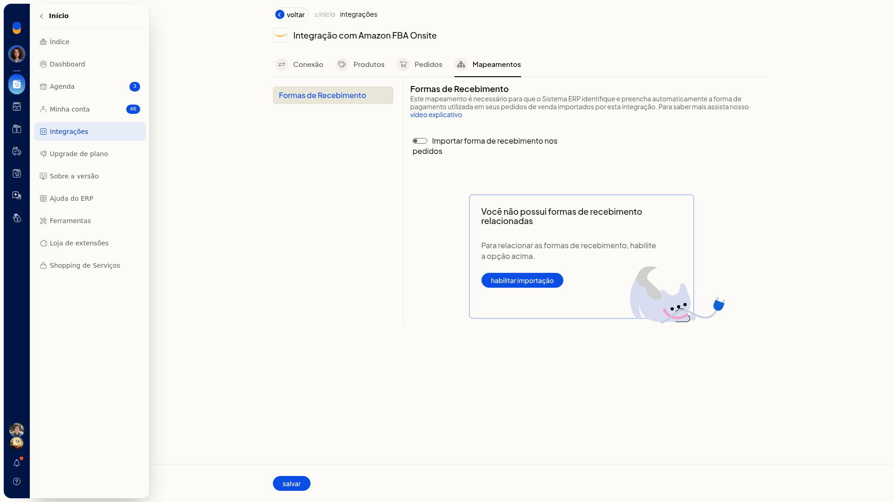

### Como autenticar o Amazon Ads

1. No **gerenciar** da **Amazon ERP**, fique na aba **Conexão**.
2. Localize o card **Autenticação Amazon Ads**.
3. Use o link **Saiba mais** para abrir a página pública de Sponsored Products da Amazon.
4. Inicie a autenticação no card **Autenticação Amazon Ads** para abrir o consentimento da Amazon. A autenticação fica neste conector, sem um canal separado de Amazon Ads.

### Como usar o menu do card

1. Em **Minhas Integrações**, abra o menu do card **Amazon ERP**. O card da **Amazon FBA Classic** tem o mesmo tipo de menu.
2. As opções são **Inativar integração**, **Excluir todos os anúncios no ERP** e **Excluir integração**.
3. Feche o menu sem escolher nenhuma opção se não quiser inativar ou excluir.

   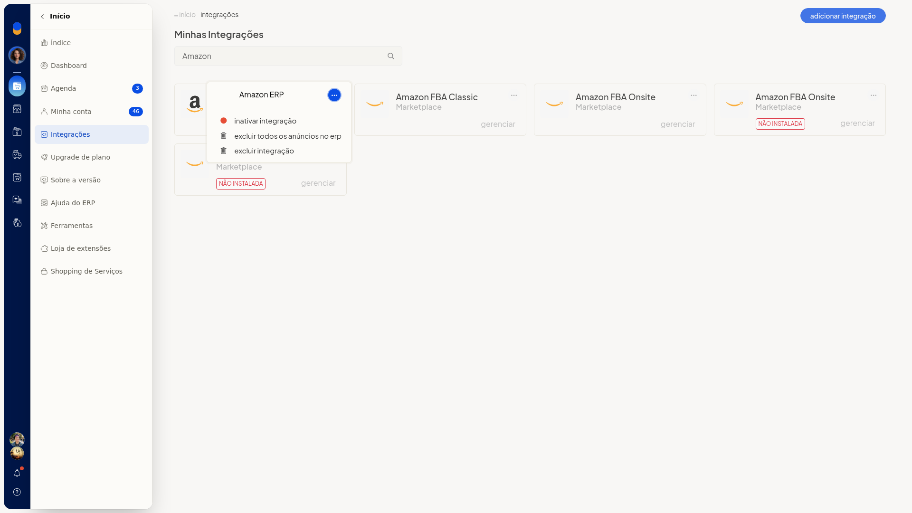

## Resultado
O canal instalado fica em **Minhas Integrações**, com **gerenciar**. Na conexão autenticada, os cards **Amazon ERP** e **Autenticação Amazon Ads** aparecem como conectada. Com a importação de recebimento desligada, **Formas de Recebimento** mostra **Você não possui formas de recebimento relacionadas** e **habilitar importação**.

## Informações adicionais
### O Amazon Ads não é um canal do catálogo

A autenticação de anúncios fica no card **Autenticação Amazon Ads**, na aba **Conexão** da Amazon.

### A FBA Classic e a FBA Onsite têm menos opções

Em **Produtos**, só há **Regras de Estoque** e **Preços**. Em **Pedidos**, só há **Fluxo de Pedidos**, **Dados Fiscais** e **Custos**. Em **Mapeamentos**, só há **Formas de Recebimento**.

### A exclusão de anúncios pode não aparecer

**Excluir todos os anúncios no ERP** só fica disponível quando esse recurso foi liberado para a empresa. Se a opção não aparecer para você, peça acesso ao administrador da conta.
