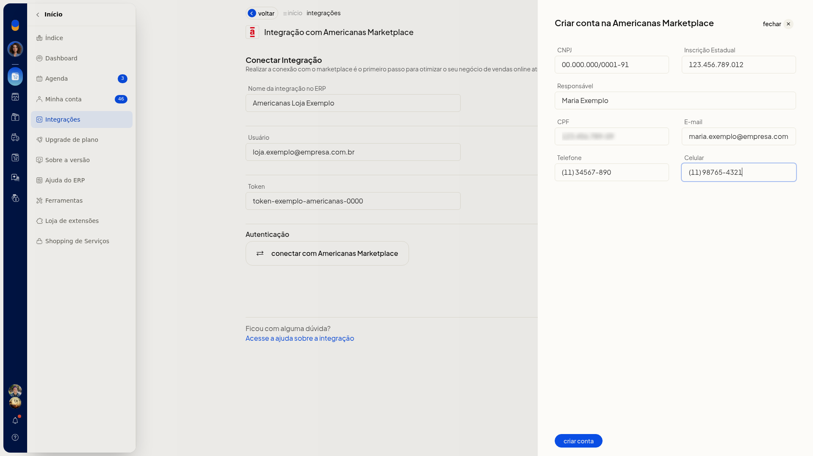

# Integração com a Americanas

## Importante
- Confirme o token com a equipe da Americanas Marketplace antes de conectar.
- Para criar a conta, tenha em mãos CNPJ, responsável, CPF, email, telefone e celular. A inscrição estadual também pode ser informada.

## Instruções
### Conectar uma conta já existente

1. Acesse **Início > Integrações** e abra **Integração com Americanas Marketplace**.
2. Em **Conectar Integração**, preencha **Nome da integração no ERP**, **Usuário** e **Token**. Em **Usuário**, use o email de acesso ao painel de Americanas Marketplace. Em **Token**, use o token verificado com a equipe da Americanas Marketplace.
3. Na seção **Autenticação**, clique em **conectar com Americanas Marketplace**.

   

### Criar uma conta nova

Na mesma tela, o atalho aparece junto do texto **Não possui uma conta da Americanas?**.

1. Em **Conectar Integração**, clique em **+ criar uma nova conta**.
2. No modal **Criar conta na Americanas Marketplace**, preencha os dados abaixo.
3. Clique em **criar conta**. O ERP da Olist avisa que a conta foi criada e pede que você aguarde o contato da equipe da Americanas Marketplace para seguir com a integração.

#### Dados da empresa

- **CNPJ**: obrigatório.
- **Inscrição Estadual**: opcional.

#### Dados do responsável

- **Responsável**: obrigatório.
- **CPF**: obrigatório.
- **E-mail**: obrigatório.
- **Telefone**: obrigatório.
- **Celular**: obrigatório.

## Resultado
Depois de criar a conta, aparece o alerta **Sua conta na Americanas Marketplace foi criada com sucesso**, com o pedido para aguardar o contato da equipe da Americanas Marketplace.

## Informações adicionais
- A ajuda da integração abre pelo link **Acesse a ajuda sobre a integração**.
