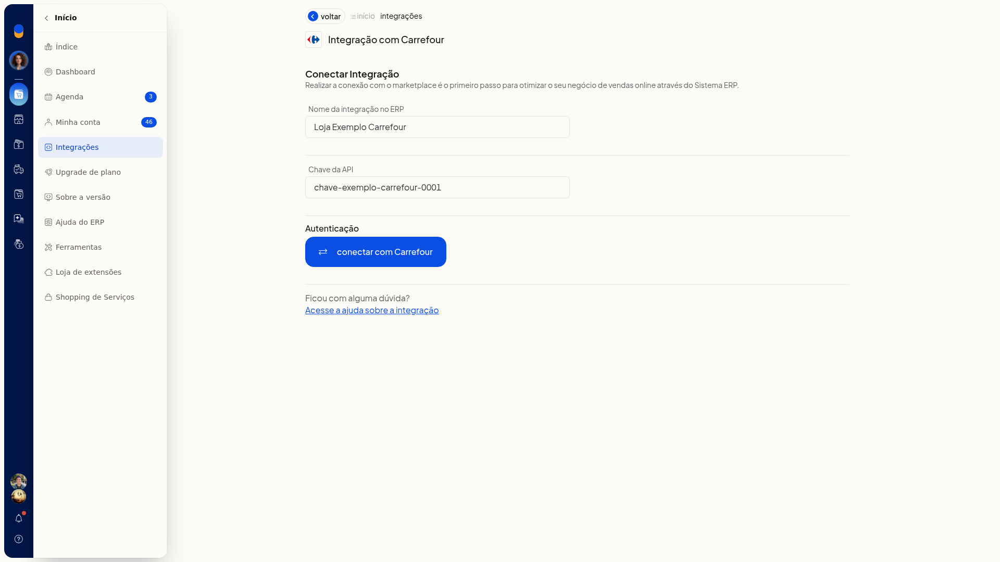
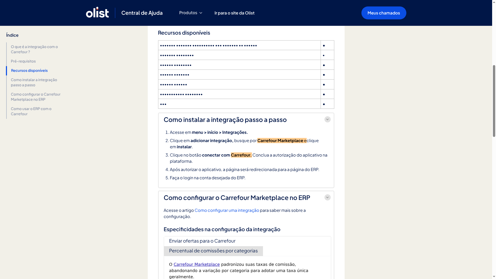

# Integração com o Carrefour

A integração com o Carrefour Marketplace conecta o ERP da Olist à plataforma de vendas do Carrefour. Com ela, você centraliza pedidos, estoque, preços e a situação de envio.

Depois de conectada, a integração recebe pedidos em aberto, envia produtos, estoque e preços, sincroniza a situação dos pedidos e usa OMS. Ela não recebe produtos do marketplace.

## Pré-requisitos
- Informe as dimensões no cadastro dos produtos.
- Configure o contrato com os Correios na conta, para cálculo de preços e prazos. Se não houver Correios, use Intelipost ou Melhor Envio.
- Tenha a chave da API para o campo **Chave da API**.

## Importante
- O envio de ofertas só pode ocorrer depois da aprovação dos produtos pelo Carrefour.
- Depois da publicação, o ERP só altera preços e estoques. Descrição e imagem não podem mais ser editadas pelo ERP; a alteração é pedida ao Carrefour por chamado.
- O envio de ofertas não sai no momento da ação. As atualizações são processadas a cada 5 minutos, com até 100 preços por envio, até concluir.
- Receber produtos do marketplace não está disponível. Estão disponíveis: receber pedidos em aberto, enviar produtos, enviar estoque, enviar preços, sincronizar a situação e usar OMS.

## Instruções
1. Acesse **Início > Integrações**.
2. Em **Adicionar integração**, no grupo **Marketplaces e Hubs**, localize **Carrefour** e clique em **instalar**.
3. Na tela de conexão, preencha **Nome da integração no ERP** e **Chave da API**. Os dois campos não são obrigatórios na tela.

   

4. Clique em **conectar com Carrefour** para autorizar o aplicativo na plataforma. Depois da autorização, volte à página do ERP e faça login na conta desejada. A integração passa a receber pedidos em aberto, enviar produtos, estoque e preços, sincronizar a situação e usar OMS.

## Resultado
A tela de conexão fica pronta para autorizar. Depois da autorização e do login na conta desejada, a integração recebe pedidos em aberto, envia produtos, estoque e preços, sincroniza a situação dos pedidos e usa OMS.

## Informações adicionais
### A comissão é de 16% sobre o produto vendido

A comissão é de 16% sobre o valor total do produto vendido, a mesma taxa para todas as categorias. Não há taxa de cadastro nem mensalidade fixa. Pode haver comissão zerada ou reduzida por tempo limitado, em geral nos primeiros 3 meses, para parceiros específicos.

