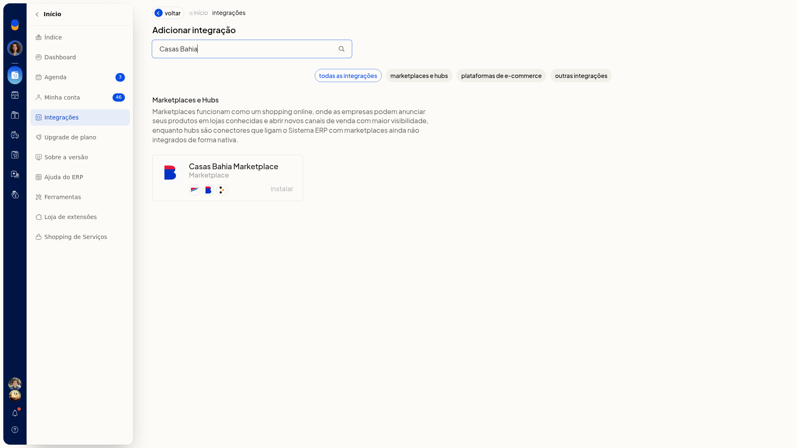
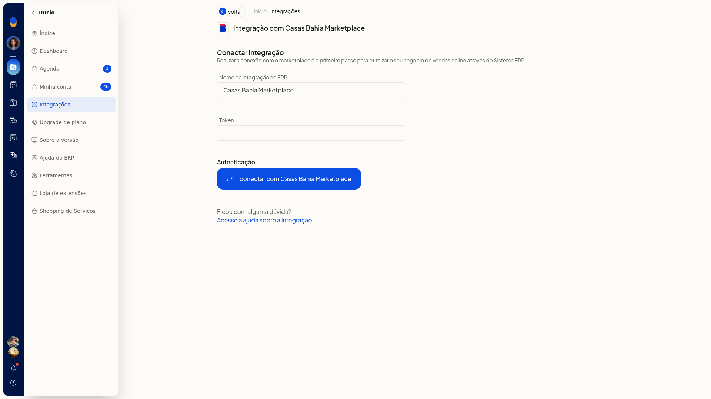
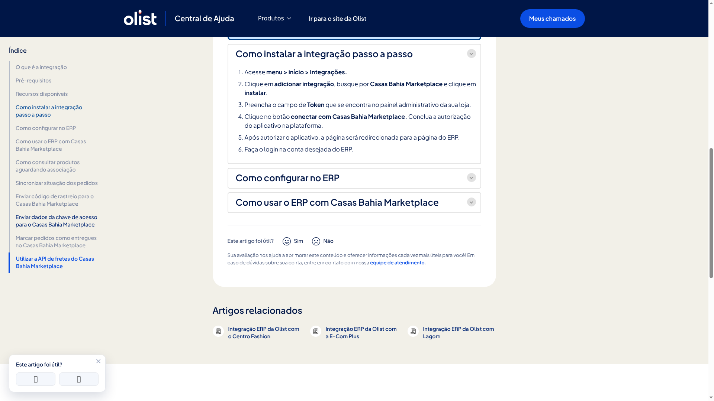
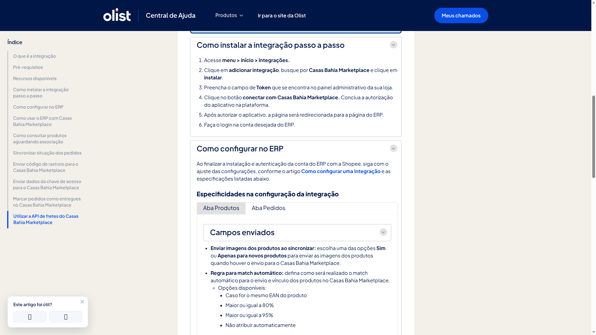
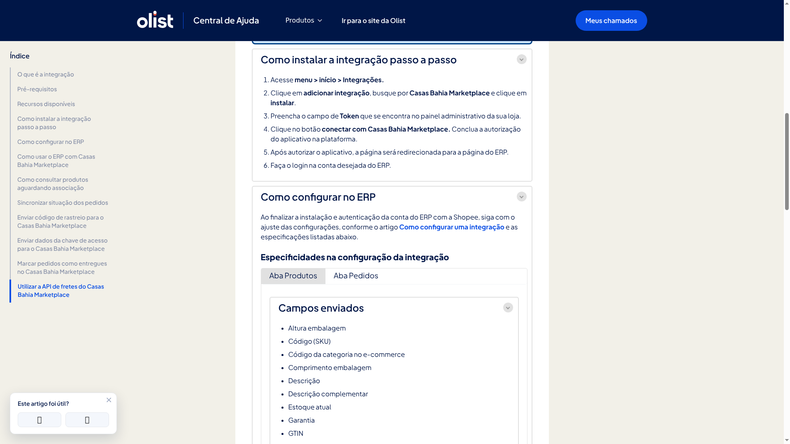
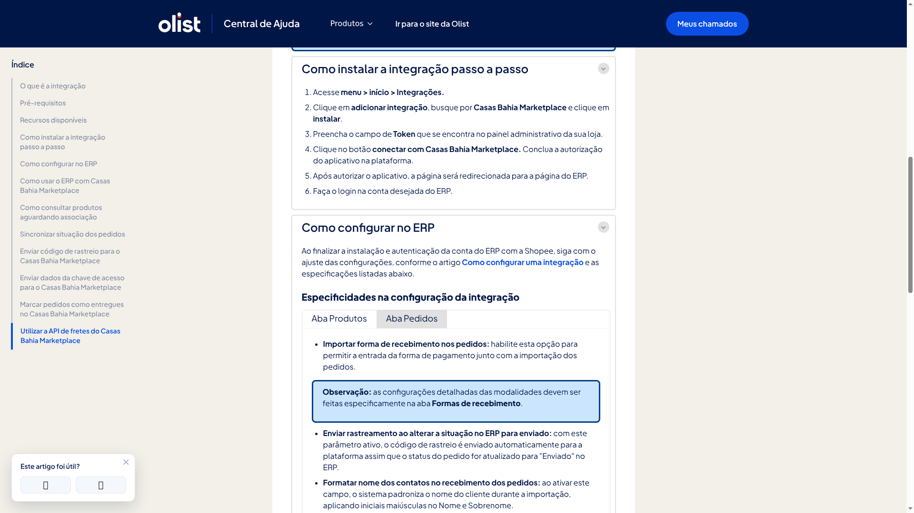

# Integração com a Casas Bahia

A integração Casas Bahia Marketplace conecta a loja desse marketplace ao ERP da Olist. Você instala o canal, define o nome da integração e informa o token para autenticar a conta.

Depois da conexão, a integração recebe pedidos e produtos e envia produtos, estoque e preços. A ajuda da tela também descreve ajustes nas abas **Produtos** e **Pedidos**.

## Pré-requisitos
- Cadastro na Casas Bahia Marketplace.
- Token obtido no painel administrativo da loja.

Se já houver outra integradora, a ajuda da integração orienta estes passos antes de conectar:

- Solicite o Client ID por chamado de suporte.
- Peça à Casas Bahia Marketplace a revogação do token antigo e a habilitação apenas do token do ERP.
- Solicite também usuário e senha. Esses dados não aparecem na tela de conexão.

## Importante
- Na tela de conexão, os únicos campos são **Nome da integração no ERP** e **Token**. Nenhum dos dois é obrigatório.
- A informação de **Dias para preparação** é enviada apenas para a categoria móveis. Nas demais categorias, é enviada a soma de dias para preparação e prazo de frete.

## Instruções
1. Acesse **Início > Integrações**.
2. Clique em **Adicionar integração** e localize o card **Casas Bahia Marketplace**, do tipo Marketplace, com os ícones Extra, Casas Bahia e Ponto.
   
3. Clique em **instalar**.
   
4. Em **Nome da integração no ERP**, mantenha ou altere o nome. O valor inicial é Casas Bahia Marketplace.
5. Em **Token**, informe o token do painel administrativo da loja.
   
6. Clique em **conectar com Casas Bahia Marketplace**. Conclua a autorização do aplicativo na plataforma, aguarde o retorno ao ERP e entre na conta desejada. A tela fica preenchida e pronta para autenticar a loja.
   

## Informações adicionais
### Recursos da integração

A ajuda marca estes recursos:

- receber pedidos
- receber produtos
- enviar produtos
- enviar estoque
- enviar preços
- sincronizar situação e OMS

### Ajustes da aba Produtos

Na tela de conexão, abra o link **Acesse a ajuda sobre a integração**, em **Ficou com alguma dúvida?**. Em **Como configurar no ERP**, a aba **Produtos** traz:

- **Enviar imagens dos produtos ao sincronizar**, com as opções **Sim** ou **Apenas para novos produtos**
- **Regra para match automático**, com as opções **Caso for o mesmo EAN do produto**, **Maior ou igual a 80%**, **Maior ou igual a 95%** e **Não atribuir automaticamente**

**Campos enviados**, na mesma aba, lista:

- altura embalagem
- código (SKU)
- código da categoria no e-commerce
- comprimento embalagem
- descrição
- descrição complementar
- estoque atual
- garantia
- GTIN
- imagens
- largura embalagem
- marca
- peso bruto
- preço de venda
- preço promocional
- variações

A ajuda também descreve **Enviar dias para preparação ao sincronizar**. O campo **Dias para preparação** fica no cadastro do produto, na aba **Dados gerais**, seção **Estoque**, e pode ser alimentado por planilha.

### Ajustes da aba Pedidos

A aba **Pedidos** da ajuda descreve:

- **Importar forma de recebimento nos pedidos**, com o detalhe das modalidades na aba **Formas de recebimento**
- **Enviar rastreamento ao alterar a situação no ERP para enviado**
- **Formatar nome dos contatos no recebimento dos pedidos**
- **Tipo de impressão de etiqueta**, com **PDF** ou **ZPL**

