# Como funciona uma integração

A integração liga o ERP da Olist a um canal de venda, hub ou plataforma. Em **Minhas Integrações** você consulta o que já está na conta, com o status da conexão e a ação **gerenciar**, e inicia uma nova conexão pelo catálogo **Adicionar integração**.

A instalação pela tela leva à configuração da integração e para antes de conectar. Para a conta ficar pronta, o mesmo fluxo inclui o produto com SKU, a natureza de operação de saída e os depósitos de estoque.

## Importante
- Na Nuvemshop, a conexão não se completa só no ERP: instale o **Sistema ERP da Olist** na loja de aplicativos da Nuvemshop. A tela avisa quando você não está logado nessa plataforma.
- Se a chave do iFood foi trocada, algumas lojas podem ter sido desconectadas. Autorize de novo a integração para restabelecer a conexão.
- O estoque inicial do produto fica ao lado de um depósito que já existe na conta.

## Instruções
### Consultar as integrações da conta

1. Acesse **Início > Integrações**.

   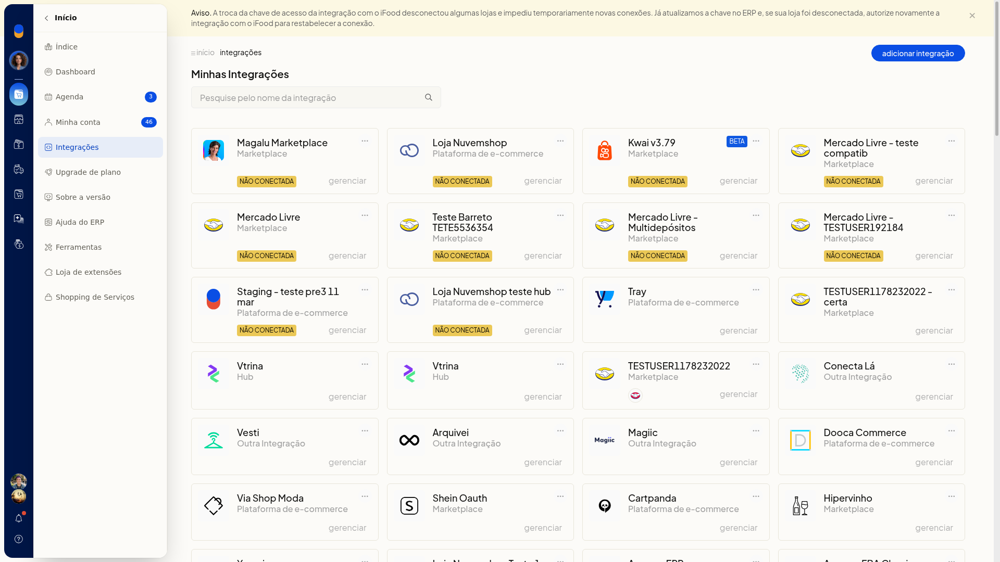

2. Em **Minhas Integrações**, use **Pesquise pelo nome da integração**.
3. Veja as categorias **Marketplace**, **Plataforma de e-commerce**, **Hub** e **Outra Integração**, o status da conexão e a ação **gerenciar**.
4. Leia o aviso do iFood se a loja tiver sido desconectada pela troca da chave de acesso. A lista mostra as integrações da conta e o que ainda não está conectado, sem alterar a conexão.

### Iniciar uma nova integração

1. Em **Minhas Integrações**, clique em **Adicionar integração**.
2. Filtre por todas as integrações, marketplaces e hubs, plataformas de e-commerce ou outras integrações, ou pesquise em **Pesquise por integrações ou canais de venda**.

   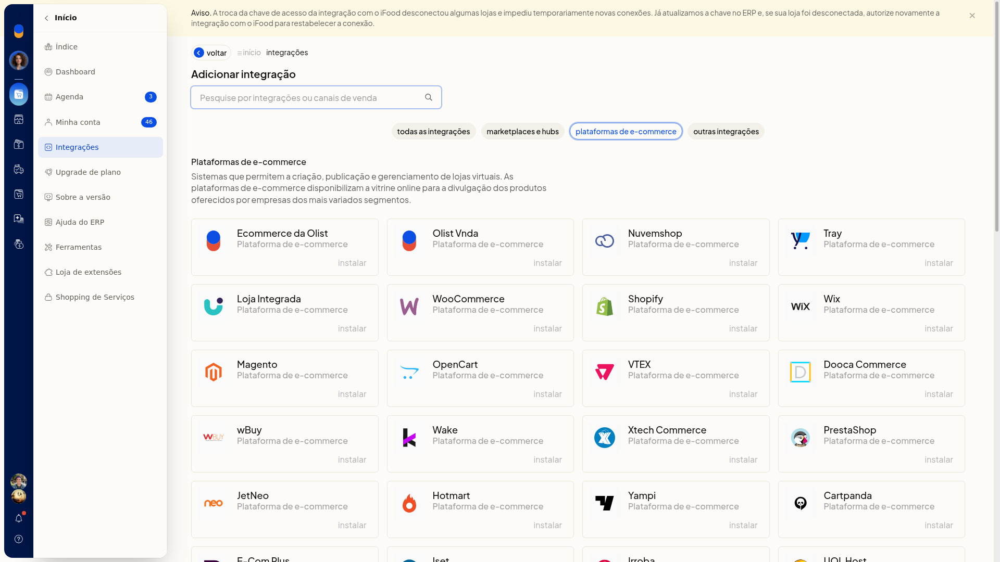

3. No card desejado, clique em **instalar**. Alguns cards indicam **via HUB** ou **BETA**.
4. Na tela da integração, preencha **Nome da integração no ERP**. O campo não é obrigatório. Não clique em **conectar**. A tela fica pronta para conectar, sem concluir a conexão.

   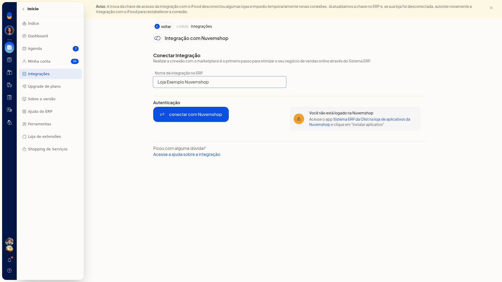

5. Se aparecer o aviso da Nuvemshop, instale antes o **Sistema ERP da Olist** na loja de aplicativos da Nuvemshop. O link **Acesse a ajuda sobre a integração** fica na mesma tela.

### Cadastrar o produto com SKU

1. Acesse **Cadastros > Produtos**.
2. Na lista, busque por nome, SKU ou GTIN. As abas separam todos, simples, kits, variações, fabricado e matéria-prima. A lista mostra as colunas **Código (SKU)** e **Integrações** e o botão **receber do e-commerce**.

   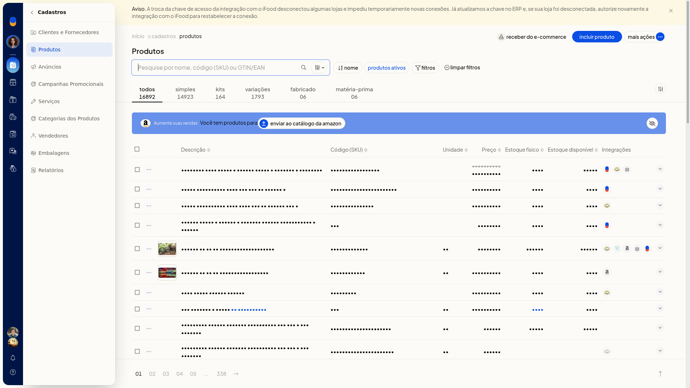

3. Clique em **incluir produto**.
4. Em **Dados Gerais**, escolha o tipo e preencha os dados do produto. O **SKU** aparece com o rótulo **Opcional**. O estoque inicial fica ao lado de um depósito. Nenhum desses campos é obrigatório.

#### Identificação

- **Tipo do produto**: Simples, Kit, Com variações, Fabricado ou Matéria-prima
- **Nome**
- **GTIN**
- **Origem**
- **Unidade**: a ajuda da tela indica que a unidade é necessária para a nota fiscal
- **NCM**
- **SKU**: rótulo **Opcional**
- **CEST**

#### Preços, peso e estoque

- **Preço de venda**
- **Preço promocional**
- **Peso líquido**
- **Tipo embalagem**
- **Largura**, **Altura** e **Comprimento**: altura e comprimento em cm
- **Controlar estoque**: Sim ou Não
- **Estoque inicial**: quantidade ao lado de um depósito já existente
- **Estoque mínimo** e **Estoque máximo**
- **Sob encomenda**: Sim ou Não
- **Controlar lotes**: Sim ou Não
- **Localização**
- **Dias para preparação**

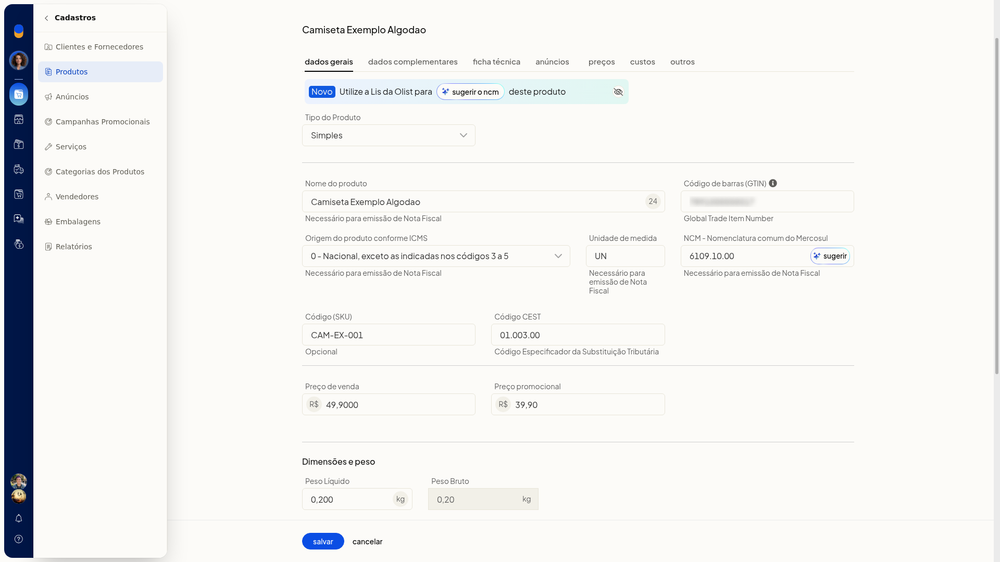

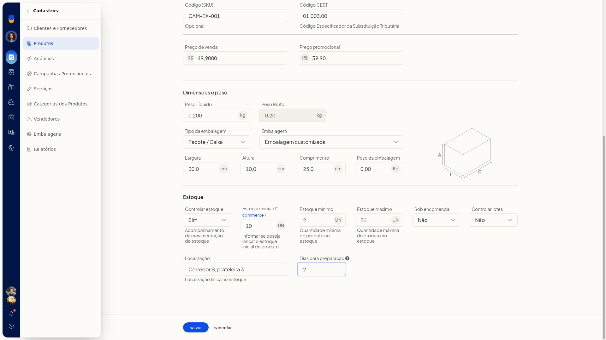

5. Clique em **Cancelar** para voltar à lista sem gravar. O produto não entra na lista.

### Cadastrar a natureza de operação de saída

1. Acesse **Configurações > Configurações ERP > Notas Fiscais > Naturezas de operação de saída**.
2. Filtre a lista por ativas, se precisar, e clique em **Incluir natureza de operação**.

   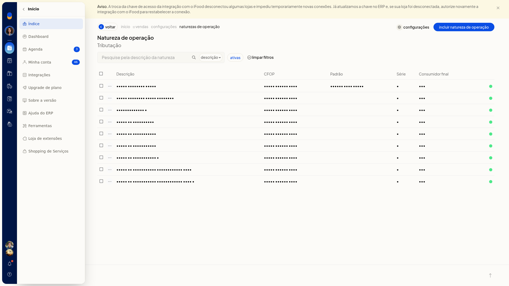

   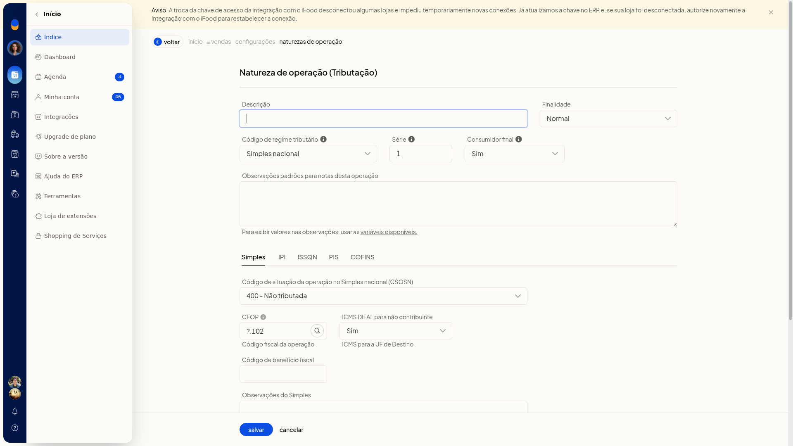

3. Preencha a **Descrição** e revise os demais campos. Nenhum campo dessa tela aparece marcado como obrigatório. **Série** e **CFOP** já podem vir preenchidos ao abrir o formulário.

   - **Finalidade**: Normal, Devolução, Bonificação ou Remessa
   - **Código de regime tributário**: Simples nacional, excesso de sublimite, Regime normal ou MEI
   - **Série**
   - **Consumidor final**: Sim ou Não
   - **CSOSN**: 101, 102, 103, 201, 202, 203, 300 Imune, 400 Não tributada, 500 ou 900 Outros
   - **CFOP**
   - **ICMS DIFAL para não contribuinte**: Sim ou Não. A ajuda trata do ICMS para a UF de destino
   - **Código de benefício fiscal**
   - **Observações padrões**, **Observações do Simples** e **Informações ao Fisco**

   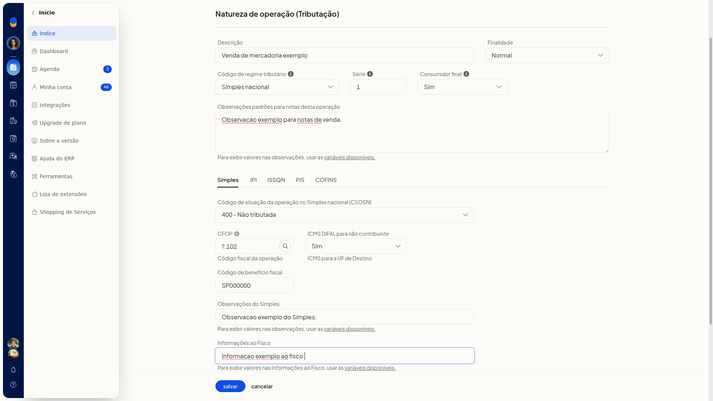

4. Abra **Configurações avançadas** para revisar preço, expedição, DRE, funrural, Zona Franca e a composição do total da NF-e. Há também **adicionar exceção**.

   - **Preço considerado**: Preço de custo ou Preço de venda ou promocional
   - **Enviar para expedição**: Sim ou Não
   - **Considerar como receita, CMV e impostos no DRE**
   - **Compra de produtor rural**: Sim ou Não
   - **Permite lançamento e reserva de estoque**: Sim ou Não
   - **Alíquota funrural**
   - **Descontar funrural do total faturado**: Sim ou Não
   - **Venda para Zona Franca de Manaus**: Não, Sim com desoneração para todos, ou Sim só para origem nacional
   - **Redução da base de ICMS-ST**: Padrão ou Antes de somar o IPI
   - **Descontar desoneração do total da NF**: Sim ou Não
   - **Itens compõem valor total da NF-e**: compõem total da nota fiscal; compõem total, mas sem faturas no XML; ou não compõem, com totais zerados

   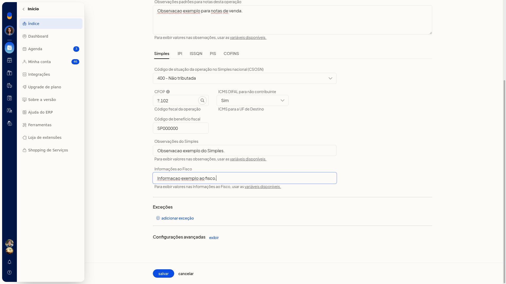

   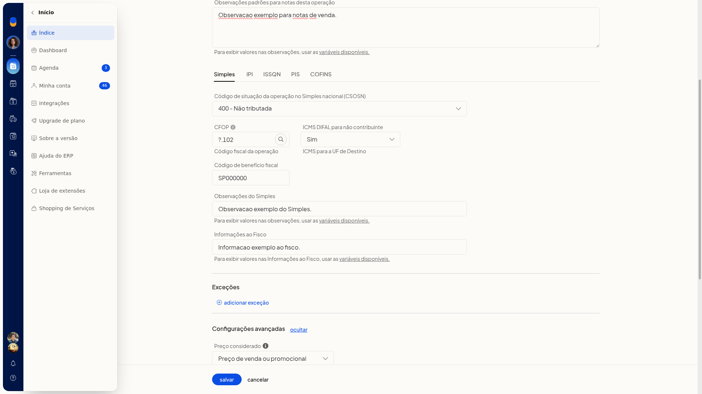

   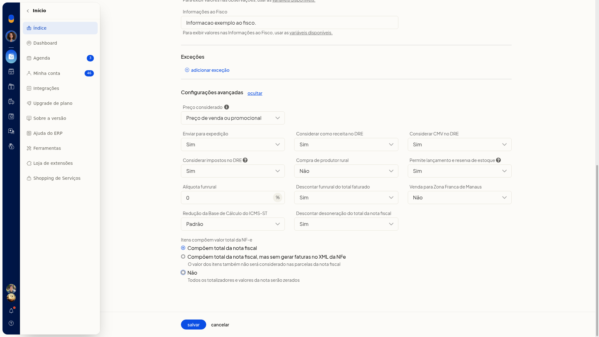

5. Clique em **Cancelar** para voltar à lista sem gravar. A natureza não é incluída na lista.

### Cadastrar o depósito de estoque

1. Acesse **Configurações > Configurações ERP > Suprimentos > Depósitos de estoque**.
2. Na lista ativa, use **Pesquisa...** e o filtro **Ativos**. Um depósito existente pode aparecer marcado como **Depósito Padrão**. O cadastro é **Incluir depósito**.

   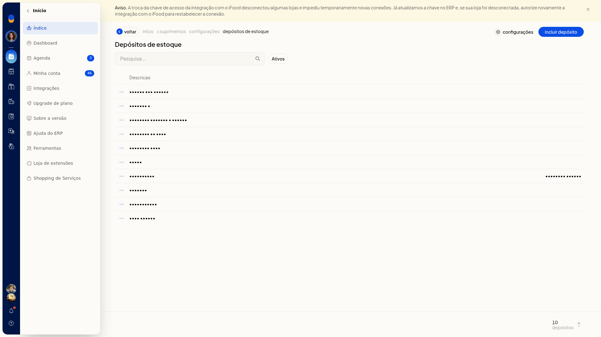

3. Clique em **Incluir depósito**.

   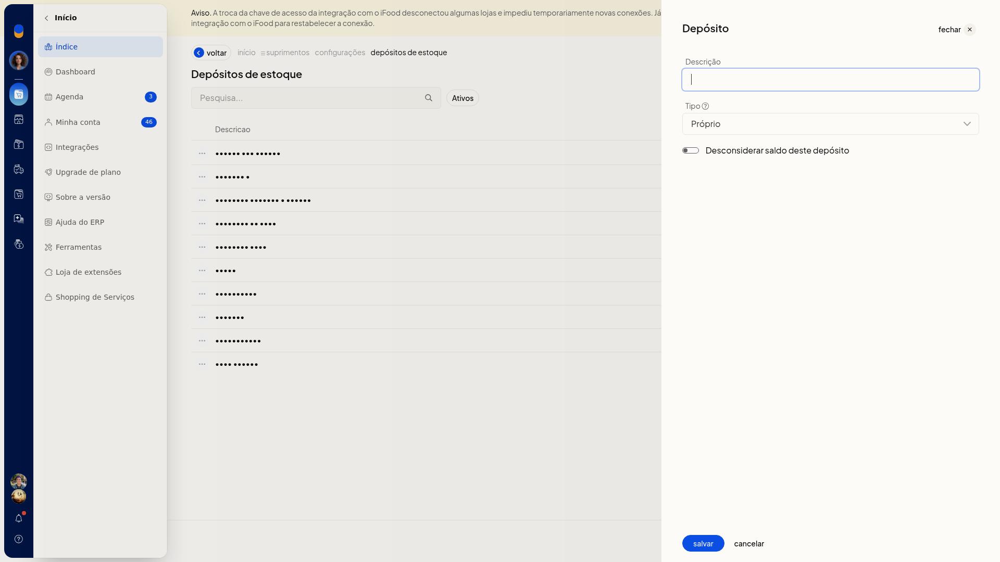

4. Informe a **Descrição do depósito** e o **Tipo**. Nenhum campo do depósito aparece marcado como obrigatório. **Próprio** vale para os canais de venda e é compartilhado entre eles. **Exclusivo para um canal de venda** é o depósito externo, em geral fulfillment de um canal. **Desconsiderar saldo deste depósito** também aparece nesse painel.

   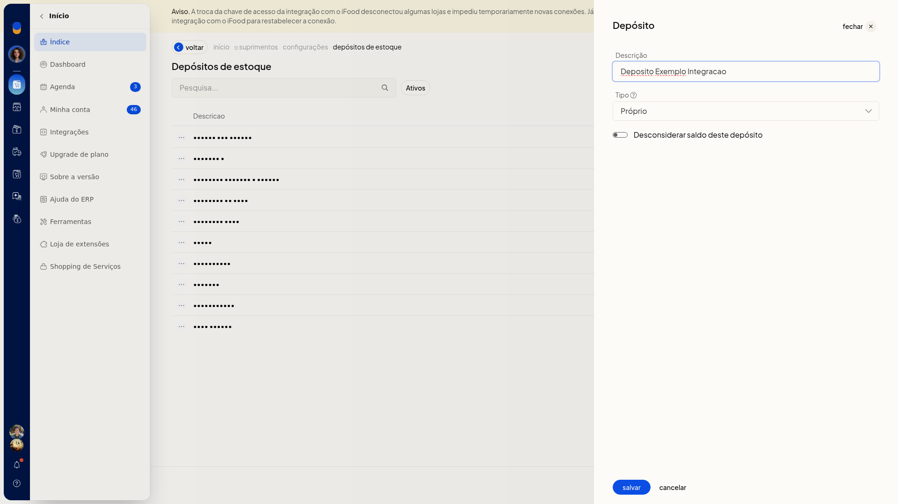

   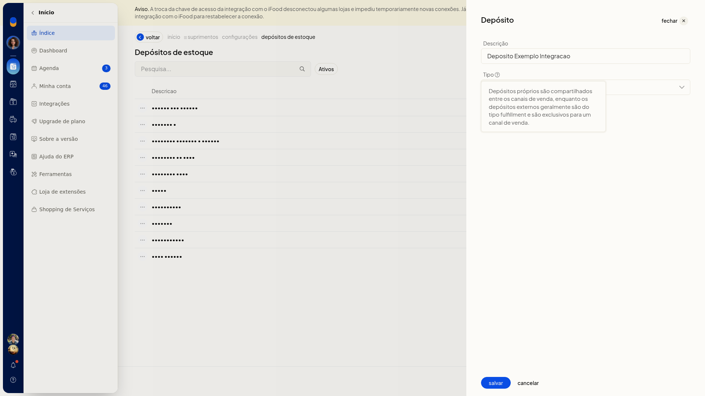

5. No tipo exclusivo, informe **CNPJ destinatário** e, se for o caso, **CNPJ Remetente**. Dá para adicionar outro CNPJ e marcar **Criar transferências de estoque para notas fiscais com os CNPJs informados acima**. O **CNPJ destinatário** é de quem recebe a nota de transferência, em geral o canal ou o centro de distribuição. No modelo unificado de várias empresas, o **CNPJ Remetente** é validado com o **CNPJ destinatário** para identificar o depósito da entrada.

   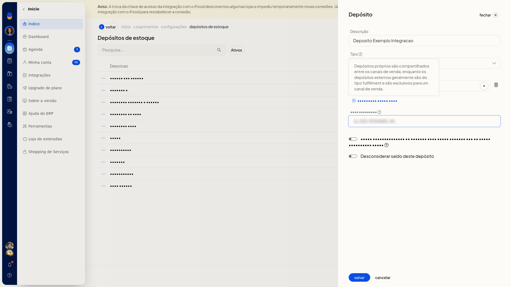

   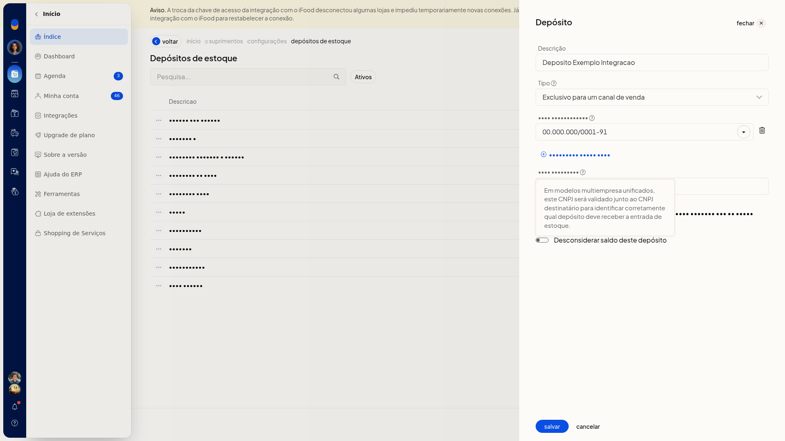

   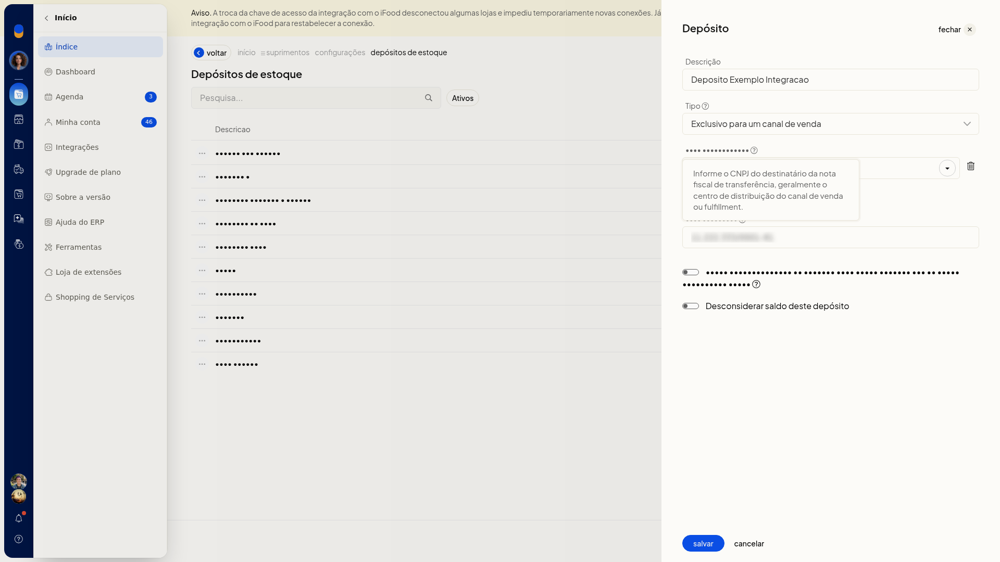

6. Clique em **Cancelar** para voltar à lista sem gravar. A lista continua com os depósitos ativos e o depósito padrão já marcado.
7. No menu da linha de um depósito já existente, as ações são **Inativar depósito** e **Tornar depósito padrão**. Não as confirme se a intenção for só consultar. O aviso do iFood pode aparecer no topo da tela.

   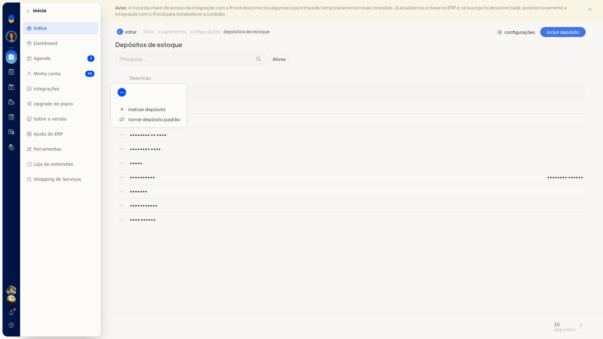

### Ver a reserva de estoque por depósito

1. Em **Depósitos de estoque**, clique em **Configurações**. **Mais ações** aponta para as configurações de depósitos.
2. Leia **Reserva de estoque individual por depósito** e o texto de ajuda sobre o controle individual da reserva.

   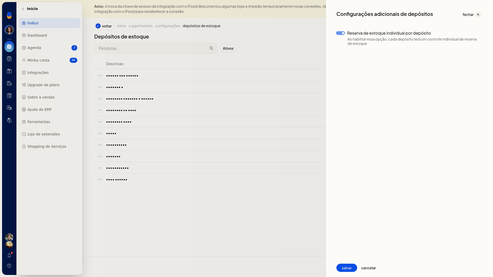

3. Clique em **Cancelar** sem salvar. A reserva por depósito não é alterada.

### Consultar o saldo por depósito

1. Acesse **Suprimentos > Controle de Estoques**.

   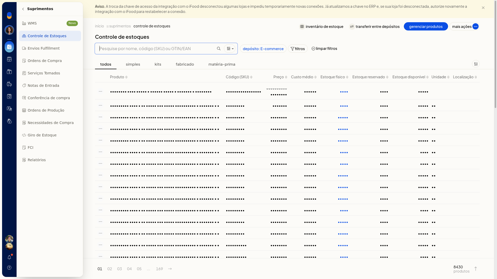

2. Abra o filtro **depósito** e escolha **Todos** ou um depósito da conta. O saldo exibido fica associado ao depósito escolhido, sem criar depósito.
3. Se precisar, use **Transferir entre depósitos**. A transferência pode ser preenchida e cancelada antes de confirmar, sem criar a transferência.

## Resultado
**Minhas Integrações** lista as integrações com o status de conexão e a ação **gerenciar**. O catálogo **Adicionar integração** abre a tela da integração, com o nome no ERP e sem conexão concluída. Cancelar o novo produto, a nova natureza ou o novo depósito volta à lista sem incluir o registro.

## Informações adicionais
- O status da conexão pode aparecer como **NÃO CONECTADA**, com a ação **gerenciar**.
- O filtro de categoria do catálogo reduz os cards. O filtro de plataformas de e-commerce restringe o catálogo a essa categoria.
- O filtro de depósitos usa **Ativos** e **Inativos**.
- Na lista de depósitos, um depósito pode estar marcado como **Depósito Padrão**.
