# Preparar a conta antes de integrar: SKU único, natureza de operação e depósitos

Antes de ligar o ERP da Olist a um canal de venda, você pode deixar a conta pronta com o produto, a natureza de operação de saída e os depósitos de estoque.

O SKU entra no cadastro do produto. A natureza de operação de saída reúne a tributação da nota. Os depósitos organizam o saldo usado na conta.

## Pré-requisitos
- O **Estoque inicial** do produto fica ao lado de um depósito que já existe na conta. Se ainda não houver depósito, cadastre-o antes de informar o estoque do produto.

## Importante
- O **SKU** aparece com o rótulo **Opcional**. A tela não mostra uma regra de SKU único.
- Na natureza de operação e no depósito, nenhum campo exibiu asterisco de obrigatoriedade.
- A ajuda da **Unidade** indica que a unidade é necessária para a nota fiscal.
- **Cancelar** volta à lista sem incluir o registro.

## Instruções
### Cadastrar o produto com SKU

1. Acesse **Cadastros > Produtos**.

   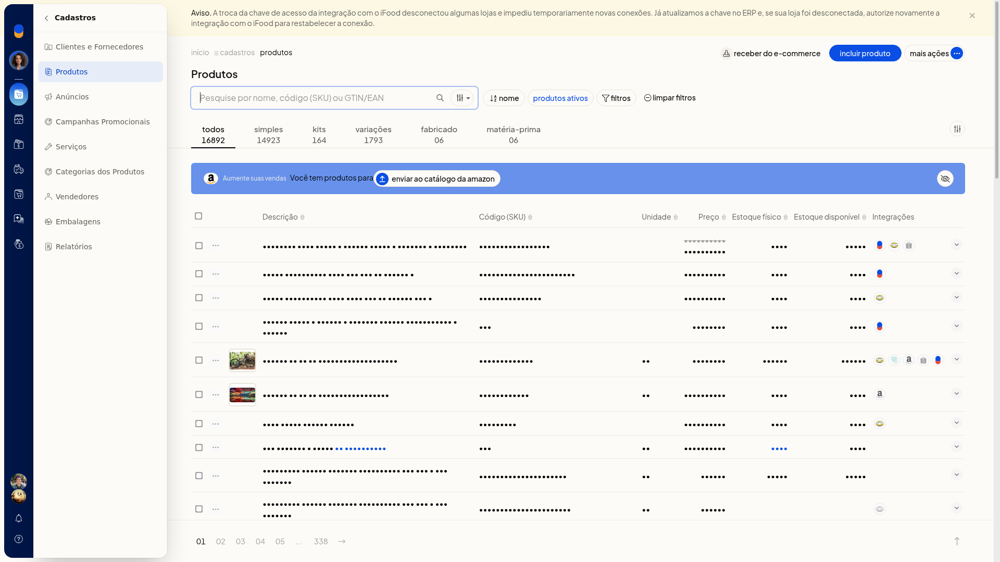

2. Use a busca por nome, SKU ou GTIN.
3. Use as abas para separar todos, simples, kits, variações, fabricado e matéria-prima.
4. Clique em **incluir produto**.
5. Em **Dados Gerais**, escolha o tipo e preencha os dados. Para descartar sem gravar, clique em **Cancelar**.

#### Identificação

- **Tipo do produto**: Simples, Kit, Com variações, Fabricado ou Matéria-prima.
- **Nome**
- **GTIN**
- **Origem**
- **Unidade**: a ajuda da tela indica que a unidade é necessária para a nota fiscal.
- **NCM**
- **SKU**: rótulo **Opcional**.
- **CEST**

#### Preços e medidas

- **Preço de venda**
- **Preço promocional**
- **Peso líquido**
- **Tipo embalagem**
- **Largura**
- **Altura**: unidade em cm.
- **Comprimento**: unidade em cm.

#### Estoque

- **Controlar estoque**: Sim ou Não.
- **Estoque inicial**: quantidade ao lado de um depósito já existente.
- **Estoque mínimo**
- **Estoque máximo**
- **Sob encomenda**: Sim ou Não.
- **Controlar lotes**: Sim ou Não.
- **Localização**
- **Dias para preparação**

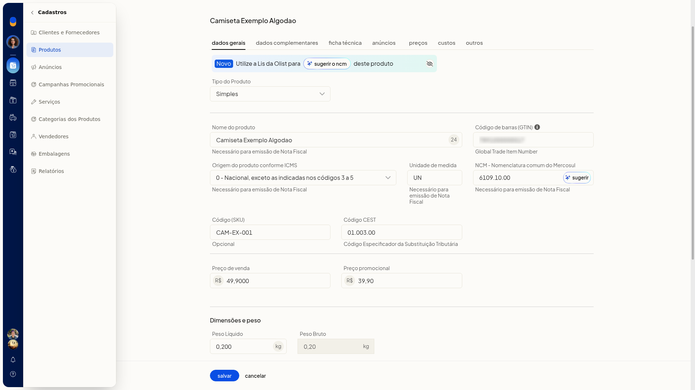

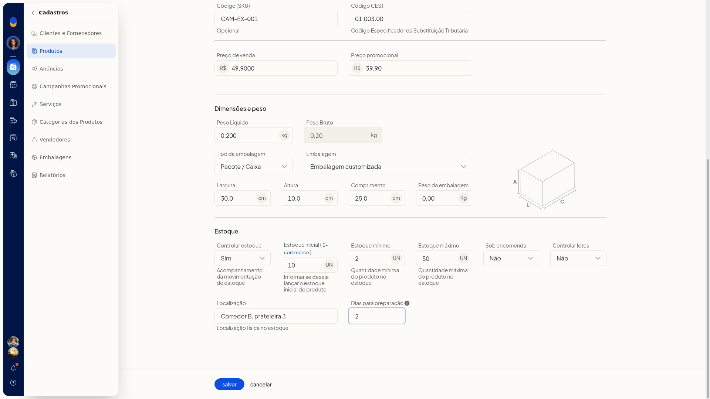

Na lista, as colunas **Código (SKU)** e **Integrações** identificam o produto. O botão **receber do e-commerce** também fica nessa tela.

### Cadastrar a natureza de operação de saída

1. Acesse **Configurações > Configurações ERP > Notas Fiscais > Naturezas de operação de saída**.
2. Filtre a lista por ativas, se precisar.

   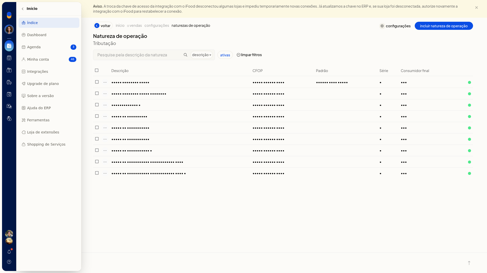

3. Clique em **Incluir natureza de operação**.

   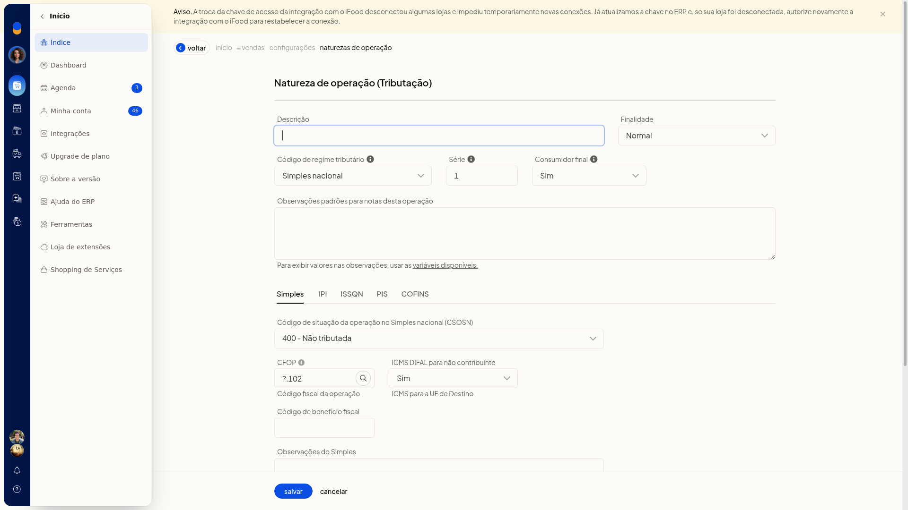

4. Preencha a **Descrição** e revise os dados de tributação. Para descartar sem gravar, clique em **Cancelar**.

#### Dados da natureza

- **Descrição**
- **Finalidade**: Normal, Devolução, Bonificação ou Remessa.
- **Código de regime tributário**: Simples nacional, excesso de sublimite, Regime normal ou MEI.
- **Série**: já vem preenchida ao abrir o formulário.
- **Consumidor final**: Sim ou Não.
- **CSOSN**: opções vistas 101, 102, 103, 201, 202, 203, 300 Imune, 400 Não tributada, 500 e 900 Outros.
- **CFOP**: já vem preenchido ao abrir o formulário.
- **ICMS DIFAL para não contribuinte**: Sim ou Não. A ajuda trata do ICMS para a UF de destino.
- **Código de benefício fiscal**
- **Observações padrões**
- **Observações do Simples**
- **Informações ao Fisco**

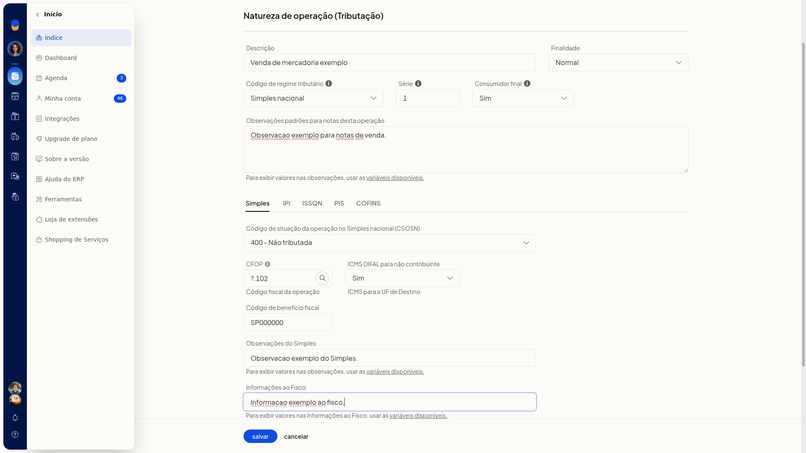

5. Abra **Configurações avançadas** para revisar preço, expedição, DRE, funrural, Zona Franca e a composição do total da NF-e. Use **adicionar exceção** quando precisar de uma exceção.

#### Configurações avançadas

- **Preço considerado**: Preço de custo ou Preço de venda ou promocional.
- **Enviar para expedição**: Sim ou Não.
- **Considerar como receita, CMV e impostos no DRE**
- **Compra de produtor rural**: Sim ou Não.
- **Permite lançamento e reserva de estoque**: Sim ou Não.
- **Alíquota funrural**
- **Descontar funrural do total faturado**: Sim ou Não.
- **Venda para Zona Franca de Manaus**: Não, Sim com desoneração para todos, ou Sim só para origem nacional.
- **Redução da base de ICMS-ST**: Padrão ou Antes de somar o IPI.
- **Descontar desoneração do total da NF**: Sim ou Não.
- **Itens compõem valor total da NF-e**: compõem total da nota fiscal; compõem total, mas sem faturas no XML; ou não compõem, com totais zerados.

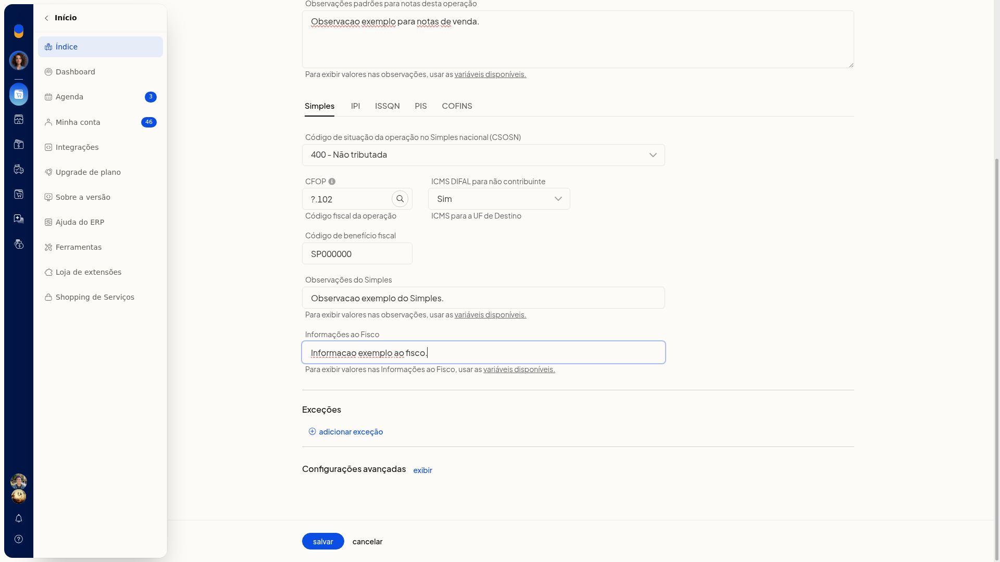

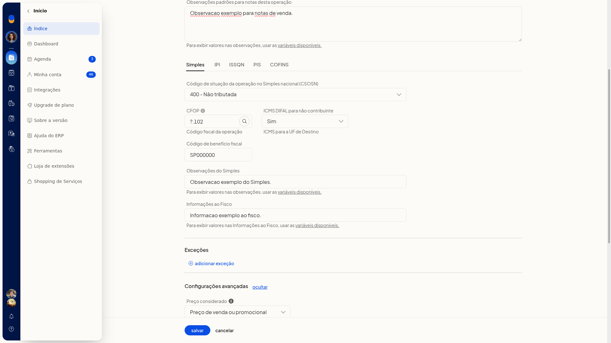

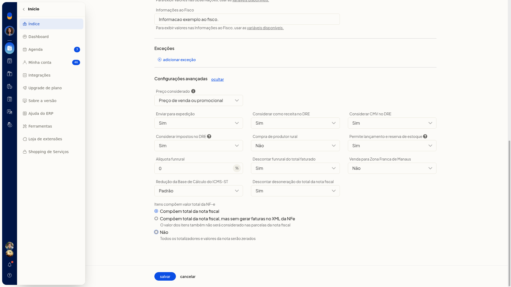

### Cadastrar o depósito

1. Acesse **Configurações > Configurações ERP > Suprimentos > Depósitos de estoque**.
2. Use a busca **Pesquisa...** e o filtro **Ativos** ou **Inativos**.

   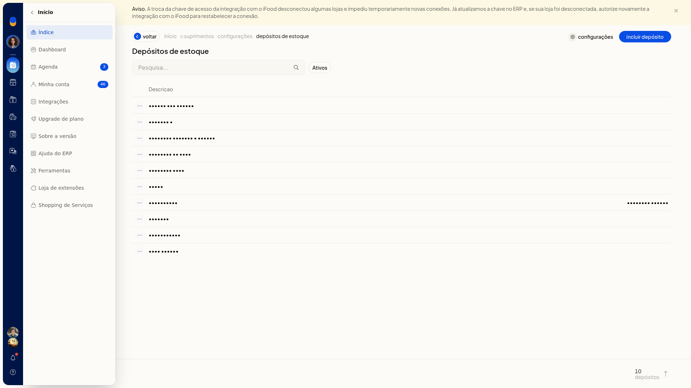

3. Clique em **Incluir depósito**.

   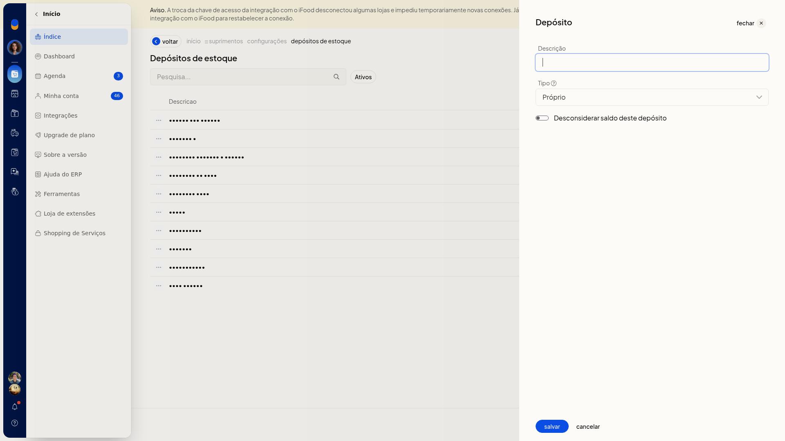

4. Informe a **Descrição** e o **Tipo**. **Próprio** vale para os canais de venda e é compartilhado entre eles. **Exclusivo para um canal de venda** é o tipo de depósito externo, em geral fulfillment.

   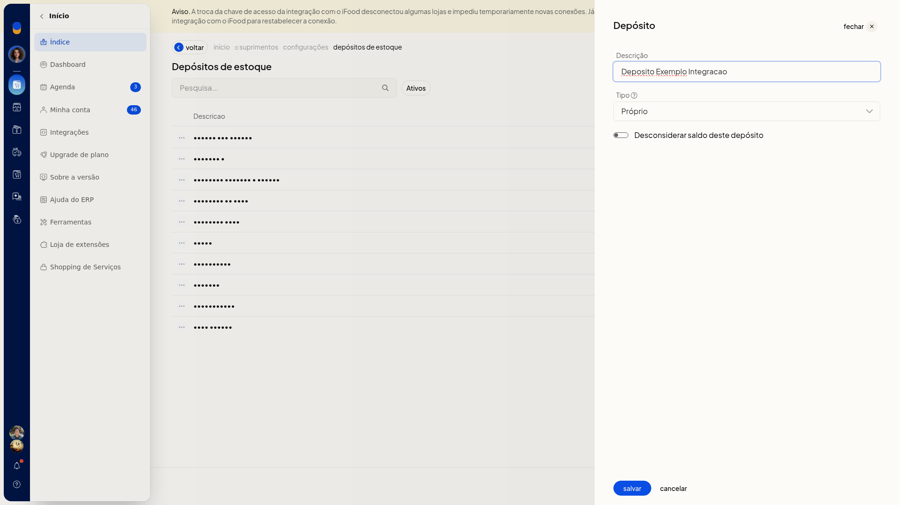

   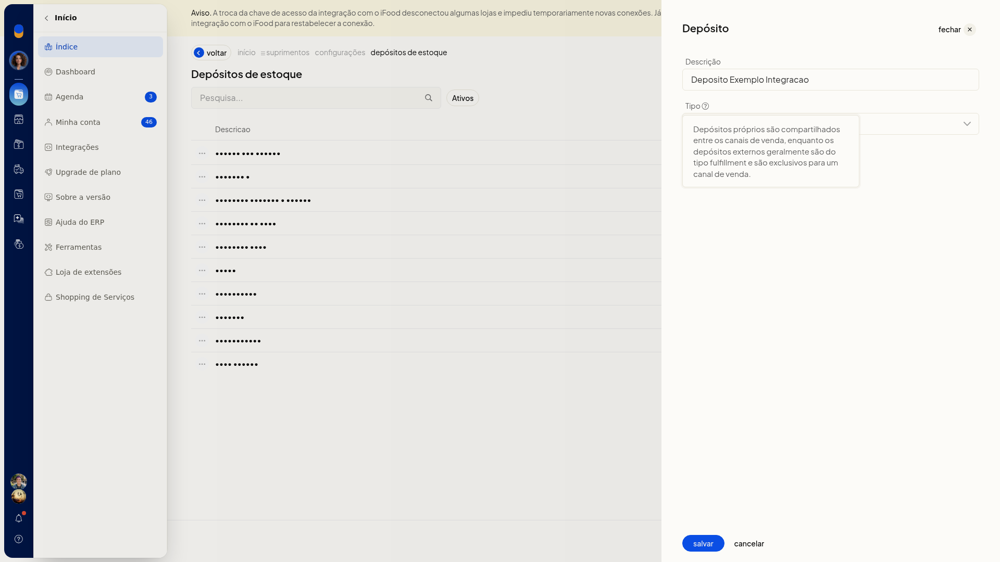

5. No tipo exclusivo, informe **CNPJ destinatário** e, se for o caso, **CNPJ Remetente**. O **CNPJ destinatário** é de quem recebe a nota de transferência, em geral o canal ou o centro de distribuição. No modelo unificado de várias empresas, o **CNPJ Remetente** é validado com o **CNPJ destinatário** para identificar o depósito da entrada.
6. Use adicionar outro CNPJ quando precisar de mais de um. Marque **Criar transferências de estoque para notas fiscais com os CNPJs informados acima** somente se quiser essa criação. Esse controle aparece só no tipo exclusivo.
7. Marque **Desconsiderar saldo deste depósito** somente se esse saldo não deve entrar na conta. Para descartar sem gravar, clique em **Cancelar**.

   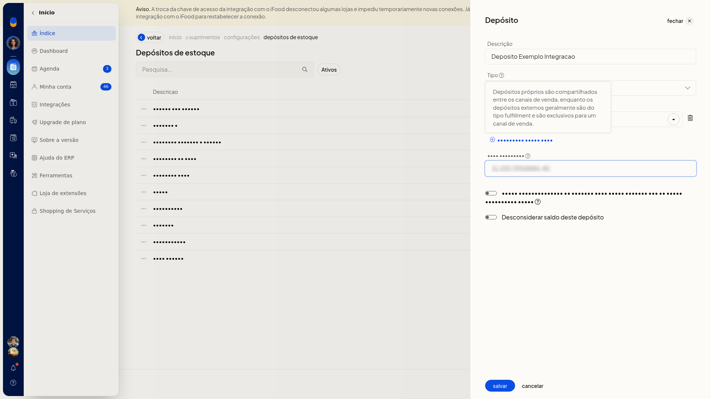

   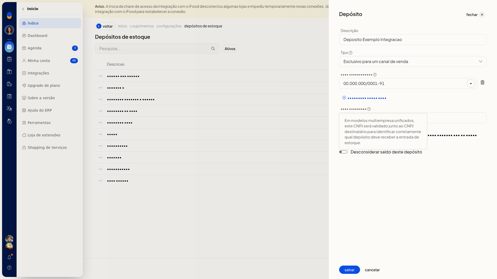

   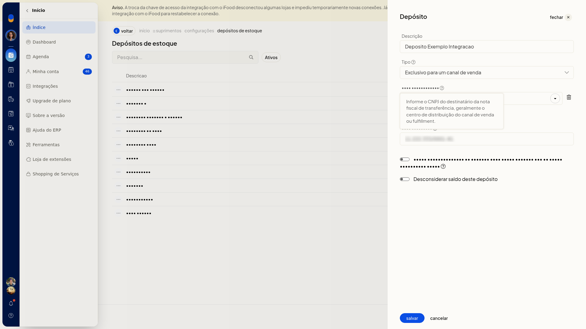

### Ajustar a reserva de estoque por depósito

1. Em **Depósitos de estoque**, clique em **Configurações**.
2. Leia **Reserva de estoque individual por depósito** e o texto de ajuda sobre o controle individual da reserva. Para sair sem alterar, clique em **Cancelar**.

   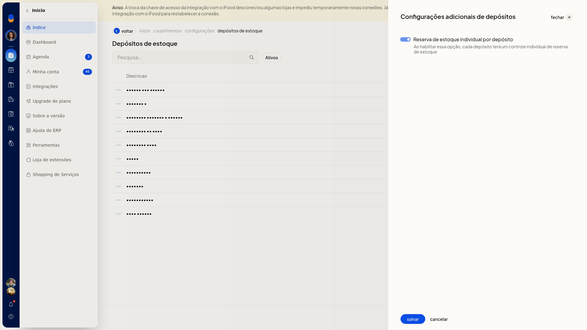

### Consultar o estoque por depósito

1. Acesse **Suprimentos > Controle de Estoques**.
2. Abra o filtro **depósito** e escolha **Todos** ou um depósito da conta. O saldo exibido fica associado ao depósito escolhido.
3. Use **Transferir entre depósitos** se quiser iniciar uma transferência. Cancele antes de confirmar se não for concluir a transferência.

   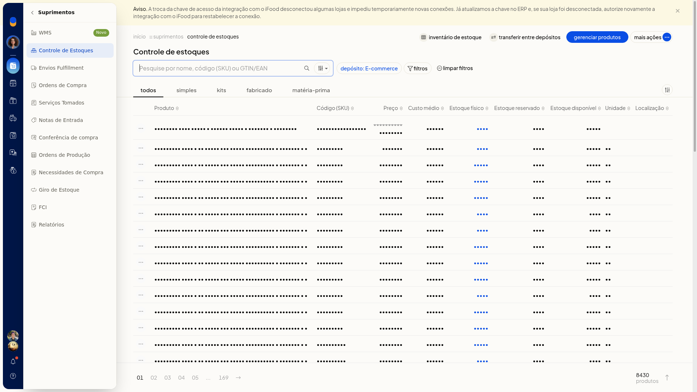

## Informações adicionais
### O depósito padrão fica marcado na lista

Um depósito existente pode aparecer marcado como **Depósito Padrão**. No menu da linha, as ações são **Inativar depósito** e **Tornar depósito padrão**.

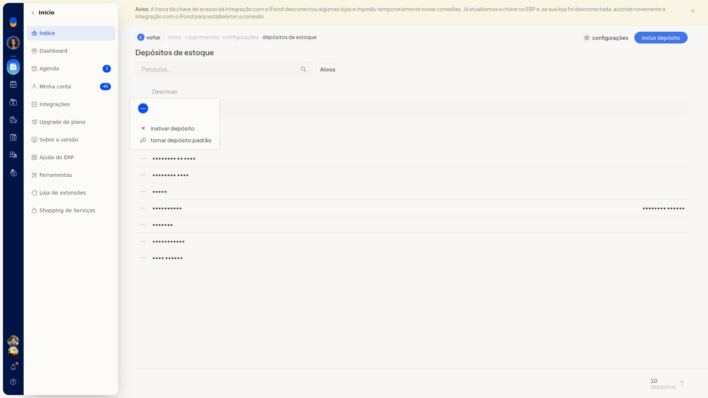

### A lista de depósitos não mostrou importar planilha

Em **Depósitos de estoque**, a inclusão vista é **Incluir depósito**. **Mais ações** aponta para as configurações de depósitos, que abrem a reserva individual.
