# Configurar a integração: pedidos, dados fiscais e mapeamentos

## Pré-requisitos
- A integração Tray já está conectada.
- Naturezas de operação, situações de pedido, formas de recebimento, categorias financeiras, bancos e formas de envio ou frete já cadastrados no ERP, pois as listas usam esses cadastros.

## Importante
- Antes de preencher os IDs de status em **Outros**, solicite o ID de status do pedido à Tray por ticket de atendimento com o parceiro.
- Cada seção tem o próprio botão **Salvar**. Grave a seção em que você alterou as opções.

## Instruções
### Configurar o fluxo de pedidos

1. Acesse **Início > Integrações** e abra a configuração da integração Tray.
2. Clique em **Pedidos > Fluxo de Pedidos**.
3. Marque ou desmarque **Sincronização automática de pedidos**.
4. Marque **Importar valor do frete nos pedidos** para identificar e destacar no pedido de venda o valor do frete.
5. Marque **Formatar nome dos contatos no recebimento dos pedidos** para formatar o nome com as iniciais maiúsculas em nome e sobrenome ao importar os pedidos.
6. Em **Completar endereço do cliente a partir do CEP na importação de pedidos**, selecione **Não**, **Apenas se bairro não está informado** ou **Sempre**. O ERP consulta o CEP nos Correios para preencher o endereço.

   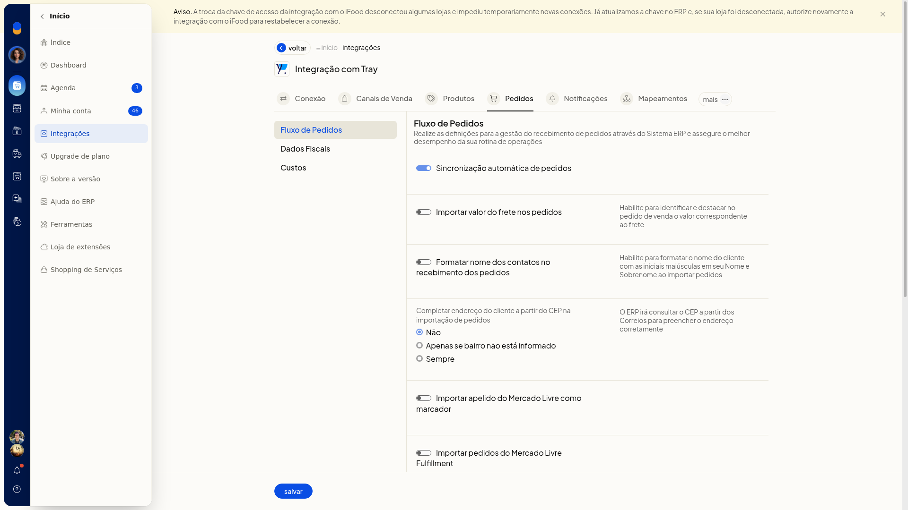

7. Ajuste **Importar apelido do Mercado Livre como marcador** e **Importar pedidos do Mercado Livre Fulfillment**.
8. Ajuste **Somar o campo Interest nas despesas do pedido**, **Enviar rastreamento ao alterar a situação no ERP para enviado** e **Marcar pedido como entregue ao alterar a situação no ERP**.
9. Clique em **Intermediador** e selecione o intermediador. A lista também oferece adicionar intermediador.

   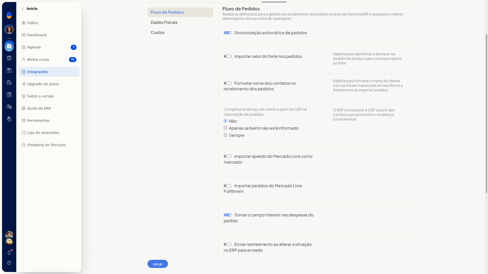

   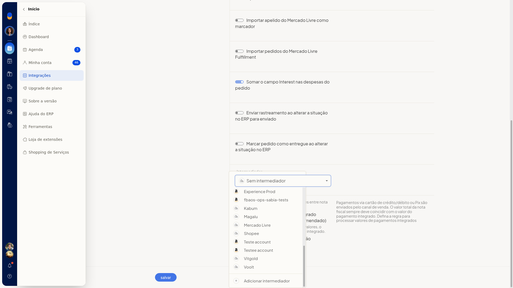

10. Em **Defina como processar valores diferentes entre nota fiscal e pagamento integrado**, selecione **Utilizar valor de pagamento integrado enviado pelo canal de venda (Recomendado)** ou **Considerar pagamento como 'Não integrado'**. Pagamentos via cartão de crédito, débito ou Pix são enviados pelo canal de venda, e o valor total da nota fiscal precisa coincidir com o valor do pagamento integrado. Na opção recomendada, se o ERP identificar divergência nos valores, o pagamento é considerado como não integrado.

   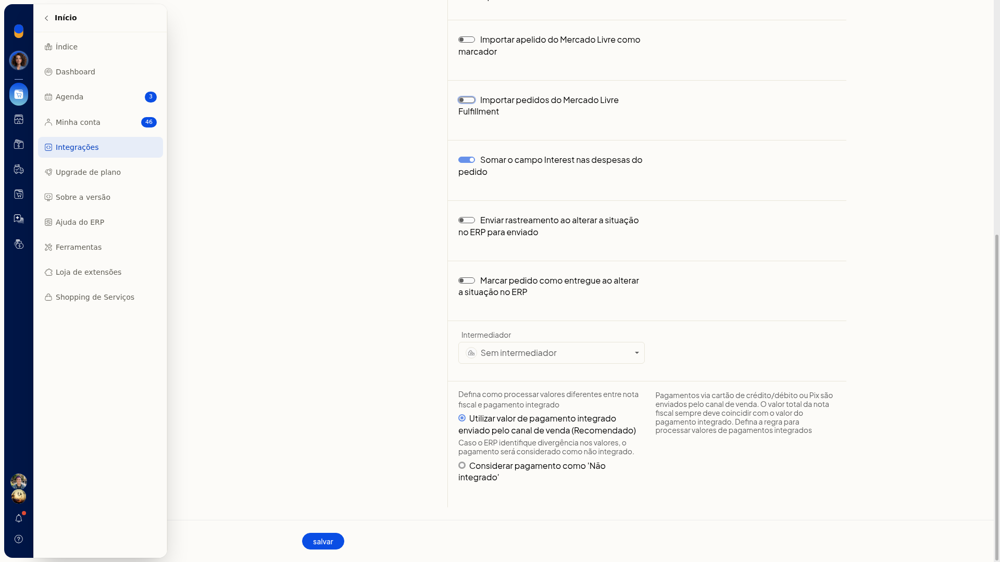

11. Clique em **Salvar** para gravar as regras de recebimento e tratamento dos pedidos.

### Configurar os dados fiscais

1. Na integração Tray, clique em **Pedidos > Dados Fiscais**.
2. Em **Envio de dados da NFe**, selecione **Automático ao autorizar nota fiscal** ou **Manual**.
3. Em **Natureza de operação para venda**, selecione a natureza padrão dos pedidos importados, entre as naturezas já cadastradas.
4. Marque **Definir natureza de operação diferente para destinatários contribuintes do ICMS** se quiser outra natureza para esses destinatários.

   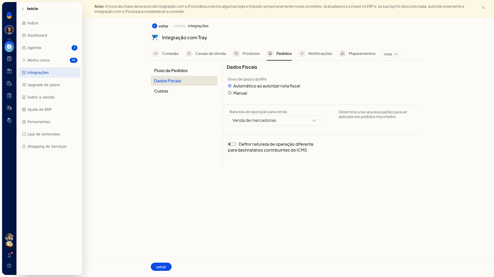

5. Clique em **Salvar** para gravar o envio dos dados da NFe e a natureza de operação padrão.

### Mapear situações de pedidos

1. Na integração Tray, clique em **Mapeamentos > Situações de Pedidos**.
2. Marque **Permite retroceder situação dos pedidos na sincronização de situações** se a sincronização puder voltar a situação do pedido.
3. Na tabela, informe o **Código da situação no E-commerce** e selecione a **Situação no Sistema ERP**.
4. Clique em **adicionar mapeamento de situação** para incluir outra linha.
5. Clique em **adicionar situações padrão** para usar o atalho de situações padrão.

   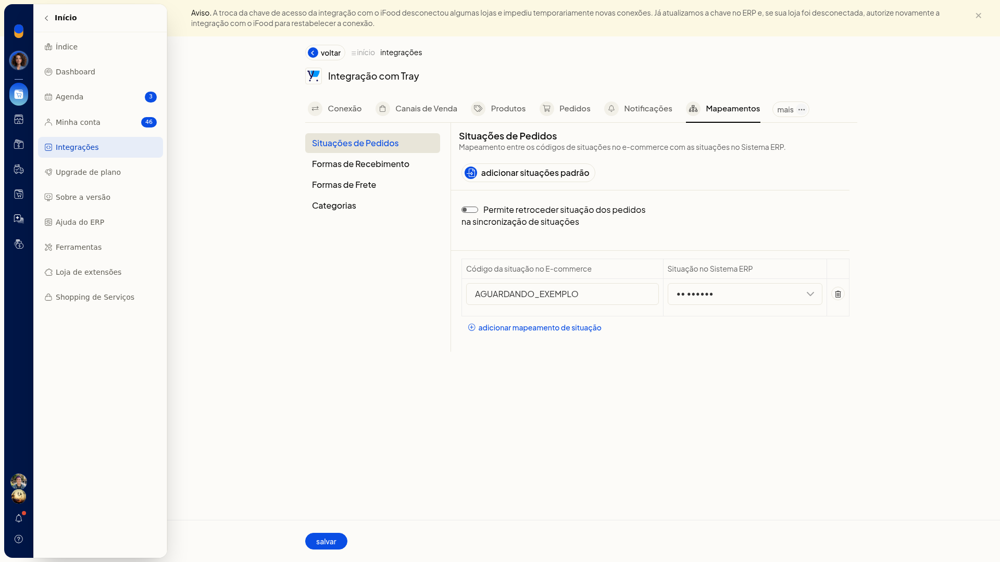

6. Clique em **Salvar** para gravar o vínculo entre o código da situação no ecommerce e a situação no ERP.

### Mapear formas de recebimento

1. Na integração Tray, clique em **Mapeamentos > Formas de Recebimento**.
2. Marque **Importar forma de recebimento nos pedidos** para trazer a forma de recebimento nos pedidos.
3. Em **Forma de recebimento padrão**, selecione a forma já cadastrada ou **Não definida**.
4. Em **Categoria financeira padrão dos pedidos**, selecione a categoria financeira.
5. Na linha de mapeamento, selecione a **Forma de recebimento**, o meio **Banco** ou **Gateway** e o banco ou gateway já cadastrado.
6. Informe o código na integração. Clique em **adicionar forma de recebimento** para incluir outra linha.

   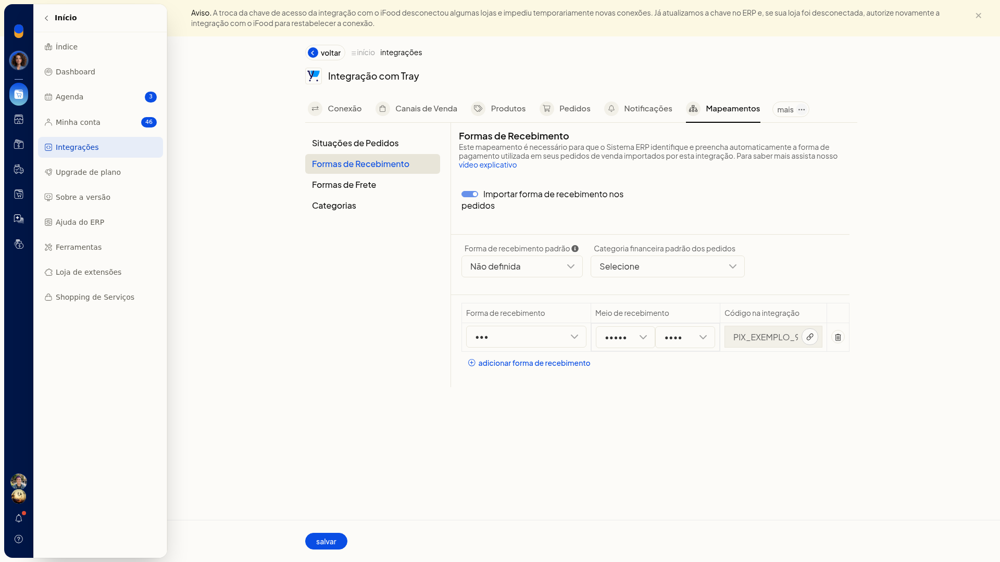

7. Clique em **Salvar** para gravar a forma padrão, a categoria financeira e os códigos da integração.

### Mapear formas de frete

1. Na integração Tray, clique em **Mapeamentos > Formas de Frete**.
2. Em cada linha, selecione a **Forma de envio**, a **Forma de frete** e informe o **Código na integração**. As opções de forma de frete dependem da forma de envio da linha.

   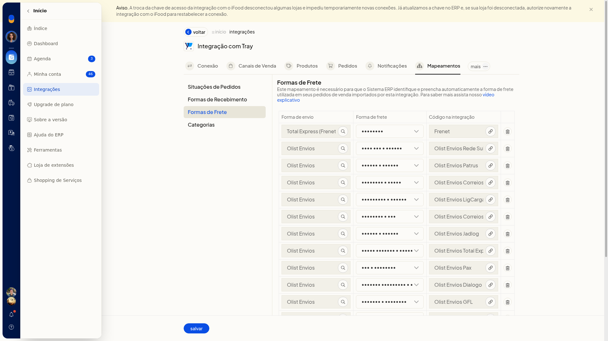

3. Clique em **adicionar** para incluir outra linha e informe o código na integração.

   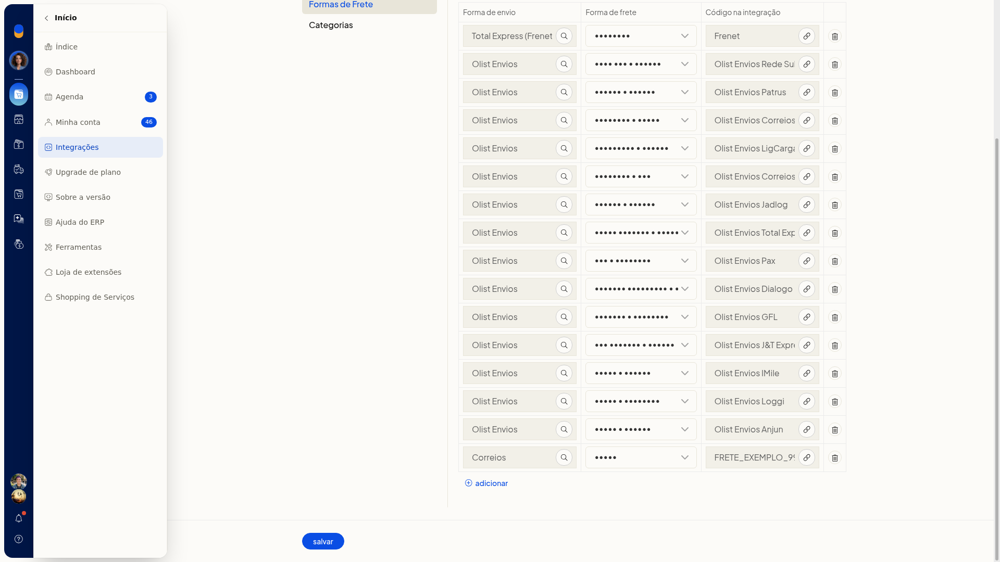

4. Clique em **Salvar** para gravar o vínculo entre forma de envio, forma de frete e código.

### Mapear categorias

1. Na integração Tray, clique em **Mapeamentos > Categorias**.
2. Na linha da categoria do ERP, informe o **Código da categoria no E-commerce**.

   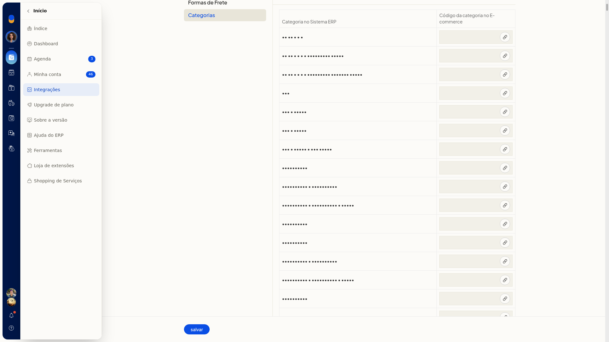

3. Para trazer as categorias a partir do ecommerce, clique em **importar categorias do e-commerce**.

   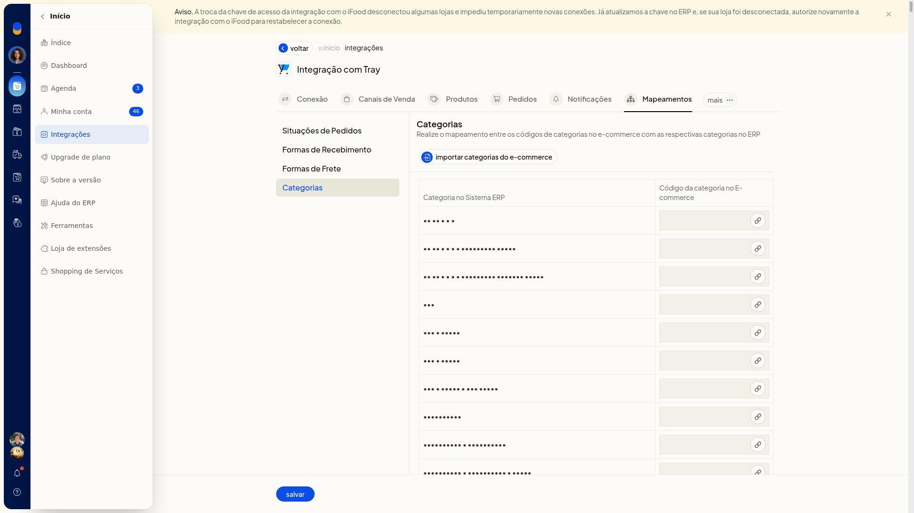

4. Clique em **Salvar** para gravar os códigos informados nas categorias.

### Configurar status e etiqueta

1. Na integração Tray, clique em **mais** e em **Outros**.

   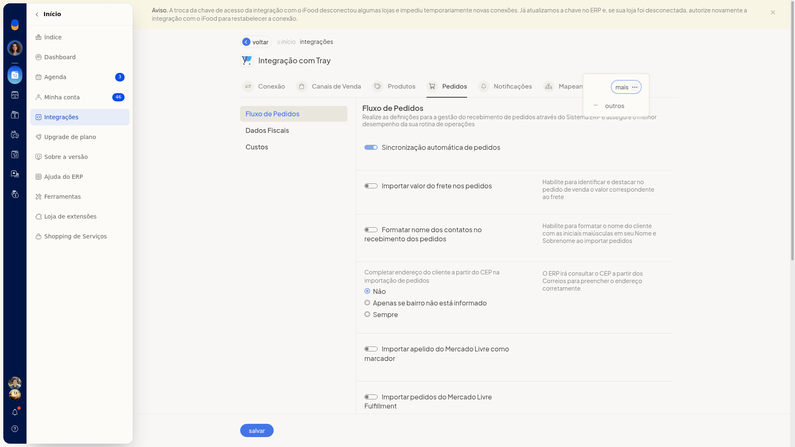

2. Em **Configurações Adicionais**, selecione **ID do status para envio do código de rastreio**, **ID do status para marcar pedido como entregue** e **ID do status para envio dos dados da NFe**. Use os IDs solicitados à Tray.
3. Em **Tipo da impressão de etiqueta**, selecione **PDF** ou **ZPL**.

   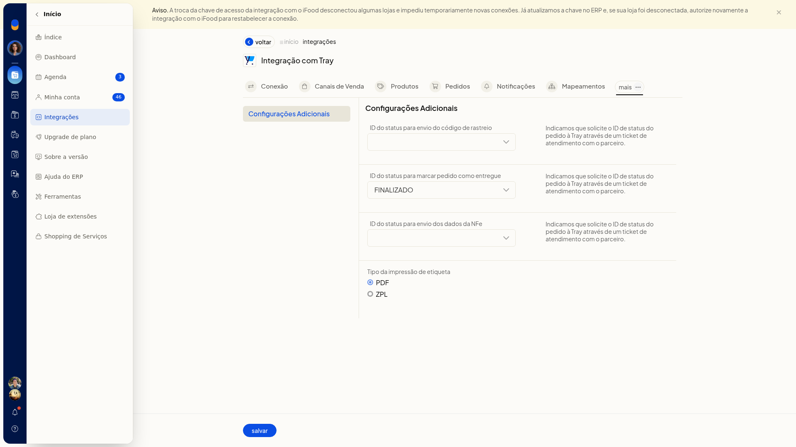

4. Clique em **Salvar** para gravar os status da Tray e o formato da etiqueta.
