# Configurar a integração: produtos, estoque e preços

Na aba **Produtos** de uma integração de loja já conectada, você define como o ERP da Olist reflete estoque e preço na loja virtual e como produtos, imagens, Código (SKU), dias de preparação e preço de custo circulam na importação e na sincronização.

Dá para escolher o saldo enviado, os depósitos considerados, o lançamento das saídas, uma margem de segurança, a origem do preço e o tratamento das imagens. O caminho é **Início > Integrações**. Na integração conectada, use **gerenciar** e abra a aba **Produtos**.

## Pré-requisitos
- A integração de ecommerce precisa estar conectada.
- Para usar **Conforme lista de preços**, a conta precisa ter ao menos uma lista de preços já cadastrada. O seletor só lista as existentes e não cria lista nesta tela.

## Importante
- Nenhum campo desta configuração é obrigatório.
- Se a conta tiver reserva de estoque habilitada, evite **Automático ao salvar o pedido**. Esse lançamento invalida a reserva.
- Depósitos de uma empresa conectada que não recebe dados desta empresa só entram no saldo depois de habilitar o envio de dados para ela.
- A gravação depende de **Salvar** no fim de cada sub-aba.

## Instruções
### Regras de estoque

1. Acesse **Início > Integrações**.
2. Na integração conectada, clique em **gerenciar**.

   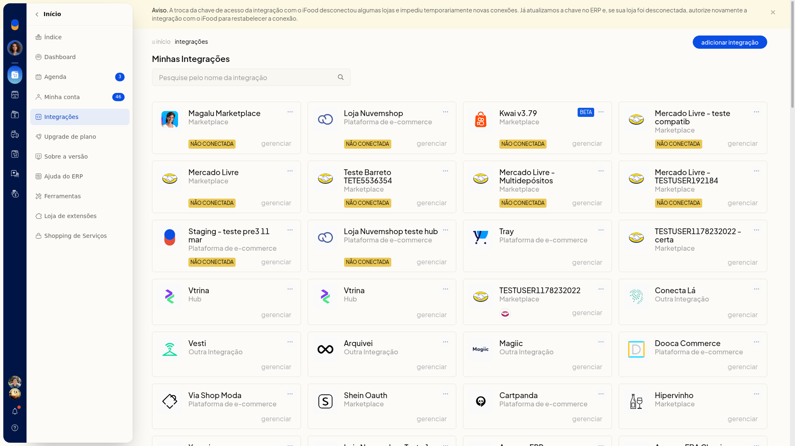

3. Abra a aba **Produtos** e a sub-aba **Regras de Estoque**.
4. Em **Atualizar estoque na loja virtual a partir do ERP**, escolha **Não atualizar**, **Enviar saldo físico** ou **Enviar saldo disponível**. O saldo disponível é o saldo físico menos as reservas. A tabela de depósitos, o lançamento das saídas e as opções de indisponibilidade e de estoque de segurança permanecem nas três opções.

   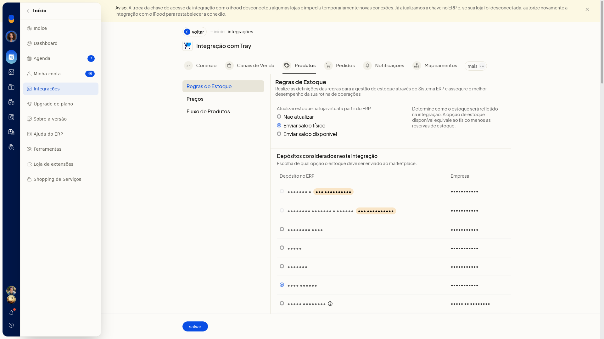

   

   

5. Em **Depósitos considerados nesta integração**, selecione uma linha nas colunas **Depósito no ERP** e **Empresa**, ou selecione **Todos Próprios**. **Todos Próprios** usa os depósitos de todas as empresas do grupo. Linhas não habilitadas de uma empresa conectada que não recebe dados desta empresa ficam fora do saldo até o envio ser habilitado.

   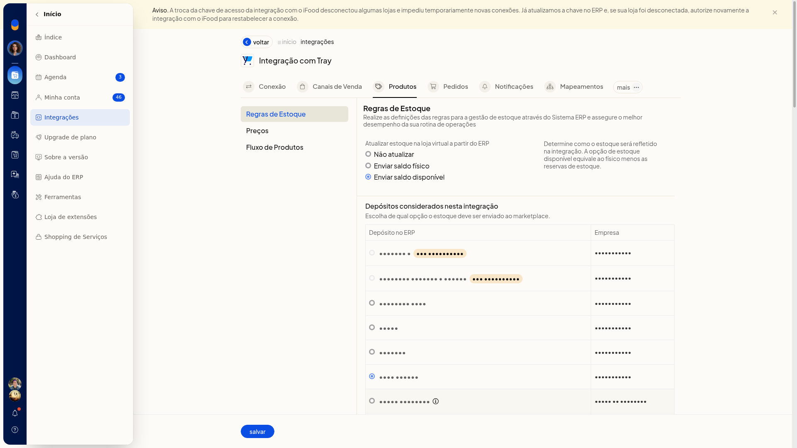

   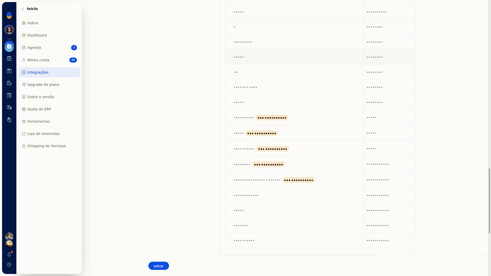

6. Em **Lançamento de estoque para saídas**, escolha **Usar configuração padrão da conta**, **Manual**, **Automático ao autorizar a nota fiscal**, **Automático ao salvar a nota fiscal**, **Automático ao salvar o pedido** ou **Automático ao marcar pedido como enviado**.

   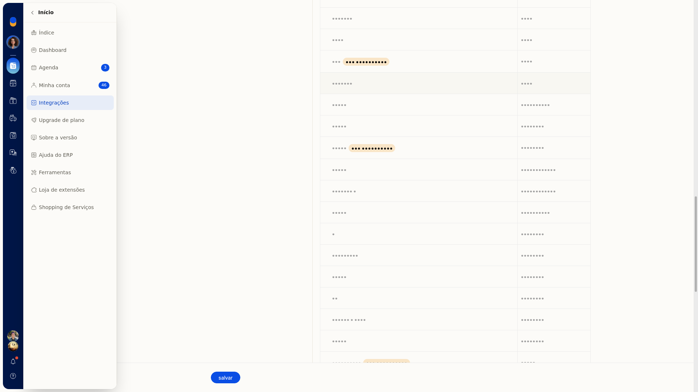

   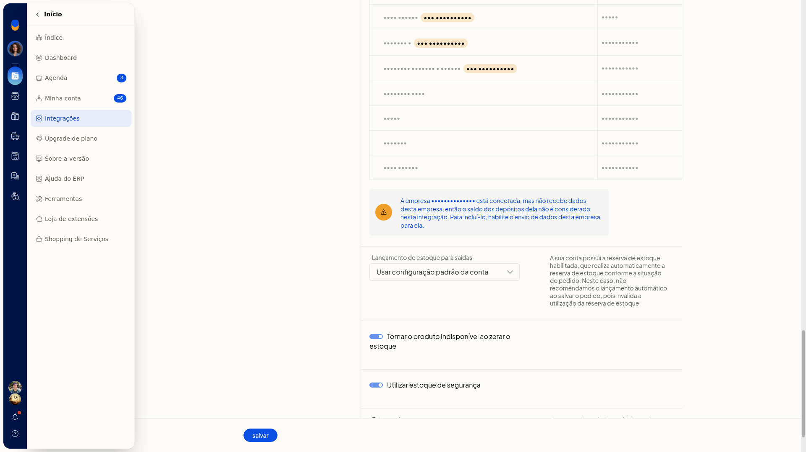

7. Marque, se quiser, **Tornar o produto indisponível ao zerar o estoque**.
8. Marque **Utilizar estoque de segurança** se quiser uma margem. Informe **Estoque de segurança** com vírgula decimal. Ao atingir a margem, o estoque do anúncio é informado como zero.

   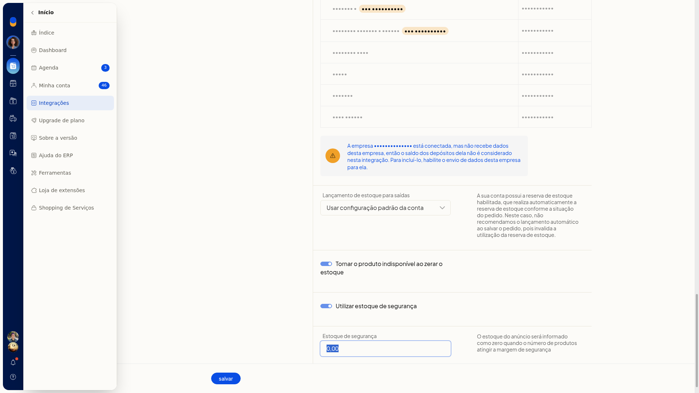

   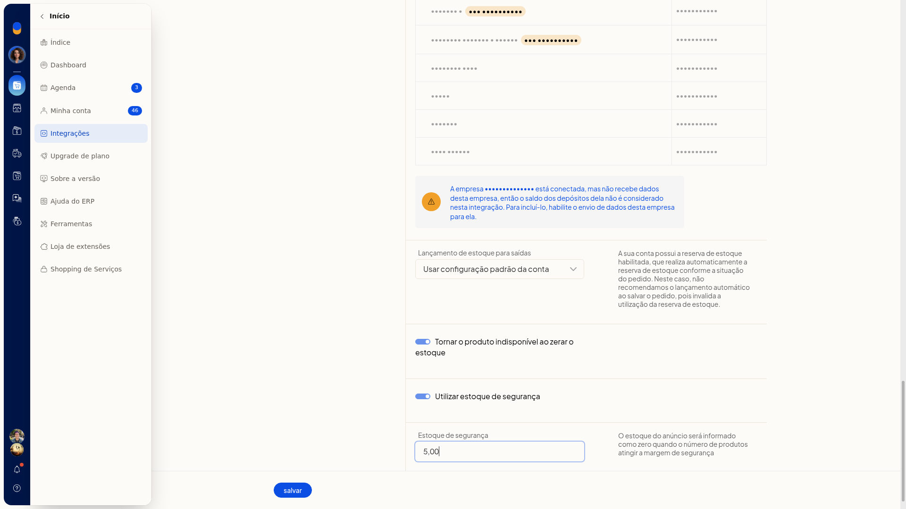

9. Clique em **Salvar**. A integração fica com a regra de estoque, os depósitos do saldo, o lançamento das saídas e a margem de segurança, se você a tiver informado.

### Preços

1. Acesse **Início > Integrações**, clique em **gerenciar** na integração conectada e abra **Produtos > Preços**.
2. Em **Regra de utilização de preços para o e-commerce**, escolha **Preço fixo**, **Conforme lista de preços** ou **Conforme regras de preço**.

   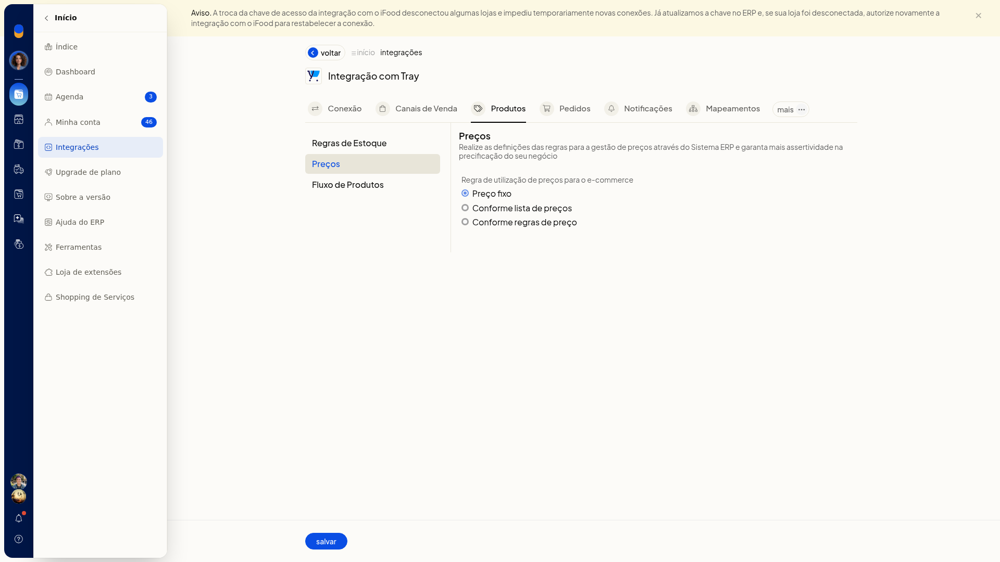

3. Em **Conforme lista de preços**, selecione **Lista de preços utilizada nos produtos**. Escolher uma lista não abre outros campos.

   

   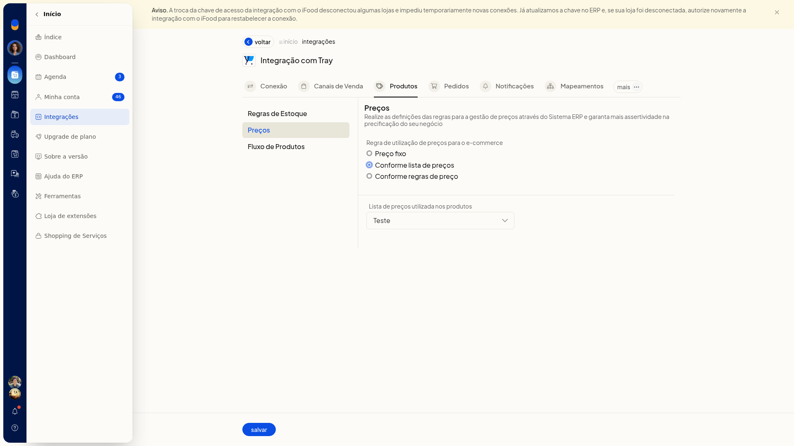

4. Em **Conforme regras de preço**, informe **Percentual de acréscimo ou desconto** com vírgula decimal e escolha **Base simples** ou **Base por dentro** em **Forma para aplicar os valores adicionais**. Use **Saiba mais** para comparar peso bruto e peso cubado.

   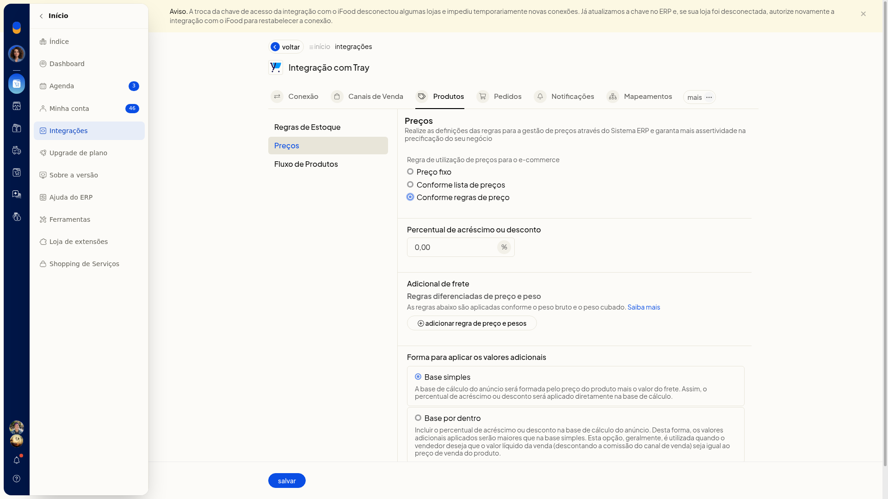

   

   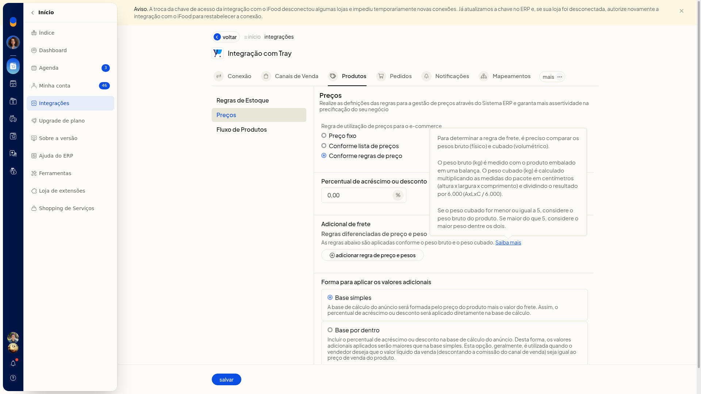

5. Clique em **Adicionar regra de preço e pesos**. No modal, escolha **Valor fixo** ou **Por faixa de peso**. Em **Valor fixo**, informe **Para anúncios com preço até** e **Valor adicional**, com vírgula decimal. Em **Por faixa de peso**, informe **De**, **Até** (em kg, com vírgula decimal) e **Valor do frete**. Você pode adicionar nova regra e marcar **Definir um limite de preço máximo**. Confirme no modal para gravar a regra. Fechar sem confirmar não grava.

   

   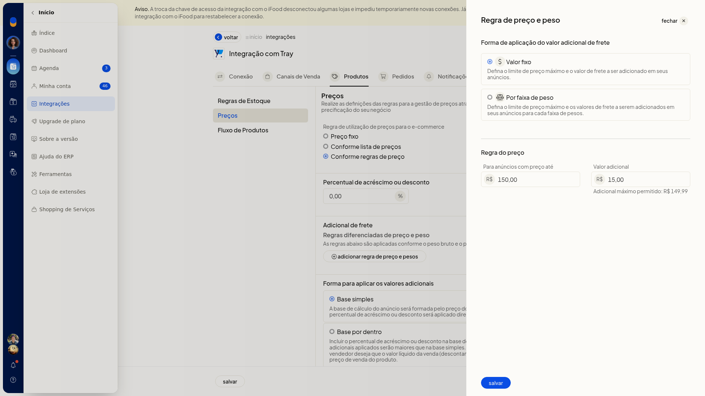

   

   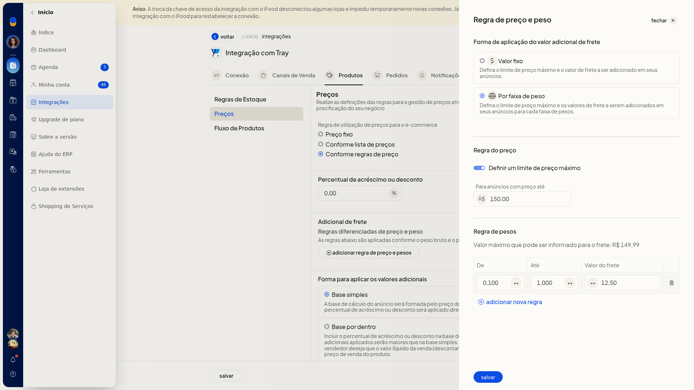

6. Clique em **Salvar**. A integração fica com a origem do preço da loja: preço fixo, uma lista de preços da conta ou regras com percentual, frete e forma de compor a base do anúncio.

### Fluxo de produtos

1. Acesse **Início > Integrações**, clique em **gerenciar** na integração conectada e abra **Produtos > Fluxo de Produtos**.
2. Em **Ao importar produtos**, escolha **Importar imagens como anexos** ou **Apenas importar a URL externa das imagens**.
3. Em **Enviar imagens dos produtos ao sincronizar**, escolha **Sim** ou **Apenas para novos produtos**.

   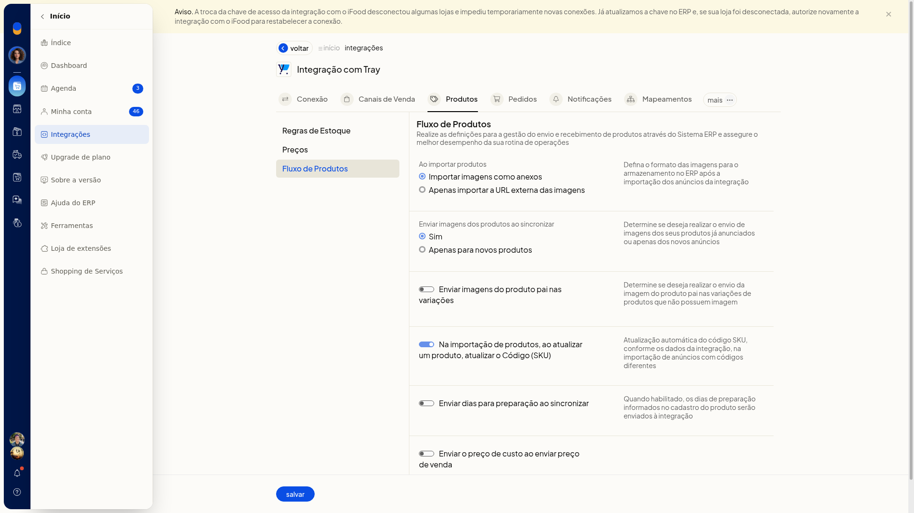

4. Marque, se quiser, **Enviar imagens do produto pai nas variações**, **Na importação de produtos, ao atualizar um produto, atualizar o Código (SKU)**, **Enviar dias para preparação ao sincronizar** e **Enviar o preço de custo ao enviar preço de venda**. Essas marcações não abrem campos extras.

   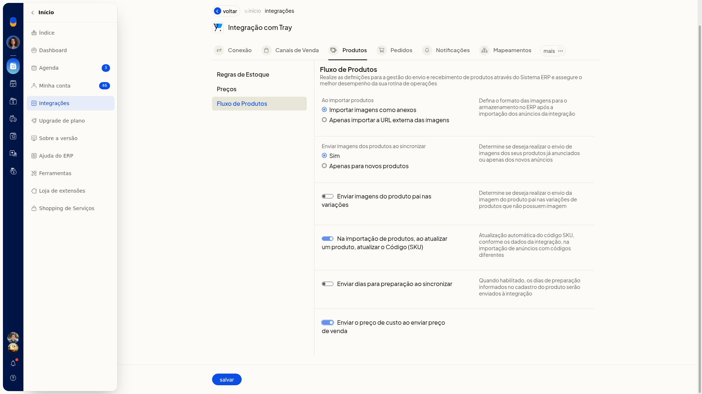

5. Clique em **Salvar**. A integração fica com as regras de imagens na importação e na sincronização e com as opções de Código (SKU), dias de preparação e preço de custo.

## Resultado
Depois de salvar, a sub-aba **Regras de Estoque** mantém a forma de refletir o estoque, os depósitos e as opções de lançamento, indisponibilidade e margem. **Preços** mantém a regra escolhida. **Fluxo de Produtos** mantém as opções de imagem, Código (SKU), dias de preparação e preço de custo.

## Informações adicionais
### Peso usado na regra de frete

Se o peso cubado for menor ou igual a 5, use o peso bruto. Se for maior que 5, use o maior entre bruto e cubado. O peso cubado é altura x largura x comprimento em centímetros, dividido por 6.000.

### Efeito da base nos valores adicionais

**Base simples** aplica o percentual sobre o preço do produto mais o frete. **Base por dentro** inclui o percentual na base, e os adicionais ficam maiores.

### Caminho que não configura produtos, estoque ou preços

**mais > Outros** abre **Configurações Adicionais** de situação de pedido e tipo de etiqueta. Esse caminho não configura produtos, estoque ou preços.
