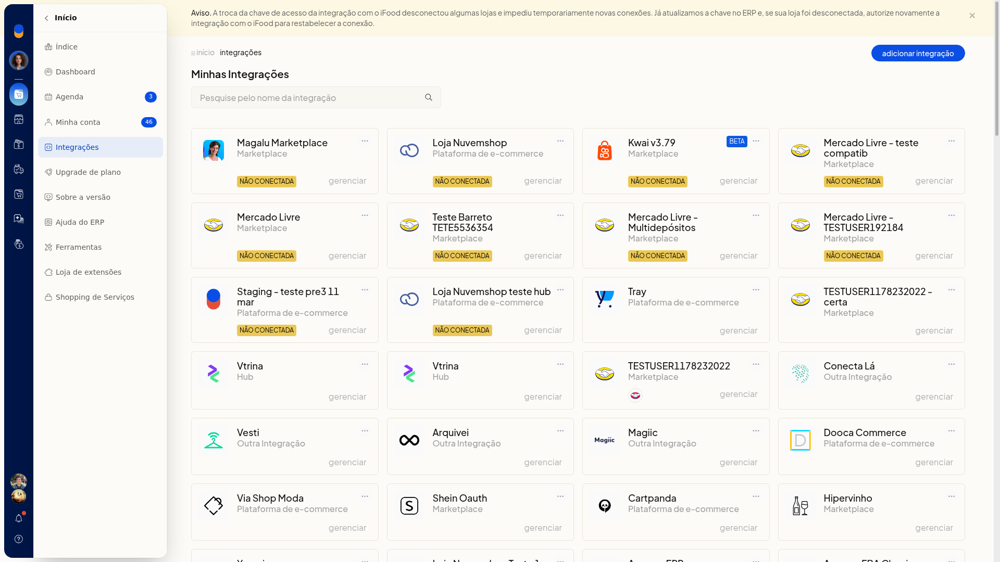
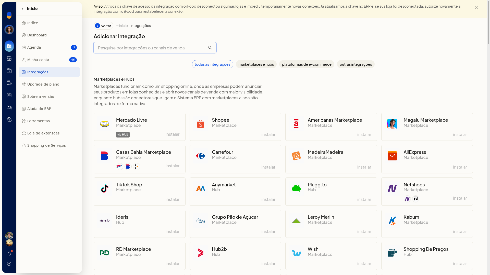
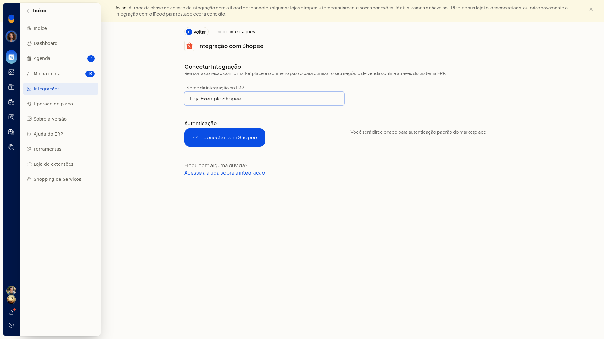
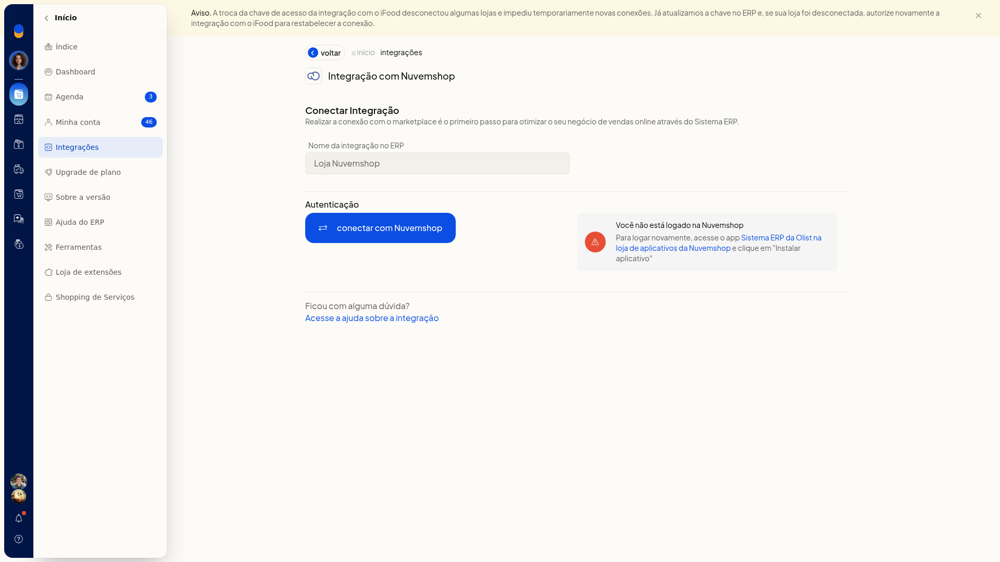

# Instalar e conectar uma integração

## Importante
- No menu de ações do card não há instalar nem conectar. Para instalar, use **Adicionar integração**. Para uma integração já listada e ainda não conectada, use **Gerenciar**.
- Na Nuvemshop, instale antes o aplicativo **Sistema ERP da Olist** na loja de aplicativos da Nuvemshop e clique em **Instalar aplicativo**.

## Instruções
### Instalar pelo catálogo

1. Acesse **Início > Integrações**.

   

2. Em **Minhas Integrações**, clique em **Adicionar integração**.

   

3. Na tela **Adicionar integração**, pesquise em **Pesquise por integrações ou canais de venda** ou escolha um filtro: **todas as integrações**, **marketplaces e hubs**, **plataformas de e-commerce** ou **outras integrações**. O catálogo agrupa os cards em **Marketplaces e Hubs**, **Plataformas de e-commerce** e **Outras integrações**.

   

4. Clique em **instalar** no card desejado. A tela **Conectar Integração** abre com o nome do canal.

   

5. Em **Nome da integração no ERP**, o nome do canal já vem preenchido. Ajuste se quiser. O campo não é obrigatório.

   

6. Clique em **conectar com** o canal, como **conectar com Shopee**, para seguir a autenticação padrão do marketplace. A conexão só segue depois dessa autorização no canal.

### Conectar uma integração já listada

1. Acesse **Início > Integrações**.
2. Em **Minhas Integrações**, localize o card com status **NÃO CONECTADA**.
3. Clique em **Gerenciar**.
4. Siga a orientação da tela. Na Nuvemshop, a tela informa que não há login e pede para instalar o aplicativo **Sistema ERP da Olist** na loja de aplicativos da Nuvemshop e clicar em **Instalar aplicativo**.

   

5. Confira **Nome da integração no ERP**. O campo já vem preenchido e não é obrigatório. Se precisar, use o link **Acesse a ajuda sobre a integração**.
6. Clique em **conectar com Nuvemshop** para iniciar a conexão com o canal. A autorização final acontece no próprio canal.

## Resultado
A tela **Conectar Integração** mostra o nome da integração no ERP e o botão para conectar com o canal, antes da autorização no canal.

## Informações adicionais
Em **Marketplaces e Hubs**, marketplaces anunciam produtos em lojas conhecidas. Hubs ligam o ERP a marketplaces ainda não integrados de forma nativa.

Alguns cards exibem **Marketplace**, **Hub**, **via HUB** ou **BETA**. A ação no catálogo continua sendo **instalar**.
