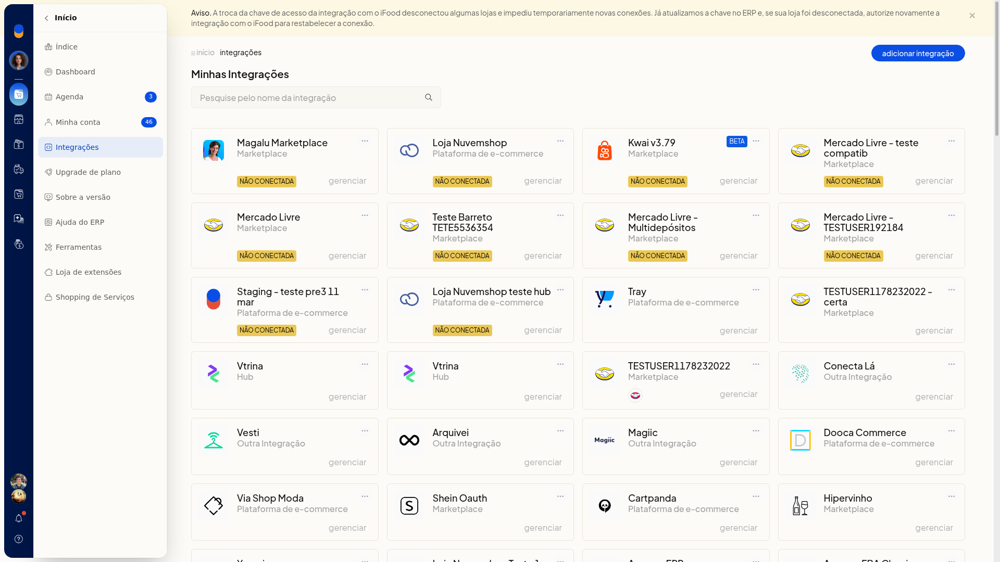
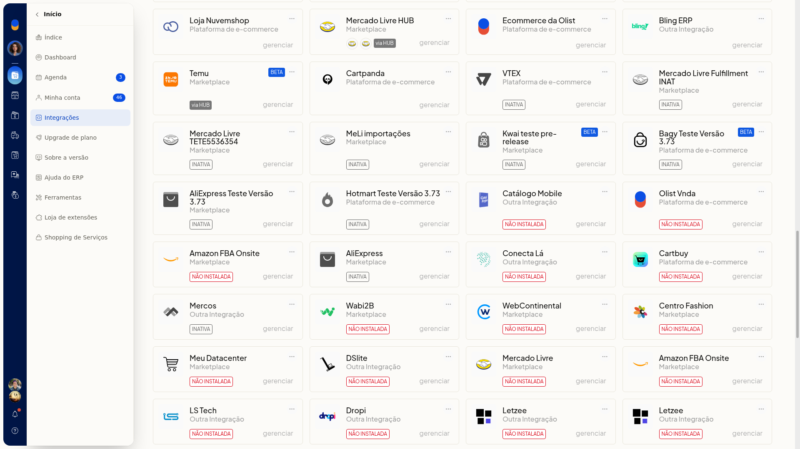
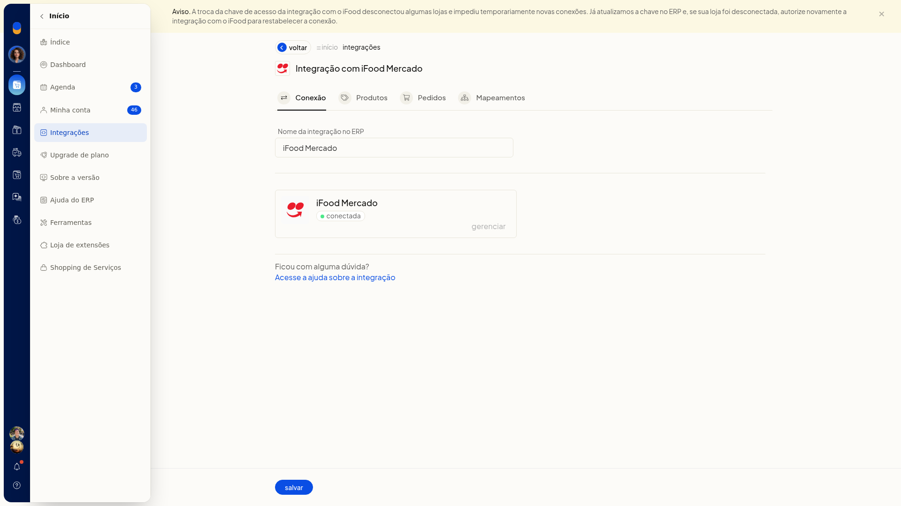
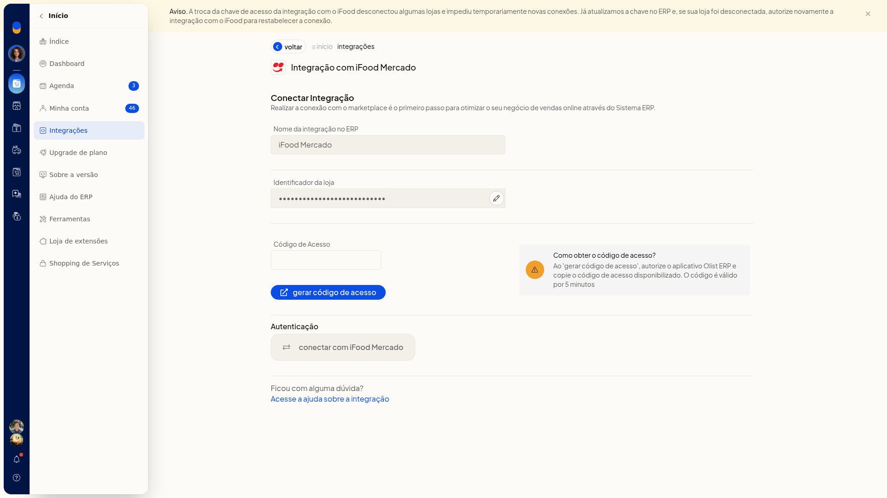
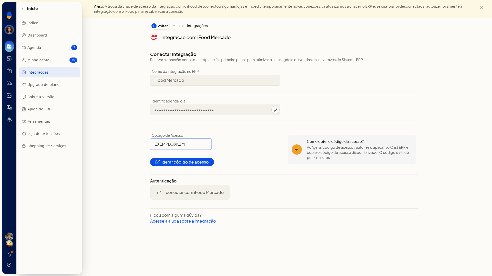
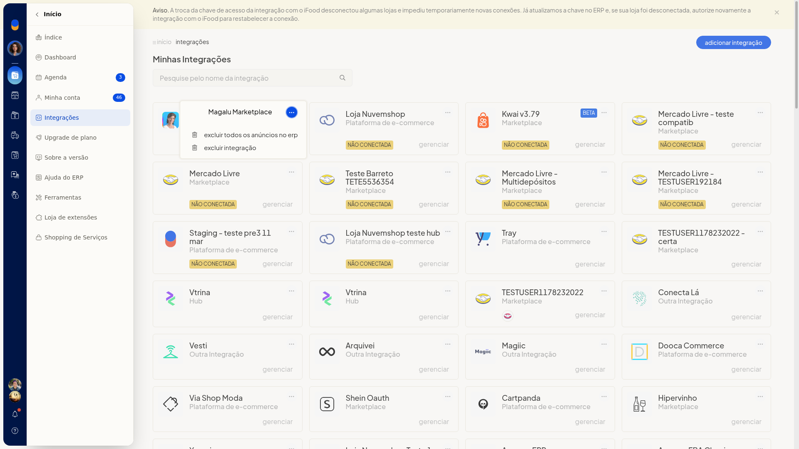
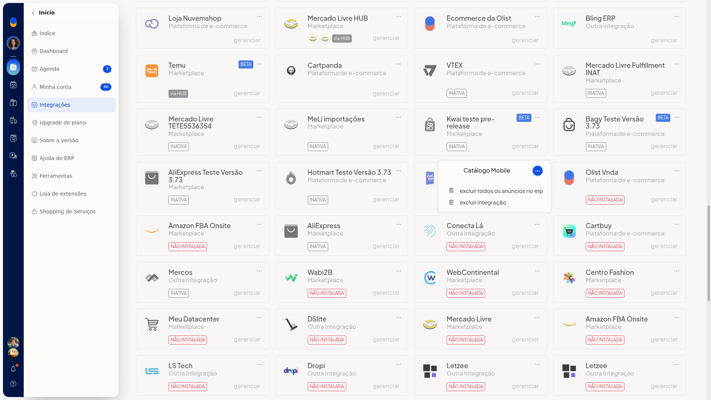

# Status da integração e reconexão

Em **Minhas Integrações**, o card de cada integração mostra o status. Com a integração já conectada, **Gerenciar** abre a aba **Conexão**, onde você confere o status **conectada** e pode reabrir **Conectar Integração** para reconectar.

No iFood Mercado, a reconexão usa um **Código de Acesso**. A área de integrações também avisa quando lojas foram desconectadas e precisam autorizar de novo.

## Importante
- No iFood Mercado, o código de acesso vale 5 minutos depois de gerar o código e autorizar o Olist ERP.
- A troca da chave de acesso do iFood desconectou algumas lojas. A chave já foi atualizada no ERP da Olist. A loja desconectada precisa autorizar novamente a integração com o iFood para restabelecer a conexão.
- A lista não tem um botão com o nome reconectar. A reconexão passa por **Gerenciar** no card e por **gerenciar** na aba **Conexão**.
- No menu de ações do card, as opções são **Excluir todos os anúncios no ERP** e **Excluir integração**. Não há ali instalar, conectar ou reconectar.

## Instruções
1. Acesse **Início > Integrações**.
2. Em **Minhas Integrações**, confira o status no card. Os rótulos exibidos são **NÃO CONECTADA**, **NÃO INSTALADA**, **INATIVA** e **conectada**.

   

   

3. No card da integração já conectada, clique em **Gerenciar**. No iFood Mercado, o card mostra o status **conectada**.
4. Na aba **Conexão**, confira o distintivo **conectada** e o campo **Nome da integração no ERP**. O campo não tem marcador de obrigatório. A aba também mostra o botão **Salvar**.

   

5. Clique em **gerenciar**.
6. Em **Conectar Integração**, confira **Nome da integração no ERP** e **Identificador da loja**, já preenchido. O campo **Código de Acesso** começa vazio e não tem marcador de obrigatório. A tela mostra **gerar código de acesso** e **conectar com iFood Mercado**. A ajuda informa que o código vale 5 minutos depois de gerar o código e autorizar o Olist ERP. Gere o código, autorize o ERP da Olist, digite o **Código de Acesso** nesse prazo e use **conectar com iFood Mercado**.

   

   

## Resultado
A aba **Conexão** de uma integração já conectada exibe o distintivo **conectada**. Ao reabrir a reconexão do iFood Mercado, o formulário mostra o **Identificador da loja** e o **Código de Acesso** antes da confirmação da conexão.

## Informações adicionais
### O status muda o que Gerenciar abre

- No card **NÃO CONECTADA**, **Gerenciar** abre **Conectar Integração**.
- No card **conectada**, **Gerenciar** abre a aba **Conexão** com o distintivo **conectada**.
- No card **NÃO INSTALADA** da Olist Vnda, **Gerenciar** abre a aba **Conexão** com as credenciais de acesso para cópia.

### O menu do card não reconecta

No menu de ações do card, inclusive com status **NÃO CONECTADA** ou **NÃO INSTALADA**, só aparecem **Excluir todos os anúncios no ERP** e **Excluir integração**.

### Voltar na reconexão do iFood

A partir da reconexão do iFood, o primeiro **Voltar** permanece na aba **Conexão**. O segundo **Voltar** retorna a **Minhas Integrações**.
