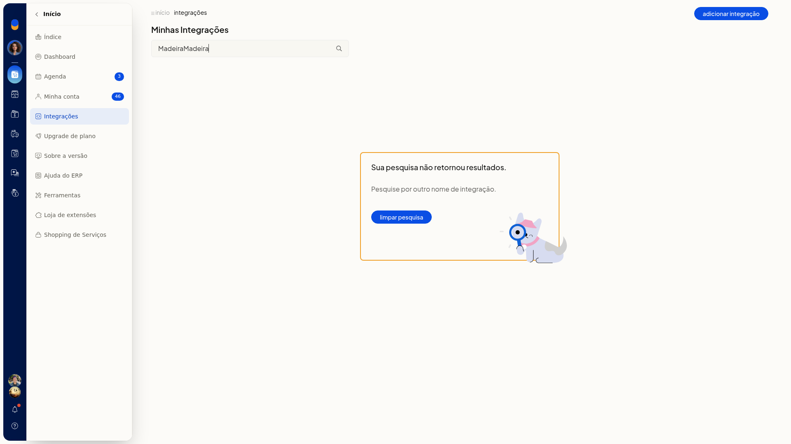
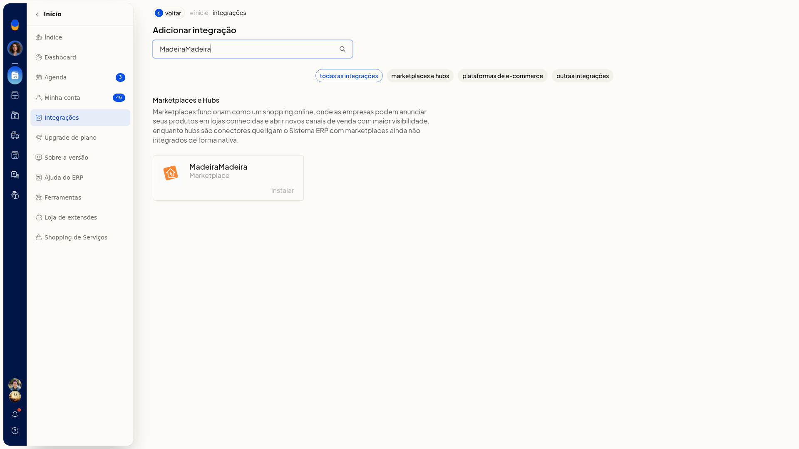
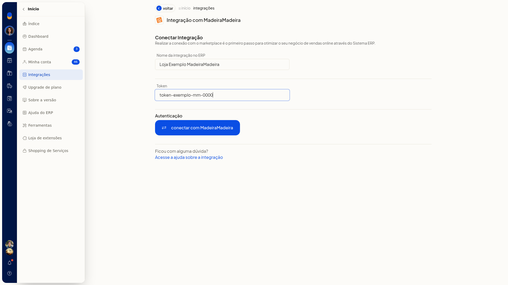

# Integração com a MadeiraMadeira

## Pré-requisitos
- Tenha em mãos o token que a tela de conexão solicita.
- Se a opção não aparecer para você, peça acesso ao administrador da conta.

## Importante
- **Nome da integração no ERP** não aceita valor vazio ou só com espaços. Nesse caso, a mensagem é **O nome da integração é obrigatório**.

## Instruções
1. Acesse **Início > Integrações**.
2. Clique em **Adicionar integração**.

   

3. Em **Marketplaces e Hubs**, localize o card **MadeiraMadeira** e clique em **instalar**. A busca do catálogo também filtra esse card.

   

4. Na tela **Conectar Integração**, na seção **Autenticação**, confira ou altere **Nome da integração no ERP**. O campo vem preenchido com MadeiraMadeira.

   

5. Informe o **Token**. O link **Acesse a ajuda sobre a integração** abre a ajuda da integração em uma nova aba.

   

6. Clique em **conectar com MadeiraMadeira**. A gravação da conexão ocorre nesse botão.

## Informações adicionais
### O que fazer depois de configurar

Depois de a integração estar configurada, informe à equipe da MadeiraMadeira as URLs apresentadas e cadastre as formas de envio na aba **Cotação de frete**, em **Mapeamentos**.

### Para onde voltar leva

**Voltar** na tela **Conectar Integração** retorna para **Minhas Integrações**.
