# Integração com o Magalu

A integração com o Magalu Marketplace conecta a loja do marketplace ao ERP da Olist. Você importa pedidos automaticamente, controla estoque e preços pelo ERP, envia e recebe produtos, efetua cotações de frete, transmite dados de NF-e e rastreio e sincroniza a situação Entregue.

A conexão fica em **Início > Integrações**, pelo **instalar** do canal, ou pela autorização do **ERP da Olist** no painel da Magalu. Depois de conectar, você define regras de imagens, SKU, estoque, depósito, fulfillment, etiquetas e comissão.

## Importante
- Só é possível vincular uma conta do Magalu a uma conta do ERP.
- No login da Magalu, use perfil de pessoa jurídica. Perfil de pessoa física não funciona.
- A integração só fica disponível para uso depois que você conclui todas as etapas do fluxo guiado de configuração.
- Para anunciar, o Magalu considera: nota no Reclame Aqui acima de Bom, boa reputação, produtos idôneos, sortimento diversificado e qualificado, pelo menos um ano de existência, ausência de processos que abalem a reputação, boa avaliação em sites e redes sociais, conta-corrente vinculada ao CNPJ do contrato, CNPJ ativo há mais de seis meses e razão social.
- O envio do anúncio exige descrição complementar preenchida. O botão **com problema (E)** indica o que impediu o envio.
- Somente o atributo certificado de homologação da Anatel é enviado. Ele precisa estar na ficha técnica do produto.
- Para enviar dimensões, a conta precisa da extensão embalagens e de uma embalagem definida no cadastro do produto.
- Para enviar rastreio, o pedido ou a nota precisa identificar o transportador como Correios ou Transportadora e ter agrupamento (PLP ou Coleta) na expedição.
- Para marcar entregue no ecommerce, o pedido já precisa estar despachado no ecommerce.

## Instruções
### Pela tela do ERP

1. Acesse **Início > Integrações**.

   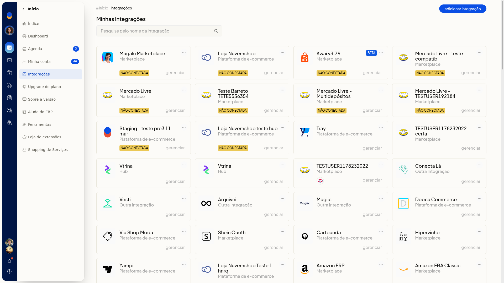

   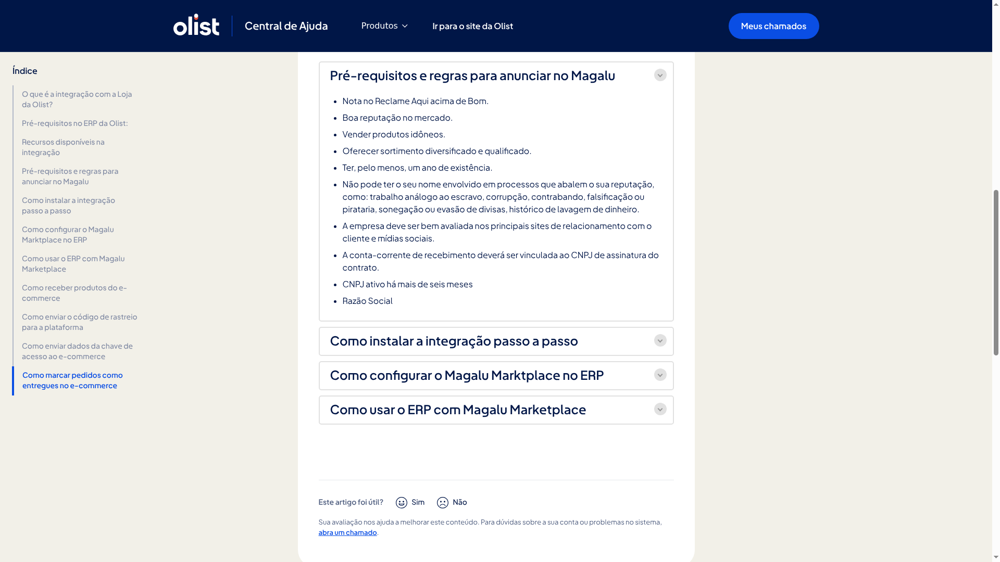

2. Se o card **Magalu Marketplace** estiver com a situação **NÃO CONECTADA**, clique em **gerenciar**. A tela de conexão abre de novo, sem abas de gerenciamento. No menu de contexto do card estão **Excluir todos os anúncios no ERP** e **Excluir integração**.

   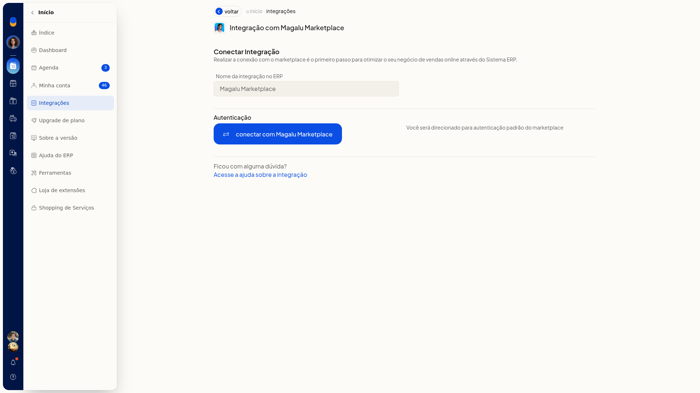

   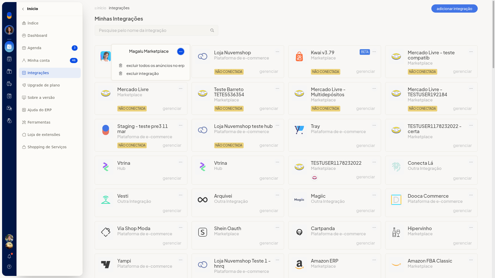

3. Clique em **Adicionar integração**.
4. Em **Marketplaces e Hubs**, localize **Magalu Marketplace** e clique em **instalar**. A busca por Magalu retorna somente esse canal.

   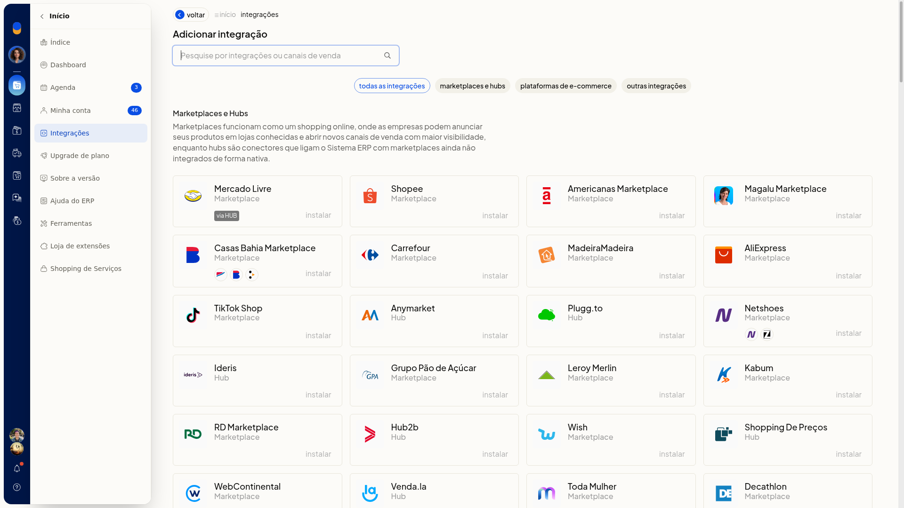

   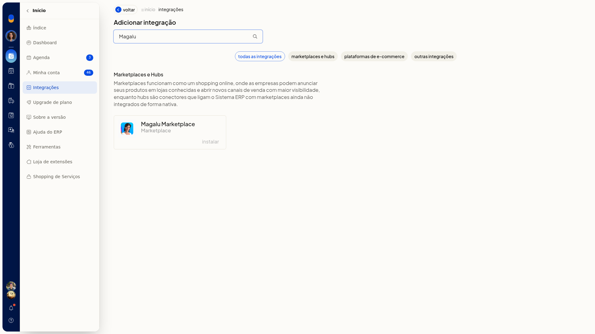

5. Em **Conectar Integração**, confira **Nome da integração no ERP**. O campo não é obrigatório, vem preenchido com Magalu Marketplace e você pode alterar o nome.

   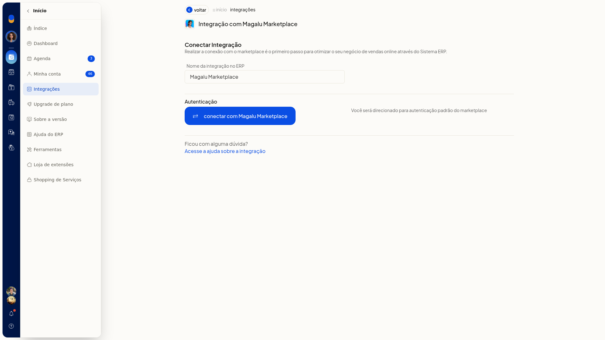

   

6. Clique em **conectar com Magalu Marketplace**. Você é direcionado para a autenticação padrão do marketplace. Conclua o login com perfil de pessoa jurídica. Até a autenticação terminar, a tela permanece em **Conectar Integração** e o card continua **NÃO CONECTADA**.

### Pelo painel da Magalu

1. No painel da Magalu, acesse **menu > gestão de integradoras**.

   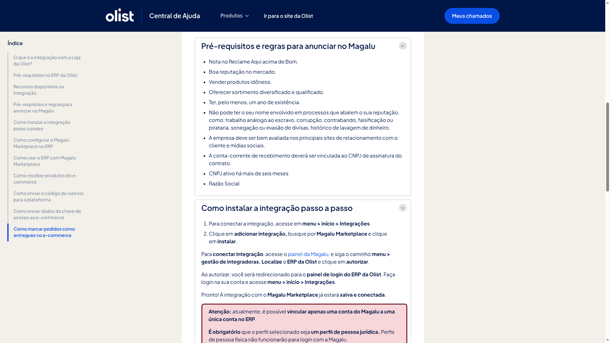

2. Localize **ERP da Olist** e clique em **autorizar**.
3. Conclua o login do ERP. Em **Início > Integrações**, a integração já aparece salva e conectada, sem passar pelo **instalar** do catálogo.

### Na configuração do conector

1. Depois da conexão, siga o fluxo guiado de configuração. Para pausar, clique em **Continuar depois**, no rodapé, e retome depois.

   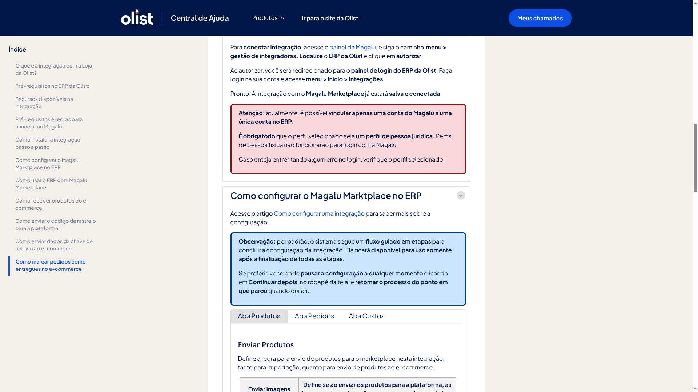

2. Na **Aba Produtos**, defina os campos abaixo. Nenhum é obrigatório.

   - **Enviar imagens dos produtos ao sincronizar**
   - **Ao importar produtos**
   - **Na importação de produtos, ao atualizar um produto, atualizar o Código (SKU)**
   - **Importar anúncios com uma variação como anúncios simples**
   - **Atualizar estoque na loja virtual a partir do ERP**
   - **Depósito a ser considerado na integração**: só aparece com a extensão depósitos de estoque instalada
   - **Utilizar Magalu Fulfillment**
   - **Utilizar estoque de segurança**: informe a quantidade de itens. Ao atingir esse número, o saldo enviado à plataforma é zero. Estoque de segurança não é considerado para produtos sob encomenda.

   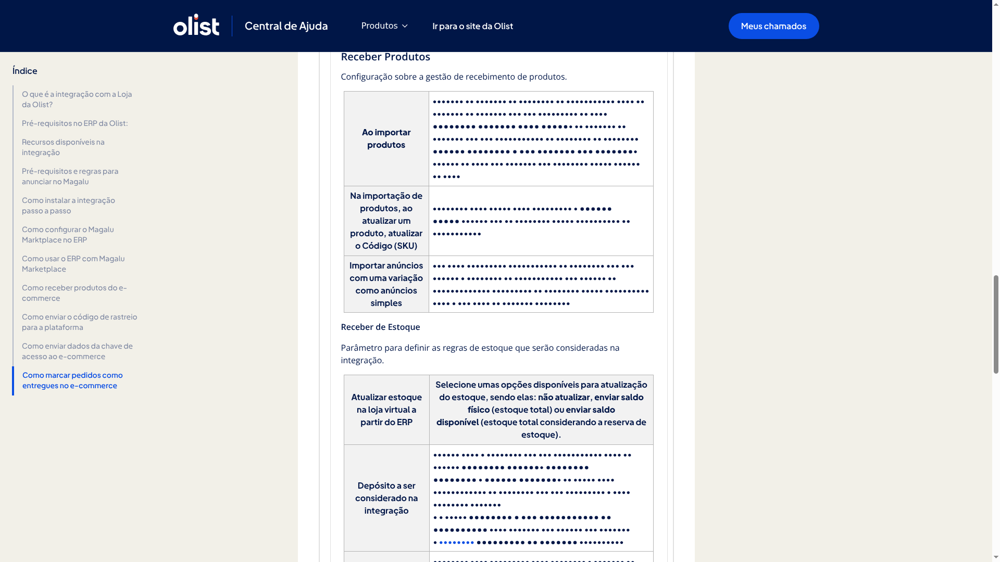

   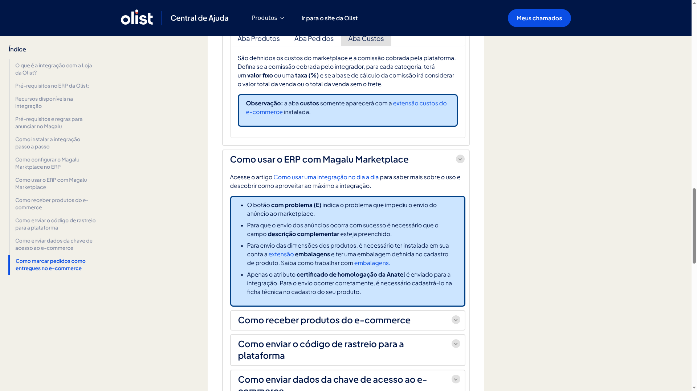

3. Na **Aba Pedidos**, defina os campos abaixo. Nenhum é obrigatório.

   - **Sincronização automática dos pedidos**: cobre as situações New, Approved, Finished e Cancelled
   - **Enviar rastreamento ao alterar a situação no ERP para enviado**
   - **Método de impressão de etiquetas**

   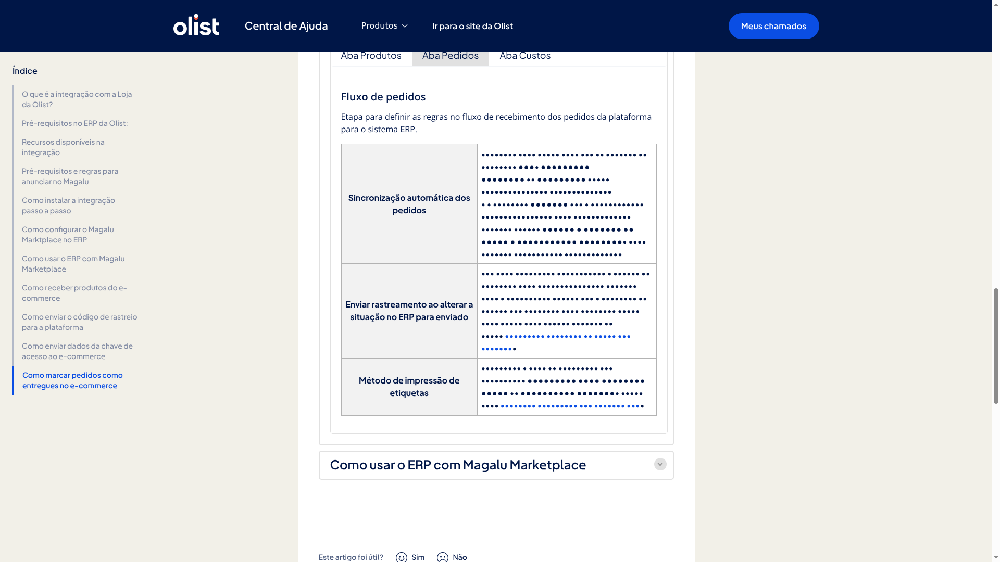

4. Conclua todas as etapas do fluxo guiado. As regras de produtos, pedidos e custos ficam definidas, e a integração passa a ficar disponível para uso. Com a extensão custos do e-commerce instalada, a **Aba Custos** aparece. Nela, defina **Comissão por categoria** (valor fixo ou taxa (%)) e **Base de cálculo da comissão** (valor total da venda ou total sem o frete). Os dois campos não são obrigatórios.

   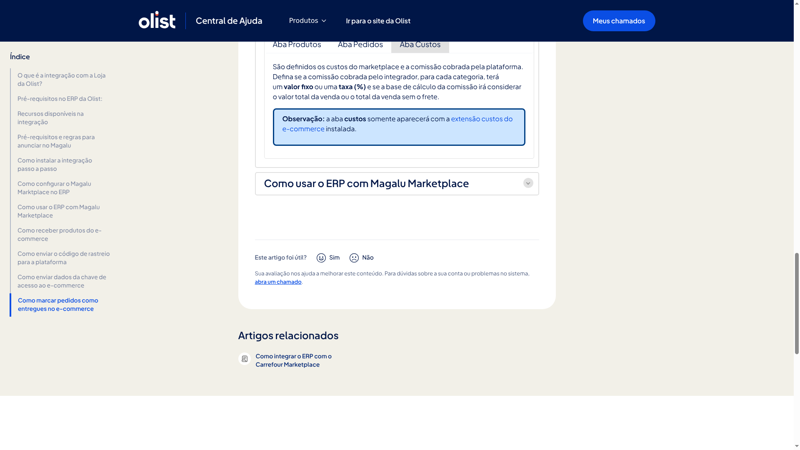

### Para receber produtos do ecommerce

1. Acesse **menu > cadastros > produtos > receber do e-commerce**.
2. Selecione a loja no campo **integração** e clique em **continuar importação de anúncios**. Para um anúncio individual, preencha **identificador do anúncio**.

   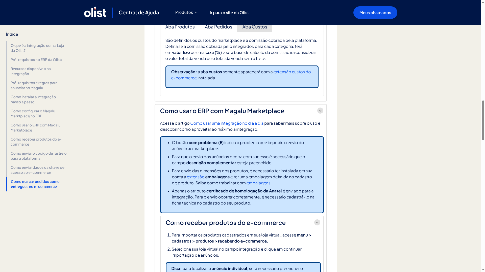

3. Relacione os anúncios aos produtos do ERP por mesmo código (SKU), mesma descrição (título) ou mesmo GTIN (EAN).
4. Escolha sim ou não para atualizar produtos já relacionados. Se sim, escolha atualizar todos os dados ou apenas dados não preenchidos, atualizar preço, estoque ou imagens e clique em **relacionar**.
5. Marque **criar produtos novos com base nos anúncios**. Na criação, selecione o depósito, marque importar as imagens do anúncio para os novos produtos e, se quiser, informe unidade, NCM e origem padrão.
6. Clique em **criar produtos**. Os anúncios da loja Magalu são relacionados ou criados como produtos no ERP. A opção **criar exceções na lista de preços vinculada ao e-commerce** cria ou atualiza produtos com preços diferentes.

   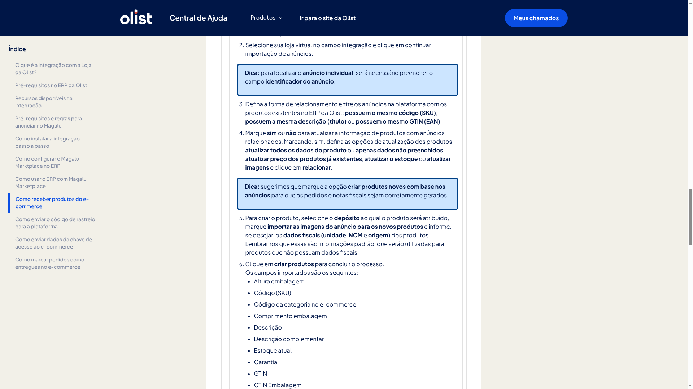

### Para enviar o código de rastreio

1. Identifique o transportador, Correios ou Transportadora, no pedido de venda ou na nota fiscal e gere o agrupamento (PLP ou Coleta) na expedição.
2. Acesse **início > vendas > expedição**. A expedição passa a exibir um marcador quando o código de rastreio já foi enviado à plataforma.

   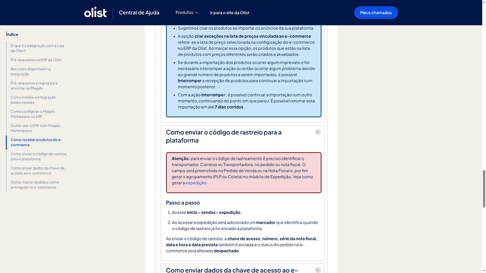

3. Envie o rastreio pela expedição. Também seguem chave de acesso, número, série, data e hora e data prevista, e o status no ecommerce muda para despachado.

### Para enviar a chave de acesso

1. Acesse **Início > Vendas > Expedição**.
2. Adicione o filtro **Agrupamentos**, selecione a visualização **visão por pedidos** e, no filtro por forma de envio, selecione **Transportadora**.
3. Localize o número de expedição, abra o menu de contexto (**...**) e selecione **Enviar chave de acesso para o e-commerce**. O XML também é enviado para otimizar a validação da nota, e o status no ecommerce muda para despachado.

   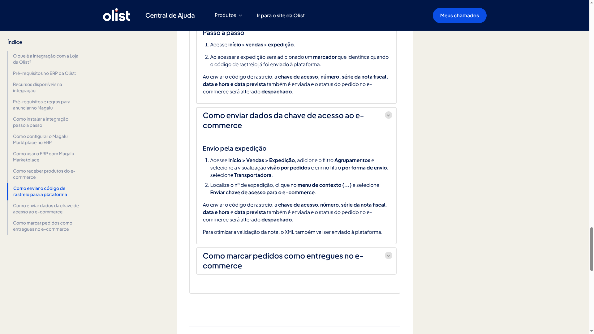

### Para marcar pedidos como entregues

1. Acesse **menu > vendas > expedição**.
2. Selecione a forma de envio e, na aba **concluídas**, abra o menu de contexto (**...**) e escolha **marcar pedidos como entregue**. O pedido precisa já estar despachado no ecommerce. O pedido marcado como entregue no ERP é sincronizado com o status entregue na plataforma.

   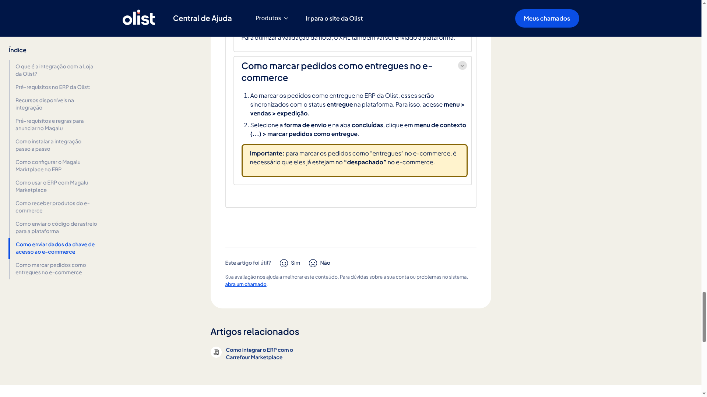

## Resultado
Depois de autorizar o **ERP da Olist** no painel da Magalu, em **Início > Integrações** a integração fica salva e conectada. O envio do rastreio ou da chave de acesso altera o status do pedido no ecommerce para despachado. Marcar entregue sincroniza o status entregue.

## Informações adicionais
- A integração está disponível para todos os planos.
- A situação Shipped não é sincronizada automaticamente. Para pedidos já selecionados, acesse **vendas > pedidos de venda** e use **sincronizar situação**.
- Se a importação de produtos for interrompida, a ação **Interromper** permite retomar do ponto em que parou em até 7 dias corridos.
