# Integração com a Shopee

A integração com a Shopee liga a loja do canal ao ERP da Olist. Com ela, você recebe pedidos, envia produtos, imagens, estoque e preços, sincroniza situações, define regras de frete, etiquetas e pagamento, trata a NF-e, autentica o chat e configura o Fulfillment.

A configuração fica em **Início > Integrações**, no card **Shopee**, em **gerenciar**, nas abas **Conexão**, **Produtos**, **Pedidos**, **Mapeamentos** e **Fulfillment**. O impulsionamento fica em **Cadastros > Anúncios** e dá destaque a até 5 anúncios por 4 horas contínuas.

## Pré-requisitos
- Conta na Shopee para autorizar a conexão e o chat.
- Integração já conectada para configurar as abas, receber pedidos e impulsionar anúncios.
- Anúncios já publicados na Shopee para impulsionar.
- Fulfillment exclusivo de contas Full.
- Se a opção não aparecer para você, peça acesso ao administrador da conta.

## Importante
- No impulsionamento, selecione até 5 anúncios ao mesmo tempo. O destaque dura 4 horas contínuas e não é possível adicionar novos anúncios durante o ciclo em andamento.
- Inclua todos os itens antes de ativar, para otimizar a cota. A renovação ocorre depois das 4 horas.
- Com a reserva de estoque habilitada, o lançamento automático ao salvar não é recomendado.
- O depósito de Fulfillment é exigido para salvar quando a importação é automática ou manual.
- Coleta Correios, Pegaki-Correios e Correios-Transacional não recebem os dados da NF. Correios recebe.
- Autorize o chat antes de usar as conversas. A **Autenticação Chat** pode estar desconectada mesmo com o canal conectado.
- **Conforme lista de preços** só fica disponível se a conta tiver lista de preços. Recursos de preço promocional só ficam disponíveis se a conta tiver preço promocional.

## Instruções
### Instalar a integração

1. Acesse **Início > Integrações**.
2. Em **adicionar integração**, escolha o canal **Shopee** e clique em **instalar**.
3. Na aba **Conexão**, informe o **Nome da integração**. O campo não é obrigatório na integração já salva.

   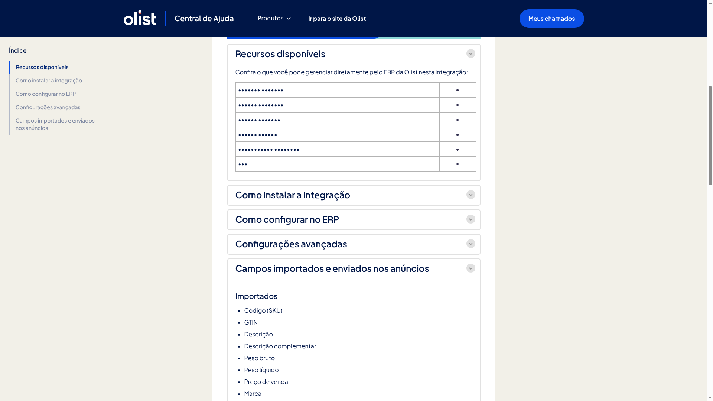

4. Clique em **conectar com Shopee** para autorizar a loja na conta da Shopee. A tela de conexão fica pronta para essa autorização.

### Configurar produtos, estoque e preços

1. Acesse **Início > Integrações**, abra **gerenciar** no card **Shopee** e vá à aba **Produtos**.
2. Em atualização de estoque, escolha **Não atualizar**, **Enviar saldo físico** ou **Enviar saldo disponível**. O campo não é obrigatório.

   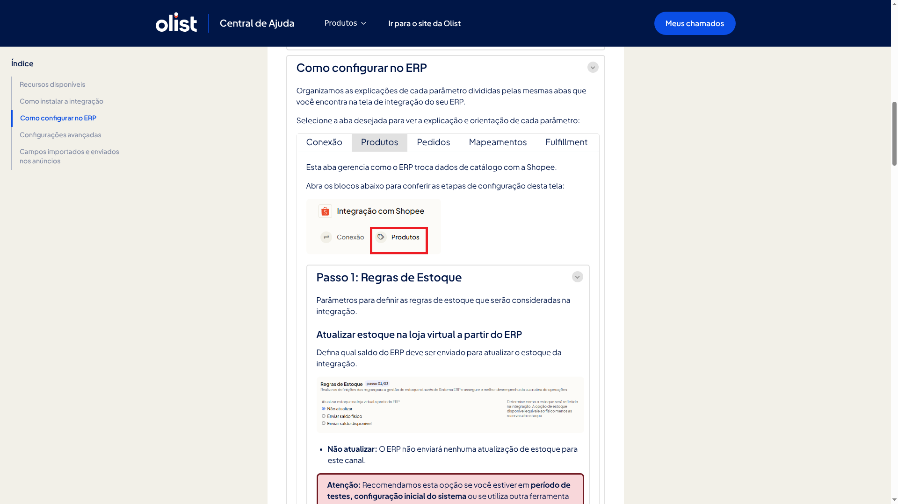

3. Em **Lançamento de estoque para saídas**, escolha **Usar configuração padrão**, **Manual**, **Automático ao autorizar a nota fiscal**, **Automático ao salvar a nota fiscal**, **Automático ao salvar o pedido** ou **Automático ao marcar pedido como enviado**.
4. Marque **Utilizar estoque de segurança** se quiser usar a reserva. Se a reserva estiver habilitada, não use o lançamento automático ao salvar.
5. Em preço enviado ao canal, escolha **Preço fixo**, **Conforme lista de preços** ou **Conforme regras de preço**.

   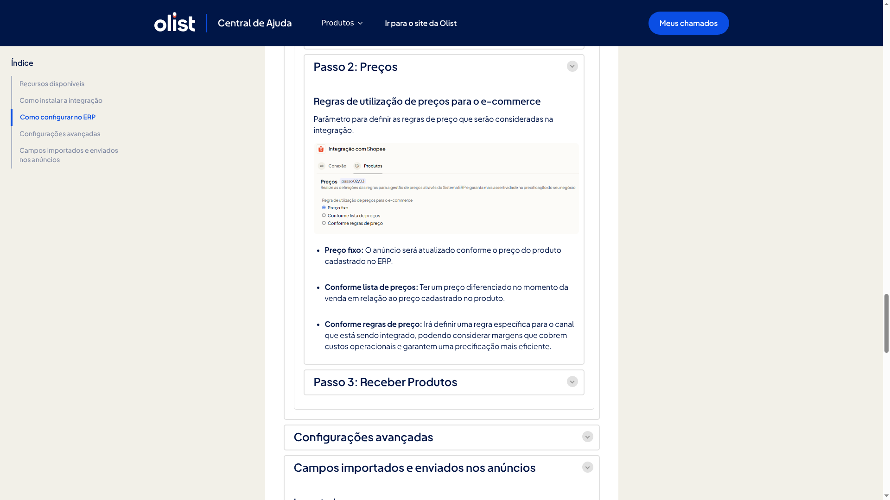

6. Em **Enviar imagens dos produtos ao sincronizar**, escolha **Sim** ou **Apenas para novos produtos**.
7. Em **Receber imagens dos anúncios**, escolha **Importar imagens como anexos** ou **Apenas URL externa**.
8. Marque **Importar anúncios com uma variação como anúncios simples** se o anúncio de uma variação deve entrar como anúncio simples. Nenhum desses campos de envio e recebimento é obrigatório.
9. Revise catálogo, estoque e preço e salve a integração.

   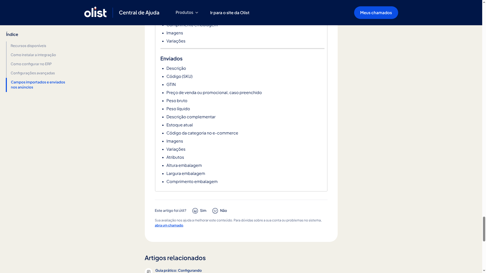

### Configurar pedidos e dados fiscais

1. Na mesma integração, abra a aba **Pedidos**.
2. Marque o que deve ocorrer na importação. Nenhum item é obrigatório:
 - **Importar valor do frete**
 - **Formatar nome dos contatos**
 - **Sincronização automática**
 - **Interpretador de endereços**
 - **Importar moedas como desconto**
 - **Importar taxa de cartão como outras despesas**
 - **Organizar envio ao enviar NFe**
 - **Enviar rastreamento ao marcar enviado**
 - **Marcar entregue ao alterar situação**
3. Em **Completar endereço a partir do CEP**, escolha **Não**, **Apenas se bairro não informado** ou **Sempre**.
4. Em **Método de impressão de etiquetas**, escolha **Padrão do Canal**, **Formato PDF** ou **Impressora Térmica**.
5. Em **Intermediador**, use a opção da conta. Na tela, a opção é **Sem intermediador**.
6. Em **Valor de pagamento na NF**, escolha **Utilizar valor de pagamento integrado** ou **Considerar pagamento como não integrado**.

   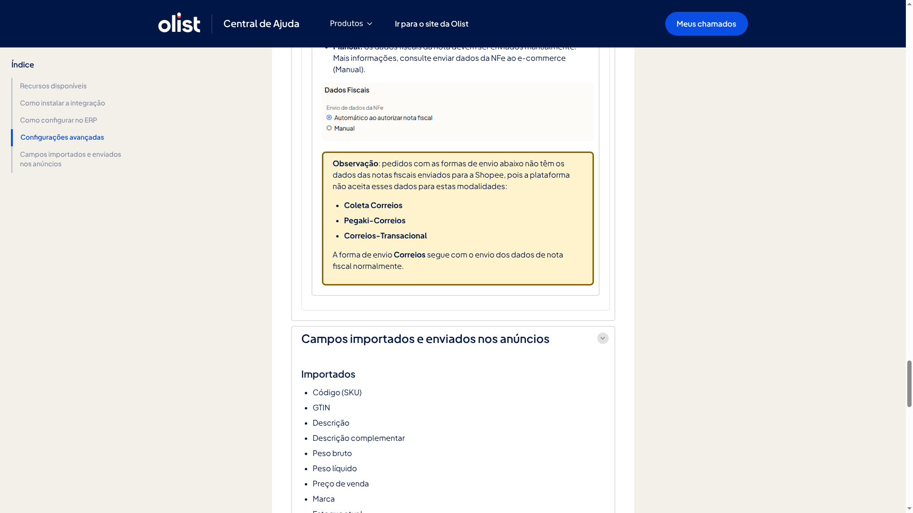

7. Em **Envio da NFe**, escolha **Automático ao autorizar** ou **Manual**.
8. Preencha **Bairro alternativo** se precisar de um bairro substituto. O campo não é obrigatório.
9. Em **Natureza de operação para venda**, selecione a natureza da conta.
10. Ligue o controle de ICMS para exibir **Natureza para contribuintes ICMS** e selecione a natureza da conta.
11. Revise pedidos, etiquetas, pagamento e NF-e e salve a integração.

   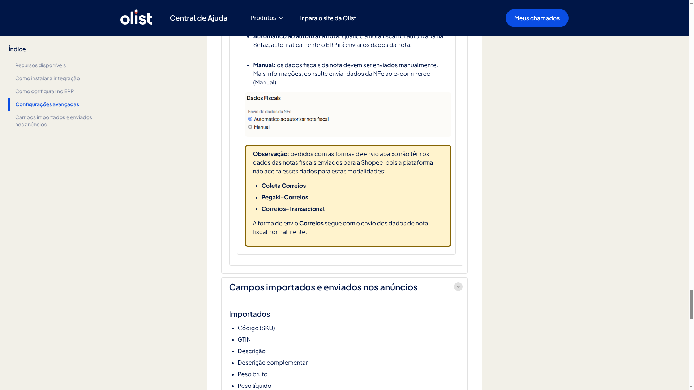

### Mapear situações, recebimentos, frete e categorias

1. Abra a aba **Mapeamentos** da integração Shopee.
2. Em situações, confira o de-para do canal para o ERP.
3. Use **adicionar situações padrão** ou **adicionar mapeamento** para incluir linhas.
4. Marque **Permite retroceder** somente se a situação puder voltar. O campo não é obrigatório.
5. Ligue formas de recebimento para exibir **Forma padrão de recebimento** e **Categoria da forma de recebimento**. O valor inicial da forma padrão é **Não definida**. A categoria começa em **Selecione**.
6. Em formas de frete, inclua a linha do frete da conta.
7. Em categorias, abra a árvore do canal e atribua a categoria. Salve a integração depois de atribuir.

### Configurar Fulfillment

1. Abra a aba **Fulfillment** em **gerenciar** da integração Shopee.
2. Marque **Importar pedidos do Fulfillment** para trazer esses pedidos. As formas de importação são **Automaticamente**, **Manualmente** e **Não importar**.

   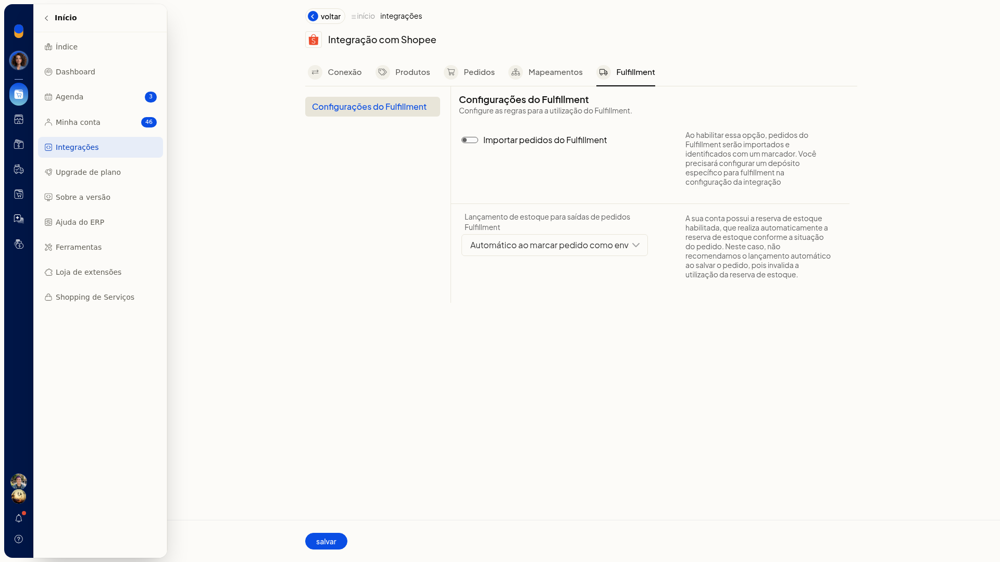

3. Em **Lançamento de saídas do Fulfillment**, escolha **Usar configuração padrão da conta**, **Manual**, **Automático ao autorizar a nota fiscal**, **Automático ao salvar a nota fiscal**, **Automático ao salvar o pedido** ou **Automático ao marcar pedido como enviado**.

   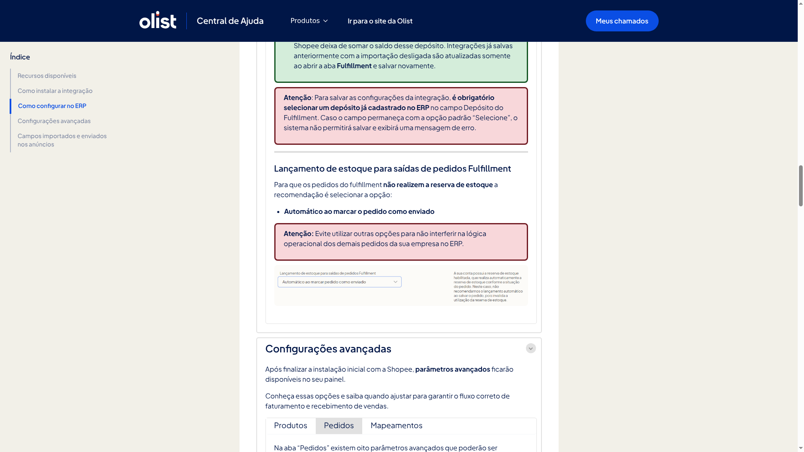

4. Quando a importação não está desligada, o depósito do Fulfillment é criado. Preencha o **CNPJ destinatário do depósito de Fulfillment**. Esse campo é obrigatório. O **CNPJ remetente do depósito de Fulfillment** é opcional. O tipo mostrado é **Exclusivo canal de venda**.

   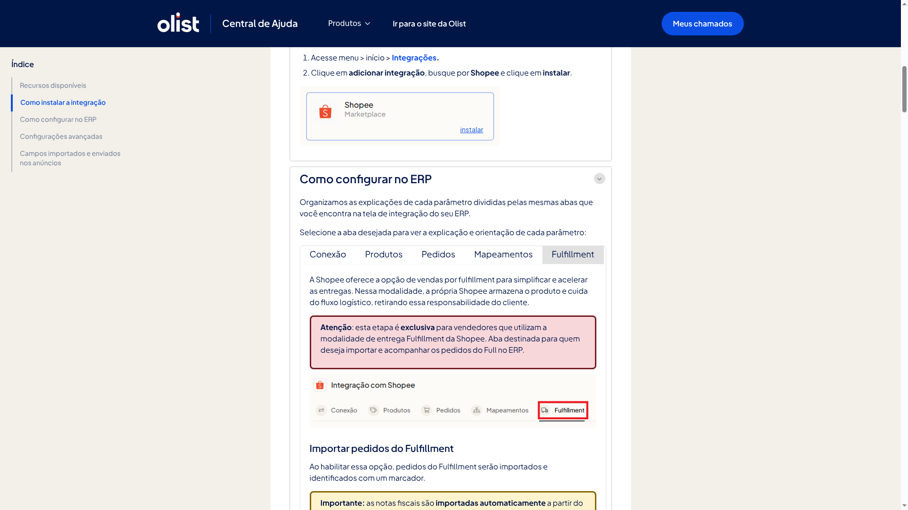

   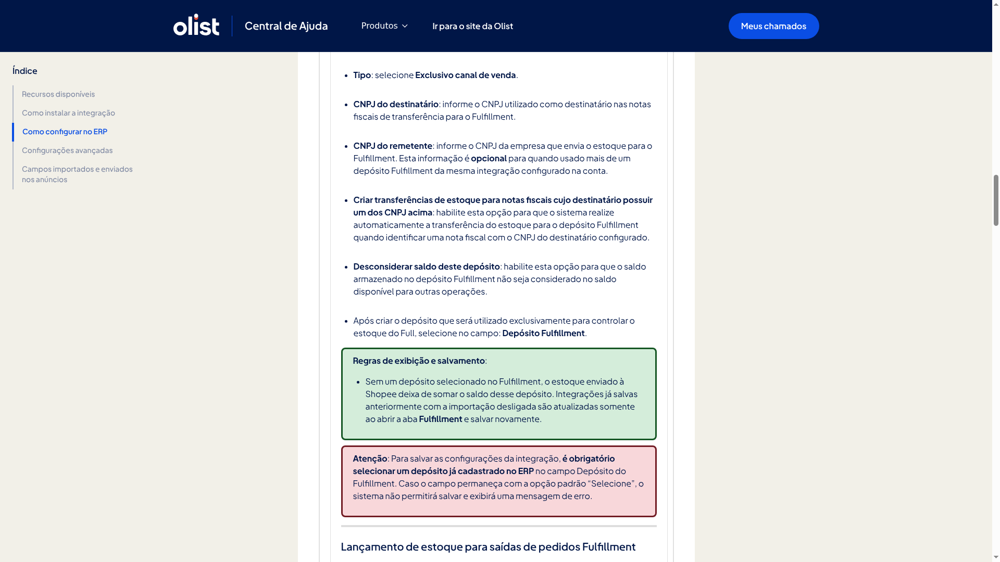

5. Revise a importação e o estoque do Fulfillment e salve a integração.

### Autenticar o chat

1. Acesse **Início > Integrações** e abra **gerenciar** no card **Shopee**.
2. Em **Autenticação Chat**, confira se o estado está desconectada.
3. Clique em **gerenciar** para abrir a autorização da conta na Shopee. Não há formulário de senha no ERP. Conclua a autorização na Shopee. O chat permanece desconectado até essa autorização.

   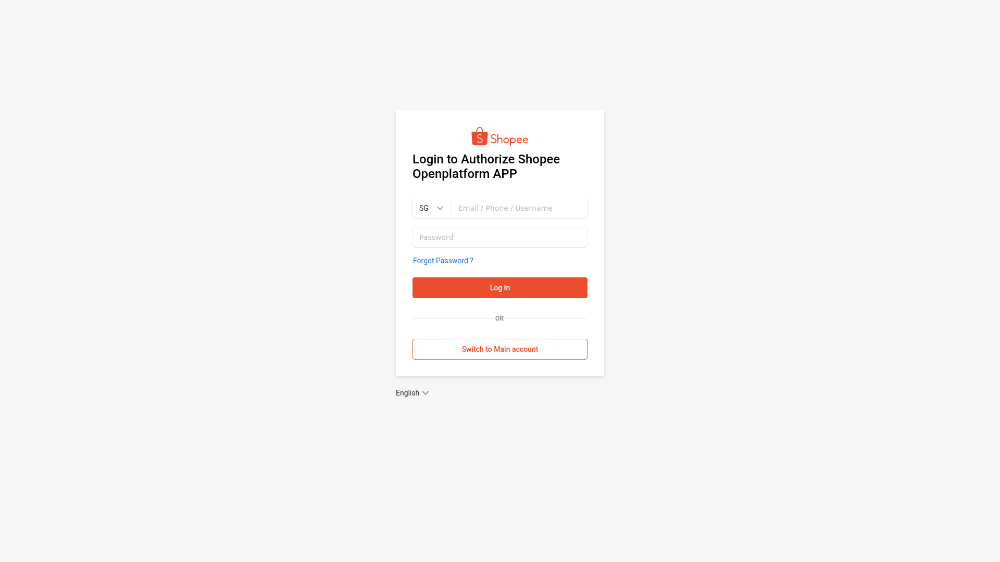

4. Depois do login, acesse a aba **Chat** e depois **Vendas > Perguntas do e-commerce**. A caixa reúne conversas de produto e de pedido, aceita anexos e tem filtros de não lido e lido. Pode ser necessário usar a extensão dessa tela.

   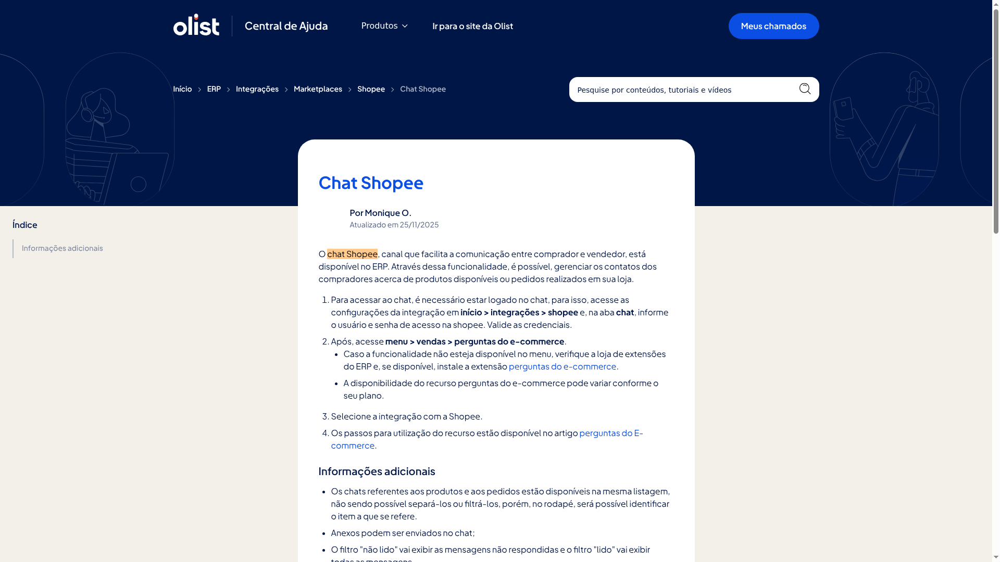

### Impulsionar pelo menu de contexto

1. Acesse **Cadastros > Anúncios**.
2. No card **Shopee**, clique em **gerenciar**.
3. Na linha do anúncio, abra o menu de contexto.
4. Clique em **Impulsionar na Shopee** para enviar o impulsionamento desse anúncio.

   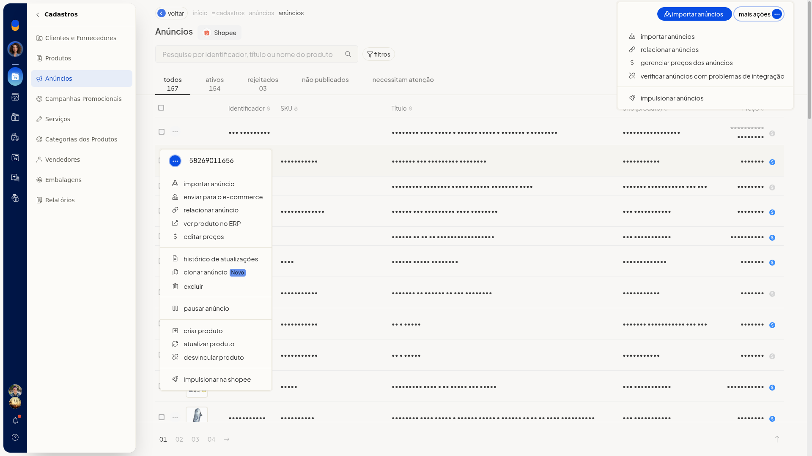

### Impulsionar por Mais ações

1. Acesse **Cadastros > Anúncios** e clique em **gerenciar** no card **Shopee**.

   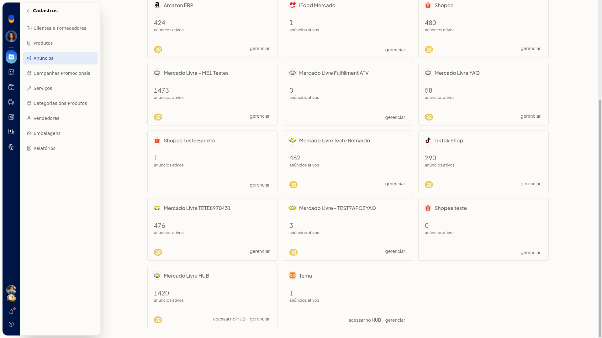

   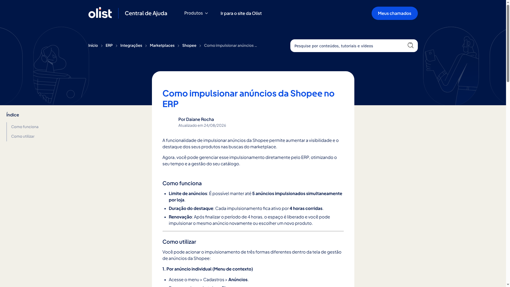

2. Na lista, clique em **Mais ações**.

   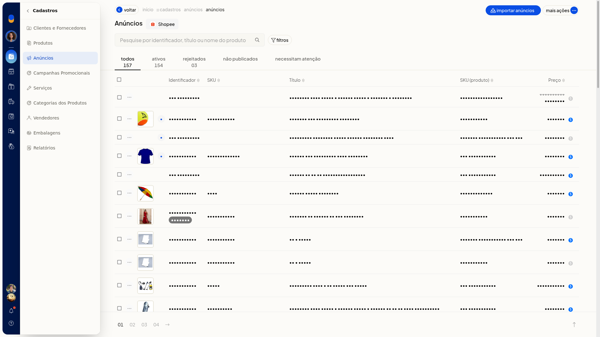

3. Escolha **Impulsionar anúncios**. Abre o painel **Impulsionar anúncios na Shopee**, com busca, as regras de cota e os botões **impulsionar**, **cancelar** e **fechar**.

   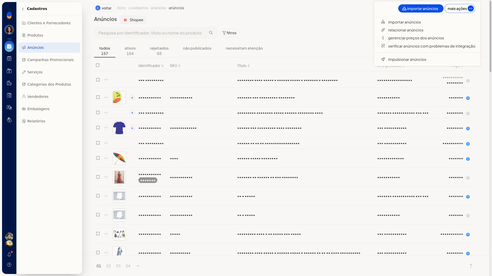

   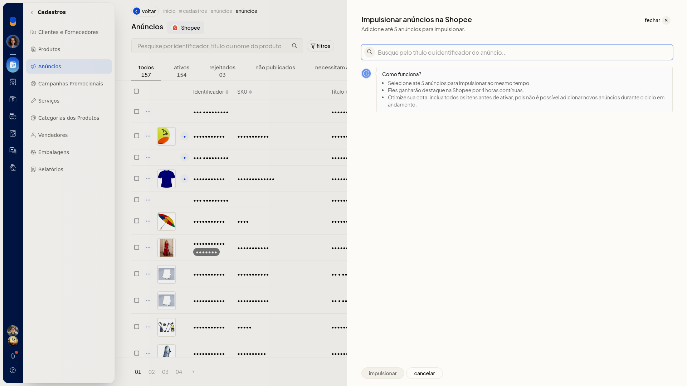

4. Busque em **Busque pelo título ou identificador do anúncio**, se precisar, e marque os anúncios no painel. O limite é 5. O contador inferior mostra a quantidade marcada.
5. Clique em **impulsionar** para enviar o destaque de 4 horas contínuas. Use **cancelar** ou **fechar** se não quiser enviar.

   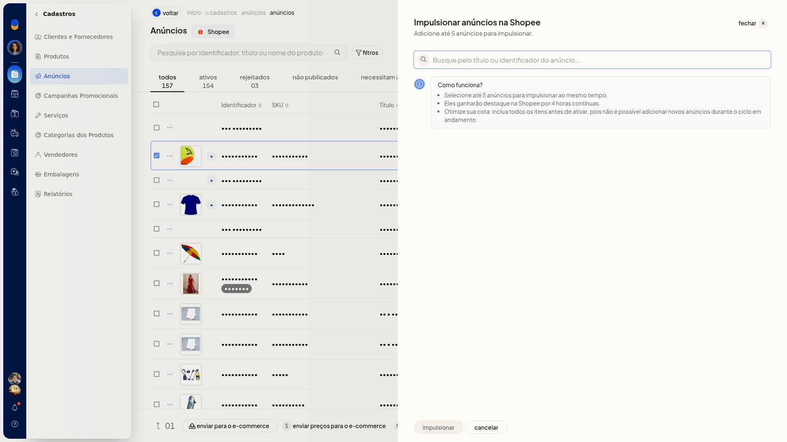

### Impulsionar em lote pela lista

1. Na lista de anúncios da Shopee, marque até 5 anúncios.
2. Abra **Mais ações > Impulsionar anúncios**.
3. Confira a seleção no painel.
4. Clique em **impulsionar** para enviar o mesmo destaque de até 5 anúncios por 4 horas contínuas.

## Informações adicionais
### Situações mapeadas do canal

- **UNPAID** Não pago vai para **Em aberto**.
- **PENDING** Pagamento pendente vai para **Em aberto**.
- **READY_TO_SHIP** Pronto para envio vai para **Pronto para envio**.
- **PROCESSED** Processado vai para **Aprovado**.
- **COMPLETED** Finalizado vai para **Entregue**.
- **IN_CANCEL** Em cancelamento vai para **Cancelado**.
- **CANCELLED** Cancelado vai para **Cancelado**.
- **INVOICE_PENDING** Nota fiscal pendente vai para **Aprovado**.
- **SHIPPED** Enviado vai para **Enviado**.

As situações do ERP na lista são **Em aberto**, **Faturado**, **Cancelado**, **Aprovado**, **Preparando envio**, **Enviado**, **Entregue**, **Pronto para envio**, **Dados incompletos**, **Não entregue** e **Em devolução**.

### Outras ações na lista de anúncios

Em **Mais ações**, a lista da Shopee também exibe importar anúncios, relacionar anúncios, gerenciar preços dos anúncios, verificar anúncios com problemas de integração, enviar para o ecommerce e enviar preços para o ecommerce.
