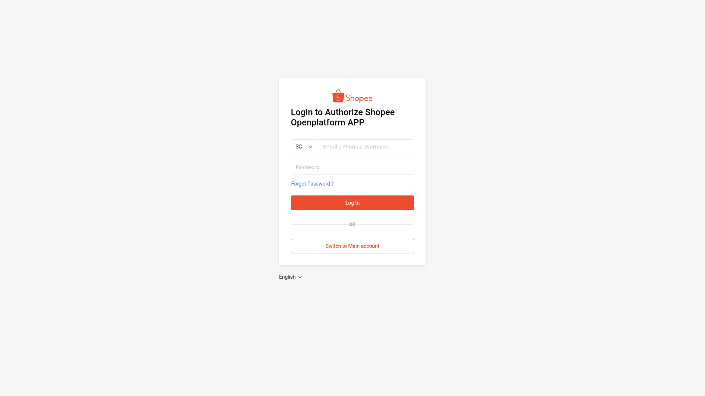
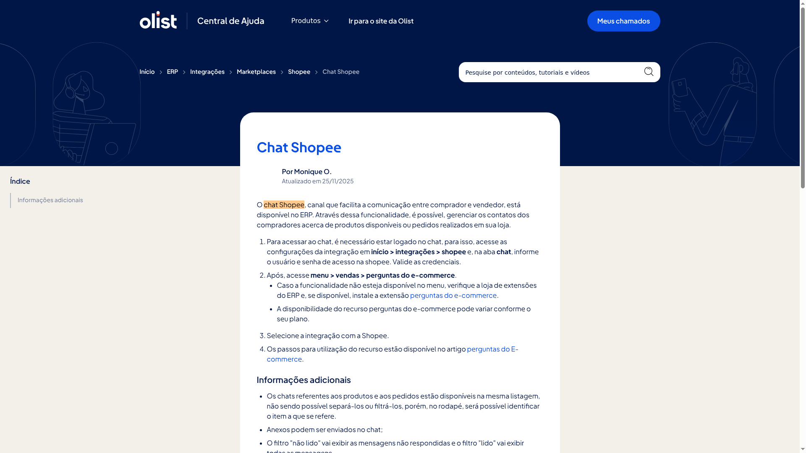

# Shopee: chat

A autenticação do chat da Shopee no ERP da Olist liga a conta do canal às conversas. Com o chat autorizado, você usa uma lista única de conversas de produto e de pedido, com anexos e filtros de não lido e lido.

A autorização fica na integração já instalada, em **Autenticação Chat**.

## Pré-requisitos
- Conta na Shopee para autorizar o chat.
- Integração Shopee já conectada.

## Importante
- Autorize o chat antes de usar as conversas. Enquanto a **Autenticação Chat** estiver desconectada, as conversas não ficam disponíveis.
- **Gerenciar** abre a autorização na Shopee. Não há formulário de senha no ERP.
- O uso das conversas pode exigir uma extensão.

## Instruções
### Pela integração

1. Acesse **Início > Integrações**.
2. No card **Shopee**, clique em **gerenciar**.
3. Em **Autenticação Chat**, clique em **gerenciar**.
4. Autorize a conta na tela da Shopee. O chat permanece desconectado até essa autorização.

   

### Pela aba Chat

1. Faça login na aba **Chat**.
2. Acesse **Vendas > Perguntas do e-commerce**. A lista reúne conversas de produto e de pedido, com anexos e filtros de **não lido** e **lido**.

   
