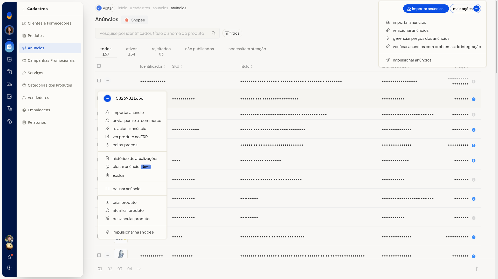
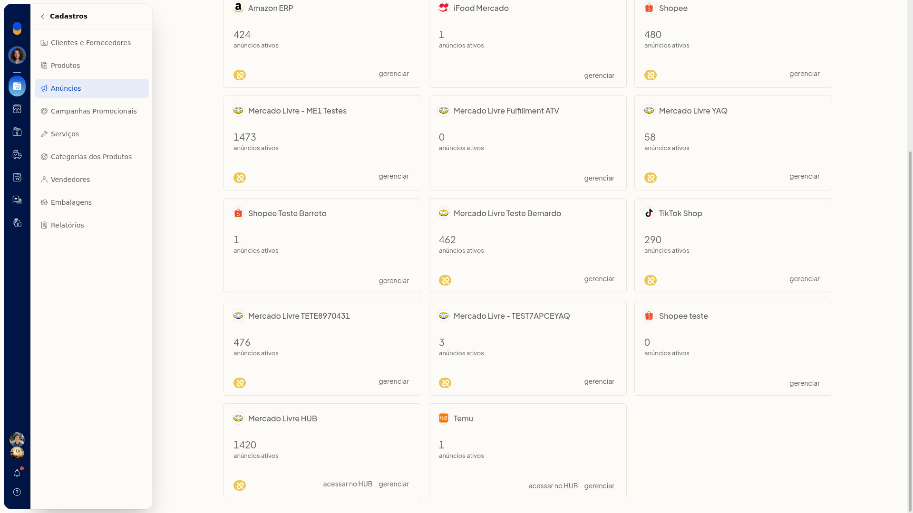
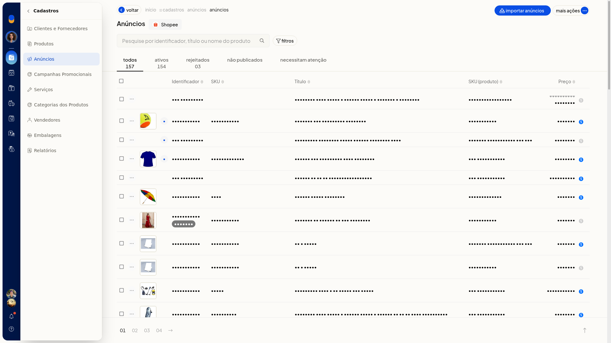
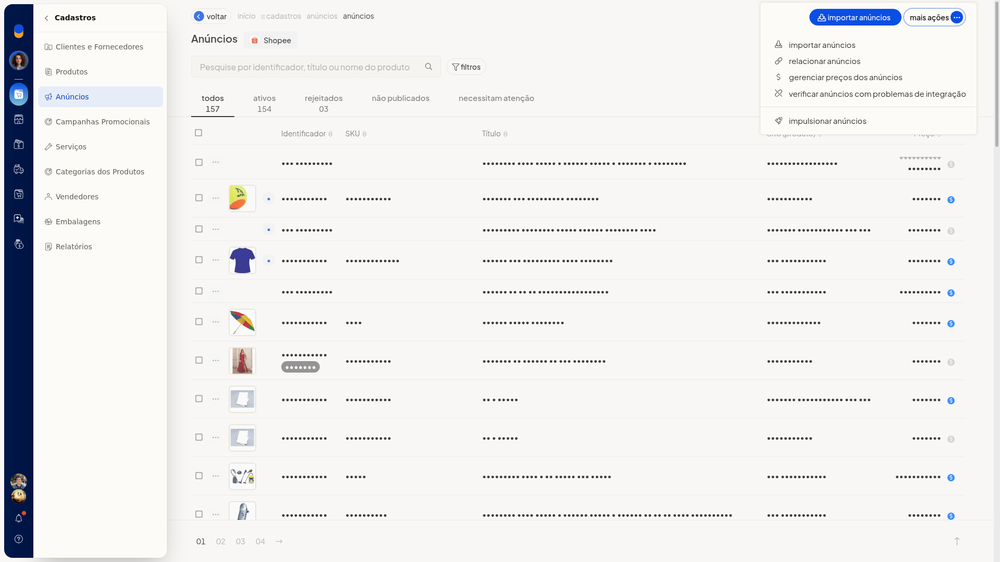
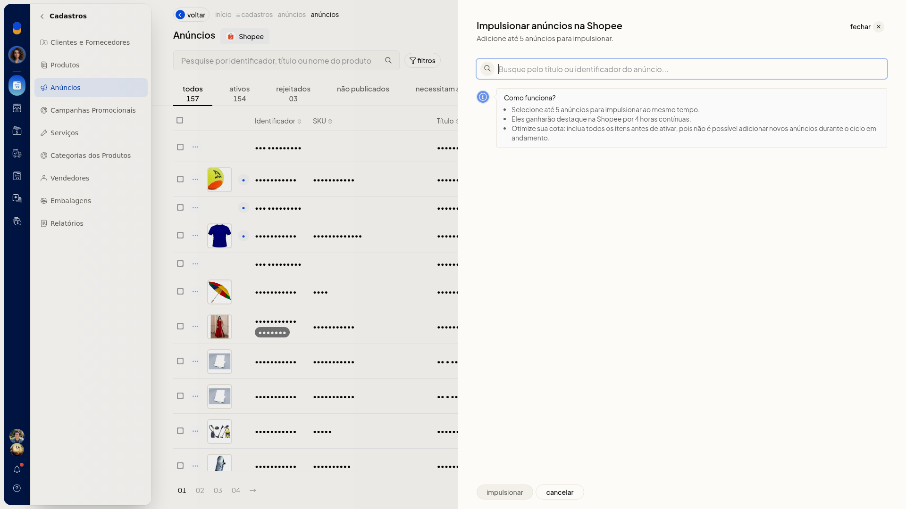
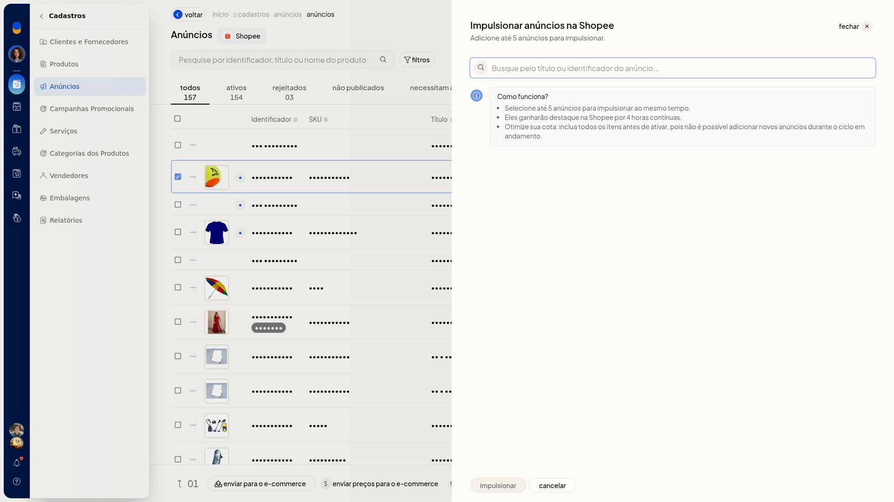

# Shopee: impulsionar anúncios

## Pré-requisitos
- Integração com a Shopee já conectada.
- Anúncios já publicados na Shopee.

## Importante
- Selecione até 5 anúncios ao mesmo tempo.
- O destaque dura 4 horas contínuas.
- Não é possível incluir novos anúncios enquanto um ciclo estiver em andamento.
- Inclua todos os anúncios desejados antes de ativar, para otimizar a cota.
- O limite é de 5 anúncios por loja.

## Instruções
### Pelo menu de contexto

1. Acesse **Cadastros > Anúncios**.
2. No card **Shopee**, clique em **gerenciar**.
3. Na linha do anúncio, abra o menu de contexto.
4. Clique em **Impulsionar na Shopee**. O destaque desse anúncio é enviado direto.

   

### Por Mais ações

1. Acesse **Cadastros > Anúncios**.
2. No card **Shopee**, clique em **gerenciar**.

   

3. Na lista de anúncios, clique em **Mais ações**.

   

4. Clique em **Impulsionar anúncios**.

   

   

5. Para localizar um anúncio, digite o título ou o identificador em **Busque pelo título ou identificador do anúncio**.
6. Marque os anúncios no painel **Impulsionar anúncios na Shopee**.
7. Clique em **impulsionar**. Os anúncios marcados recebem destaque por 4 horas contínuas.

   

### Em lote pela lista

1. Acesse **Cadastros > Anúncios**.
2. No card **Shopee**, clique em **gerenciar**.
3. Na lista, marque até 5 anúncios.
4. Clique em **Mais ações** e depois em **Impulsionar anúncios**.
5. Confira a seleção no painel **Impulsionar anúncios na Shopee**.
6. Clique em **impulsionar**. Os anúncios marcados recebem destaque por 4 horas contínuas.

## Informações adicionais
### A cota se renova depois das 4 horas

Depois das 4 horas, a cota de até 5 anúncios por loja pode ser usada de novo.
