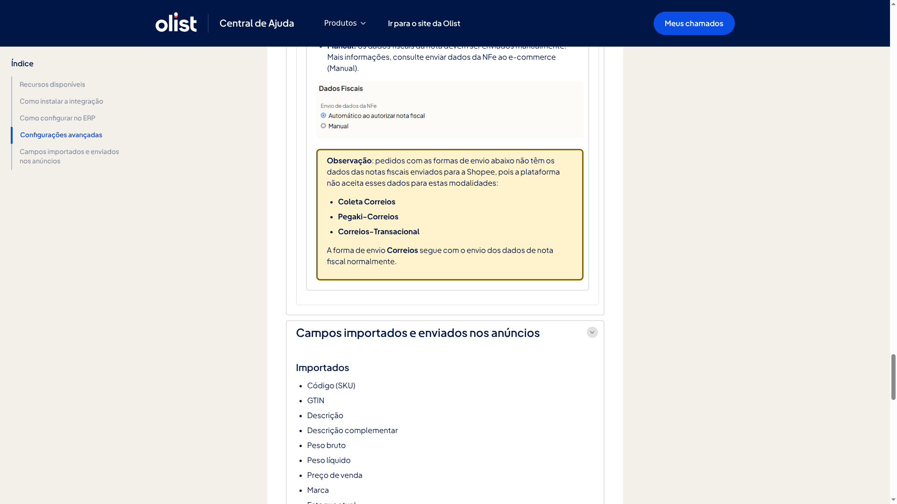
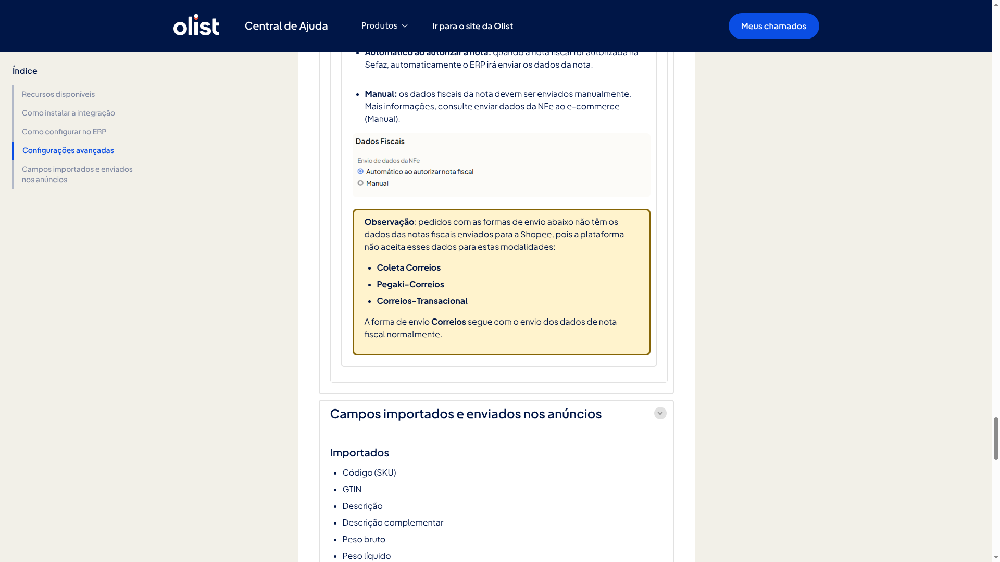

# Shopee: pedidos e dados fiscais

Na aba **Pedidos** da integração Shopee, o ERP da Olist define como os pedidos do canal entram no ERP e como frete, endereço, etiquetas, pagamento e NF-e são tratados.

Você marca o que ocorre na importação, escolhe a impressão das etiquetas e define se a nota segue de forma automática ou manual para a Shopee.

## Pré-requisitos
- A integração com a Shopee já precisa estar conectada.

## Importante
- Coleta Correios, Pegaki-Correios e Correios-Transacional não recebem os dados da NF. Correios recebe.

## Instruções
1. Acesse **Início > Integrações**.
2. No card **Shopee**, clique em **gerenciar**.
3. Abra a aba **Pedidos**.
4. No fluxo, marque o que deve ocorrer na importação. Nenhum item é obrigatório: **Importar valor do frete**, **Formatar nome dos contatos**, **Sincronização automática**, **Interpretador de endereços**, **Importar moedas como desconto**, **Importar taxa de cartão como outras despesas**, **Organizar envio ao enviar NFe**, **Enviar rastreamento ao marcar enviado** e **Marcar entregue ao alterar situação**.
5. Em **Completar endereço a partir do CEP**, escolha **Não**, **Apenas se bairro não informado** ou **Sempre**. O campo não é obrigatório.
6. Em **Método de impressão de etiquetas**, escolha **Padrão do Canal**, **Formato PDF** ou **Impressora Térmica**. O campo não é obrigatório.
7. Em **Intermediador**, selecione **Sem intermediador** quando não houver intermediador. O campo não é obrigatório.
8. Em **Valor de pagamento na NF**, escolha **Utilizar valor de pagamento integrado** ou **Considerar pagamento como não integrado**. O campo não é obrigatório.

   

9. Em dados fiscais, no campo **Envio da NFe**, escolha **Automático ao autorizar** ou **Manual**. O campo não é obrigatório.
10. Em **Bairro alternativo**, digite o texto livre do bairro, se quiser usar. O campo não é obrigatório.
11. Em **Natureza de operação para venda**, selecione uma natureza da lista da conta. O campo não é obrigatório.

   

12. Ligue o **controle de ICMS** para exibir **Natureza para contribuintes ICMS** e selecione uma natureza da lista da conta. O campo não é obrigatório.
