# Integração com o TikTok Shop

## Pré-requisitos
- Para autorizar, esteja logado na loja TikTok. A tela avisa **Você não está logado na loja TikTok** e orienta **Acesse o painel TikTok para logar**.

## Importante
- A loja da aba **Geral** é escolhida depois da autorização.
- Naturezas de operação, listas de preços e depósitos dos campos são os já cadastrados na conta.
- O texto de ajuda de estoque informa que a conta tem reserva de estoque e não recomenda o lançamento automático ao salvar o pedido.
- Em **Formas de Frete**, **Código na integração** não aceita digitação enquanto **Forma de envio** está vazia. Nesse caso, **Forma de frete** só oferece **Selecione**.
- Nenhum campo traz marcador de obrigatório.

## Instruções
### Instalar a integração

1. Acesse **Início > Integrações**.
2. Clique em **Adicionar integração**.
3. No card **TikTok Shop**, identificado como Marketplace, clique em **instalar**.

   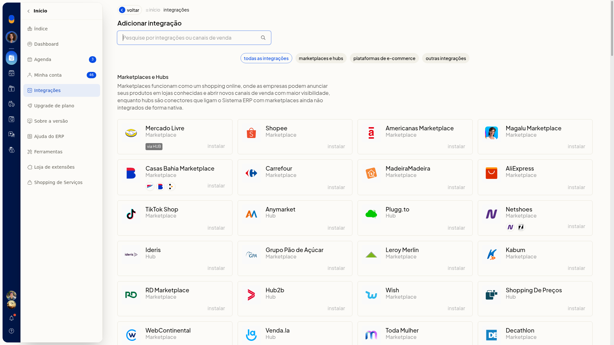

4. Em **Conectar Integração**, revise **Nome da integração no ERP**. O campo não é obrigatório, vem preenchido com TikTok Shop e pode ser substituído.

   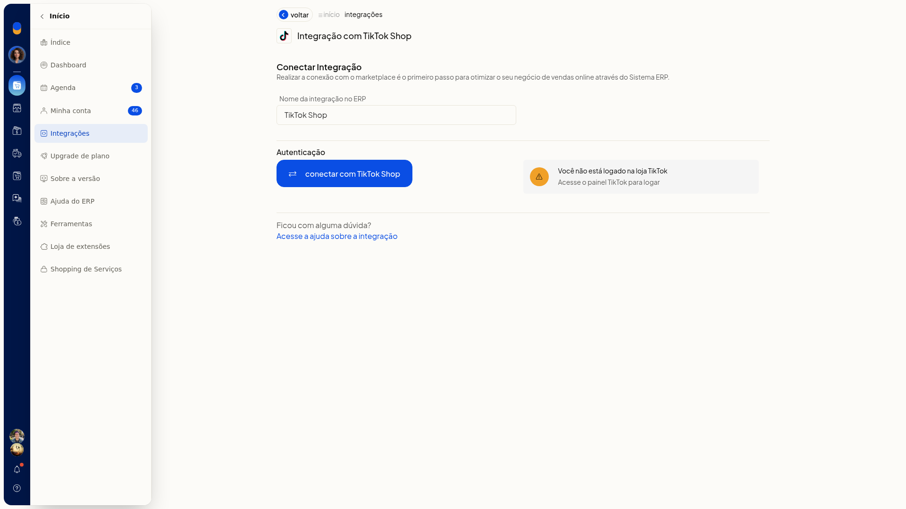

   

5. Na seção **Autenticação**, leia o aviso de login no painel TikTok e clique em **conectar com TikTok Shop** para autorizar a loja. O link **Acesse a ajuda sobre a integração** permanece na própria tela. A tela fica pronta para autorizar, com o nome informado e o aviso **Você não está logado na loja TikTok** se você ainda não estiver logado.

### Configurar a integração já existente

1. Acesse **Início > Integrações**.
2. Localize o card **TikTok Shop** e clique em **gerenciar**.

   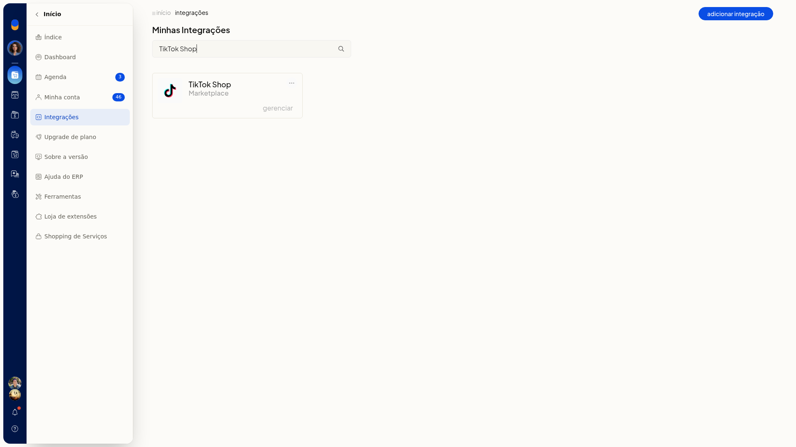

3. Use as abas **Conexão**, **Produtos**, **Pedidos**, **Mapeamentos**, **Geral** e **Fulfillment**. Não há aba Outros.

#### Conexão

4. Na aba **Conexão**, confira **Nome da integração no ERP**. O campo não é obrigatório.

   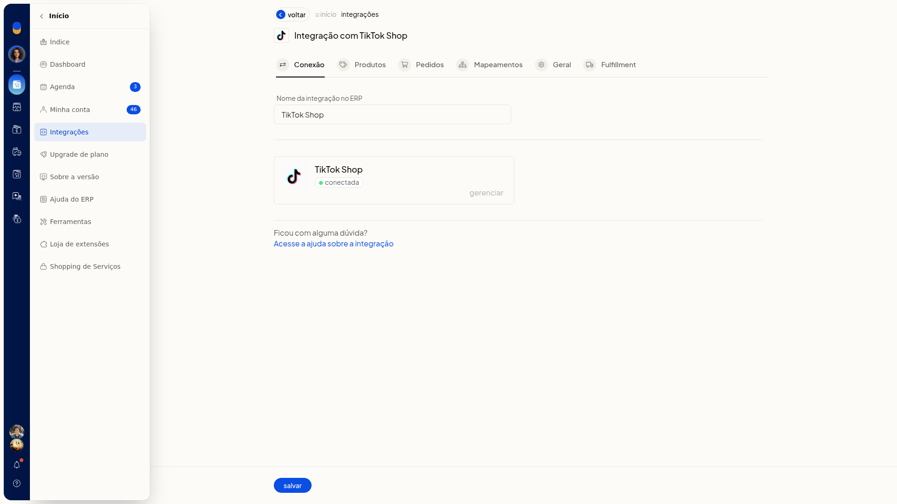

#### Produtos

5. Na aba **Produtos**, abra **Regras de Estoque**.
6. Em **Atualizar estoque na loja virtual a partir do ERP**, selecione **Não atualizar**, **Enviar saldo físico** ou **Enviar saldo disponível**. O campo não é obrigatório.

   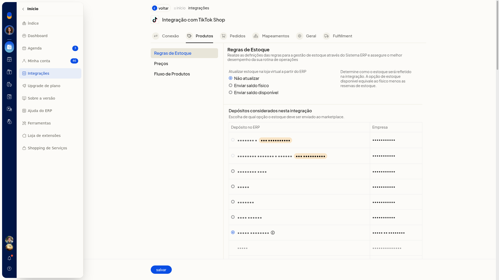

7. Preencha o restante de **Regras de Estoque**. Nenhum destes campos é obrigatório:
 - **Depósito TikTok Shop a ser considerado na integração**: busque o depósito.
 - **Lançamento de estoque para saídas**: selecione **Usar configuração padrão da conta**, **Manual**, **Automático ao autorizar a nota fiscal**, **Automático ao salvar a nota fiscal**, **Automático ao salvar o pedido** ou **Automático ao marcar pedido como enviado**.
 - **Utilizar estoque de segurança**: marque a caixa se quiser usar.

   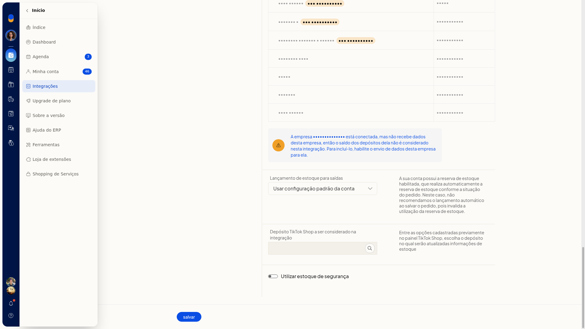

8. Abra **Preços**.
9. Em **Regra de utilização de preços para o e-commerce**, selecione uma opção. O campo não é obrigatório:
 - **Preço fixo**
 - **Conforme lista de preços**, que exibe **Lista de preços utilizada nos produtos** (opção inicial **Selecione**)
 - **Conforme regras de preço**

   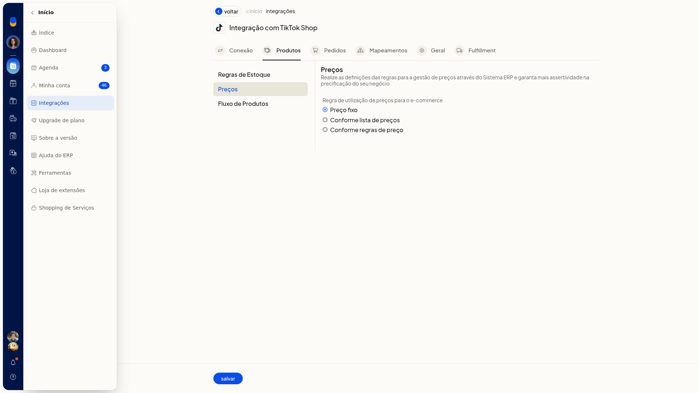

   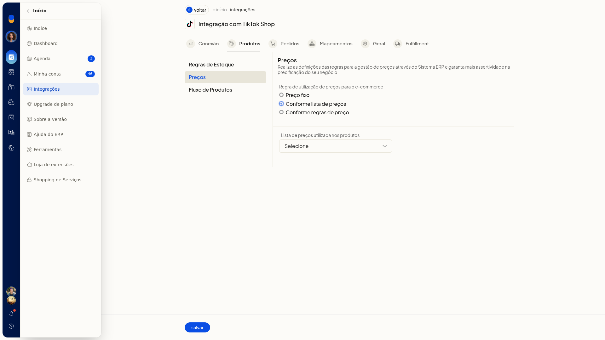

10. Se escolher **Conforme regras de preço**, selecione **Forma para aplicar os valores adicionais**: **Base simples** ou **Base por dentro**. Informe **Adicional de frete** em valor monetário, como 9,90. O campo não é obrigatório. Clique em **Adicionar regra de preço e pesos**.

   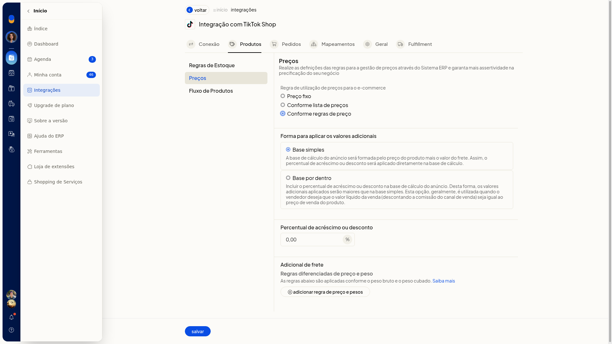

11. No modal **Regra de preço e peso**, use **Valor fixo** ou **Por faixa de peso**.

   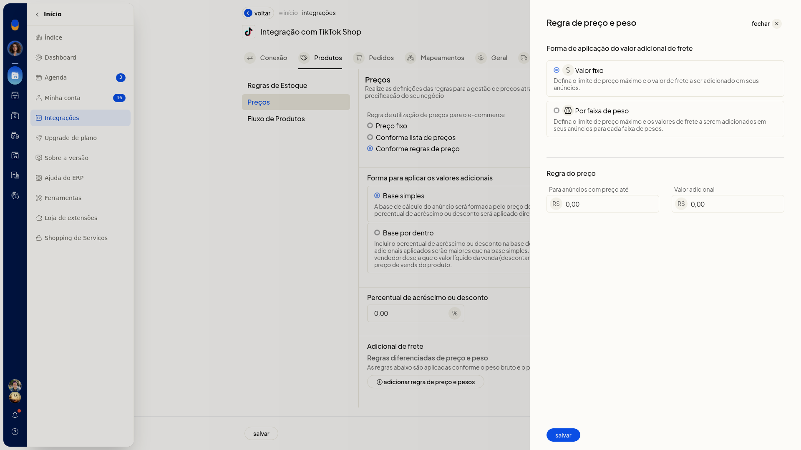

   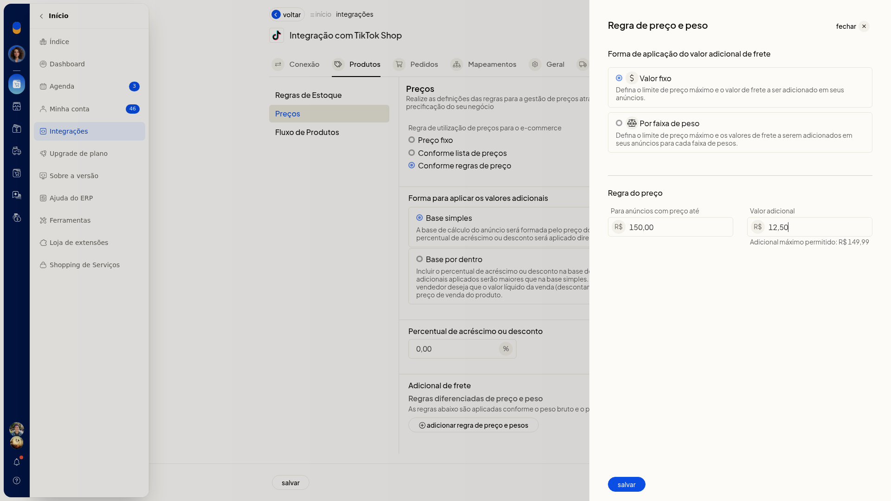

12. Em **Por faixa de peso**, marque **Definir um limite de preço máximo** se quiser limitar o valor. Clique em **adicionar nova regra** e informe **De** e **Até** em kg, como 0,100 e 1,000, e o frete. Os campos não são obrigatórios. **fechar** sai do modal sem gravar a regra.

   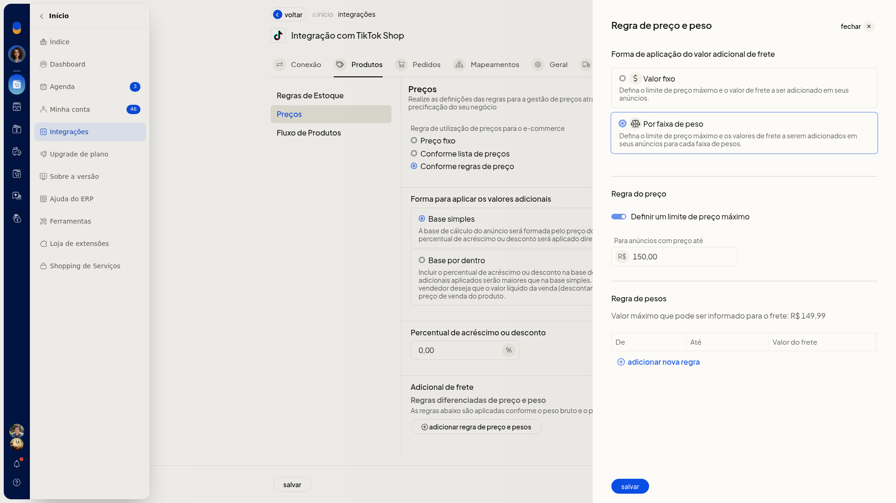

   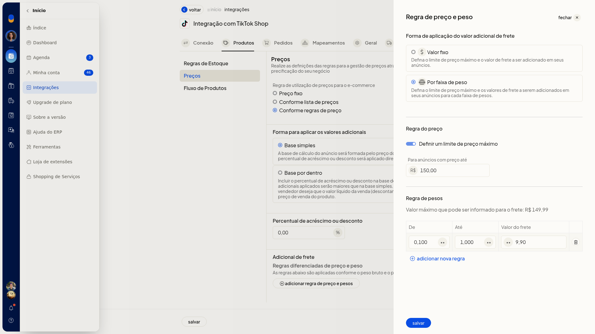

13. Abra **Fluxo de Produtos**. Os campos não são obrigatórios:
 - **Ao importar produtos**: **Importar imagens como anexos** ou **Apenas importar a URL externa das imagens**.
 - **Na importação de produtos, ao atualizar um produto, atualizar o Código (SKU)**: marque a caixa se quiser atualizar o código.

   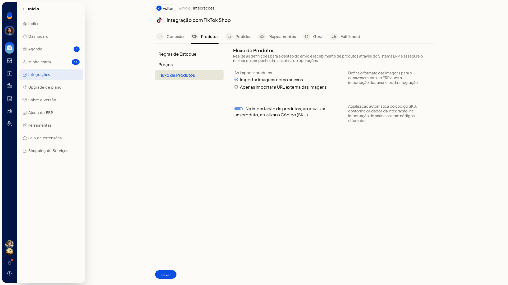

#### Pedidos

14. Na aba **Pedidos**, abra **Fluxo de Pedidos**. Marque as caixas que quiser usar. Nenhuma é obrigatória:
 - **Importar forma de recebimento**
 - **Formatar nome dos contatos**
 - **Sincronização automática de pedidos**
 - **Interpretador de endereços não estruturados**
 - **Enviar rastreamento ao alterar situação para enviado**
 - **Marcar pedido como entregue ao alterar situação**
 - **Importar valor do frete**

   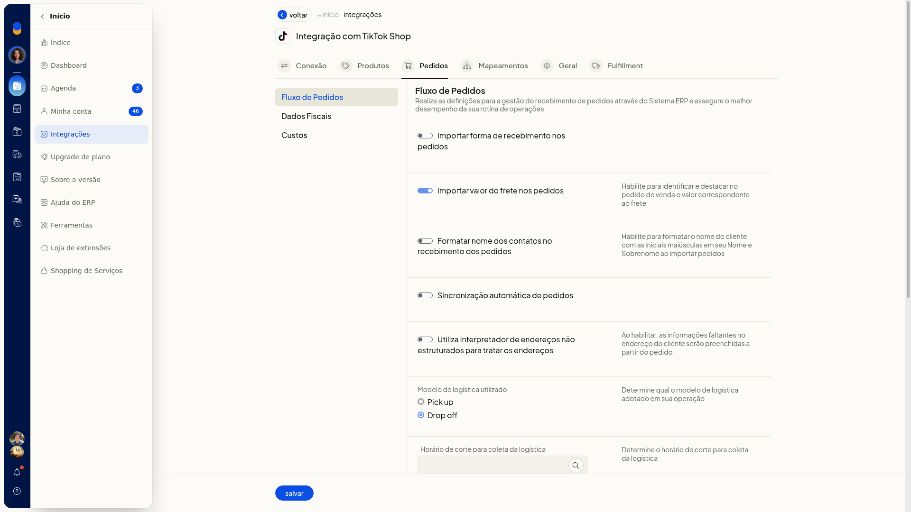

15. Complete a logística e o pagamento. Os campos não são obrigatórios:
 - **Modelo de logística utilizado**: **Pick up** ou **Drop off**.
 - **Horário de corte para coleta da logística**.
 - **Método de impressão de etiquetas**: **Padrão do Canal**, **PDF** ou **ZPL**.
 - **Divergência de pagamento**: **Utilizar valor de pagamento integrado enviado pelo canal de venda (Recomendado)** ou **Considerar pagamento como Não integrado**.

   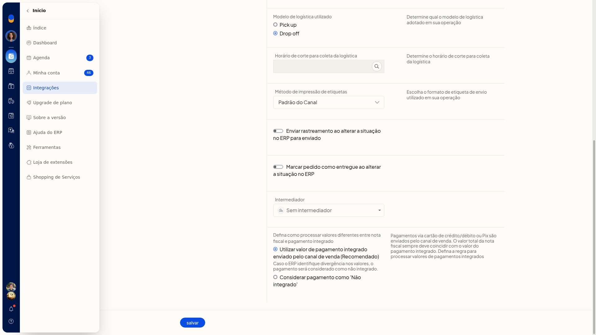

16. Abra **Dados Fiscais**. Os campos não são obrigatórios:
 - **Envio de dados da NFe**: **Automático ao autorizar nota fiscal** ou **Manual**.
 - **Natureza de operação diferente para Pedidos de Amostra e Live Giveaway**: use o interruptor.
 - **Natureza de operação diferente para contribuintes ICMS**: use o interruptor.
 - **Natureza de operação para venda**: selecione uma natureza cadastrada na conta. O texto de ajuda indica a natureza padrão dos pedidos importados.

   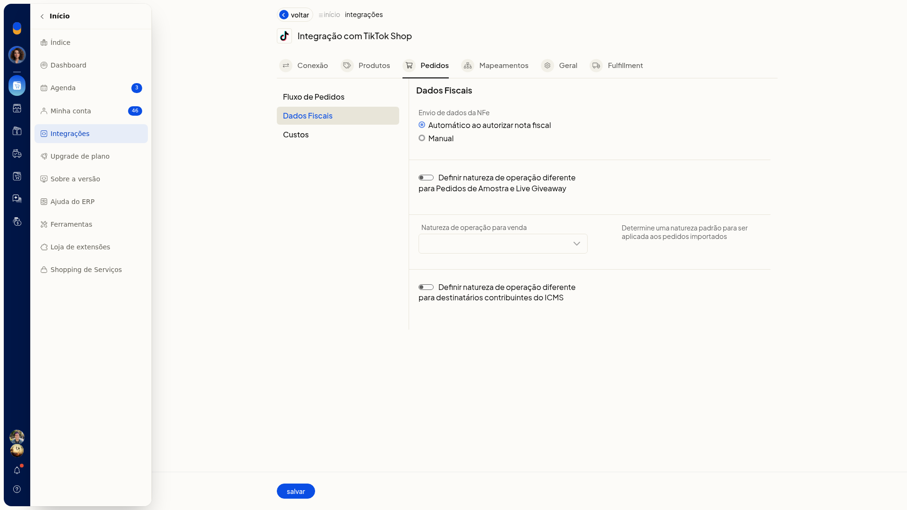

17. Abra **Custos**. Informe o custo geral. Os campos não são obrigatórios:
 - **Valor fixo (R$)**: valor monetário, como 0,00.
 - **Taxa (%)**: percentual, como 0,00 ou 8,50.
 - **Base de cálculo do custo**: **Total da venda** ou **Total da venda sem frete**.

   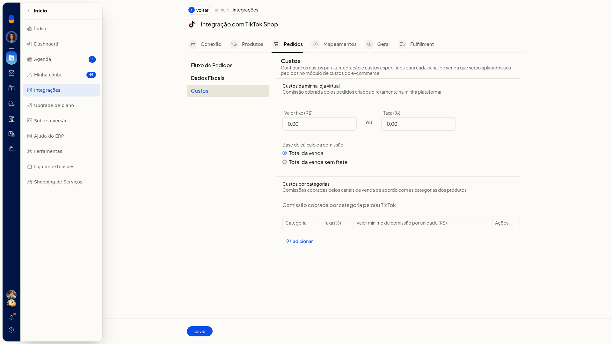

18. Na tabela de comissão por categoria, clique em **adicionar**.
19. No modal **Comissão por categoria**, busque **Categoria no Sistema ERP** e informe **Taxa (%)** e **Valor mínimo (R$)**. A ajuda de **Valor mínimo (R$)** indica o valor mínimo de comissão por unidade. Os campos não são obrigatórios. **cancelar** fecha o modal sem gravar na tabela.

   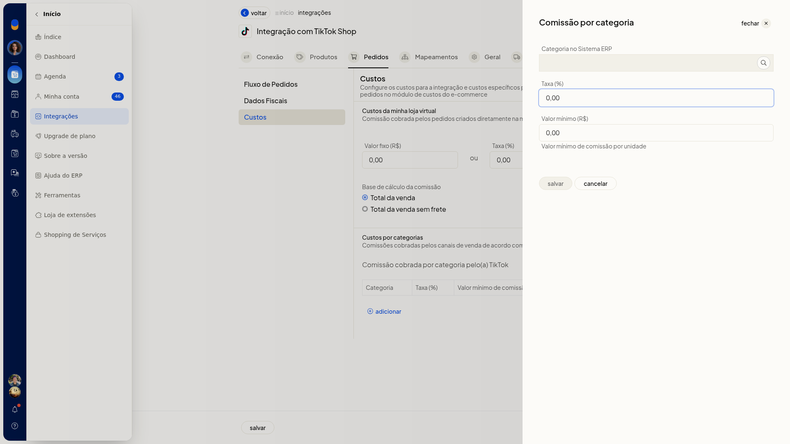

   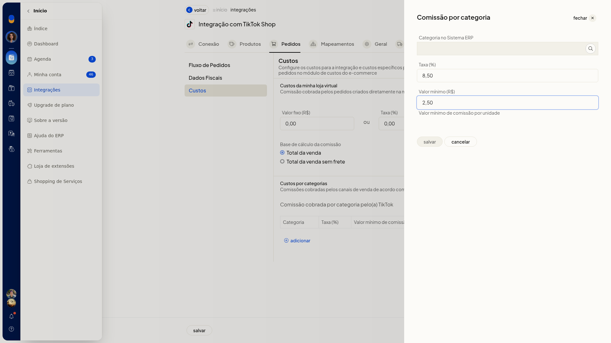

#### Mapeamentos

20. Na aba **Mapeamentos**, abra **Situações de Pedidos**.
21. Se quiser, marque **Permite retroceder situação dos pedidos na sincronização de situações**. A caixa não é obrigatória.

   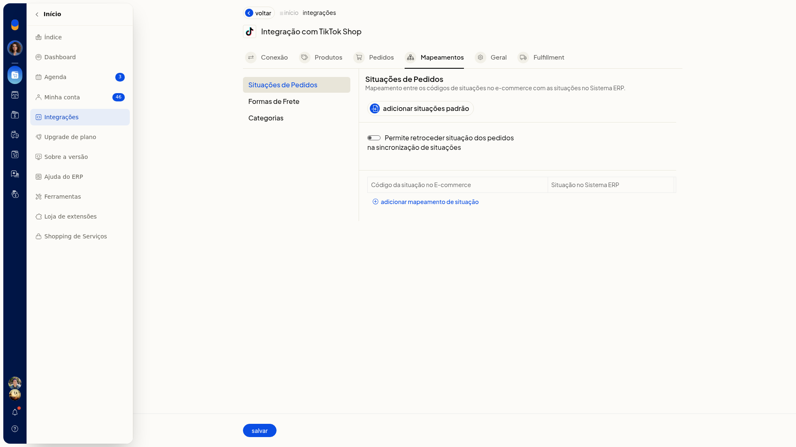

22. Clique em **adicionar mapeamento de situação**. Há também **adicionar situações padrão** na tela.
23. Informe **Código da situação no E-commerce** e escolha **Situação no Sistema ERP**. Os campos não são obrigatórios. As situações são **Selecione**, **Em aberto**, **Faturado**, **Cancelado**, **Aprovado**, **Preparando envio**, **Enviado**, **Entregue**, **Pronto para envio**, **Dados incompletos**, **Não entregue** e **Em devolução**. A linha fica na tabela até você salvar a integração.

   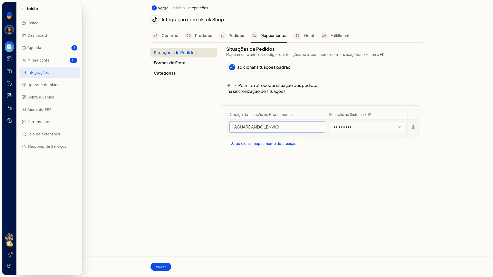

24. Abra **Formas de Frete** e clique em **adicionar**. A tela também traz um vídeo explicativo.

   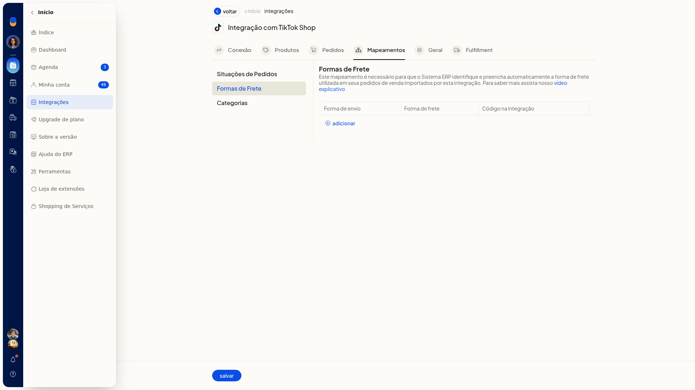

25. Na nova linha, busque **Forma de envio**, selecione **Forma de frete** e depois informe **Código na integração**. Os campos não são obrigatórios. Com **Forma de envio** vazia, o código não aceita digitação.

   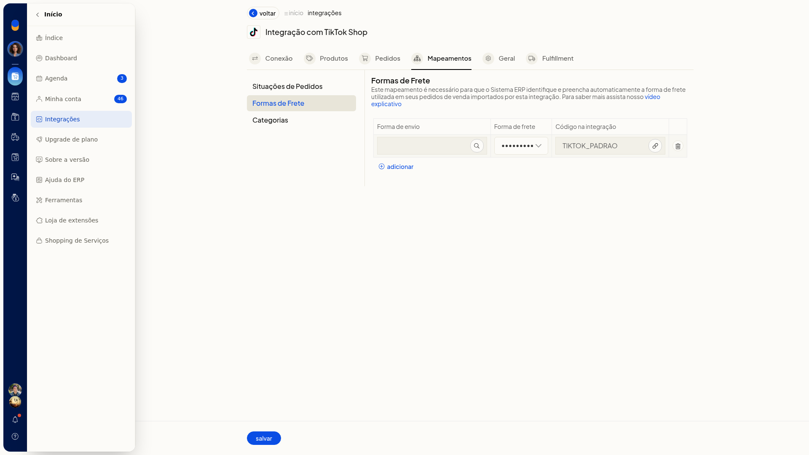

26. Abra **Categorias** e localize a categoria do ERP na tabela **Categoria no Sistema ERP** / **Código da categoria no E-commerce**.

   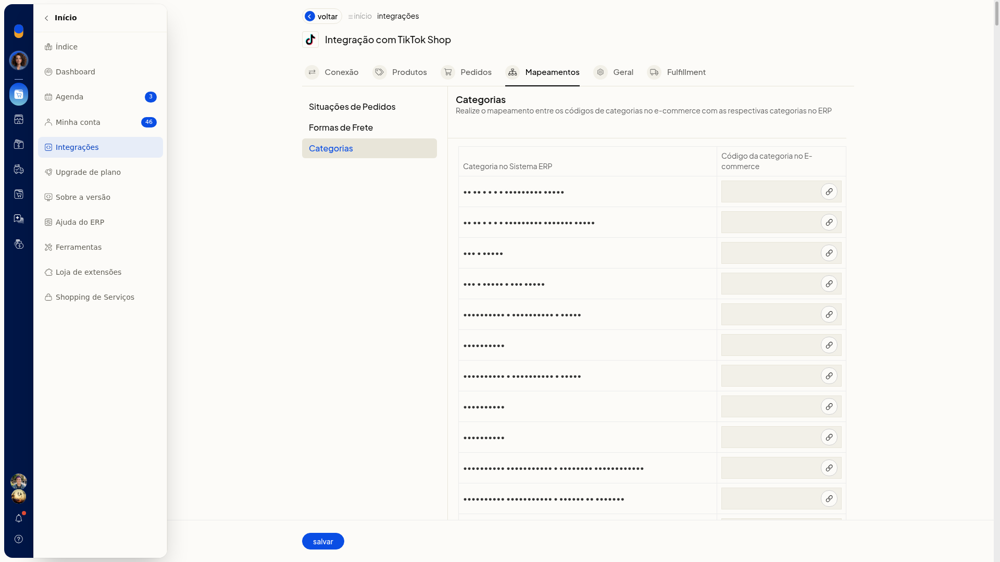

27. Clique no botão de vínculo da linha.
28. No painel, pesquise em **Pesquise a categoria ou selecione abaixo** ou expanda a árvore de categorias do TikTok. **Código da categoria no E-commerce** é preenchido pelo painel, não por digitação livre na linha. Clique em **atribuir categoria** para confirmar o vínculo. **fechar** ou **cancelar** sai sem atribuir.

   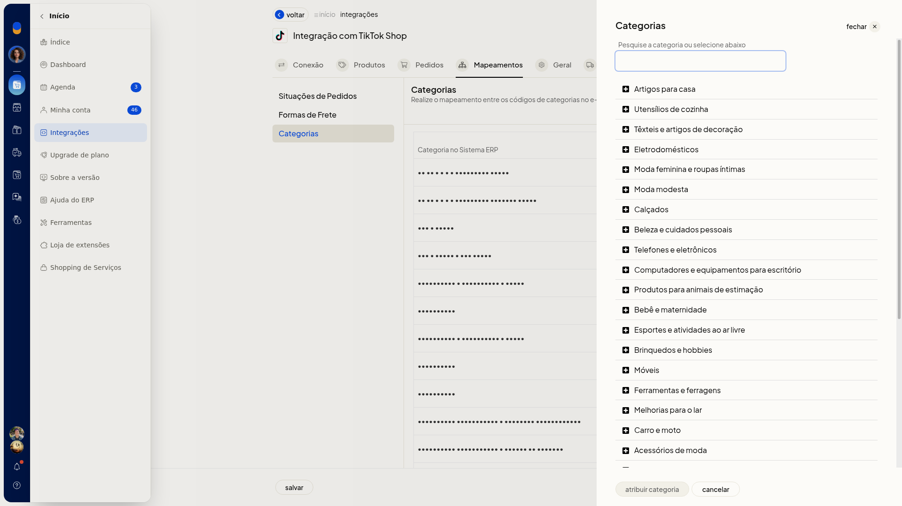

   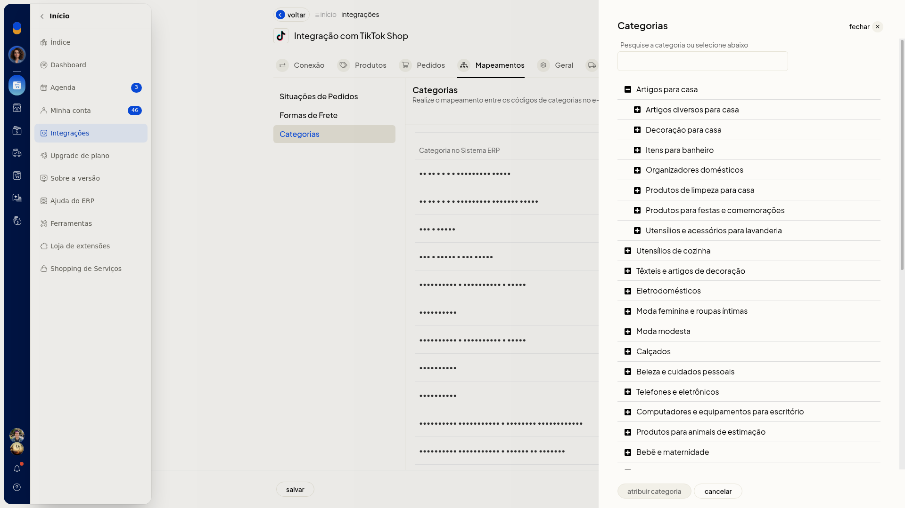

#### Geral

29. Na aba **Geral**, em **Configurações da Loja**, busque **Loja TikTok Shop associada**. O campo não é obrigatório. Escolha a loja depois da autorização.

   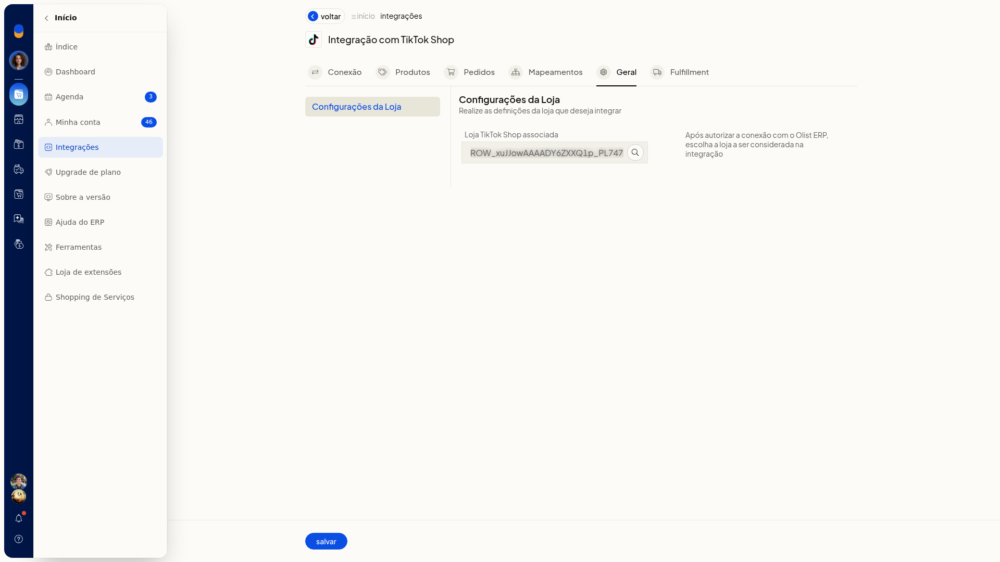

#### Fulfillment

30. Na aba **Fulfillment**, defina a importação dos pedidos, o depósito e o lançamento de estoque das saídas. Os campos não são obrigatórios:
 - **Importar pedidos do Fulfillment**: marque a caixa para importar.
 - **Depósito do Fulfillment**: selecione um depósito cadastrado na conta. A opção inicial é **Selecione**.
 - **Lançamento de estoque para saídas de pedidos Fulfillment**: **Usar configuração padrão da conta**, **Manual**, **Automático ao autorizar a nota fiscal**, **Automático ao salvar a nota fiscal**, **Automático ao salvar o pedido** ou **Automático ao marcar pedido como enviado**.

   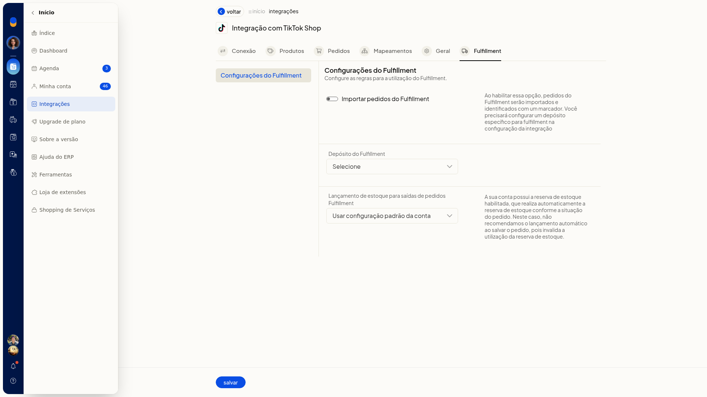

31. Clique em **salvar** para gravar as alterações das abas.

## Resultado
Em **Conectar Integração**, a tela mostra o nome informado, o botão **conectar com TikTok Shop** e o aviso **Você não está logado na loja TikTok** enquanto a autorização não é iniciada. No card já existente, **gerenciar** abre as abas de regras do conector. Modais e linhas novas exibem o que você preencheu antes de salvar, atribuir ou conectar.

## Informações adicionais
- A página da integração existente tem só as abas **Conexão**, **Produtos**, **Pedidos**, **Mapeamentos**, **Geral** e **Fulfillment**.
- Em **Situações de Pedidos**, **adicionar situações padrão** fica na mesma tela de **adicionar mapeamento de situação**.
- Em **Formas de Frete**, a tela inclui um vídeo explicativo.
- **atribuir categoria** confirma o vínculo da categoria do TikTok. **salvar** grava as alterações das abas.
