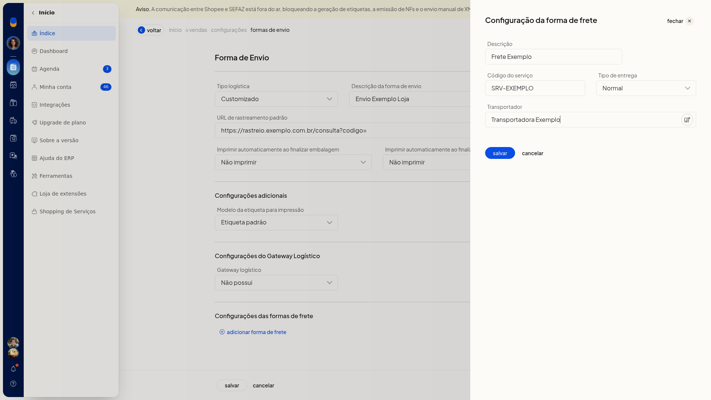
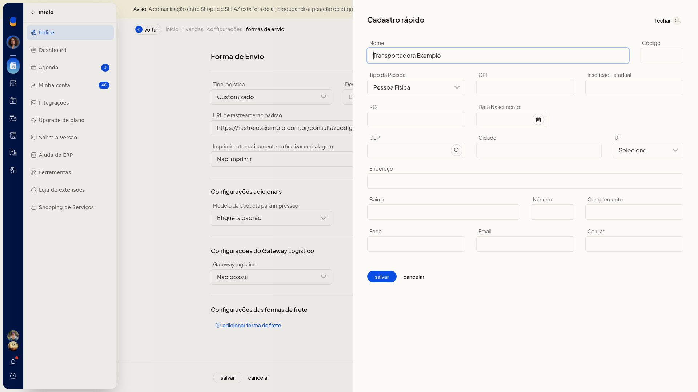
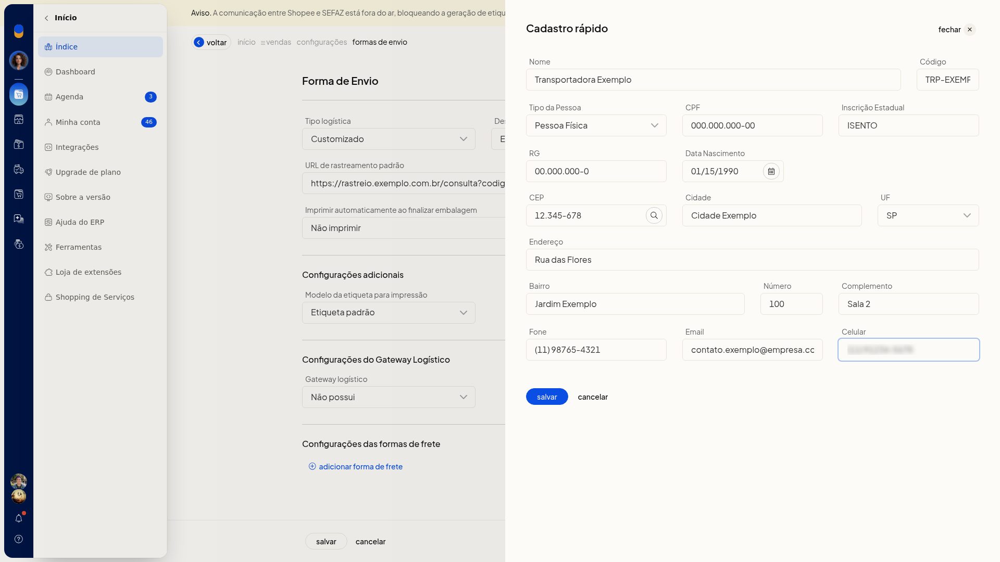

# Cadastrar transportador no cadastro rápido da forma de frete

O cadastro rápido registra os dados de um transportador a partir da forma de frete, sem sair do formulário da forma de envio no ERP da Olist. Você informa nome, código e tipo de pessoa e, para pessoa física, documentos, endereço e contato.

## Pré-requisitos
- Se **Formas de envio** não aparecer para você, peça acesso ao administrador da conta.

## Importante
- Os campos do cadastro rápido não são obrigatórios.
- Em **Data Nascimento**, use o formato mm/dd/aaaa.
- O **CEP** é exibido como 12.345-678.
- Se a cidade não estiver cadastrada, a tela mostra **Cidade não encontrada**.

## Instruções
1. Acesse **Configurações > Configurações ERP > Vendas > Formas de envio**.
2. Clique em **Incluir forma de envio**.
3. Em **Configurações das formas de frete**, clique em **Adicionar forma de frete**.
4. Em **Transportador**, digite um nome que não exista no cadastro. A tela mostra **cadastro não encontrado**.

   

5. Abra o cadastro rápido a partir de **Transportador**.
6. Preencha **Nome** e **Código**.
7. Em **Tipo da Pessoa**, selecione **Pessoa Física**, **Pessoa Jurídica**, **Estrangeiro** ou **Estrangeiro no Brasil**.

   

8. Para **Pessoa Física**, preencha os dados abaixo.

#### Documentos

- **CPF**: use o formato 000.000.000-00.
- **IE**
- **RG**
- **Data Nascimento**: use o formato mm/dd/aaaa.

#### Endereço

- **CEP**: o valor é exibido como 12.345-678.
- **Cidade**
- **UF**
- **Endereço**
- **Bairro**
- **Número**
- **Complemento**

#### Contato

- **Fone**: use o formato (11) 98765-4321.
- **Email**
- **Celular**: use o formato (11) 91234-5678.

9. Clique em **Cancelar** para fechar o cadastro rápido sem gravar o transportador.

## Resultado
Os dados ficam preenchidos no cadastro rápido. **Cancelar** encerra a tela sem criar o cadastro do transportador.
