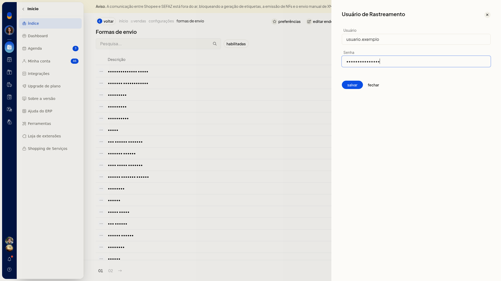

# Configurar o usuário de rastreamento das formas de envio

Nas formas de envio, você informa as credenciais de rastreamento da loja. O ajuste fica em **Formas de envio**, no painel **Usuário de Rastreamento**.

## Pré-requisitos
- Se **Formas de envio** não aparecer, peça acesso ao administrador da conta.

## Importante
- **Fechar** encerra o painel sem gravar.

## Instruções
1. Acesse **Configurações > Configurações ERP > Vendas > Formas de envio**.
2. Clique em **Editar usuário de rastreamento**.

   

3. Preencha **Usuário** e **Senha**. Os dois campos não são obrigatórios.

   

4. Clique em **Salvar**. As credenciais ficam prontas para gravação.
