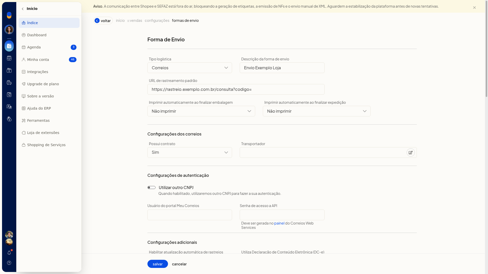
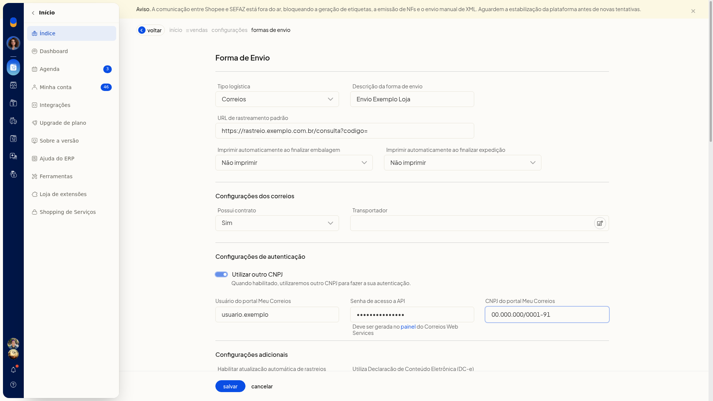
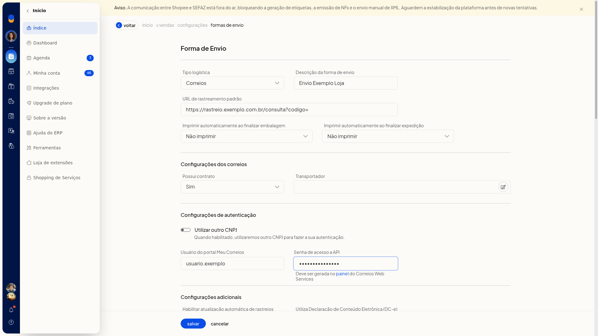
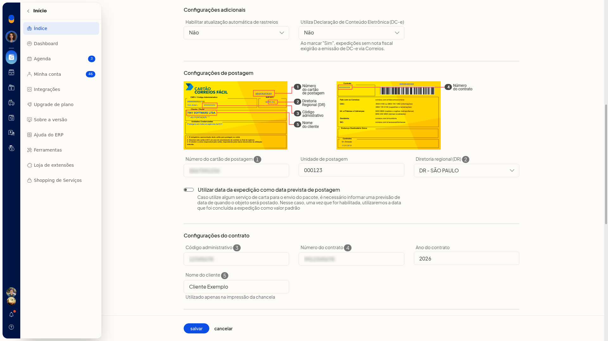
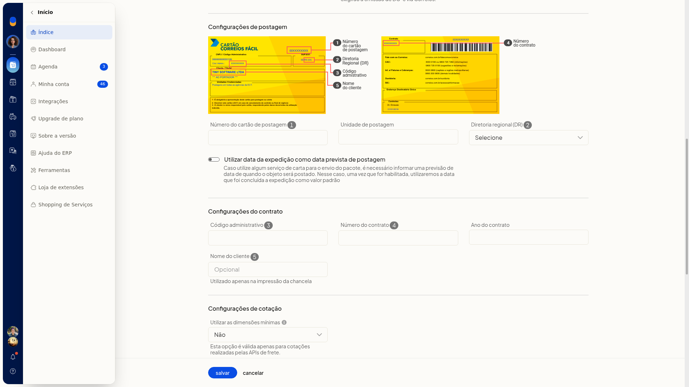
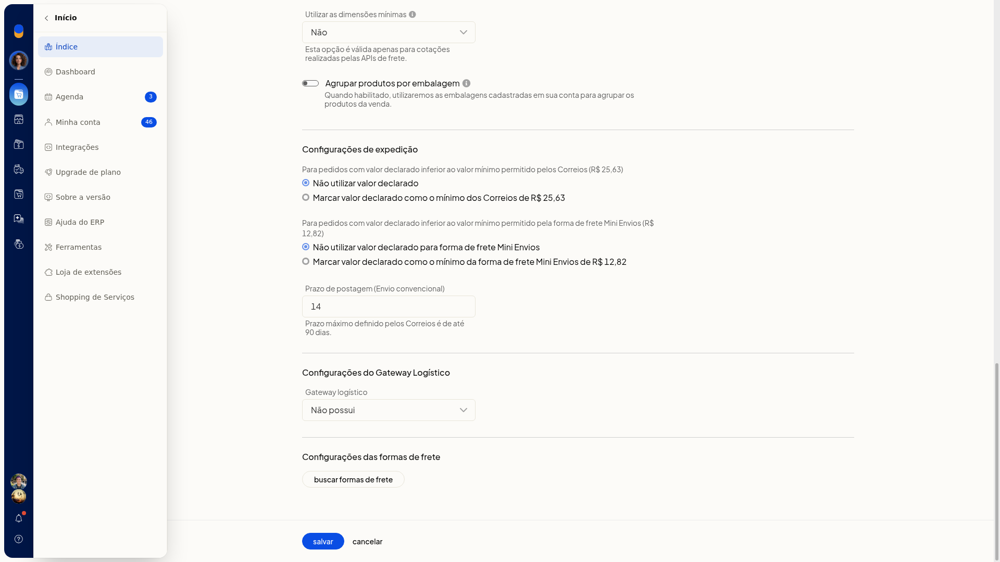
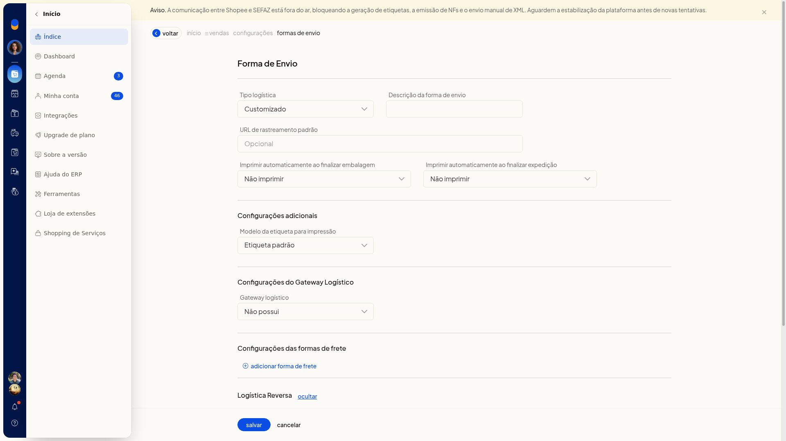
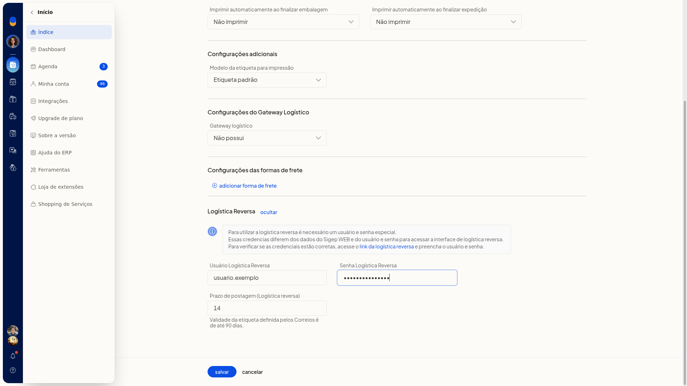
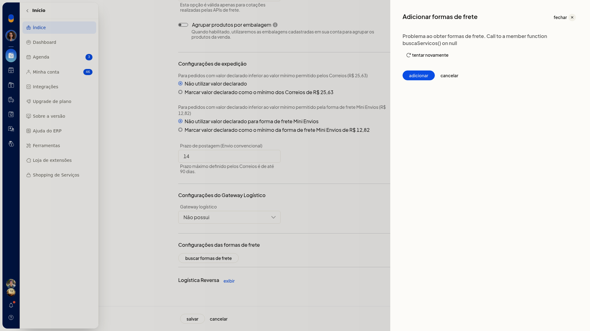

# Correios no ERP (inclui logística reversa)

No ERP da Olist, a forma de envio **Correios** reúne contrato, autenticação, cotação e logística reversa para expedir pedidos e cotar o frete.

Você inclui essa forma em **Configurações > Configurações ERP > Vendas > Formas de envio** e informa os dados do contrato, as regras de cotação e as credenciais da logística reversa.

## Pré-requisitos
- Se a opção não aparecer para você, peça acesso ao administrador da conta.
- A **Senha de acesso a API** precisa ser gerada no painel do Correios Web Services.
- A logística reversa exige identificação e senha especiais, diferentes dos dados do Sigep WEB e das credenciais da interface de logística reversa.

## Importante
- Com **Utilizar outro CNPJ** marcado, a autenticação usa outro CNPJ.
- Com **Utiliza DC-e** em **Sim**, expedições sem nota fiscal exigem DC-e via Correios.
- **Utilizar as dimensões mínimas** vale apenas para cotações feitas pelas APIs de frete.
- **Nome do cliente** é usado apenas na impressão da chancela.
- O **Prazo de postagem (Envio convencional)** aceita até 90 dias.
- O **Prazo de postagem (Logística reversa)** aceita um número inteiro de 1 a 90. A validade da etiqueta definida pelos Correios é de até 90 dias.
- Em **Gateway logístico**, a lista traz **Não possui** e os gateways já configurados na conta. A tela não cria o gateway.

## Instruções
1. Acesse **Configurações > Configurações ERP > Vendas > Formas de envio**.
2. Clique em **Incluir forma de envio**.
3. Em **Tipo logística**, selecione **Correios**.

   

4. Informe a **Descrição da forma de envio**. A **URL de rastreamento padrão** é opcional.
5. Em **Imprimir automaticamente ao finalizar embalagem** e **Imprimir automaticamente ao finalizar expedição**, selecione **Não imprimir**, **DANFE** ou **Etiqueta de envio**.
6. Em **Modelo da etiqueta para impressão**, selecione **Etiqueta padrão** ou **Minha transportadora**.
7. Em **Gateway logístico**, selecione **Não possui** ou um gateway já configurado na conta.

#### Contrato e autenticação

8. Em **Possui contrato**, selecione **Sim** ou **Não**.
9. Informe o **Transportador** já cadastrado.
10. Marque **Utilizar outro CNPJ** quando a autenticação deve usar outro CNPJ. Preencha o **CNPJ** no formato 00.000.000/0001-91.

   

11. Preencha **Usuário do portal Meu Correios** e **Senha de acesso a API**.

   

12. Em **Habilitar atualização automática de rastreios**, selecione **Não** ou **Sim**. Essa opção só fica disponível quando a conta tem atualização de status de envio da venda.
13. Em **Utiliza DC-e**, selecione **Sim** ou **Não**.
14. Informe **Número do cartão de postagem**, **Unidade de postagem** e **Diretoria regional (DR)**.
15. Marque **Utilizar data da expedição como data prevista de postagem** para usar a data da expedição.
16. Preencha **Código administrativo**, **Número do contrato**, **Ano do contrato** e **Nome do cliente**.

   

#### Cotação

17. Em **Utilizar as dimensões mínimas**, selecione **Não** ou **Sim**.
18. Marque **Agrupar produtos por embalagem** para usar as embalagens da conta.
19. Para valor declarado abaixo de R$ 25,63, escolha não utilizar o valor declarado ou aplicar o mínimo de R$ 25,63.
20. Para Mini Envios abaixo de R$ 12,82, escolha não utilizar ou aplicar o mínimo de R$ 12,82.
21. Informe o **Prazo de postagem (Envio convencional)**. O valor inicial é 14 e o máximo é 90 dias.

   

   

#### Logística reversa

22. Em **Logística Reversa**, clique em **exibir**.
23. Confira o aviso de credenciais especiais. O link abre, em nova aba, o serviço público de logística reversa dos Correios.

   

24. Preencha **Usuário Logística Reversa**, **Senha Logística Reversa** e **Prazo de postagem (Logística reversa)**. O prazo inicial é 14.

   

#### Formas de frete

25. Clique em **Buscar formas de frete**.
26. No modal **Adicionar formas de frete**, clique em **Adicionar** para incluir os serviços. Sem credenciais dos Correios gravadas, o modal mostra **Problema ao obter formas de frete**. Clique em **Tentar novamente** para repetir a busca ou em **Cancelar** para fechar sem adicionar serviços.

   

27. Clique em **Salvar** para gravar a forma de envio. **Cancelar** volta à lista sem gravar.
