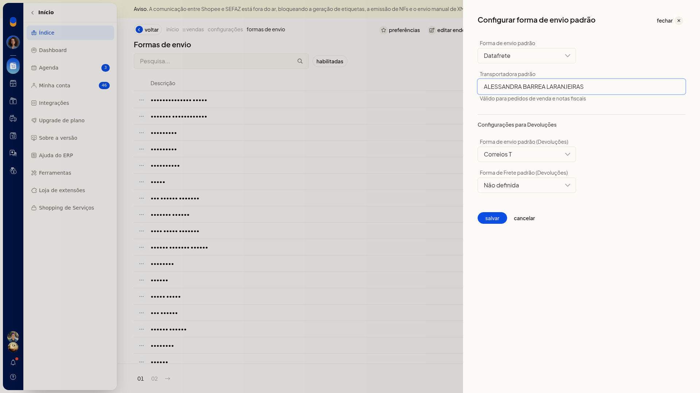
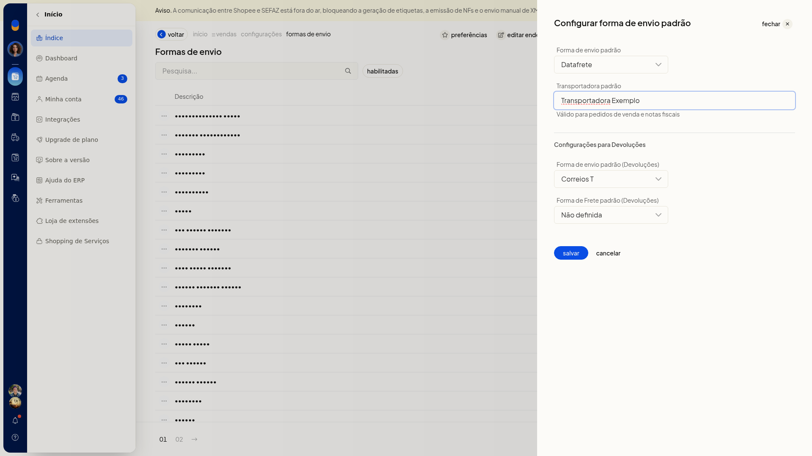

# Definir a forma de envio padrão e o frete padrão de devoluções

Nas preferências de **Formas de envio**, você define a forma de envio padrão, a transportadora padrão e o frete padrão de devoluções. Essa configuração vale para pedidos de venda e notas fiscais.

## Importante
- A preferência vale para pedidos de venda e notas fiscais.
- Em **Transportadora padrão**, use um transportador já cadastrado. Um nome que não existe no cadastro aparece como **Cadastro não encontrado**.
- Em **Forma de Frete padrão (Devoluções)**, as opções são **Não definida** e as formas de envio para devoluções já cadastradas na conta.

## Instruções
1. Acesse **Configurações > Configurações ERP > Vendas > Formas de envio**.
2. Clique em **Preferências**.

   

3. Em **Forma de envio padrão**, selecione **Não definida** ou uma forma de envio já cadastrada.
4. Em **Transportadora padrão**, busque um transportador já cadastrado.

   

5. Em **Forma de Frete padrão (Devoluções)**, selecione **Não definida** ou uma opção de envio para devoluções já cadastrada.
6. Clique em **Salvar**. Para descartar a alteração sem gravar, clique em **Cancelar**.
