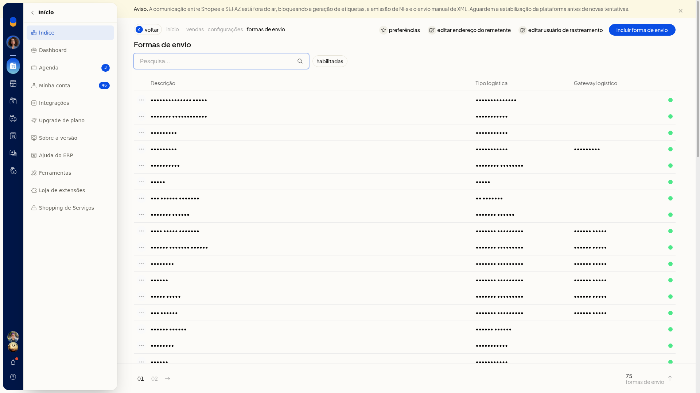
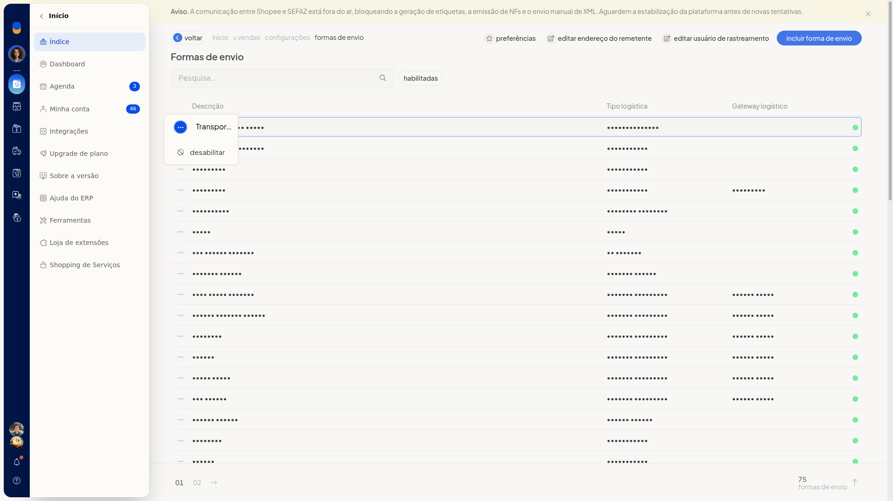

# Desabilitar uma forma de envio

## Pré-requisitos
- Se a opção não aparecer para você, peça acesso ao administrador da conta.

## Instruções
1. Acesse **Configurações > Configurações ERP > Vendas > Formas de envio**.
2. No filtro de situação, mantenha **habilitadas** para localizar a forma.

   

3. Na linha da forma, abra o menu de ações e clique em **Desabilitar**.

   
