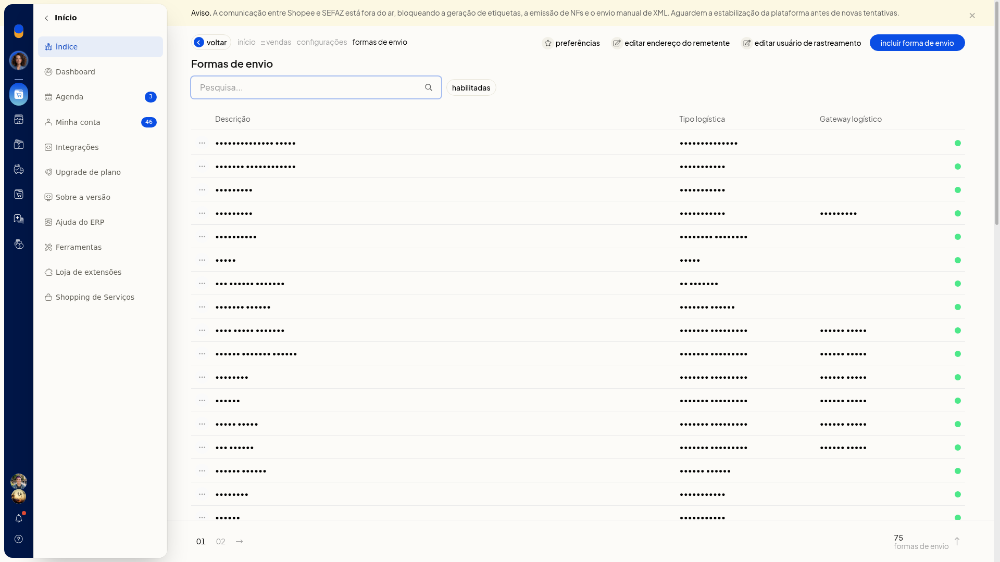
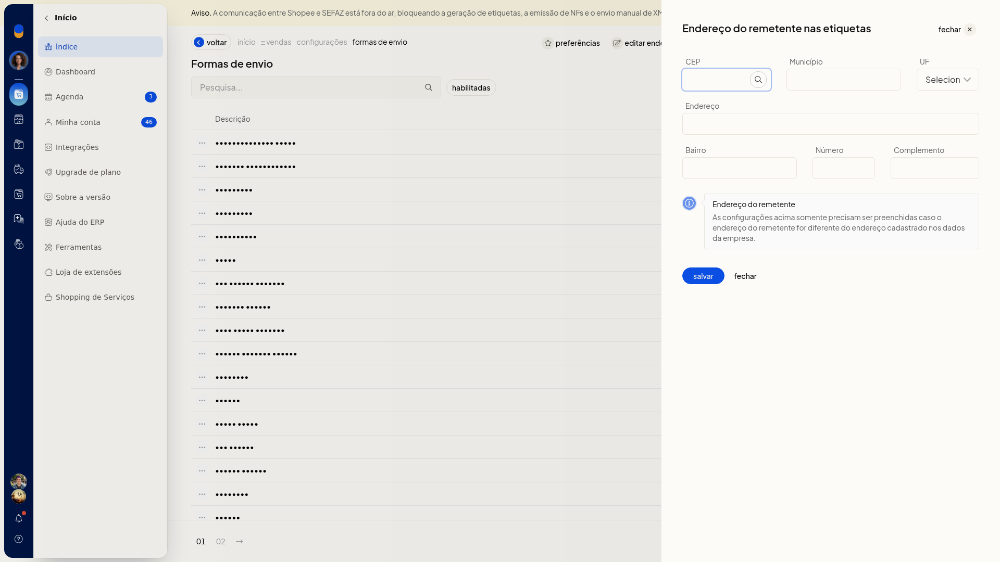
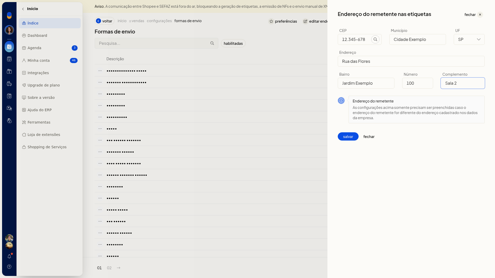

# Editar o endereço do remetente nas etiquetas

No ERP da Olist, o endereço do remetente nas etiquetas é o que sai impresso quando esse endereço é diferente do cadastro da empresa. Você informa CEP, município, UF, logradouro, bairro, número e complemento.

## Pré-requisitos
- Se a opção não aparecer para você, peça acesso ao administrador da conta.

## Importante
- Preencha o endereço somente se ele for diferente do endereço da empresa.
- **Fechar** encerra o painel sem gravar.

## Instruções
1. Acesse **Configurações > Configurações ERP > Vendas > Formas de envio**.

   

2. Clique em **Editar endereço do remetente**.

   

3. Preencha os campos. Nenhum deles é obrigatório.
 - **CEP**: formato 12.345-678
 - **Município**
 - **UF**: uma UF brasileira ou **EX**
 - **Endereço**
 - **Bairro**
 - **Número**
 - **Complemento**

   

4. Clique em **Salvar**. Para sair sem gravar, clique em **Fechar**.
