# Formas de envio e cotação de frete

Formas de envio é a configuração em que você define como os pedidos são expedidos e como o frete é cotado no ERP da Olist. Nela você consulta as formas já cadastradas, inclui uma nova forma, informa o remetente das etiquetas e as credenciais de rastreamento, adiciona formas de frete e, para os Correios, configura contrato, cotação e logística reversa.

A tela fica em **Configurações > Configurações ERP > Vendas > Formas de envio**.

## Importante
- Preencha o endereço do remetente nas etiquetas somente se ele for diferente do endereço da empresa.
- A senha de acesso à API dos Correios deve ser gerada no painel do Correios Web Services.
- A logística reversa exige um usuário e uma senha especiais, diferentes dos dados do Sigep WEB e das credenciais da interface de logística reversa.
- **Gateway logístico** lista apenas **Não possui** e os gateways já configurados na conta. A tela não cria o gateway.
- Com **Utilizar outro CNPJ** marcado, a autenticação usa outro CNPJ.
- Com **Utiliza DC-e** em **Sim**, expedições sem nota fiscal exigirão DC-e via Correios.
- **Utilizar as dimensões mínimas** vale apenas para cotações feitas pelas APIs de frete.
- **Nome do cliente** é usado apenas na impressão da chancela.
- As preferências valem para pedidos de venda e notas fiscais.
- Nenhum campo destes formulários aparece marcado como obrigatório.

## Instruções
### Consultar as formas de envio

1. Acesse **Configurações > Configurações ERP > Vendas > Formas de envio**.
2. Use a pesquisa e o filtro de situação para localizar a forma. A lista mostra **Descrição**, **Tipo logística** e **Gateway logístico** e é paginada.

   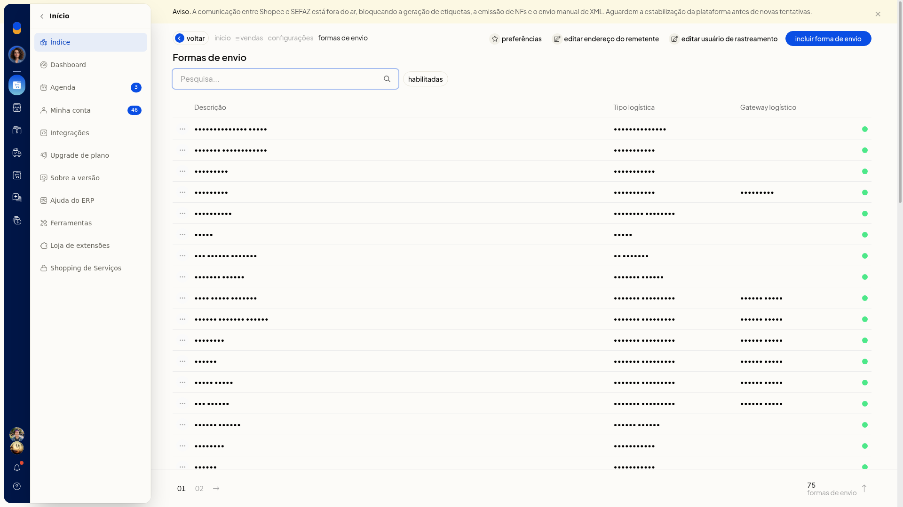

3. Na linha de uma forma habilitada, abra o menu de ações e clique em **Desabilitar** para desabilitar a forma.

   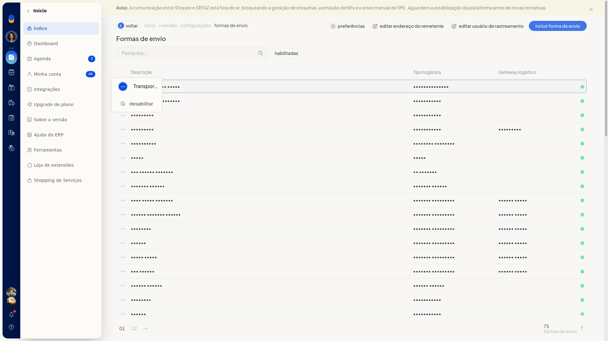

### Editar o endereço do remetente

1. Na lista de **Formas de envio**, clique em **Editar endereço do remetente**.
2. No painel **Endereço do remetente nas etiquetas**, preencha **CEP**, **Município**, **UF**, **Endereço**, **Bairro**, **Número** e **Complemento** somente se o remetente das etiquetas for diferente do endereço da empresa. Em **UF**, escolha **Selecione**, uma UF brasileira ou **EX**. O **CEP** usa o formato 12.345-678.

   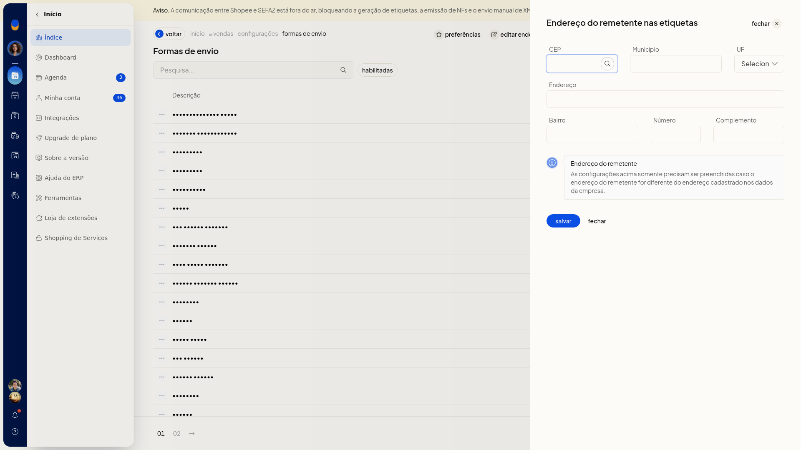

   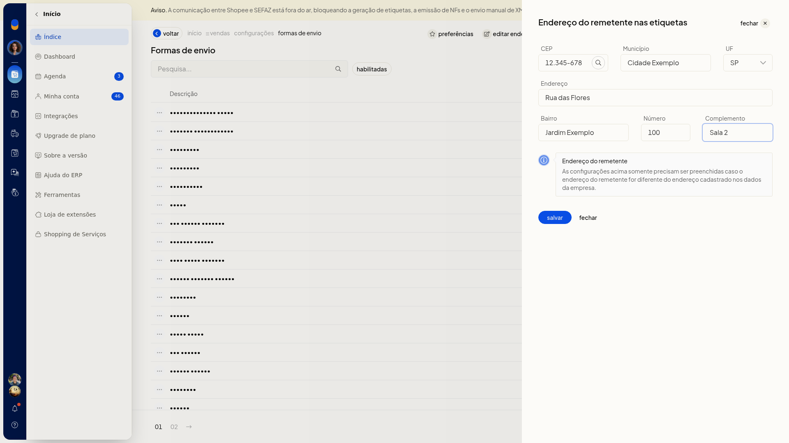

3. Clique em **Salvar**. **Fechar** encerra o painel sem gravar.

### Editar o usuário de rastreamento

1. Na lista de **Formas de envio**, clique em **Editar usuário de rastreamento**.
2. No painel **Usuário de Rastreamento**, informe **Usuário** e **Senha**.

   

   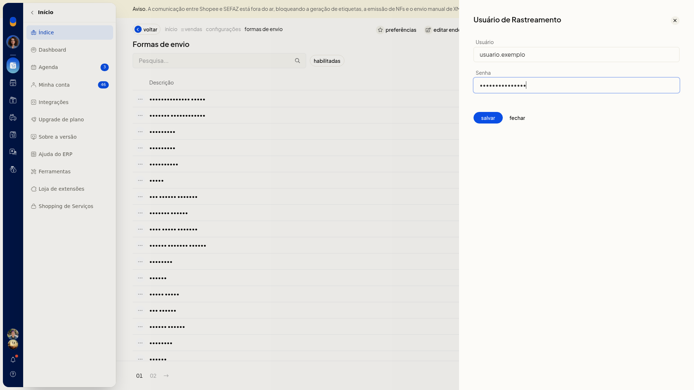

3. Clique em **Salvar**. **Fechar** encerra o painel sem gravar.

### Incluir uma forma de envio

1. Na lista, clique em **Incluir forma de envio**.
2. Em **Tipo logística**, selecione o tipo. As opções são **Correios**, **Transportadora**, **Mercado Envios**, **Correios Log**, **Americanas Entrega**, **Jadlog**, **Total Express**, **Olist**, **Gateway logístico**, **Customizado**, **Magalu Entregas**, **Magalu Fulfillment**, **Shopee Envios**, **Netshoes Entregas**, **CB Entrega**, **AliExpress Envios**, **Madeira Envios**, **Conecta Lá Etiquetas**, **Loggi**, **Amazon DBA**, **Magalu Entregas por Netshoes**, **Shein Envios**, **Mandaê (beta)**, **Kwai Envios**, **Envios da Olist**, **Beleza Envios**, **Forma Teste (beta)**, **TikTok Shipping**, **Envios do HUB** e **Posta Ja**.

   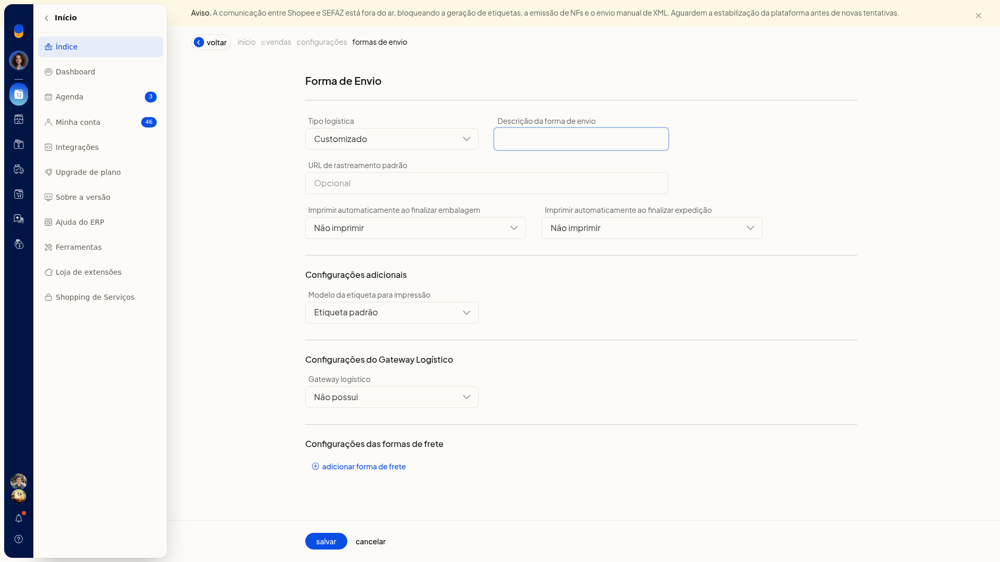

3. Informe **Descrição da forma de envio**. **URL de rastreamento padrão** é opcional.
4. Em **Imprimir automaticamente ao finalizar embalagem** e em **Imprimir automaticamente ao finalizar expedição**, escolha **Não imprimir**, **DANFE** ou **Etiqueta de envio**.
5. Em **Modelo da etiqueta para impressão**, escolha **Etiqueta padrão** ou **Minha transportadora**.
6. Em **Gateway logístico**, escolha **Não possui** ou um gateway já configurado na conta.

   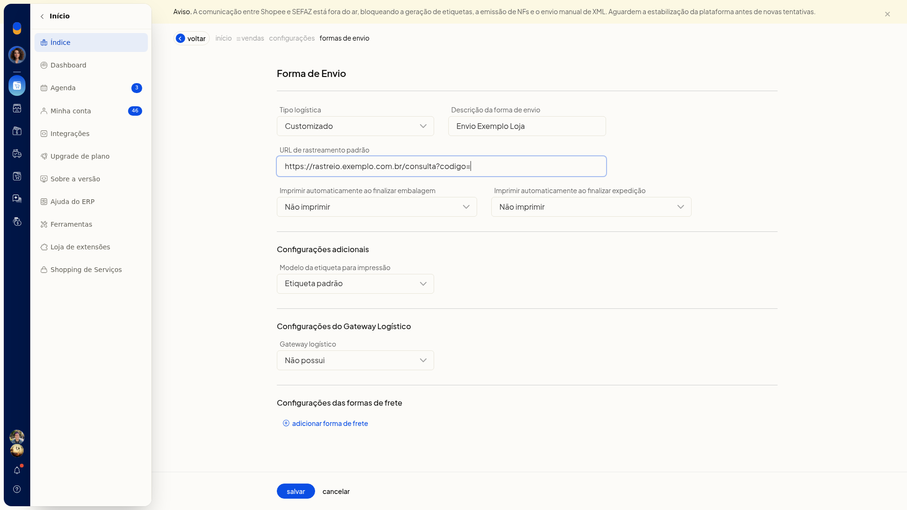

7. Para incluir frete, siga **Adicionar uma forma de frete**. Para Correios, siga **Configurar Correios**.
8. Clique em **Salvar**. **Cancelar** descarta o formulário e volta à lista.

### Configurar Correios

1. Em **Incluir forma de envio**, selecione **Correios** em **Tipo logística**.
2. Informe **Descrição da forma de envio**. **URL de rastreamento padrão** permanece opcional.

   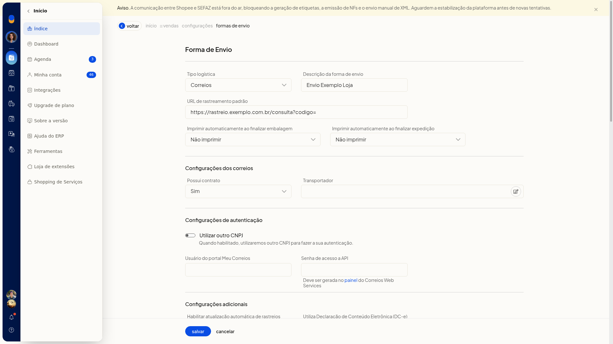

3. Defina **Possui contrato** como **Sim** ou **Não** e informe o **Transportador**.
4. Marque **Utilizar outro CNPJ** se a autenticação deve usar outro CNPJ. O campo **CNPJ** usa o formato 00.000.000/0001-91.

   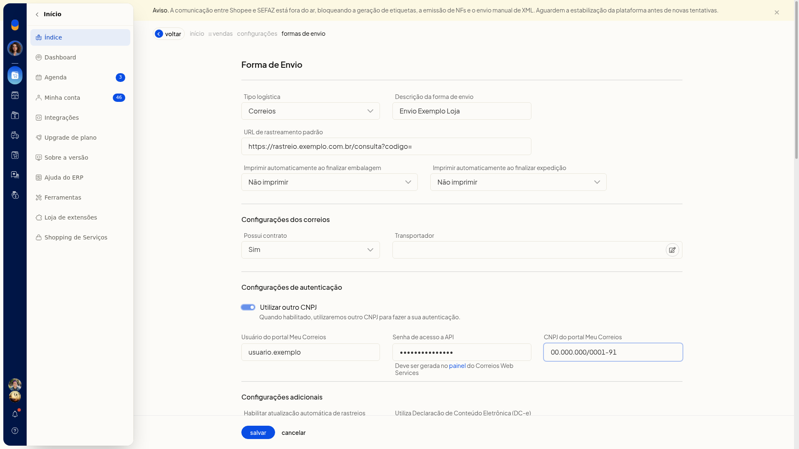

5. Preencha **Usuário do portal Meu Correios** e **Senha de acesso a API**. Gere essa senha no painel do Correios Web Services.

   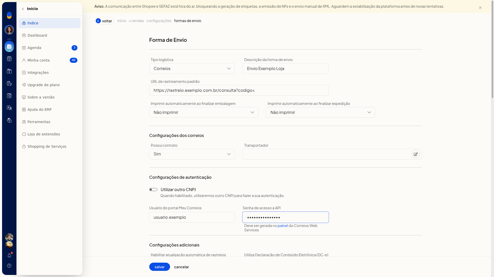

6. Ajuste **Habilitar atualização automática de rastreios** (**Não** ou **Sim**) e **Utiliza DC-e** (**Sim** ou **Não**).
7. Informe **Número do cartão de postagem**, **Unidade de postagem** e **Diretoria regional (DR)**. Em **Diretoria regional (DR)**, escolha **Selecione** ou uma diretoria regional dos Correios, como **DR - SÃO PAULO** ou **DR - SÃO PAULO INTERIOR**.
8. Marque **Utilizar data da expedição como data prevista de postagem** se quiser usar essa data. Informe **Código administrativo**, **Número do contrato**, **Ano do contrato** e **Nome do cliente**.

   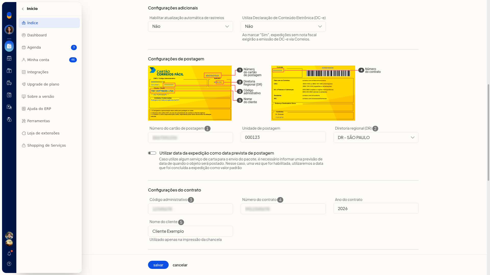

9. Na cotação, defina **Utilizar as dimensões mínimas** como **Não** ou **Sim**. Essa opção vale apenas para cotações pelas APIs de frete.
10. Marque **Agrupar produtos por embalagem** para usar as embalagens da conta.
11. Para valor declarado abaixo de R$ 25,63, escolha **Não utilizar valor declarado** ou a opção que aplica o mínimo de R$ 25,63.
12. Para Mini Envios abaixo de R$ 12,82, escolha não utilizar ou aplicar o mínimo de R$ 12,82.
13. Em **Prazo de postagem (Envio convencional)**, informe o prazo. O máximo é 90 dias. O valor inicial é 14.

   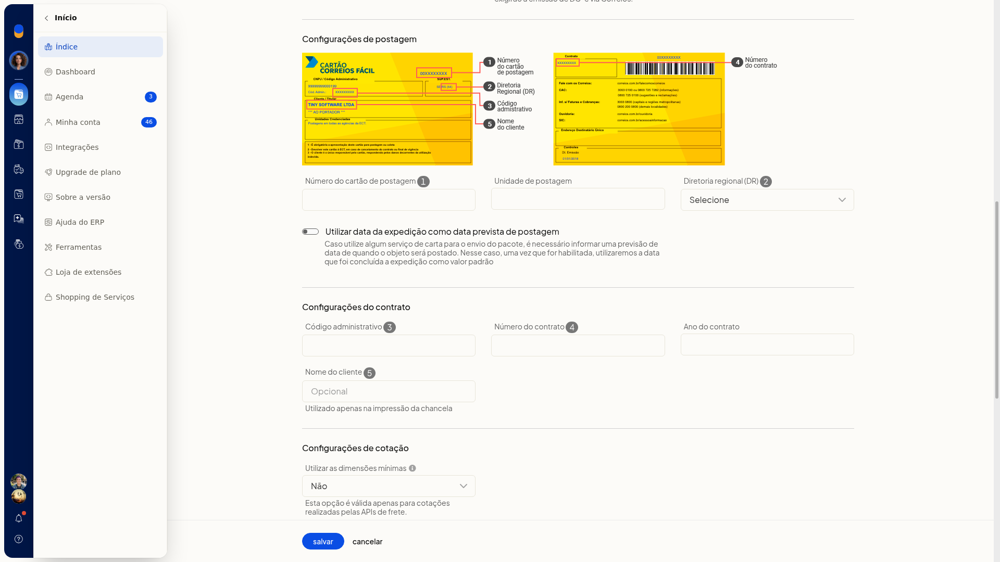

   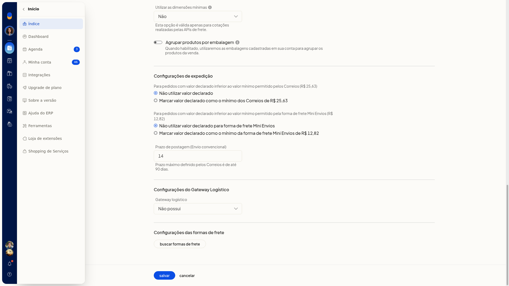

14. Expanda **Logística Reversa** e siga a seção seguinte, se precisar. Use **Buscar formas de frete** para localizar os serviços dos Correios.
15. Clique em **Salvar**. **Cancelar** volta à lista sem gravar.

### Informar a logística reversa

1. No formulário de **Incluir forma de envio**, em **Logística Reversa**, clique em **exibir**.
2. Leia o aviso: é necessário um usuário e uma senha especiais, diferentes dos dados do Sigep WEB e do usuário e da senha da interface de logística reversa.
3. Acesse o link da logística reversa para conferir se as credenciais estão corretas. O link abre, em uma nova aba, o serviço público de logística reversa dos Correios.

   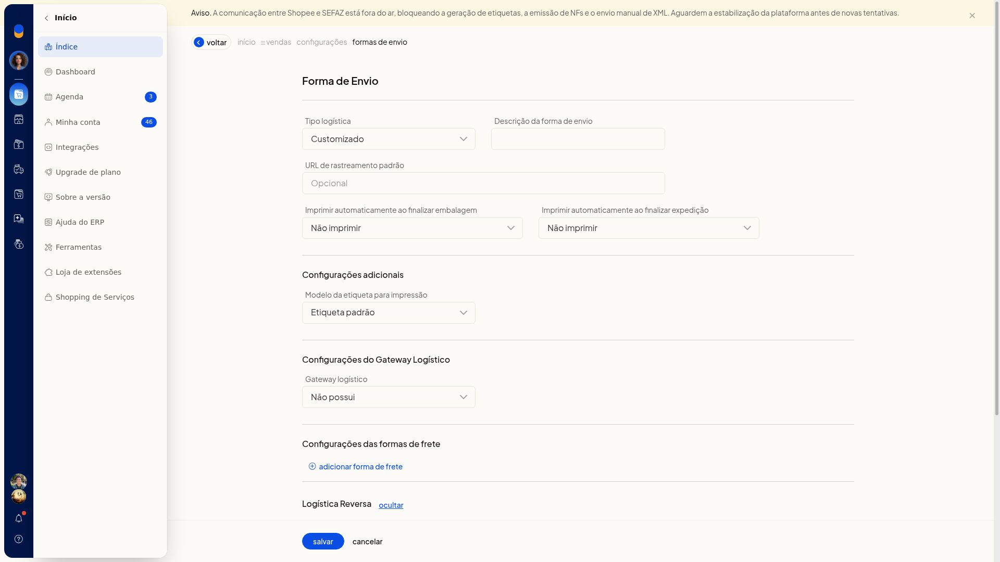

4. Preencha **Usuário Logística Reversa** e **Senha Logística Reversa**.
5. Em **Prazo de postagem (Logística reversa)**, informe um número inteiro de 1 a 90. O valor inicial é 14. A validade da etiqueta definida pelos Correios é de até 90 dias.

   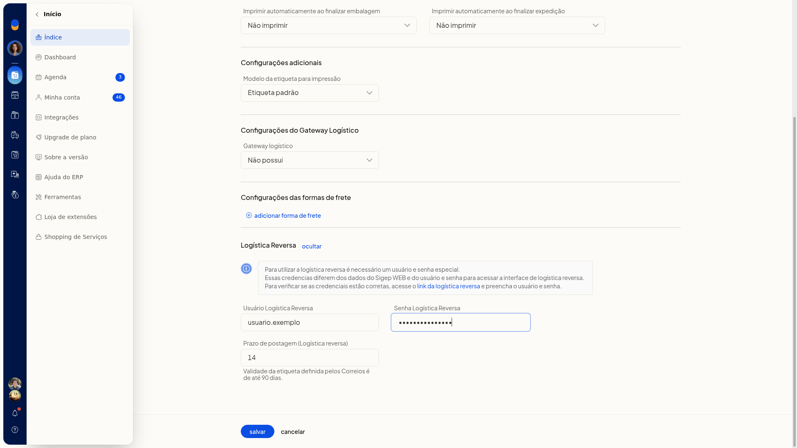

6. Clique em **Salvar** no formulário da forma de envio. **Cancelar** descarta o formulário.

### Adicionar uma forma de frete

1. No formulário da forma de envio, em **Configurações das formas de frete**, clique em **Adicionar forma de frete**.
2. Em **Configuração da forma de frete**, informe **Descrição**, **Código**, **Tipo de entrega** e **Transportador**.
3. Em **Tipo de entrega**, escolha **Não definida**, **Normal**, **Expressa**, **Agendada**, **Econômica**, **Super Expressa** ou **Retirada em mãos**.

   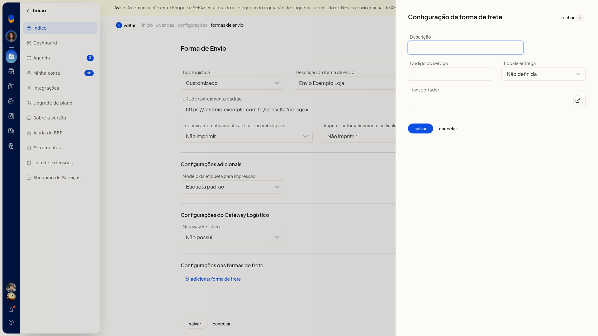

4. Em **Transportador**, informe um nome já cadastrado. Se o nome não existir, a tela mostra **cadastro não encontrado** e permite abrir o cadastro rápido.

   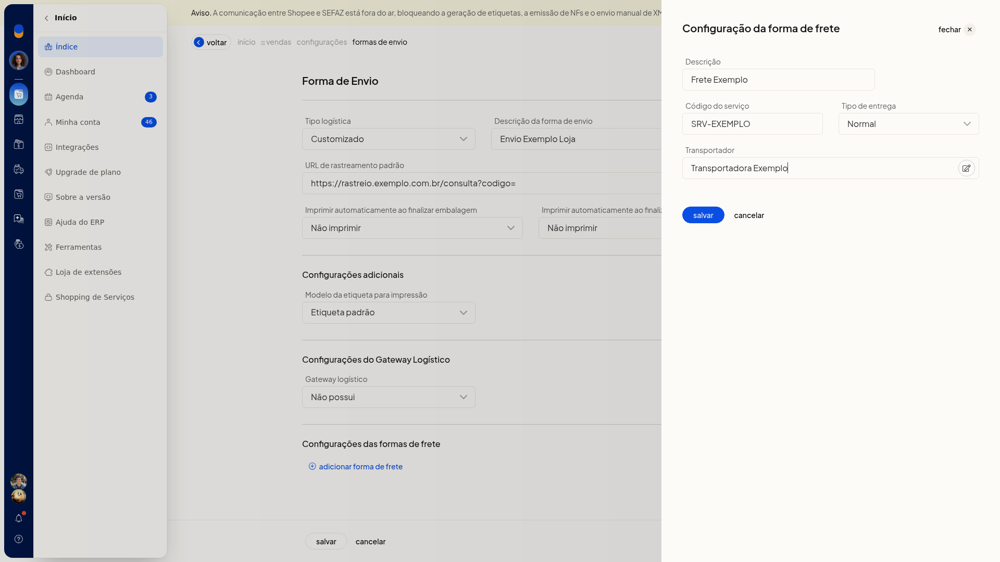

5. Clique em **Salvar** na configuração da forma de frete. **Cancelar** fecha essa configuração sem incluí-la e mantém o formulário da forma de envio aberto.

### Cadastrar o transportador no cadastro rápido

1. A partir de **Transportador** na forma de frete, abra o cadastro rápido quando o nome não for encontrado.
2. Preencha **Nome** e **Código**.
3. Em **Tipo da Pessoa**, escolha **Pessoa Física**, **Pessoa Jurídica**, **Estrangeiro** ou **Estrangeiro no Brasil**.

   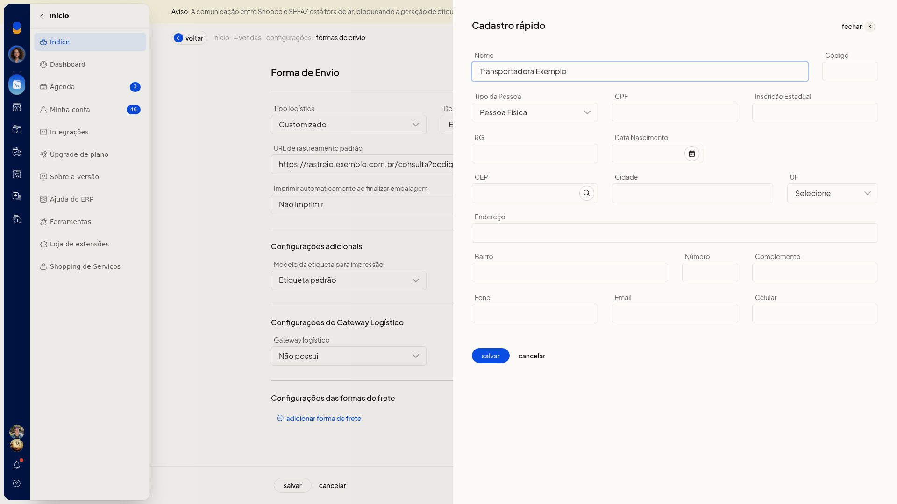

4. Para pessoa física, preencha **CPF**, **IE**, **RG**, **Data Nascimento**, **CEP**, **Cidade**, **UF**, **Endereço**, **Bairro**, **Número**, **Complemento**, **Fone**, **Email** e **Celular**.
5. Use estes formatos: **CPF** 000.000.000-00, **Data Nascimento** mm/dd/aaaa, **CEP** 12.345-678, **Fone** (11) 98765-4321 e **Celular** (11) 91234-5678. Se a cidade não estiver cadastrada, a tela mostra **Cidade não encontrada**.

   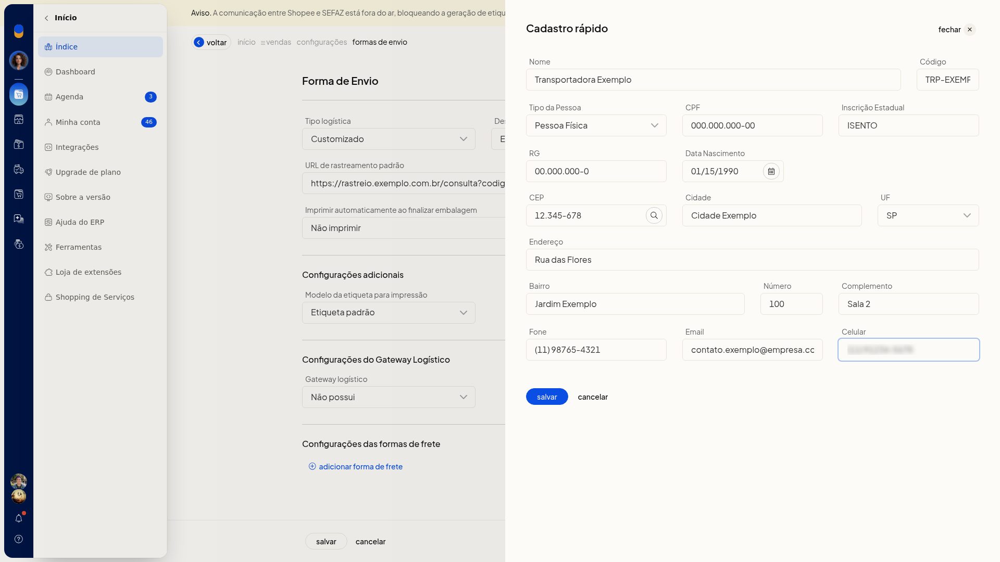

6. Clique em **Salvar** no cadastro rápido. **Cancelar** fecha o cadastro sem gravar o transportador.

### Buscar formas de frete dos Correios

1. Com **Tipo logística** em **Correios**, role até **Buscar formas de frete** e clique no botão.
2. No modal **Adicionar formas de frete**, confira a lista de serviços.
3. Se o modal mostrar **Problema ao obter formas de frete**, clique em **Tentar novamente**. Sem credenciais de Correios gravadas, a busca não lista serviços.

   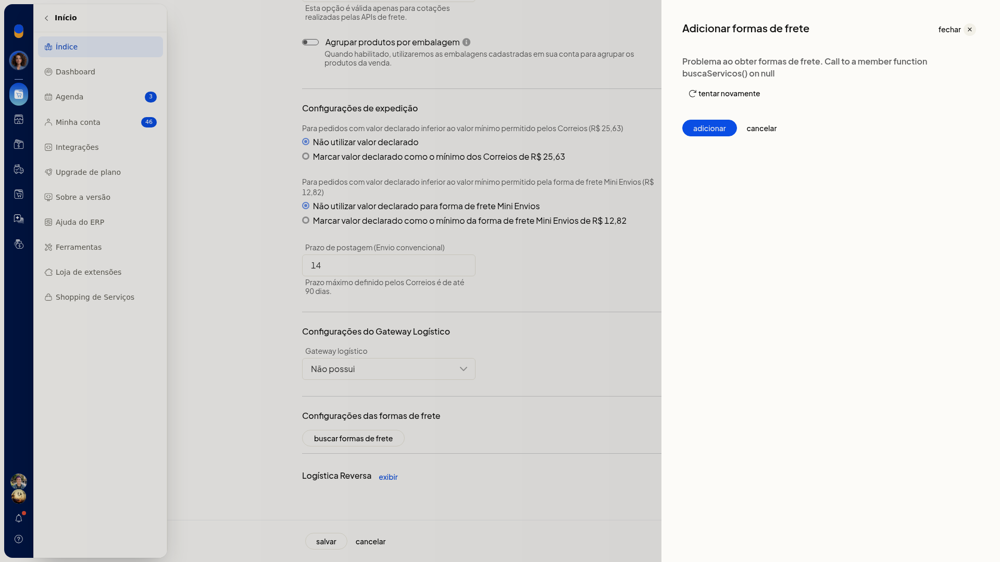

4. Clique em **Adicionar** para incluir os serviços. **Cancelar** fecha o modal sem adicionar serviços e sem gravar a forma de envio.

### Definir a forma de envio padrão

1. Na lista de **Formas de envio**, clique em **Preferências**.
2. Em **Configurar forma de envio padrão**, leia a ajuda: a configuração é válida para pedidos de venda e notas fiscais.

   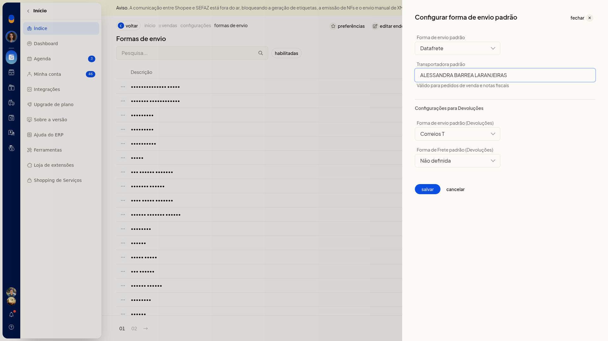

3. Em **Forma de envio padrão**, escolha **Não definida** ou uma forma já cadastrada na conta.
4. Em **Transportadora padrão**, busque um transportador do cadastro. Um nome inexistente mostra **Cadastro não encontrado**.
5. Em **Forma de Frete padrão (Devoluções)**, escolha **Não definida** ou uma opção de envio para devoluções composta pelas formas já cadastradas.

   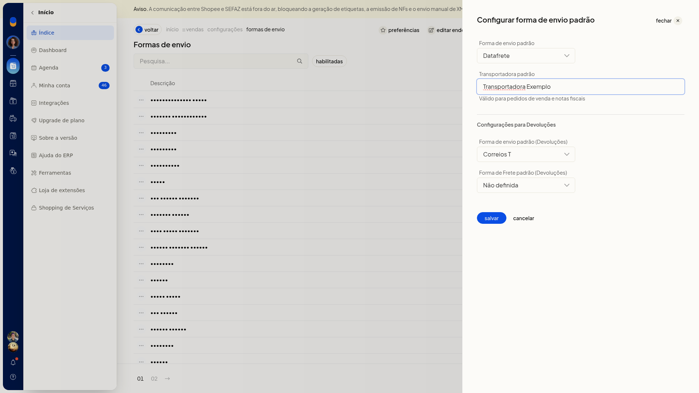

6. Clique em **Salvar**. **Cancelar** descarta a alteração e não grava a preferência.

## Informações adicionais
- **Fechar** nos painéis de endereço do remetente e de usuário de rastreamento encerra sem gravar.
- **Cancelar** na inclusão da forma de envio volta à lista sem criar a forma.
- **Cancelar** na configuração da forma de frete fecha essa configuração e mantém o formulário da forma de envio aberto, sem incluir o frete.
- **Cancelar** no cadastro rápido fecha o cadastro sem criar o transportador.
- **Cancelar** no modal **Adicionar formas de frete** fecha o modal sem adicionar serviços.
- **Cancelar** em **Preferências** descarta a alteração da forma padrão.
