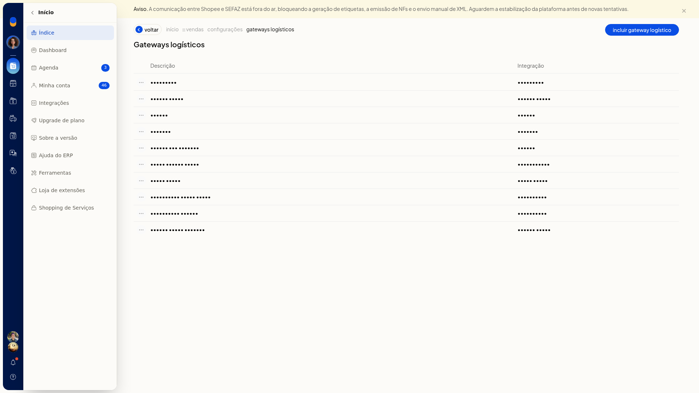

# Excluir um gateway logístico

## Pré-requisitos
- Se **Gateways logísticos** não aparecer para você, peça acesso ao administrador da conta.

## Instruções
1. Acesse **Configurações > Configurações ERP**.
2. Abra a aba **Vendas**.

   

3. Na seção **Expedição e Logística**, clique em **Gateways logísticos**.

   

4. Na linha do gateway, confira **Descrição** e **Integração** e abra o menu de ações.

   

5. Clique em **Excluir**.

## Informações adicionais
- No menu de ações da linha, a opção visível é **Excluir**.
