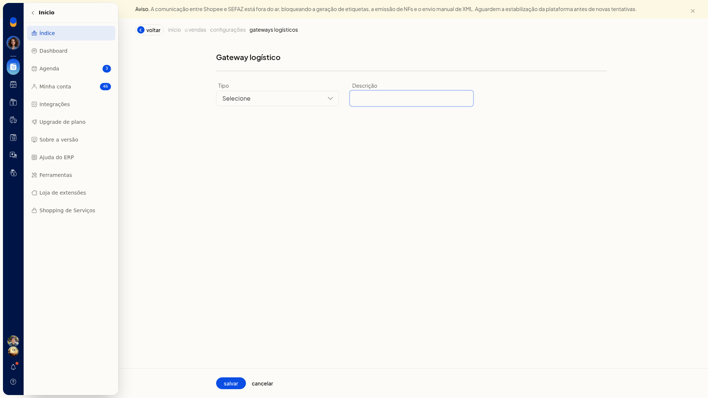
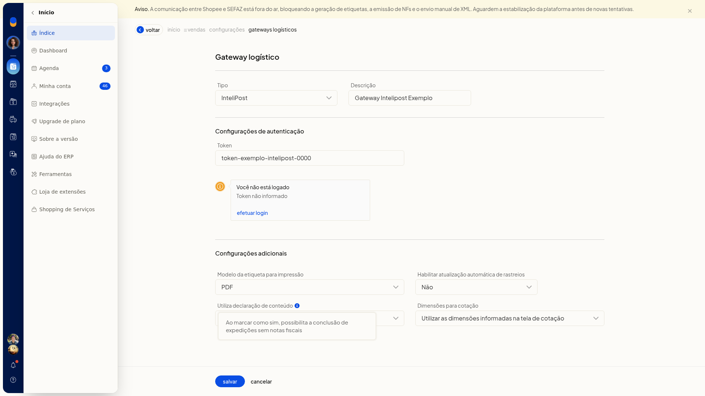
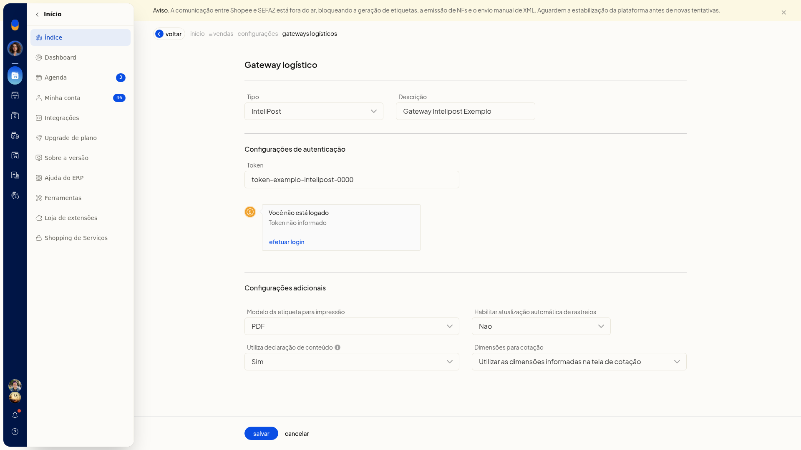
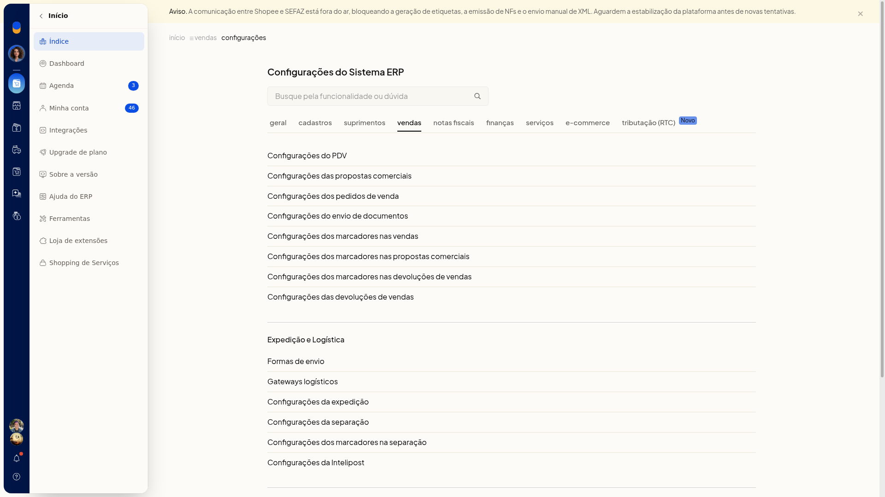
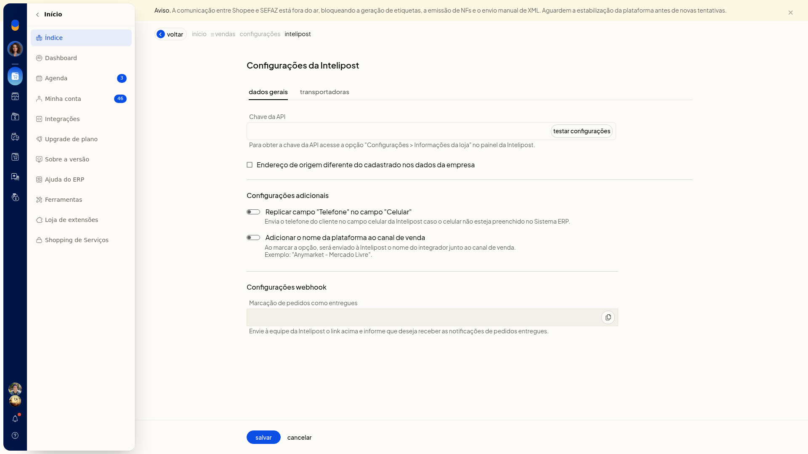
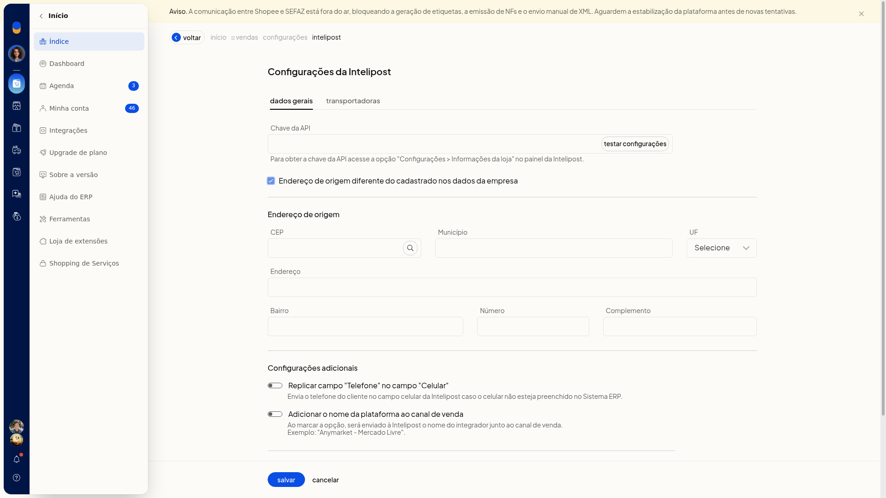
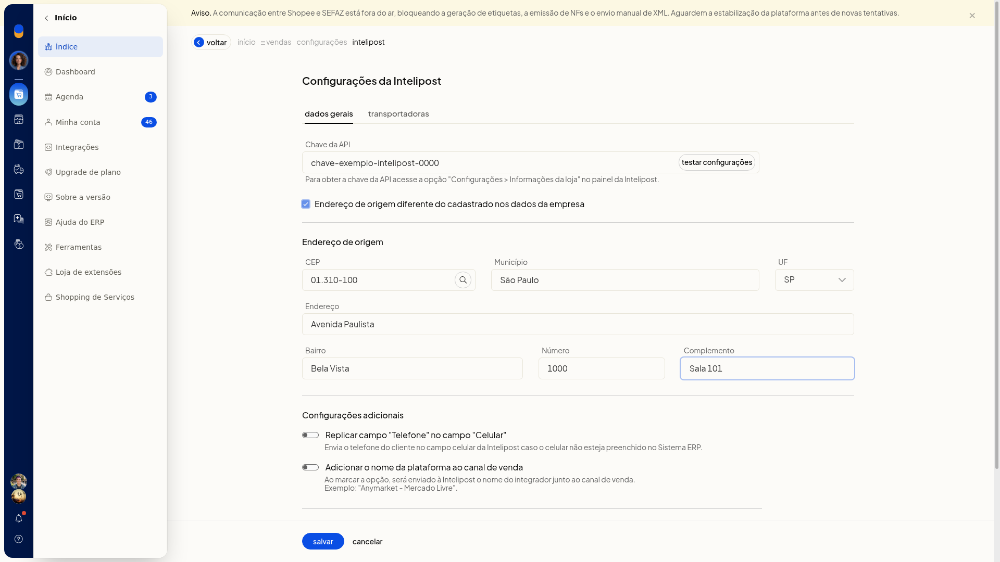
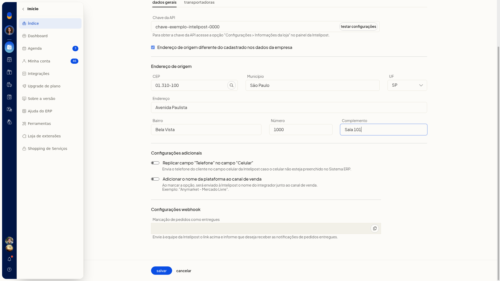
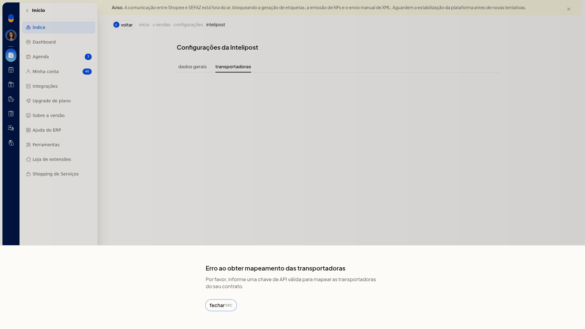
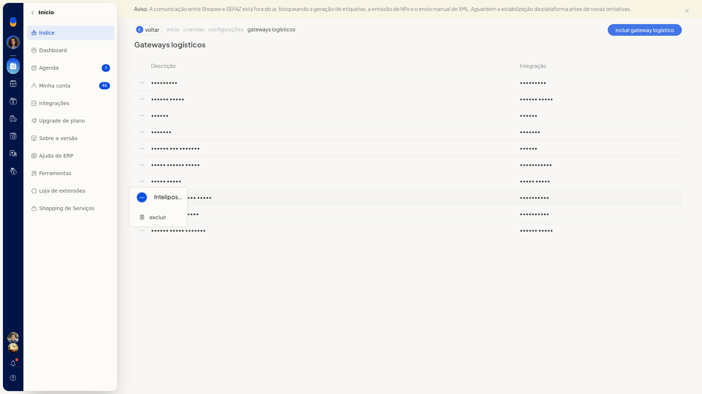

# Gateways logísticos: o que são e como instalar

Gateways logísticos no ERP da Olist é a tela em que você consulta e inclui a integração com uma plataforma de frete. Você escolhe o tipo, informa a descrição e, no caso da InteliPost, o token e as opções de etiqueta, rastreio, declaração de conteúdo e dimensões.

Na mesma área, **Configurações da Intelipost** guarda a chave de API, um endereço de origem opcional e as opções de telefone, canal de venda e o link para marcar pedidos como entregues.

## Pré-requisitos
- Tenha o token da conta Intelipost para instalar o gateway **InteliPost**.
- Tenha a chave de API para **Configurações da Intelipost**. No painel da Intelipost, busque a chave em **Configurações > Informações da loja**.
- Se a opção não aparecer para você, peça acesso ao administrador da conta.

## Importante
- A aba **Transportadoras** só obtém o mapeamento com uma chave de API válida.
- Em **Utiliza declaração de conteúdo**, **Sim** possibilita a conclusão de expedições sem notas fiscais.

## Instruções
### Incluir um gateway logístico

1. Acesse **Configurações > Configurações ERP**. Na aba **Vendas**, na seção **Expedição e Logística**, clique em **Gateways logísticos**.
2. A lista mostra as colunas **Descrição** e **Integração**. Clique em **Incluir gateway logístico**.

   

3. Em **Tipo**, escolha a integração: **Melhor Envio**, **Frenet**, **Datafrete**, **Frete Rápido**, **Flixlog**, **SmartEnvios (beta)**, **Super Frete (beta)** ou **InteliPost**. Preencha a **Descrição**. Nenhum campo deste formulário é obrigatório.

   

4. Com **InteliPost** selecionado, informe o **Token**. Sem token, a tela mostra **Você não está logado / Token não informado** e o link **efetuar login**.
5. Escolha o **Modelo da etiqueta**: **PDF** ou **ZPL**.
6. Em **Habilitar atualização automática de rastreios**, escolha **Sim** ou **Não**.
7. Em **Utiliza declaração de conteúdo**, escolha **Sim** ou **Não**.

   

8. Escolha a origem das dimensões: **Utilizar as dimensões informadas na tela de cotação** ou **Utilizar as dimensões dos produtos**.

   

9. Clique em **Salvar** para concluir a inclusão. Para descartar e voltar à lista, clique em **Cancelar**.

### Configurar a Intelipost

1. Acesse **Configurações > Configurações ERP**. Na aba **Vendas**, na seção **Expedição e Logística**, clique em **Configurações da Intelipost**.

   

2. Na aba **Dados Gerais**, preencha **Chave da API**.

   

3. Se o envio deve sair de outro endereço, marque **Endereço de origem diferente do cadastrado nos dados da empresa**. Preencha **CEP**, **Município**, **UF**, **Endereço**, **Bairro**, **Número** e **Complemento**.

   

   

4. Se quiser, marque **Replicar campo "Telefone" no campo "Celular"**. O telefone do cliente é enviado no celular da Intelipost quando o celular está vazio no ERP.
5. Se quiser, marque **Adicionar o nome da plataforma ao canal de venda**. O envio leva o nome do integrador mais o canal, como no exemplo Anymarket - Mercado Livre.
6. Em **Marcação de pedidos como entregues**, use o botão de copiar para enviar o link à Intelipost.

   

7. Abra a aba **Transportadoras** para obter o mapeamento das transportadoras. Sem chave válida, a tela mostra **Erro ao obter mapeamento das transportadoras — informe uma chave de API válida**. Clique em **Fechar** para voltar ao formulário.

   

8. Clique em **salvar** para gravar. **Voltar** retorna à aba **Vendas** sem gravar o que foi digitado. **cancelar** também está na tela, junto de **testar configurações**.

## Informações adicionais
- A lista pode ter mais de um gateway da mesma integração, cada um com descrição e tipo.
- No menu de ações da linha, a opção é **Excluir**.

