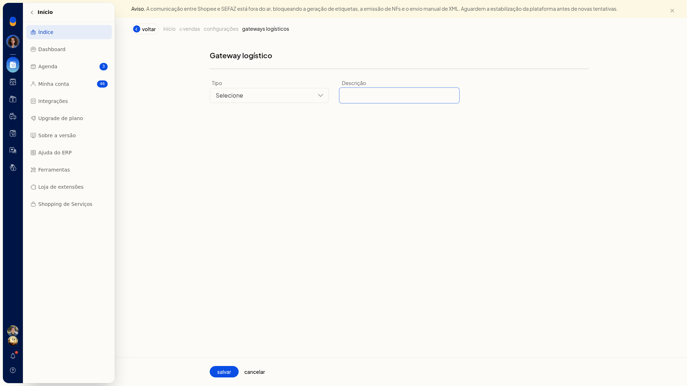
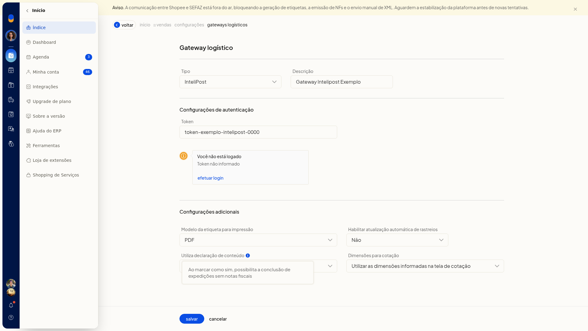
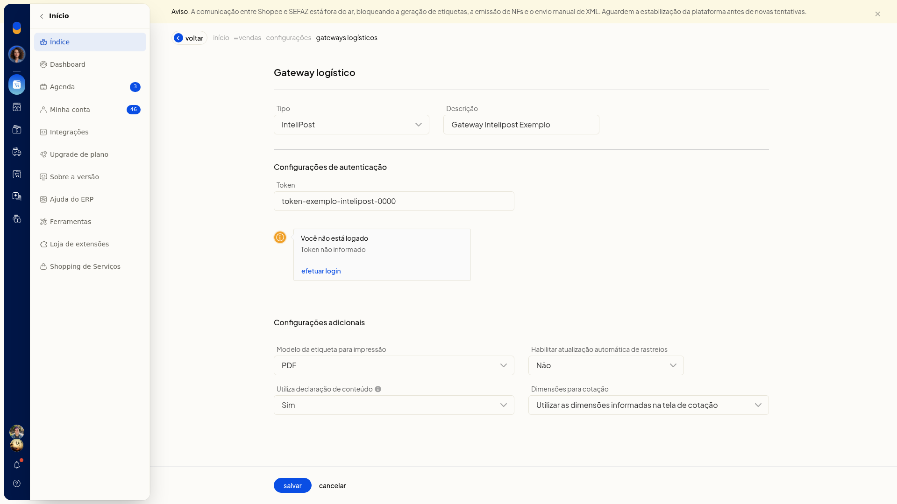
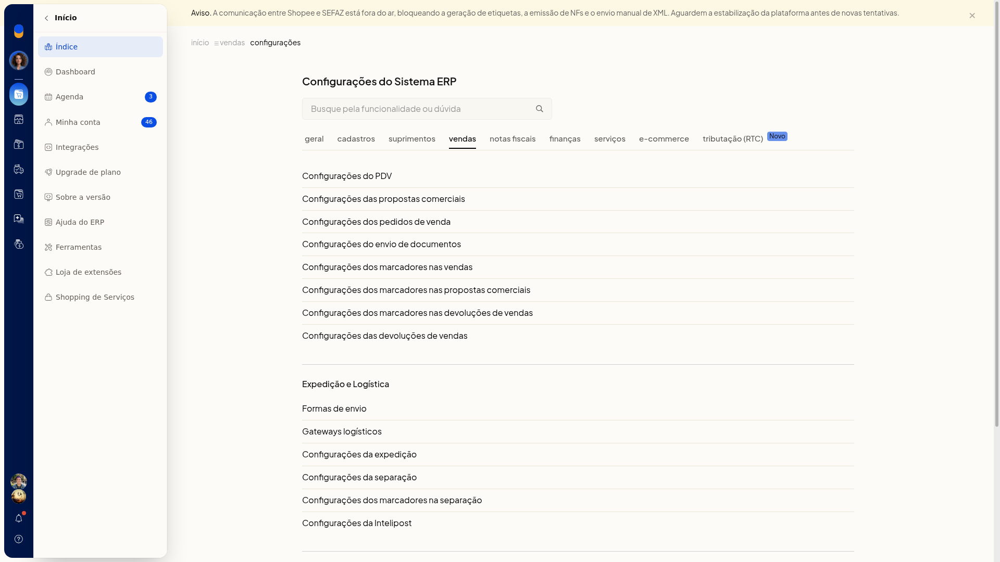
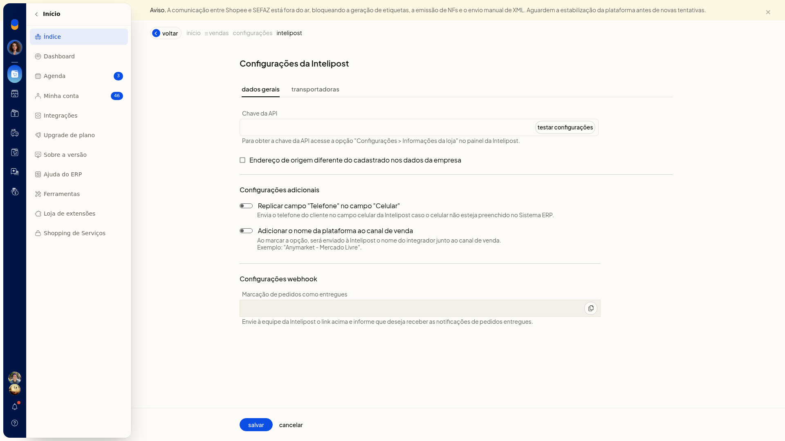
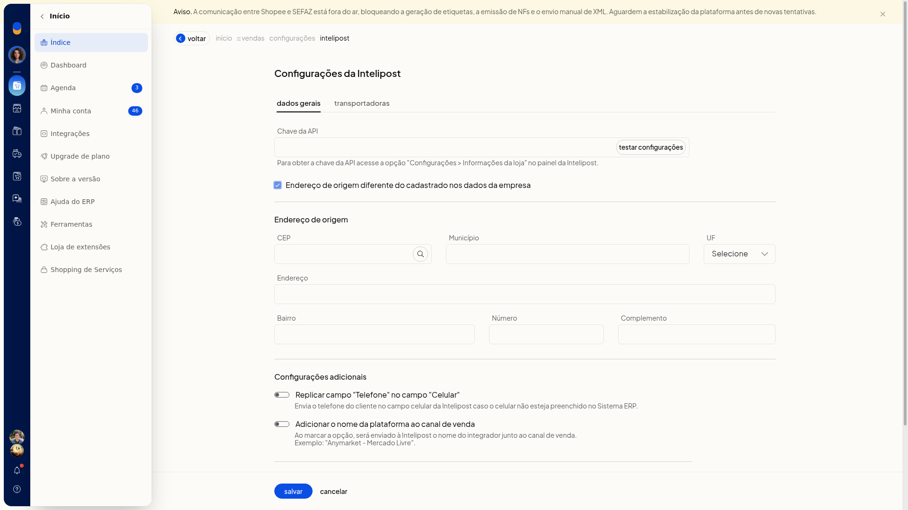
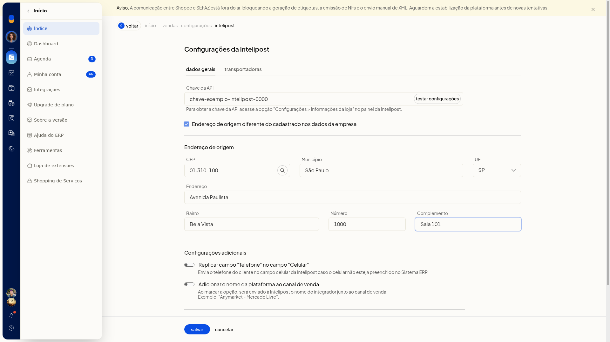
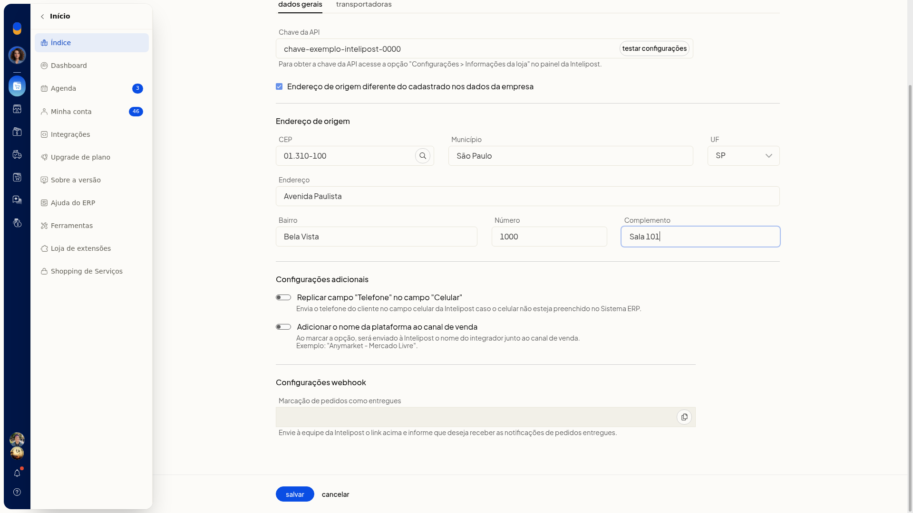
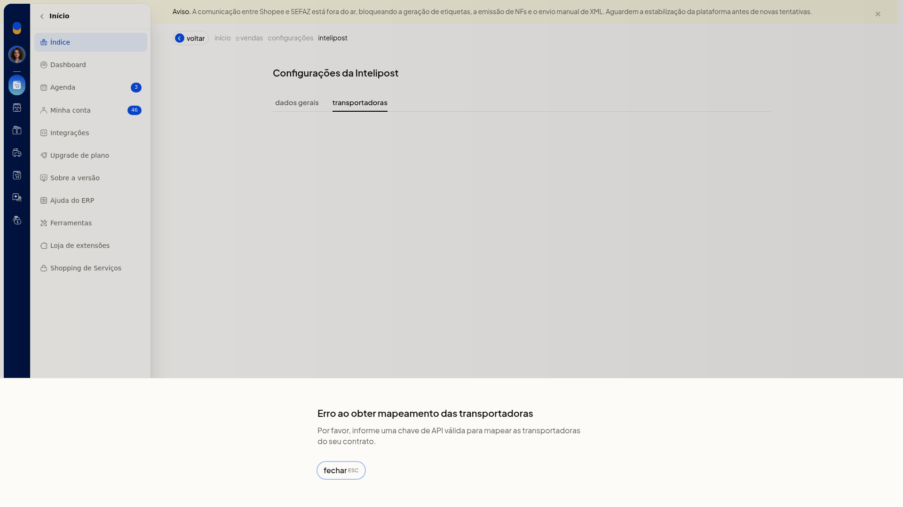
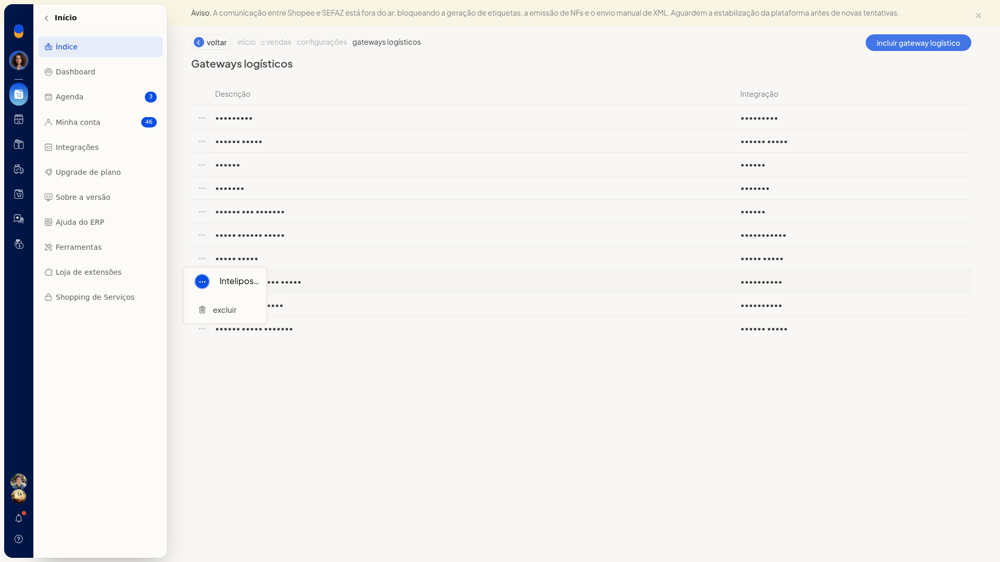

# Intelipost

A Intelipost no ERP da Olist liga a conta de frete ao ERP. Você inclui um gateway do tipo **InteliPost**, com token, modelo da etiqueta, rastreio, declaração de conteúdo e origem das dimensões.

Na mesma área de vendas, **Configurações da Intelipost** guarda a chave de API, um endereço de origem diferente do cadastro da empresa, se quiser, e as opções de telefone, canal de venda e link para marcar pedidos como entregues. Com chave válida, a aba **Transportadoras** obtém o mapeamento das transportadoras.

## Pré-requisitos
- Token da conta Intelipost para incluir o gateway.
- Chave de API da Intelipost para as configurações. Busque no painel da Intelipost, em **Configurações > Informações da loja**.
- Se a opção não aparecer para você, peça acesso ao administrador da conta.

## Importante
- Sem o token, a tela mostra **Você não está logado** / **Token não informado** e o link **efetuar login**.
- A aba **Transportadoras** só segue com o mapeamento quando a chave de API é válida.
- Em **Utiliza declaração de conteúdo**, **Sim** possibilita concluir expedições sem notas fiscais.

## Instruções
### Incluir o gateway pela tela

1. Acesse **Configurações > Configurações ERP**.
2. Na aba **Vendas**, na seção **Expedição e Logística**, clique em **Gateways logísticos**.
   
3. Clique em **Incluir gateway logístico**.
   
4. Em **Tipo**, selecione **InteliPost**.
5. Preencha **Descrição**.
6. Informe o **Token**.
7. Em **Modelo da etiqueta**, selecione **PDF** ou **ZPL**.
8. Em **Habilitar atualização automática de rastreios**, selecione **Sim** ou **Não**.
9. Em **Utiliza declaração de conteúdo**, selecione **Sim** ou **Não**.
   
10. Nas dimensões, selecione **Utilizar as dimensões informadas na tela de cotação** ou **Utilizar as dimensões dos produtos**.
   
11. Clique em **Salvar** para concluir a inclusão. Para descartar, clique em **Cancelar**. A tela volta à lista sem incluir o gateway.

### Configurar a Intelipost pela tela

1. Acesse **Configurações > Configurações ERP**.
2. Na aba **Vendas**, na seção **Expedição e Logística**, clique em **Configurações da Intelipost**.
   
3. Na aba **Dados Gerais**, preencha **Chave da API**.
   
4. Se o envio deve sair de outro endereço, marque **Endereço de origem diferente do cadastrado nos dados da empresa**.
   
5. Preencha **CEP**, **Município**, **UF**, **Endereço**, **Bairro**, **Número** e **Complemento**.
   
6. Se quiser, marque **Replicar campo "Telefone" no campo "Celular"**. O telefone do cliente é enviado no celular da Intelipost quando o celular está vazio no ERP.
7. Se quiser, marque **Adicionar o nome da plataforma ao canal de venda**. O envio leva o nome do integrador mais o canal, como Anymarket - Mercado Livre.
8. No campo **Marcação de pedidos como entregues**, use o botão de copiar para enviar o link à Intelipost.
   
9. Abra a aba **Transportadoras** para obter o mapeamento. Sem chave válida, a tela mostra **Erro ao obter mapeamento das transportadoras — informe uma chave de API válida**. Clique em **Fechar** para voltar ao formulário.
   
10. Clique em **salvar** para gravar ou em **testar configurações** para testar. **Voltar** retorna à aba **Vendas** sem gravar o que foi digitado.

## Informações adicionais
### A lista pode repetir a mesma integração

A lista de **Gateways logísticos** mostra **Descrição** e **Integração**. Pode haver mais de um gateway da mesma integração.

### O menu de ações da linha tem Excluir

No menu de ações da linha, a opção é **Excluir**.

### Esta tela não tem cadastro por planilha

Não há botão de importar planilha nem outro controle de cadastro em massa.
