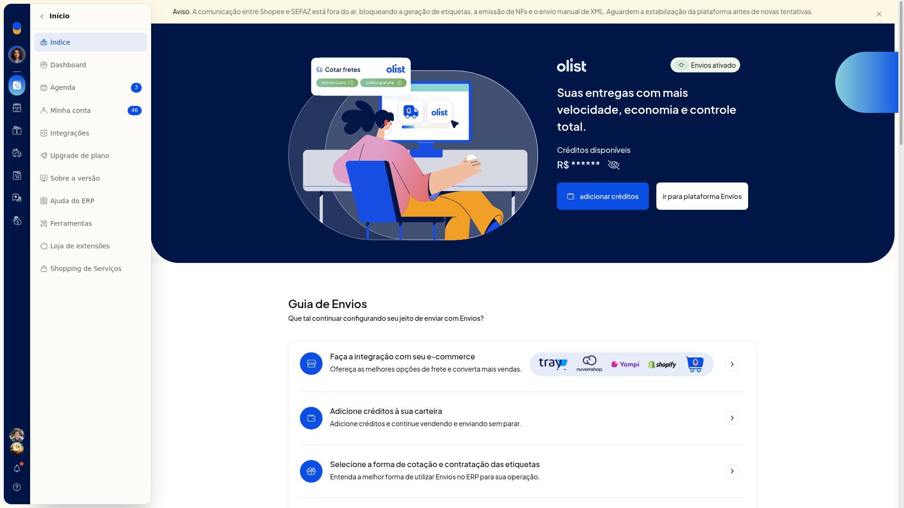
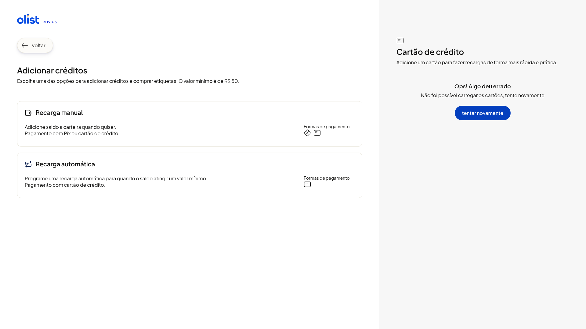
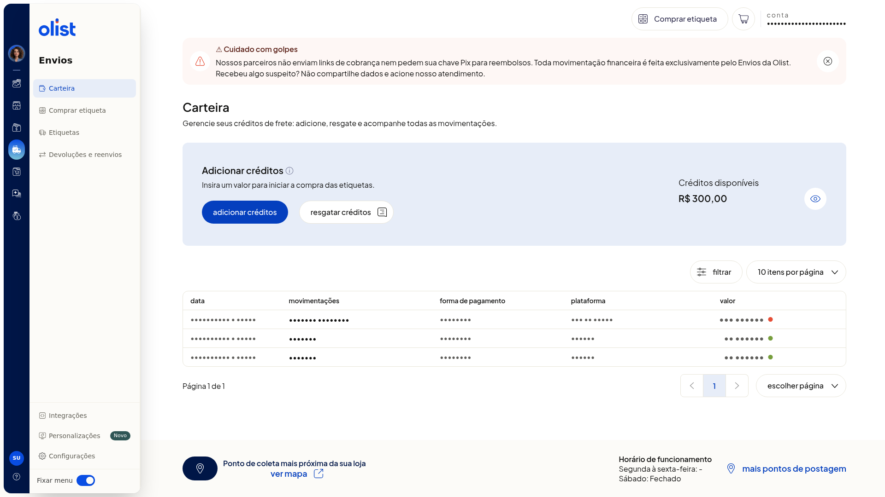
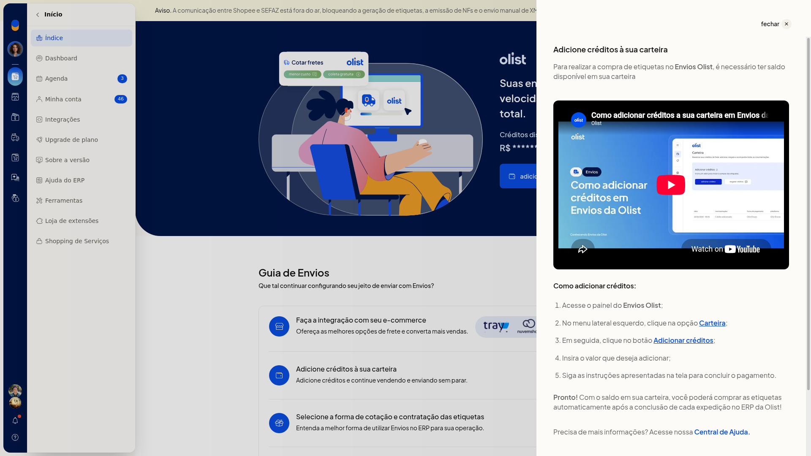

# Adicionar créditos à carteira do Olist Envios

Na página Envios, você confere se o Envios da Olist está ativado, vê os créditos da carteira e adiciona saldo para comprar etiquetas.

O botão **adicionar créditos** e o atalho **ir para plataforma Envios** abrem a mesma carteira. Nela, você faz uma recarga manual com Pix ou cartão, ou programa uma recarga automática com cartão.

## Pré-requisitos
- A conta precisa ter o Envios da Olist.
- Se **Envios** não aparecer na barra lateral de produtos, peça acesso ao administrador da conta.

## Importante
- Recarga manual: o valor mínimo é de R$ 50,00.
- Recarga automática: use cartão de crédito, já salvo ou cadastrado na hora.

## Instruções
### Pela página Envios

1. Acesse **Barra lateral de produtos > Envios**.
2. Confira o aviso **Envios ativado** e o bloco **Créditos disponíveis**.

   

3. Clique em **adicionar créditos**.
4. Escolha **Recarga manual**. A opção indica Pix ou cartão, com mínimo de R$ 50,00.

   

5. Informe o valor no campo **R$**. O campo é obrigatório, em reais. A recarga mínima é de R$ 50,00.
6. Escolha **PIX** ou um cartão já salvo. Se não houver cartão, clique em **adicionar cartão**.
7. No painel **Cadastrar cartão**, preencha os campos obrigatórios: **Número do cartão**, **Nome do titular**, **Data de vencimento** (mês e ano), **Código de segurança**, **Documento do titular** e **CEP do titular**. **Apelido** é opcional. Para sair sem salvar o cartão, clique em **voltar**, feche o painel ou clique em **cancelar**.
8. Clique em **continuar** para seguir ao pagamento, com o valor e a forma escolhidos.

### Recarga automática

1. Abra **Adicionar créditos** pelo botão **adicionar créditos** na página Envios ou por **Carteira > adicionar créditos**.
2. Escolha **Recarga automática**. A opção faz a recarga com cartão quando o saldo atinge o valor configurado.
3. Preencha **Quando o saldo estiver abaixo de**. O campo é obrigatório e o valor é em reais.
4. Preencha **Recarregar o valor de**. O campo é obrigatório e o valor é em reais, adicionado a cada recarga automática.
5. Selecione um cartão salvo ou clique em **adicionar cartão** e preencha o painel **Cadastrar cartão**, como na recarga manual.
6. Clique em **continuar** para programar a recarga com os dois valores e o cartão selecionado.

### Pela Carteira

1. Na página Envios, clique em **ir para plataforma Envios**.
2. Se aparecer a tela de boas-vindas, clique em **começar**.
3. Acesse também **menu lateral esquerdo > Carteira**. A Carteira mostra **adicionar créditos**, **resgatar créditos** e a tabela de movimentações.

   

4. Clique em **adicionar créditos**.
5. Escolha **Recarga manual** ou **Recarga automática**. As opções são as mesmas da página Envios. Informe os valores, escolha a forma de pagamento e clique em **continuar** para seguir ao pagamento ou programar a recarga.

## Informações adicionais
### O Guia de Envios explica o caminho

Na página Envios, em **Guia de Envios**, o card **Adicione créditos à sua carteira** mostra o roteiro e o vídeo **Como adicionar créditos a sua carteira em Envios da Olist**. O painel também mostra o link **Central de Ajuda**. Não há campos para preencher.

O roteiro do painel é: acessar o painel do Envios, clicar em **Carteira** no menu lateral esquerdo, clicar em **Adicionar créditos**, inserir o valor e seguir as instruções da tela para concluir o pagamento.

Com saldo na carteira, as etiquetas podem ser compradas automaticamente depois de cada expedição no ERP.

