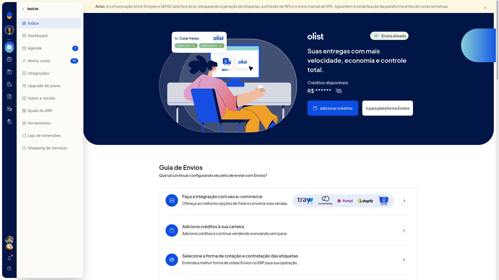
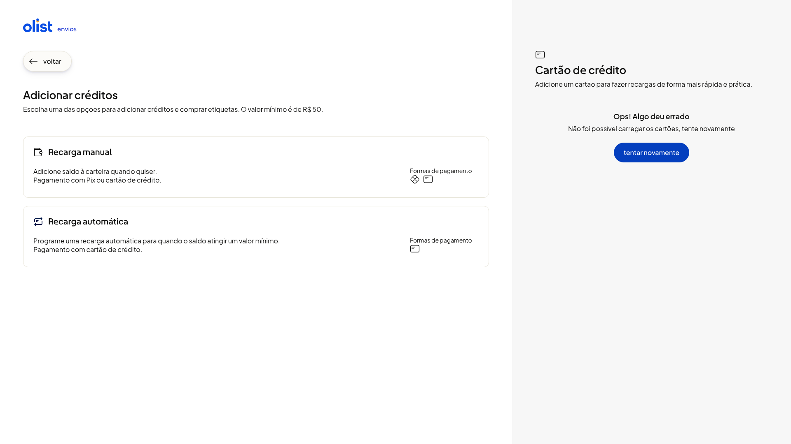

# Cadastrar um cartão para recarga no Olist Envios

No Envios da Olist, você cadastra um cartão de crédito para usar na recarga da carteira. O cartão serve na recarga manual e na recarga automática, quando o saldo chega ao valor que você definir.

O cadastro começa em **adicionar créditos**, na opção **adicionar cartão**.

## Pré-requisitos
- Se **Envios** não aparecer para você, peça acesso ao administrador da conta.

## Importante
- A recarga automática é feita com cartão de crédito já salvo ou cadastrado na hora.
- Na recarga manual, o pagamento pode ser por Pix ou por cartão.

## Instruções
1. Na barra lateral de produtos, clique em **Envios**.

   

2. Clique em **adicionar créditos**.
3. Escolha **Recarga manual** ou **Recarga automática**.

   

4. Clique em **adicionar cartão**.
5. Preencha os campos obrigatórios.

#### Dados do cartão

- **Número do cartão**
- **Nome do titular**
- **Data de vencimento**: informe mês e ano
- **Código de segurança**

#### Dados do titular

- **Documento do titular**
- **CEP do titular**: informe o CEP

6. Se quiser, preencha **Apelido**. Esse campo é opcional.
7. Clique em **adicionar cartão**.

Para abrir a mesma tela pela Carteira, na página Envios clique em **ir para plataforma Envios**. Se aparecer a tela de boas-vindas, clique em **começar**. No menu lateral esquerdo, acesse **Carteira > adicionar créditos** e siga a partir do passo 3.

## Informações adicionais
### Sair sem gravar o cartão

**Voltar**, **fechar painel** ou **cancelar** fecha o cadastro sem gravar o cartão. **Cancelar** devolve à recarga.
