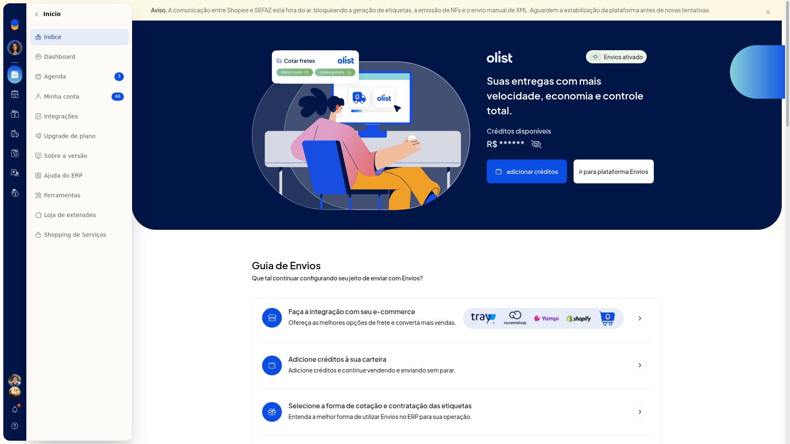
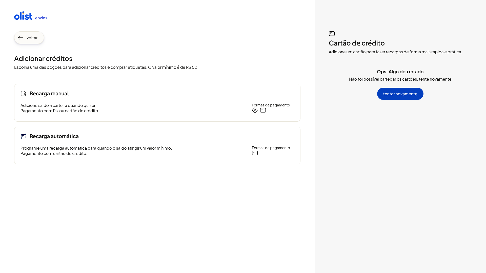
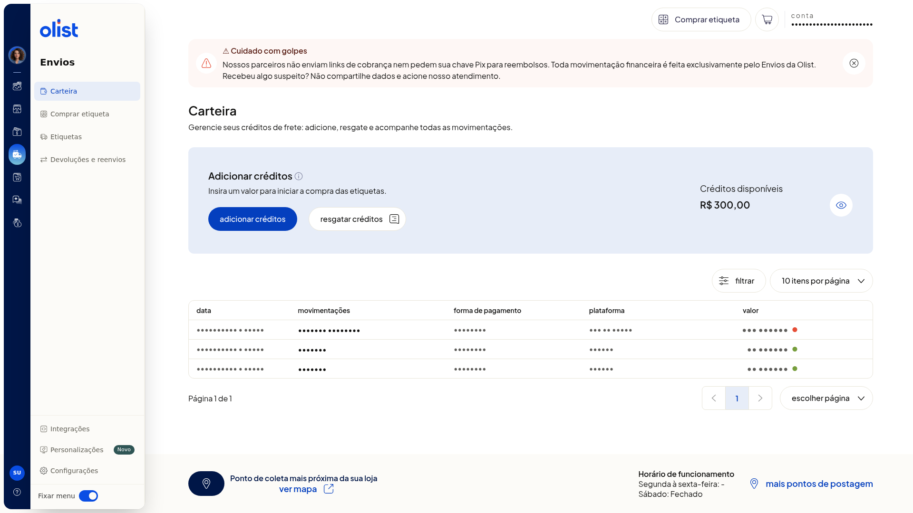
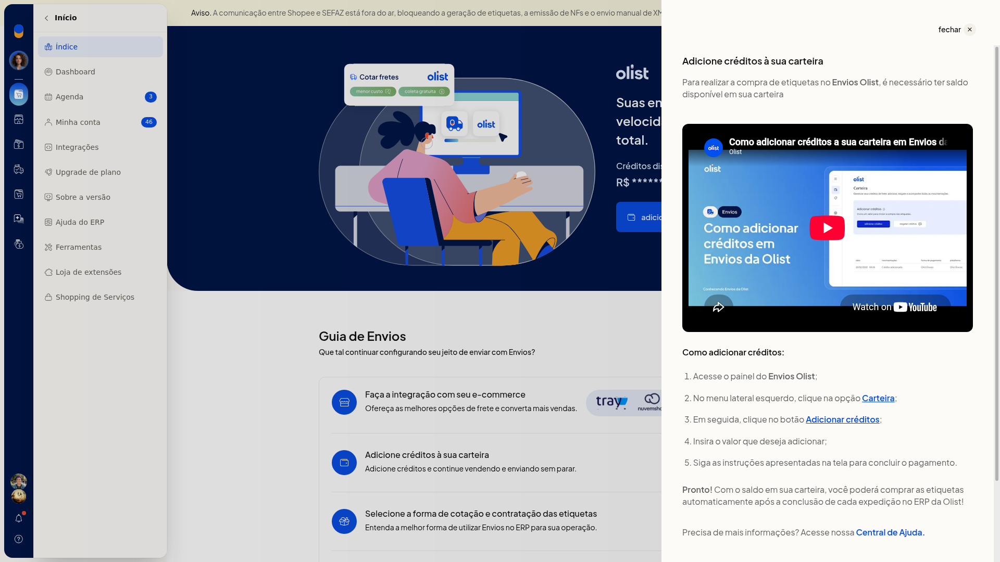
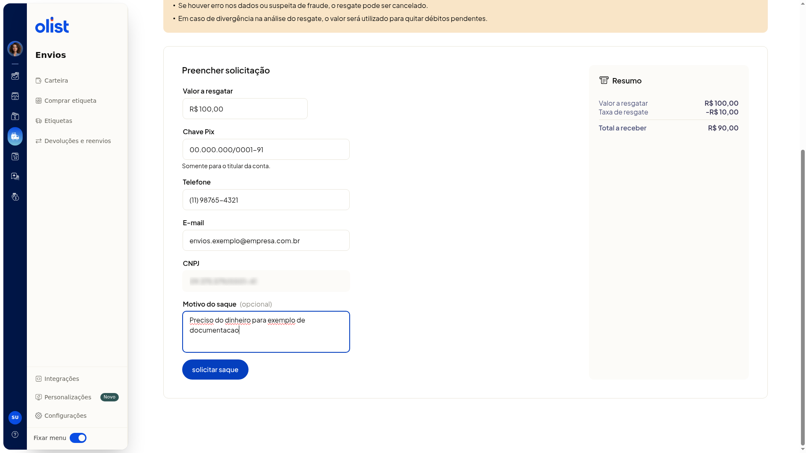

# Olist Envios no ERP

## Importante
- Se **Envios** não aparecer na barra lateral de produtos, peça acesso ao administrador da conta.
- Para comprar etiquetas, é preciso ter saldo na carteira.
- Na recarga manual, o valor mínimo é de R$ 50,00.
- A recarga automática usa cartão de crédito, já salvo ou cadastrado na hora.
- No resgate, a tela informa taxa de R$ 10,00, limite de R$ 5.000,00 por solicitação e resgate apenas para a mesma titularidade da conta.
- O **CNPJ** da solicitação de resgate aparece preenchido e não pode ser alterado.

## Instruções
### Adicionar créditos pela página Envios

1. Acesse **barra lateral de produtos > Envios**.
2. Confira o aviso de **Envios ativado** e o bloco **Créditos disponíveis**. O valor aparece mascarado.

   

3. Clique em **adicionar créditos**.
4. Escolha **Recarga manual**. A opção indica Pix ou cartão, com mínimo de R$ 50,00.

   

5. No campo **R$**, digite o valor em reais.
6. Escolha **PIX** ou um cartão já salvo. Se não houver cartão utilizável, clique em **adicionar cartão**.
7. Clique em **continuar** para seguir ao pagamento, com o valor e a forma já escolhidos.

### Programar a recarga automática

1. Abra **Adicionar créditos** pelo botão **adicionar créditos** da página **Envios** ou por **Carteira > adicionar créditos**.
2. Escolha **Recarga automática**. A opção indica recarga com cartão quando o saldo atinge o mínimo configurado.
3. Preencha **Quando o saldo estiver abaixo de** com o valor em reais. A recarga ocorre quando o saldo chega a esse valor.
4. Preencha **Recarregar o valor de** com o valor em reais de cada recarga.
5. Selecione um cartão salvo ou clique em **adicionar cartão**.
6. Clique em **continuar** para seguir com os dois valores e o cartão selecionados.

### Cadastrar um cartão

1. Em **Recarga manual** ou **Recarga automática**, clique em **adicionar cartão**.
2. No painel **Cadastrar cartão**, preencha os campos obrigatórios:
 - **Número do cartão**
 - **Nome do titular**
 - **Data de vencimento**: mês e ano
 - **Código de segurança**
 - **Documento do titular**
 - **CEP do titular**
3. Se quiser, preencha **Apelido**. O campo é opcional.
4. Clique em **adicionar cartão** para concluir o cadastro. Para sair sem salvar, clique em **voltar**, **fechar painel** ou **cancelar**. **Cancelar** devolve à recarga sem salvar o cartão.

### Adicionar créditos pela Carteira

1. Na página **Envios** do ERP da Olist, clique em **ir para plataforma Envios**.
2. Se aparecer a tela de boas-vindas, clique em **começar**. A **Carteira** exibe **adicionar créditos**, **resgatar créditos** e a tabela de movimentações.

   

3. Se preferir, abra o mesmo destino em **menu lateral esquerdo > Carteira**.
4. Clique em **adicionar créditos**.
5. Escolha **Recarga manual** ou **Recarga automática**. As opções são as mesmas da entrada pelo ERP.

### Consultar o passo a passo no Guia de Envios

1. Na página **Envios**, em **Guia de Envios**, abra o card **Adicione créditos à sua carteira**.
2. Leia o painel: é preciso ter saldo para comprar etiquetas.

   

3. Siga o roteiro exibido: acesse o painel do Envios da Olist, clique em **Carteira** no menu lateral esquerdo, clique em **Adicionar créditos**, insira o valor e siga as instruções da tela para concluir o pagamento.
4. Assista ao vídeo **Como adicionar créditos a sua carteira em Envios da Olist** ou acesse o link **Central de Ajuda**. Não há campos para preencher. Com saldo, as etiquetas podem ser compradas automaticamente após cada expedição no ERP.

### Resgatar créditos

1. Na **Carteira** do painel Envios, clique em **resgatar créditos**.
2. Na tela **Solicitar resgate**, leia as regras de taxa, limite e titularidade.
3. Informe **Valor a resgatar** em reais. O resumo da solicitação é atualizado com o valor informado.
4. Confira **Chave Pix**, **Telefone** e **E-mail**. Eles podem já vir preenchidos com os dados da conta e podem ser editados.
5. Confira o **CNPJ** preenchido. Não há campo para substituir esse valor.
6. Se quiser, preencha **Motivo do saque (opcional)**.

   

7. Clique em **solicitar saque** para enviar a solicitação já preenchida.

## Resultado
Com saldo na carteira, as etiquetas podem ser compradas automaticamente depois de cada expedição no ERP.

## Informações adicionais
- O card **Adicione créditos à sua carteira** não é um formulário: ele mostra o roteiro, o vídeo e o link **Central de Ajuda**.
- **adicionar créditos**, na página **Envios** ou na **Carteira**, abre as mesmas opções: **Recarga manual** e **Recarga automática**.
