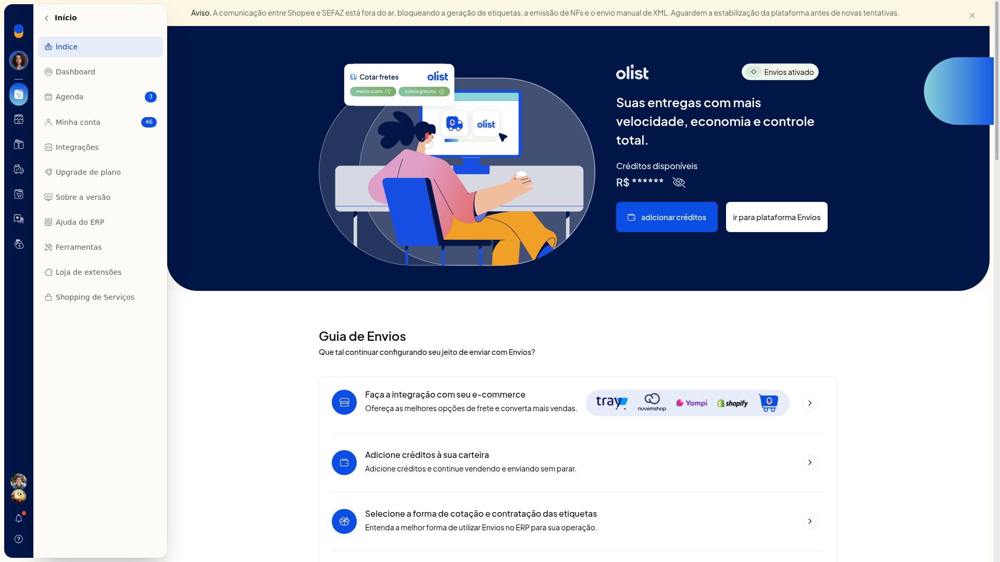
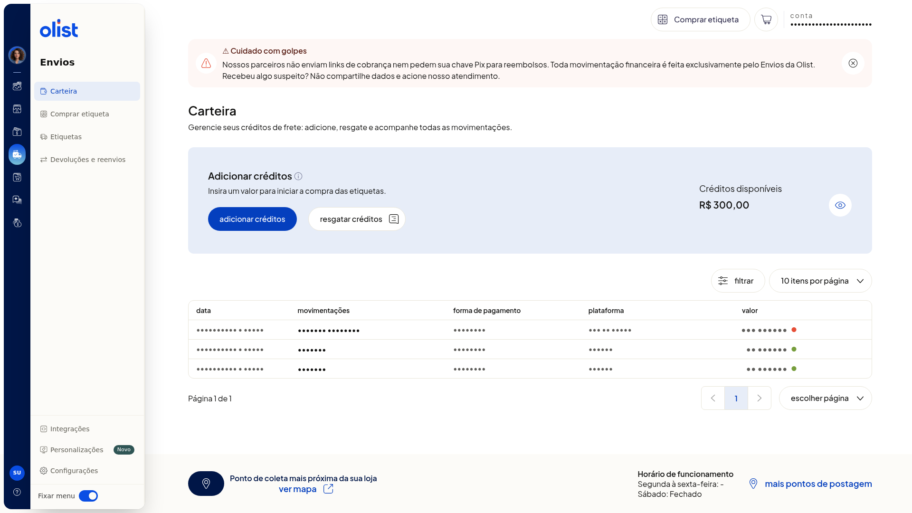
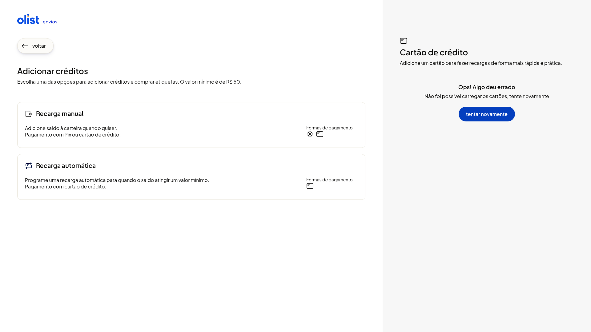

# Programar a recarga automática de créditos do Olist Envios

A recarga automática do Envios da Olist adiciona créditos na carteira com cartão de crédito quando o saldo chega ao valor que você definir. Com isso, a carteira pode manter saldo para a compra de etiquetas sem uma recarga manual a cada vez.

A programação é feita na tela **Adicionar créditos**, aberta pelo botão **adicionar créditos** na página **Envios** ou na **Carteira** do painel do Envios.

## Importante
- A recarga automática é feita com cartão de crédito, já salvo ou cadastrado na hora.
- Os dois campos de valor são obrigatórios e recebem valor em reais.

## Instruções
1. Na **barra lateral de produtos > Envios**, clique em **Envios**.

   

2. Clique em **adicionar créditos**.
Para abrir a mesma tela pelo painel, clique em **ir para plataforma Envios**. Se aparecer a tela de boas-vindas, clique em **começar**. Na **Carteira**, clique em **adicionar créditos**. O caminho **menu lateral esquerdo > Carteira** também abre essa tela.

3. Escolha **Recarga automática**. A opção faz a recarga com cartão quando o saldo atinge o mínimo configurado.

   

4. Preencha **Quando o saldo estiver abaixo de**. A recarga automática ocorre quando o saldo chega a esse valor.
5. Preencha **Recarregar o valor de**. Esse é o valor em reais adicionado a cada recarga automática.
6. Selecione um cartão já salvo. Se não houver cartão utilizável, clique em **adicionar cartão**.

#### Cadastrar cartão

No painel **Cadastrar cartão**, preencha:

- **Número do cartão**: obrigatório
- **Nome do titular**: obrigatório
- **Data de vencimento**: obrigatório, mês e ano
- **Código de segurança**: obrigatório
- **Documento do titular**: obrigatório
- **CEP do titular**: obrigatório
- **Apelido**: opcional

Clique em **adicionar cartão**. Para sair sem salvar o cartão, clique em **cancelar**.

7. Clique em **continuar**.

## Informações adicionais
### Com saldo, as etiquetas podem ser compradas depois da expedição

Com saldo na carteira, as etiquetas podem ser compradas automaticamente depois de cada expedição no ERP.
