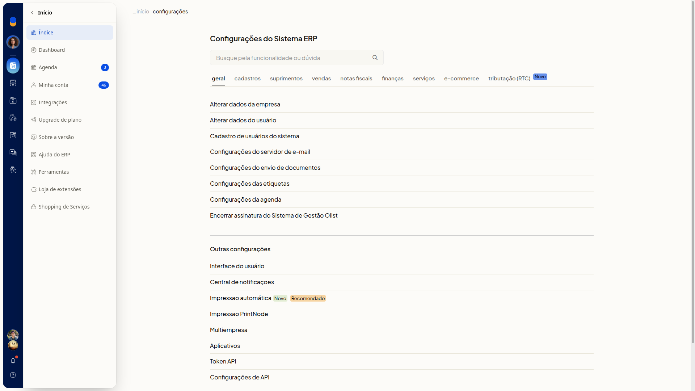
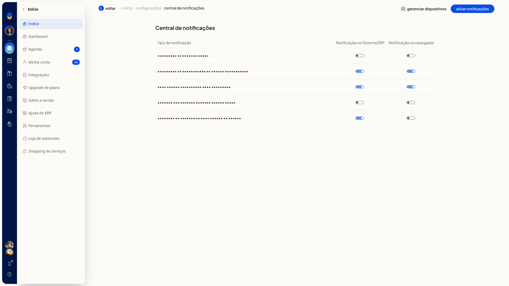
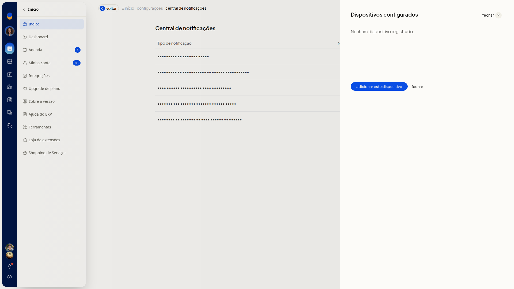
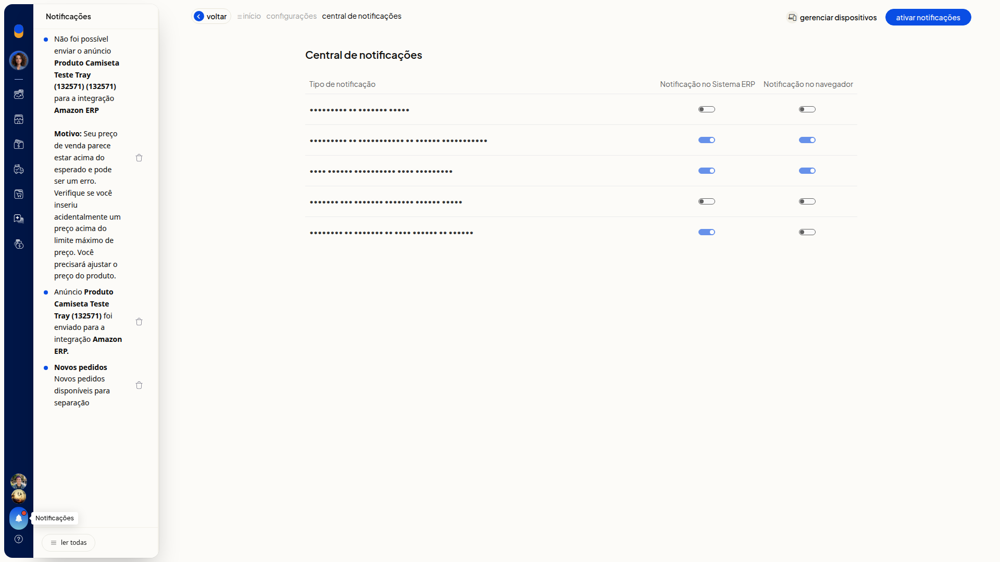

# Central de notificações

## Importante
- A tabela de tipos de aviso é fixa. Não há formulário nem botão para cadastrar um novo tipo.
- A Central de notificações só abre quando existe ao menos um tipo de notificação disponível para configuração.
- Se um tipo de aviso não aparecer para você, peça acesso ao administrador da conta.
- O botão **ativar notificações** só aparece em navegadores com suporte a notificações e quando este navegador ainda não está configurado para receber notificações.
- Para ativar as notificações, o navegador precisa autorizar o envio de notificações.
- **gerenciar dispositivos** só aparece em navegadores com suporte a notificações.
- Ao marcar a notificação no navegador sem nenhum dispositivo configurado, é preciso adicionar um dispositivo.

## Instruções
1. Acesse **Configurações > Configurações ERP**.
2. Na tela **Configurações do Sistema ERP**, clique na aba **Geral**.
3. Em **Outras configurações**, clique em **Central de notificações**.

   

4. Confira as colunas **Tipo de notificação**, **Notificação no Sistema ERP** e **Notificação no navegador**. Cada tipo tem um interruptor em cada coluna. Nenhum interruptor é obrigatório.
 - **Perguntas do Mercado Livre**
 - **Problemas no faturamento do Amazon FulFillment**
 - **Novo pedido disponível para separação**
 - **Pedidos com entrega Mercado Envios Agora**
 - **Bloqueio de emissão de nota fiscal na Amazon**

   

5. Use o interruptor da coluna **Notificação no Sistema ERP** para definir se você recebe o aviso no Sistema ERP.
6. Use o interruptor da coluna **Notificação no navegador** para definir se você recebe o aviso no navegador. Se você marcar a notificação no navegador sem nenhum dispositivo configurado, adicione um dispositivo.
7. Clique em **ativar notificações**, se o botão aparecer, e autorize o envio de notificações no navegador.
8. Clique em **gerenciar dispositivos**.
9. No painel **Dispositivos configurados**, confira a lista ou a mensagem **Nenhum dispositivo registrado**.

   

10. Clique em **Adicionar este dispositivo** para configurar este navegador. Para voltar à tabela sem adicionar, clique em **Fechar**.
11. Clique em **Notificações** na barra superior.
12. Leia os avisos recebidos no painel **Notificações**. A tela mostra **ler todas** e, em cada aviso, **Excluir notificação**. Você vê os avisos já recebidos no ERP.

   

## Resultado
A Central de notificações mostra a tabela de tipos de aviso, com um interruptor em **Notificação no Sistema ERP** e outro em **Notificação no navegador**. Em **Dispositivos configurados**, você confere se há dispositivo registrado para a notificação no navegador.
