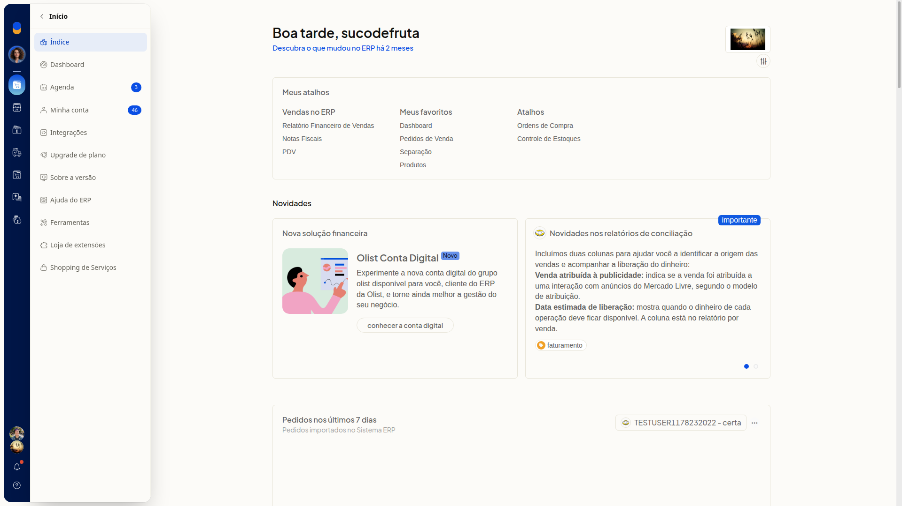
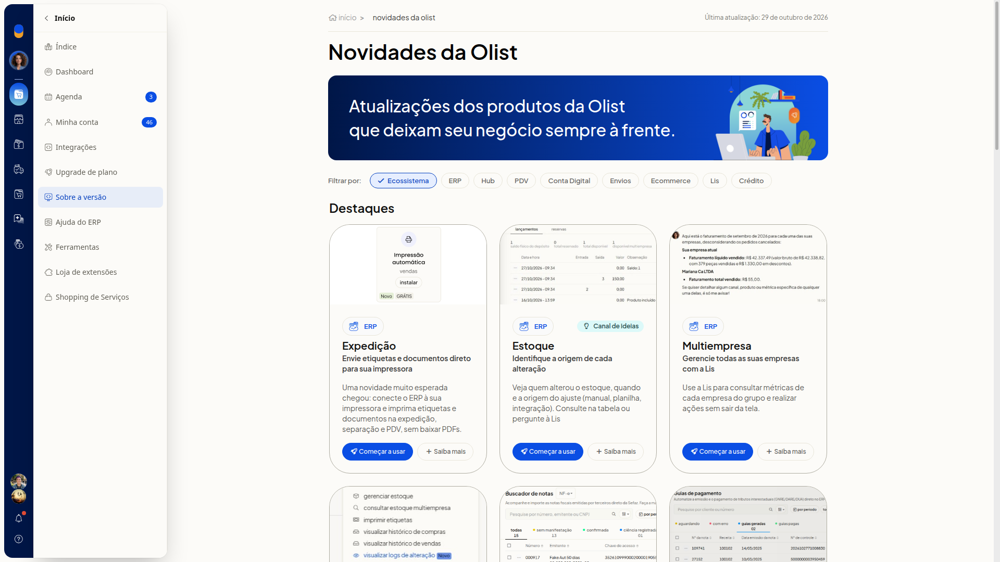
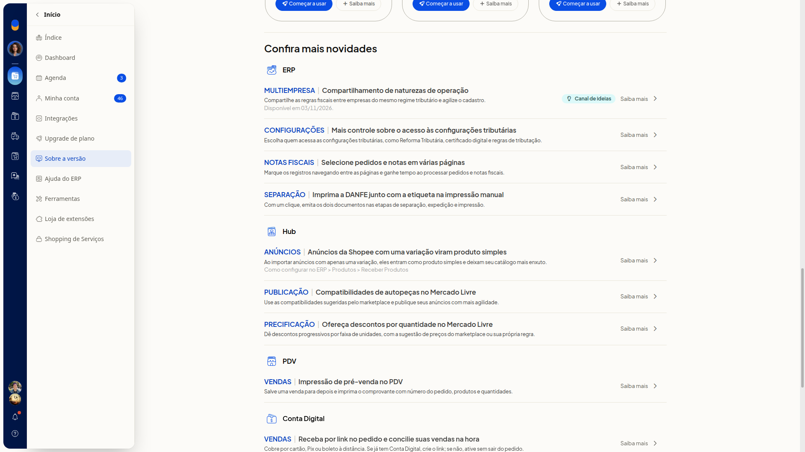
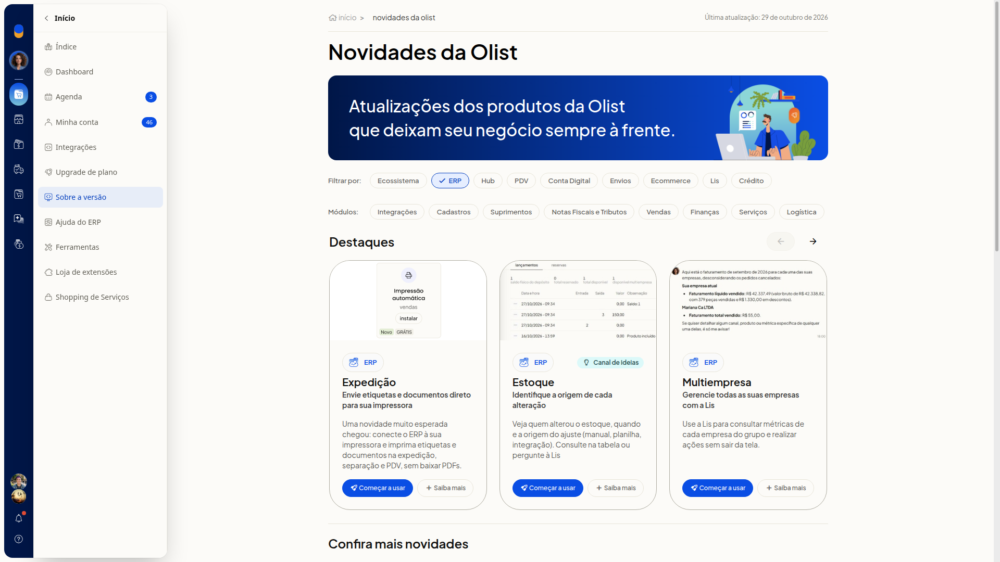
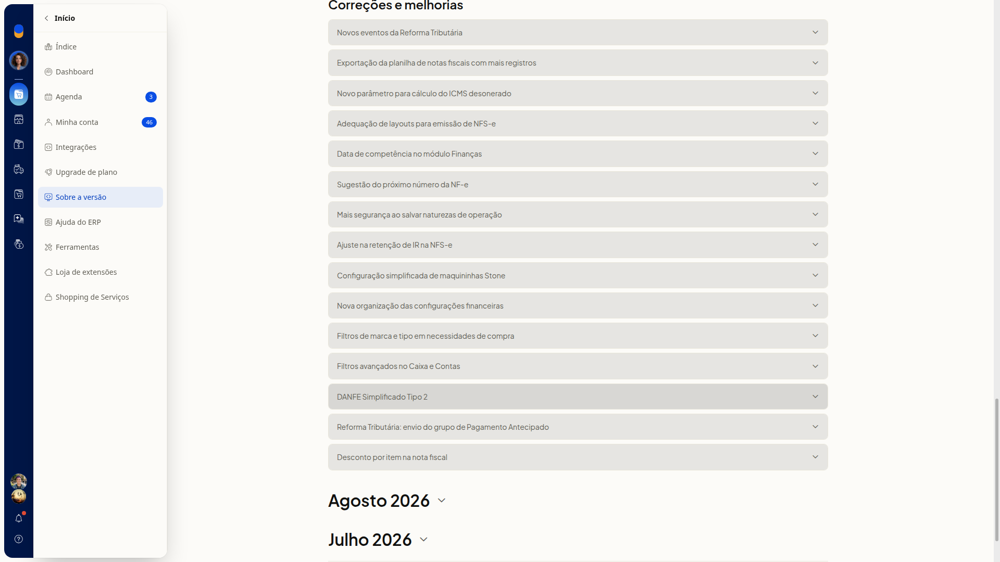
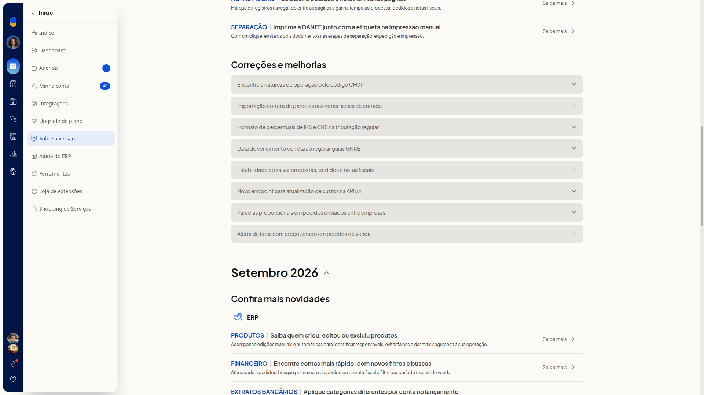

# Sobre a versão: novidades e atualizações

## Instruções
1. Acesse **Início > Sobre a versão**.

   

2. Leia, em **Novidades da Olist**, a data da última atualização, os **Destaques** e a lista **Confira mais novidades**. A lista reúne novidades agrupadas por produto. Cada novidade pode trazer **Começar a usar**, **Saiba mais** ou **Canal de ideias**.

   

   

3. Clique em **Ecossistema**, **ERP**, **Hub**, **PDV**, **Conta Digital**, **Envios**, **Ecommerce**, **Lis** ou **Crédito**. A lista passa a mostrar as novidades do produto escolhido.

4. Selecione **ERP** para ver as abas de **Módulos**, a seção **Correções e melhorias** e os grupos por mês. As abas de **Módulos** são **Integrações**, **Cadastros**, **Suprimentos**, **Notas Fiscais e Tributos**, **Vendas**, **Finanças**, **Serviços** e **Logística**.

   

5. Role até os grupos de mês, como **Setembro 2026**, **Agosto 2026** e **Julho 2026**.

   

6. Clique no mês para expandir, como **Setembro 2026**. A página mostra mais novidades daquele mês e outro bloco **Correções e melhorias**. Você vê o histórico de atualizações daquele período.

   

## Resultado
A página **Novidades da Olist** mostra as atualizações dos produtos da Olist, com a data da última atualização, os filtros de produto, **Destaques** e **Confira mais novidades**.

## Informações adicionais
### O histórico não usa o título histórico de versões

As atualizações aparecem em grupos de mês e na lista **Confira mais novidades**. A página não traz uma seção com o título histórico de versões.
