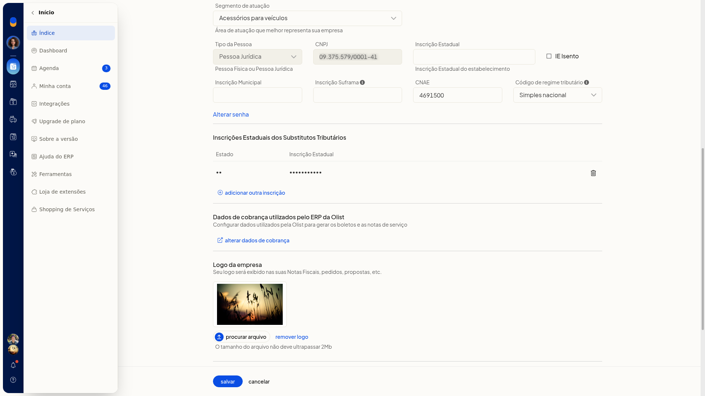

# Alterar o regime tributário da empresa

Você altera o código de regime tributário da empresa já cadastrada no ERP da Olist. Na tela **Dados da empresa**, você escolhe o regime do cadastro no campo **Código de regime tributário**.

## Pré-requisitos
- A aba **Geral** não fica disponível para empresas no plano Conta Digital da Olist.
- Se a opção não aparecer para você, peça acesso ao administrador da conta.

## Importante
- Ao alterar o regime, as naturezas de operação deverão ser reconfiguradas de acordo com as regras tributárias do novo regime.

## Instruções
1. Acesse **Configurações > Configurações do Sistema ERP**.
2. Na aba **Geral**, clique em **Alterar dados da empresa**.

   

3. Em **Código de regime tributário**, selecione uma opção. O campo não é obrigatório.
 - **Simples nacional**
 - **Simples nacional - excesso de sublimite de receita bruta**
 - **Regime normal**
 - **Microempreendedor Individual (MEI)**

   

4. Clique em **Salvar** para aplicar a troca de regime. O regime escolhido fica selecionado no cadastro da empresa.
