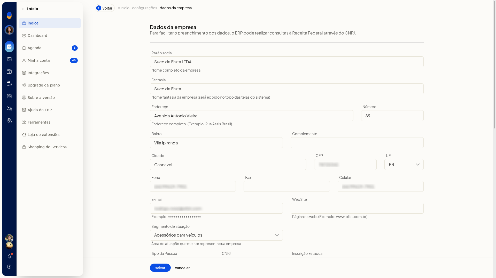
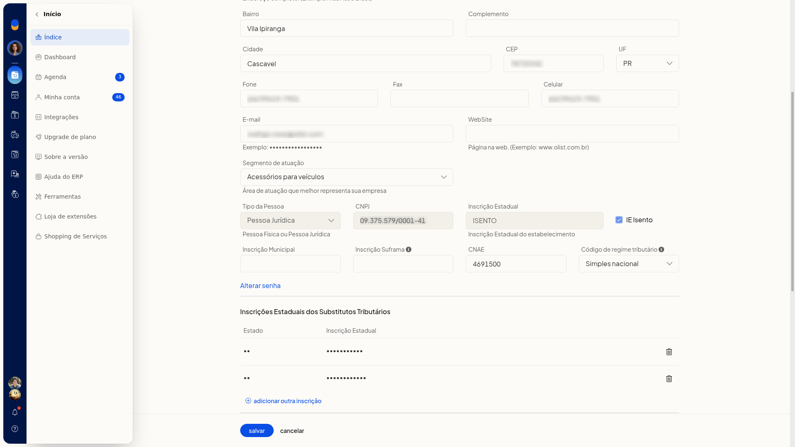
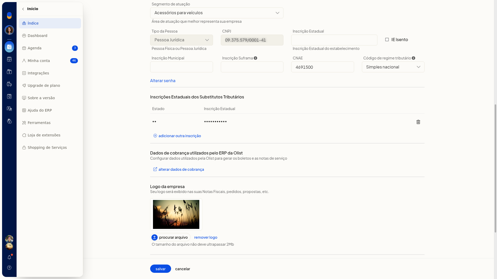
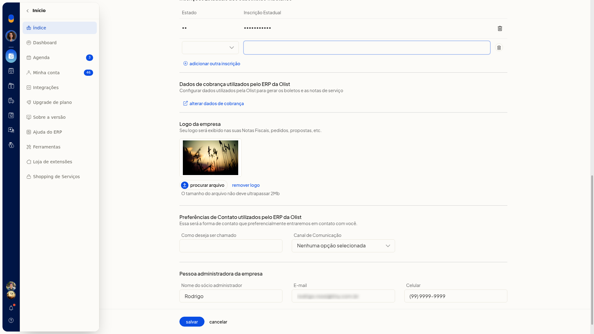
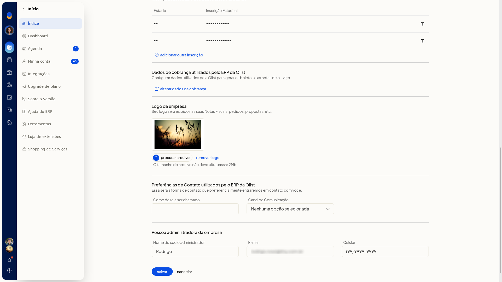
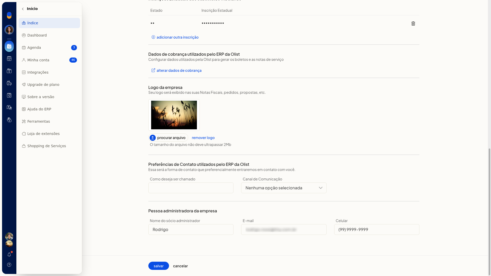

# Configurar os dados da empresa

A tela **Dados da empresa**, no ERP da Olist, permite revisar e atualizar o cadastro já existente da empresa: identificação, endereço, contatos, dados fiscais e o logotipo exibido em notas fiscais, pedidos e propostas.

Você informa inscrição estadual, inscrição municipal, inscrição Suframa, CNAE e regime tributário, inclui inscrições estaduais de substituto tributário e envia o logotipo. O texto da página informa que o ERP pode consultar a Receita Federal pelo CNPJ para facilitar o preenchimento.

## Pré-requisitos
- A empresa já precisa estar cadastrada. A tela altera o registro existente e não cria uma nova empresa.
- A tela não fica disponível para empresas no plano Conta Digital.
- Se a opção não aparecer para você, peça acesso ao administrador da conta.

## Importante
- Nenhum campo desta tela é marcado como obrigatório.
- O CNPJ já vem preenchido e não pode ser alterado nesta tela. Não há botão para consultar a Receita Federal.
- Ao alterar o **Código de regime tributário**, as naturezas de operação deverão ser reconfiguradas de acordo com as regras tributárias do novo regime.
- A **Inscrição Suframa**, quando usada, tem 8 ou 9 dígitos. Ela é obrigatória em operações com benefício de alíquota zero da CBS em áreas sob controle da SUFRAMA.
- O arquivo do logotipo não deve ultrapassar 2Mb.
- A inscrição estadual de substituto tributário só é gravada em **Salvar**. **Voltar** descarta a linha incluída e ainda não salva.
- **remover logo** pede confirmação. Se você confirmar, o logotipo é removido de forma persistente.

## Instruções
1. Acesse **Configurações > Configurações do Sistema ERP**.
2. Na aba **Geral**, clique em **Alterar dados da empresa**.

   

3. Revise identificação, endereço e contatos.

   

#### Identificação, endereço e contatos

- **Razão social**: nome completo da empresa.
- **Fantasia**: nome fantasia. Ele é exibido no topo das telas do sistema.
- **Tipo da Pessoa**: **Pessoa Jurídica** ou **Pessoa Física**.
- **Endereço**, **Número**, **Bairro**, **Complemento** e **Cidade**.
- **CEP**.
- **UF**: selecione a opção.
- **Fone**, **Fax** e **Celular**.
- **E-mail**.
- **WebSite**: página na web.
- **Segmento de atuação**: selecione a área que melhor representa a empresa.
- **Como deseja ser chamado**.
- **Canal de Comunicação**: **E-mail** ou **WhatsApp**.

4. Nos dados fiscais, confira o **CNPJ** já preenchido.
5. Para isenção de inscrição estadual, marque **IE Isento**.

   

**Inscrição Estadual** passa a exibir ISENTO e fica somente leitura. Desmarque **IE Isento** para limpar o campo e voltar a editá-lo.

6. Preencha **Inscrição Municipal**, **Inscrição Suframa** (8 ou 9 dígitos, quando houver) e **CNAE**, como 6203-1/00.

   

7. Em **Código de regime tributário**, selecione uma opção:
 - Simples nacional
 - Simples nacional - excesso de sublimite de receita bruta
 - Regime normal
 - Microempreendedor Individual (MEI)

Leia o aviso do campo: ao alterar o regime, as naturezas de operação deverão ser reconfiguradas de acordo com as regras tributárias do novo regime.

8. Em **Inscrições Estaduais dos Substitutos Tributários**, clique em **adicionar outra inscrição**.

   

9. Escolha a UF, informe a inscrição e inclua a linha. Ela permanece na tabela apenas até **Salvar**.

   

10. Em **Logo da empresa**, clique em **procurar arquivo** e envie uma imagem de até 2Mb. A logo é exibida em notas fiscais, pedidos e propostas. Para excluir, clique em **remover logo** e confirme Deseja remover o logotipo da empresa?.

   

11. Em **Pessoa administradora da empresa**, preencha **Nome do sócio administrador**, **E-mail** e **Celular**.
12. Clique em **Salvar** para gravar identificação, endereço, contatos, dados fiscais, inscrições de substituto tributário e logotipo. **Voltar** sai sem gravar e descarta a linha de inscrição de substituto incluída e ainda não salva.

## Resultado
Depois de **Salvar**, os dados cadastrais, fiscais e o logotipo ficam gravados no cadastro da empresa. A inscrição de substituto tributário só permanece se tiver sido salva.

## Informações adicionais
- A tela não mostra importação por planilha nem ação de integração para estes dados.
