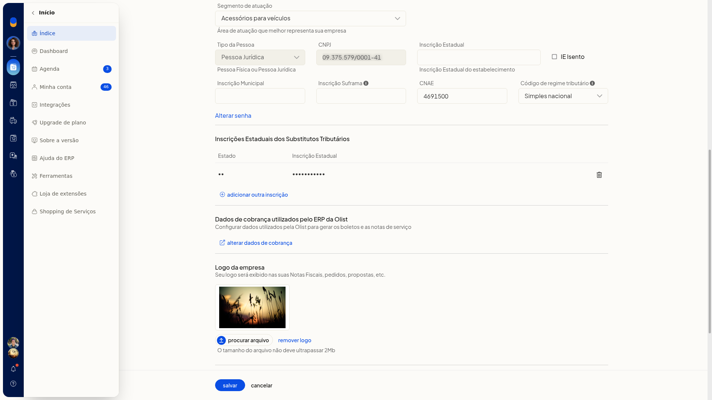
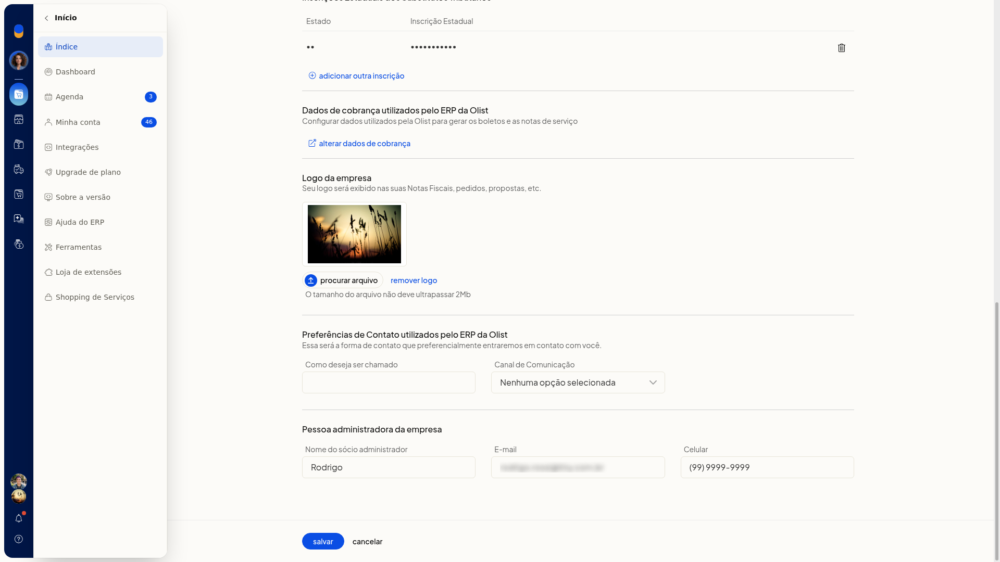
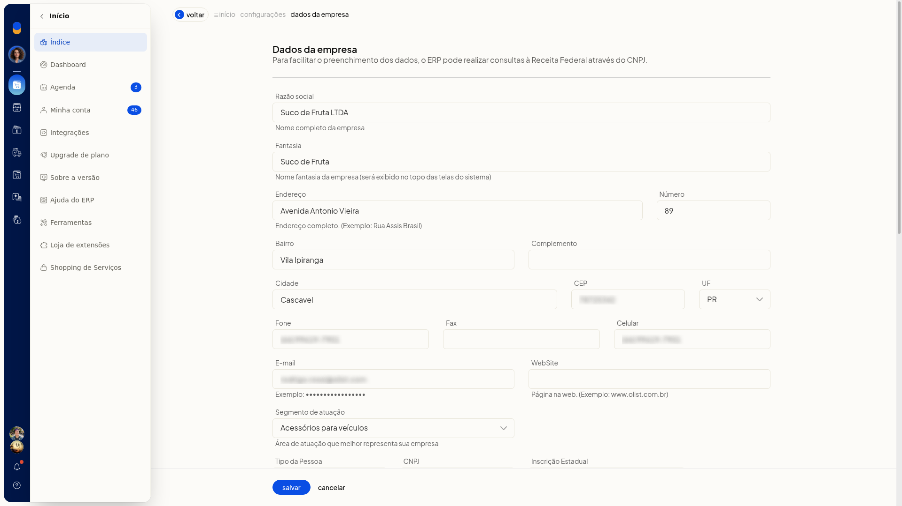
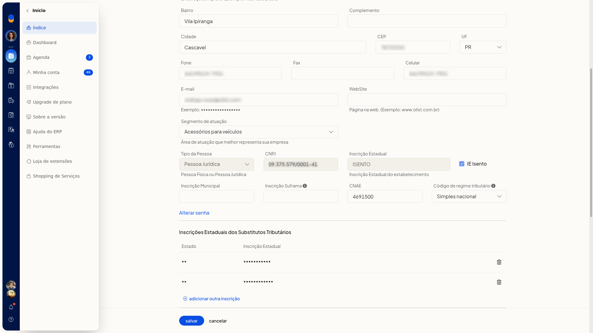

# Enviar ou remover o logotipo da empresa

No ERP da Olist, o logotipo da empresa é exibido em notas fiscais, pedidos e propostas. Nesta tela você envia uma imagem de até 2Mb ou remove o logotipo já cadastrado.

O envio e a remoção ficam em **Configurações > Configurações do Sistema ERP > Geral > Alterar dados da empresa**, na seção **Logo da empresa**.

## Pré-requisitos
- A tela não fica disponível para empresas no plano Conta Digital.
- Se a opção não aparecer para você, peça acesso ao administrador da conta.

## Importante
- O arquivo do logotipo não deve ultrapassar 2Mb.
- O envio só é gravado ao clicar em **Salvar**. **Voltar** sai sem gravar.
- A remoção pede confirmação e, se confirmada, exclui o logotipo de forma persistente.

## Instruções
Para enviar o logotipo:

1. Acesse **Configurações > Configurações do Sistema ERP**.
2. Na aba **Geral**, clique em **Alterar dados da empresa**.

   

3. Em **Logo da empresa**, clique em **procurar arquivo** e selecione a imagem.

   

   

   

4. Clique em **Salvar** para gravar o logotipo. Ele passa a ser exibido em notas fiscais, pedidos e propostas.

   

Para remover o logotipo:

1. Acesse **Configurações > Configurações do Sistema ERP**.
2. Na aba **Geral**, clique em **Alterar dados da empresa**.
3. Em **Logo da empresa**, clique em **remover logo**.
4. Confirme **Deseja remover o logotipo da empresa?**. O logotipo é excluído de forma persistente.

## Resultado
O logotipo enviado fica disponível para notas fiscais, pedidos e propostas. O logotipo removido deixa de ser exibido nesses documentos.
