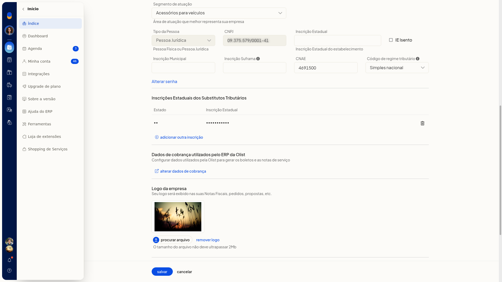
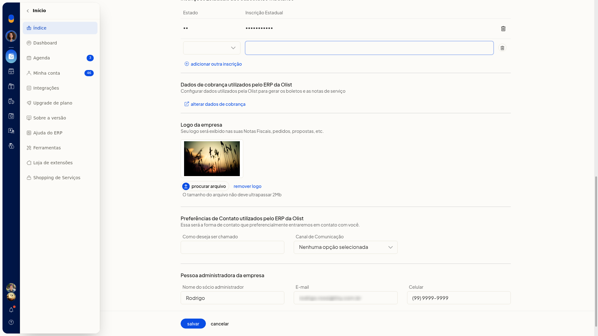
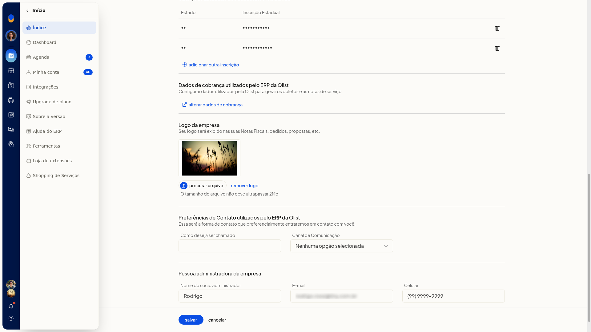

# Incluir inscrição estadual de substituto tributário

No ERP da Olist, você inclui a inscrição estadual de substituto tributário no cadastro já existente da empresa, na tela **Dados da empresa**. A inscrição só fica registrada quando você salva.

## Pré-requisitos
- A tela não fica disponível para empresas no plano Conta Digital da Olist.
- Se a opção não aparecer para você, peça acesso ao administrador da conta.

## Importante
- A inscrição incluída fica só na tela até você clicar em **Salvar**.
- **Voltar** descarta a linha que ainda não foi salva.

## Instruções
1. Acesse **Configurações > Configurações do Sistema ERP**.
2. Na aba **Geral**, clique em **Alterar dados da empresa**.

   

   

3. Em **Inscrições Estaduais dos Substitutos Tributários**, clique em **adicionar outra inscrição**.

   

4. Escolha a UF e informe a inscrição. A linha entra na tabela e permanece só até salvar.

   

5. Clique em **Salvar** para gravar a inscrição. A alteração só fica registrada nesse momento.

## Resultado
Depois de salvar, a inscrição estadual de substituto tributário fica gravada no cadastro da empresa.
