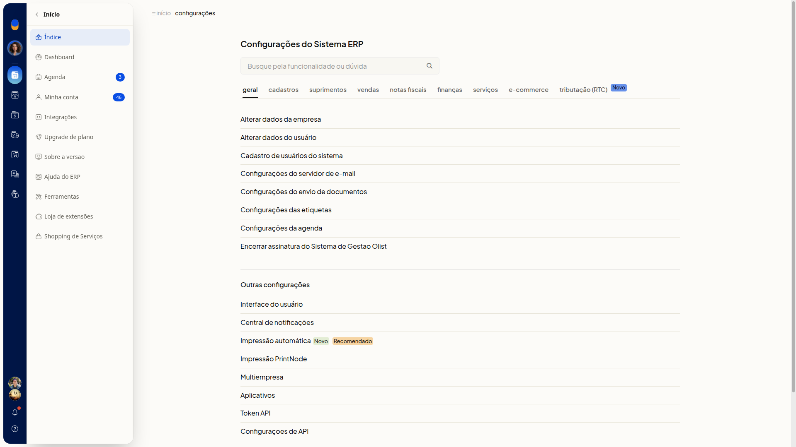
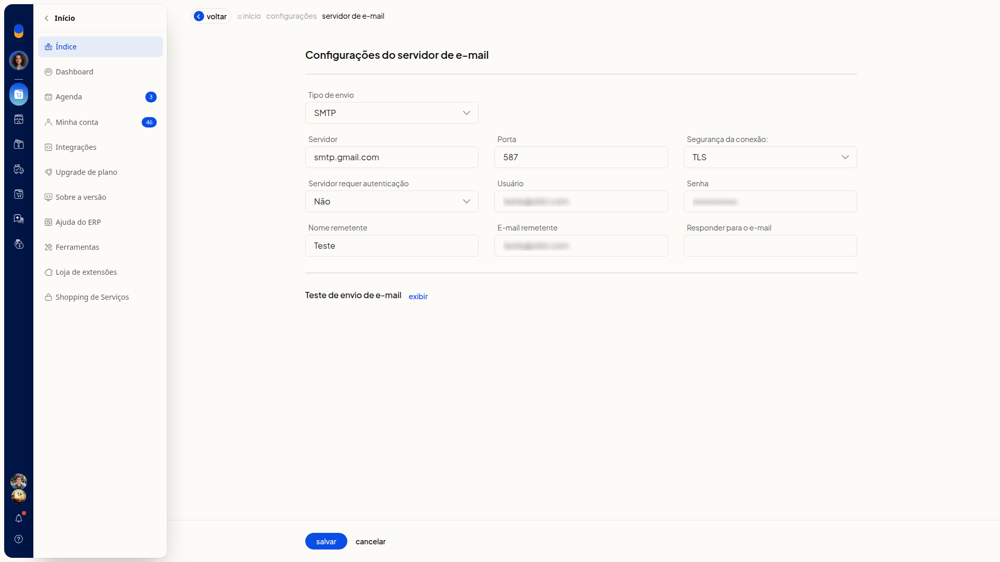
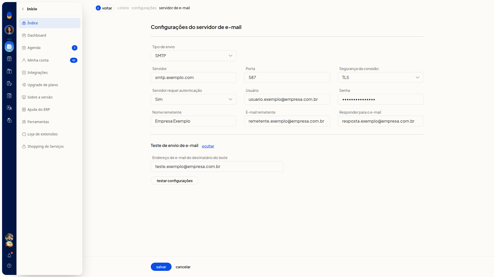
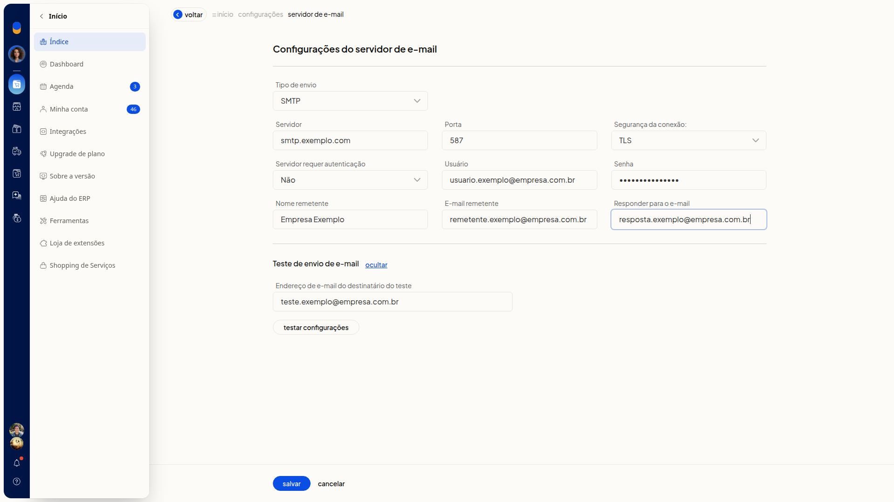
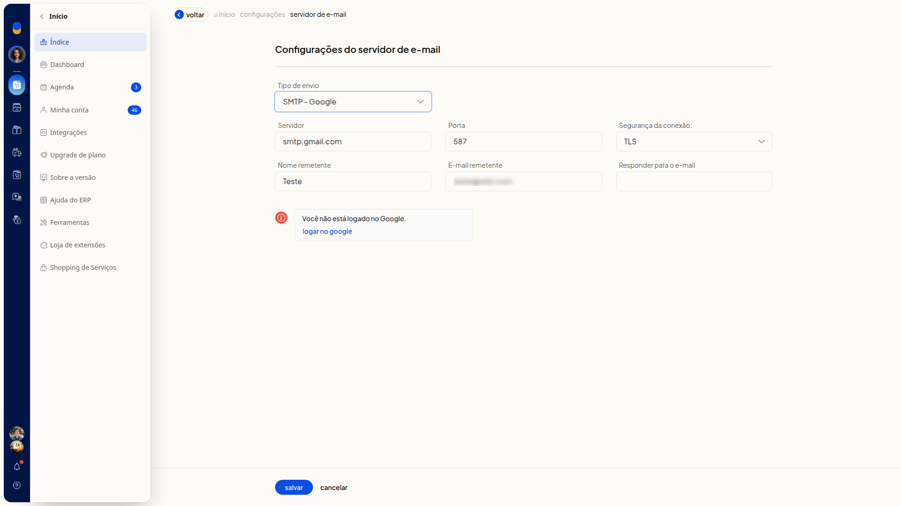
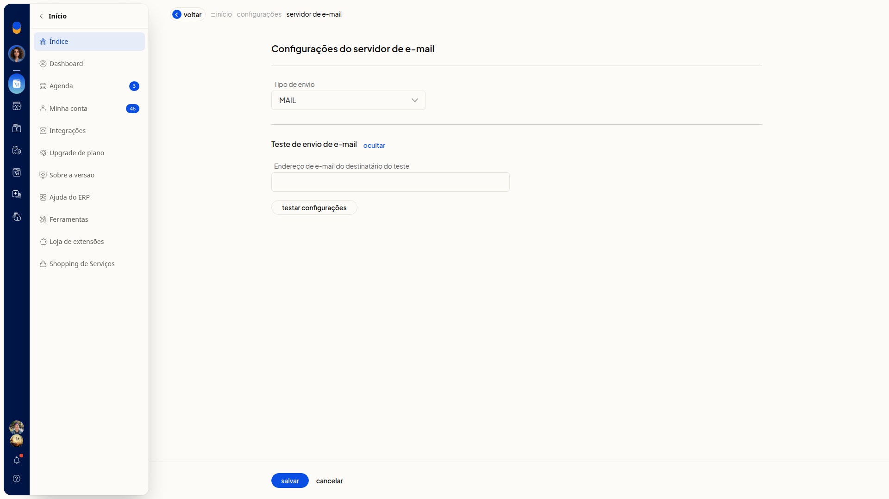
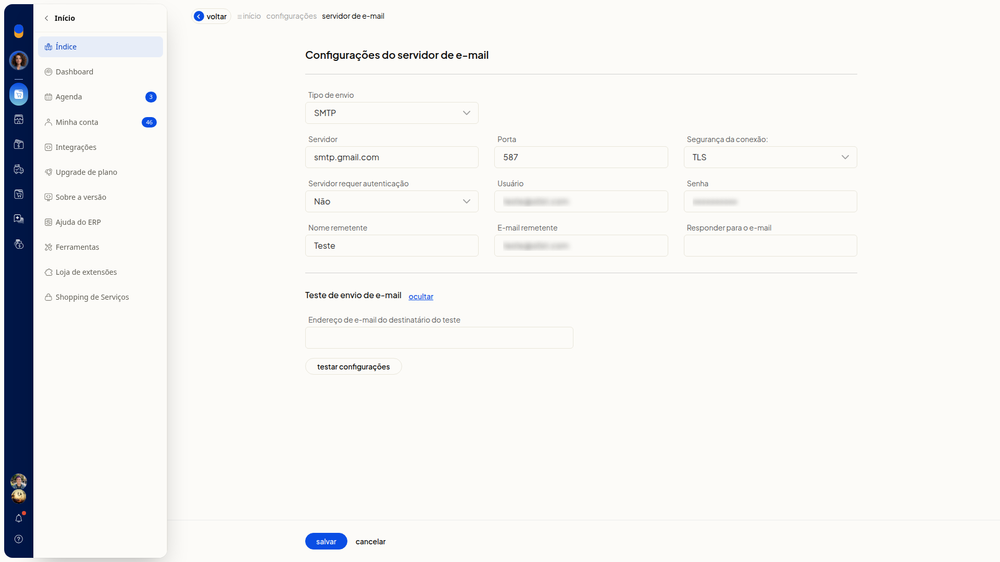
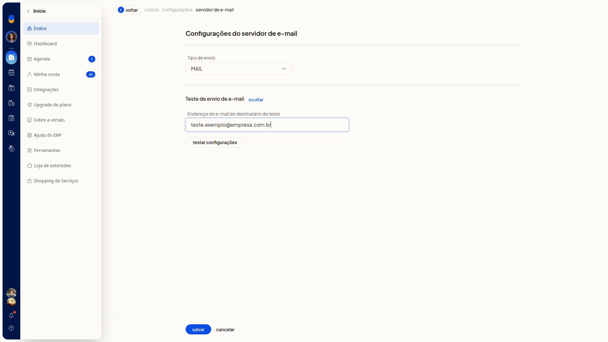

# Configurar o envio de documentos por e-mail

No ERP da Olist, você define como os emails saem do sistema. Em **Configurações do servidor de e-mail**, você escolhe o tipo de envio (**SMTP**, **SMTP - Google** ou **MAIL**), informa os dados do servidor e do remetente e pode testar o envio.

## Pré-requisitos
- Para o tipo **SMTP**, tenha em mãos **Servidor**, **Porta**, **Segurança da conexão** e, se o provedor exigir, **Usuário** e **Senha**.
- Se **Configurações do servidor de e-mail** não aparecer para você, peça acesso ao administrador da conta.

## Importante
- **Configurações do envio de documentos** não tem regras de envio por email. Configure o envio em **Configurações do servidor de e-mail**.
- No tipo **SMTP - Google**, a tela informa que é preciso estar logado no Google e mostra o aviso **Você não está logado no Google**.
- Nenhum campo de **Configurações do servidor de e-mail** é obrigatório.

## Instruções
Escolha o tipo de envio e siga os passos correspondentes.

### Configurar o tipo SMTP

1. Acesse **Configurações > Configurações ERP** e abra a aba **Geral**.

   

2. Clique em **Configurações do servidor de e-mail**.
3. Selecione **SMTP** em **Tipo de envio**.

   

#### Dados do servidor

4. Preencha **Servidor** e **Porta**.
5. Selecione **SSL**, **TLS** ou **Nenhuma** em **Segurança da conexão**.
6. Selecione **Sim** ou **Não** em **Servidor requer autenticação**.

   

7. Preencha **Usuário** e **Senha**.

#### Dados do remetente

8. Preencha **Nome remetente**, **E-mail remetente** e **Responder para o e-mail**.

   

9. Clique em **Salvar** para gravar o servidor SMTP, o remetente e o endereço de resposta.

### Configurar o tipo SMTP - Google

1. Acesse **Configurações > Configurações ERP > Geral > Configurações do servidor de e-mail**.
2. Selecione **SMTP - Google** em **Tipo de envio**.

   

3. Confira **Servidor** smtp.gmail.com, **Porta** 587 e **Segurança da conexão** em **TLS**.
4. Clique em **Logar no Google** se aparecer o aviso **Você não está logado no Google**.
5. Clique em **Salvar** para gravar o tipo **SMTP - Google**.

### Configurar o tipo MAIL

1. Acesse **Configurações > Configurações ERP > Geral > Configurações do servidor de e-mail**.
2. Selecione **MAIL** em **Tipo de envio**. Você não precisa informar servidor, porta nem autenticação.

   

3. Clique em **Salvar** para usar o tipo **MAIL**.

### Testar as configurações de email

1. Acesse **Configurações > Configurações ERP > Geral > Configurações do servidor de e-mail**.
2. Clique em **exibir** na seção **Teste de envio de e-mail**.

   

3. Preencha **Endereço de e-mail do destinatário do teste**.

   

4. Clique em **Testar configurações** para enviar um email de teste ao destinatário informado.
