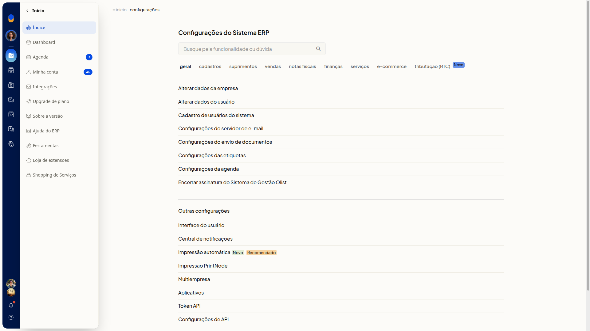
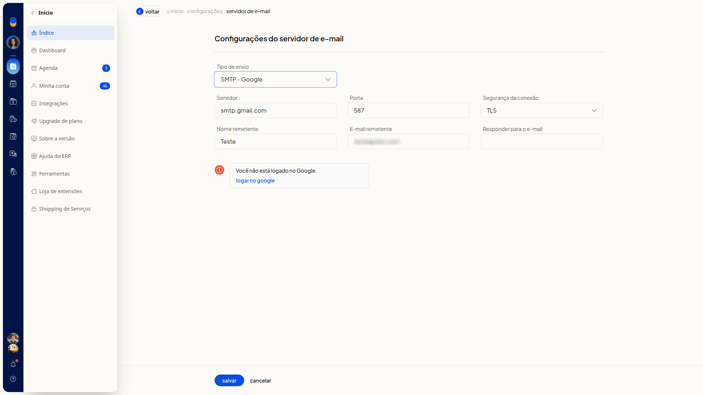

# Configurar o servidor de e-mail com SMTP - Google

No ERP da Olist, o tipo **SMTP - Google** define o envio de emails pelo servidor do Google. Em **Configurações do servidor de e-mail**, você seleciona esse tipo e entra na conta Google para concluir a configuração.

## Importante
- É preciso entrar na conta Google para concluir o tipo **SMTP - Google**.

## Instruções
1. Acesse **Configurações > Configurações ERP**.
2. Abra a aba **Geral**.

   

3. Clique em **Configurações do servidor de e-mail**.
4. Em **Tipo de envio**, selecione **SMTP - Google**. A tela mostra **Servidor** smtp.gmail.com, **Porta** 587, **Segurança da conexão:** TLS e o aviso **Você não está logado no Google**. Nesse tipo, a tela não mostra **Servidor requer autenticação**, **Usuário** e **Senha**.

   

5. Clique em **Logar no Google** se o aviso **Você não está logado no Google** aparecer.
6. Clique em **Salvar**.
