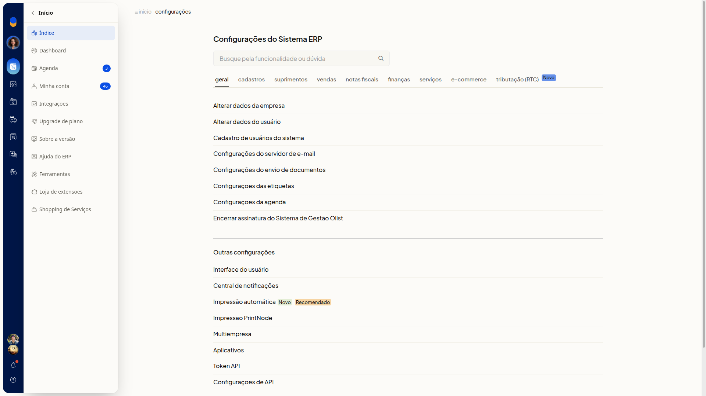
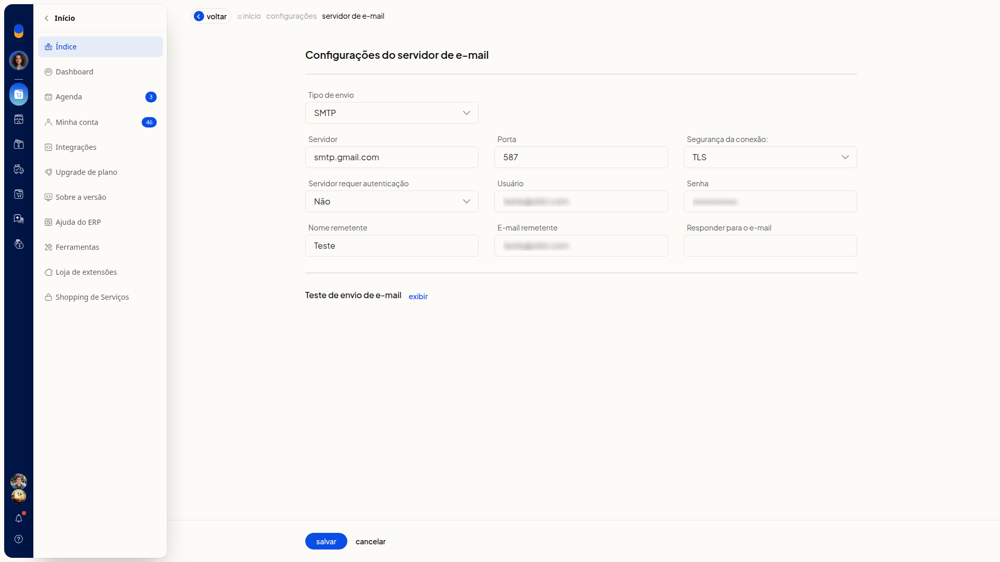
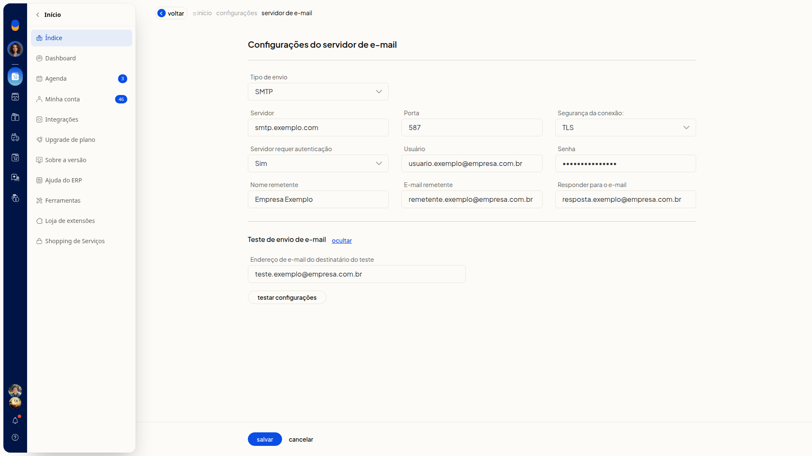
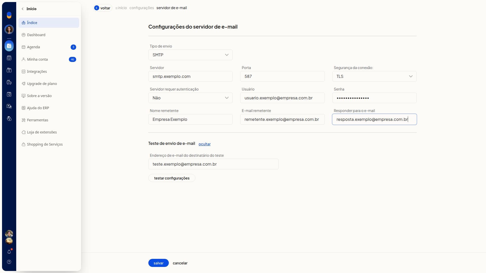
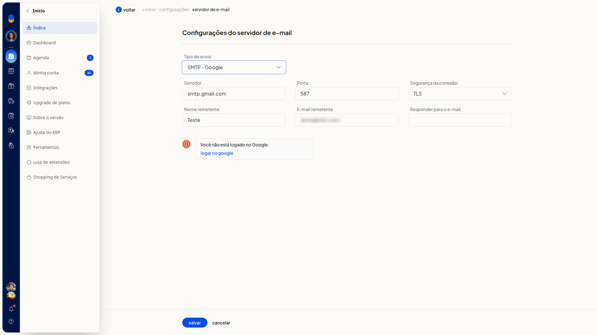
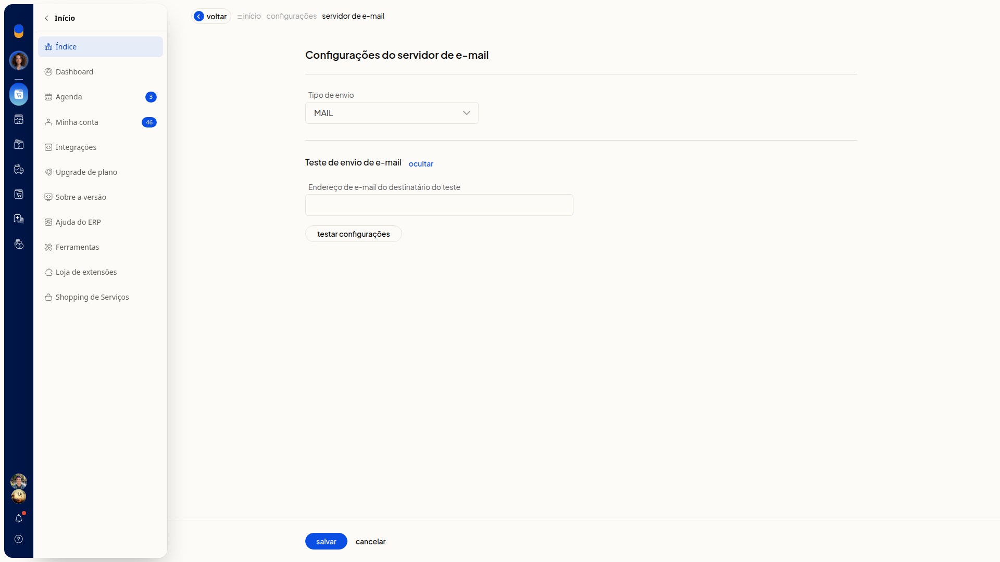
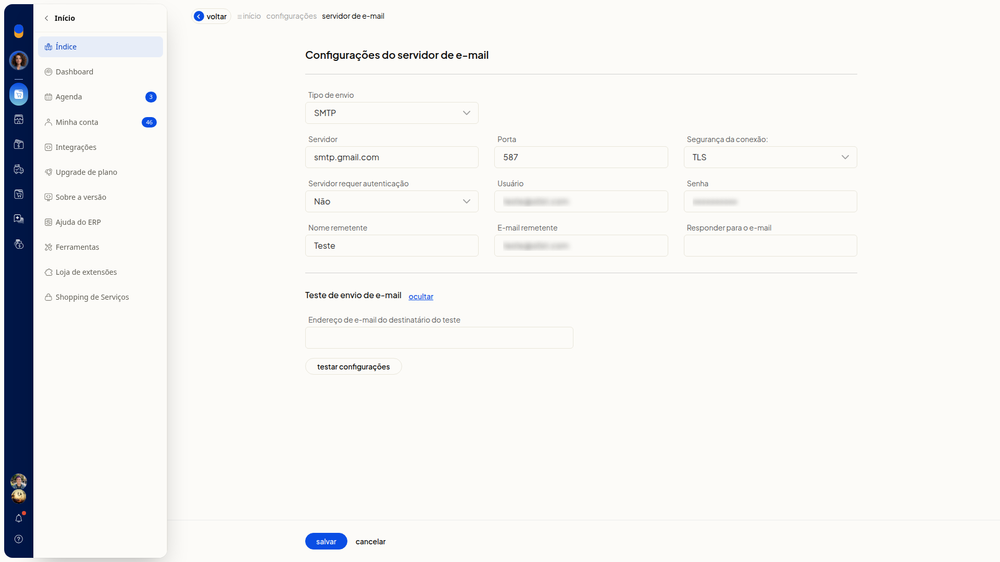
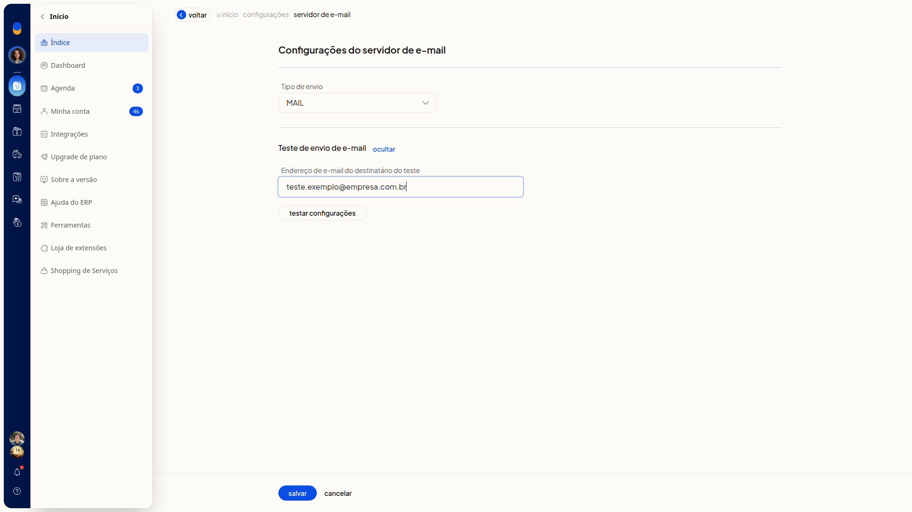

# Configurar o servidor de e-mail

No ERP da Olist, você define como os emails saem do sistema. Em **Configurações do servidor de e-mail**, você escolhe **SMTP**, **SMTP - Google** ou **MAIL**, informa servidor, porta, segurança, autenticação e dados do remetente, e testa o envio.

## Pré-requisitos
- Se **Configurações do servidor de e-mail** não aparecer para você, peça acesso ao administrador da conta.

## Importante
- Para o tipo SMTP, tenha o servidor, a porta, a segurança da conexão e, se o provedor exigir, **Usuário** e **Senha**.
- No tipo SMTP - Google, clique em **Logar no Google** quando aparecer o aviso **Você não está logado no Google**. Sem esse login, o tipo não fica concluído.
- Nenhum campo da tela é marcado como obrigatório.

## Instruções
### Pelo tipo SMTP

1. Acesse **Configurações > Configurações ERP > Geral > Configurações do servidor de e-mail**.

   

2. Em **Tipo de envio**, selecione **SMTP**.

   

#### Servidor e autenticação

3. Preencha **Servidor** e **Porta**.
4. Em **Segurança da conexão:**, selecione **SSL**, **TLS** ou **Nenhuma**.
5. Em **Servidor requer autenticação**, selecione **Sim** ou **Não**.

   

6. Preencha **Usuário** e **Senha**, tanto com **Sim** quanto com **Não**.

#### Remetente

7. Preencha **Nome remetente**, **E-mail remetente** e **Responder para o e-mail**.

   

8. Clique em **Salvar** para gravar o servidor SMTP, o remetente e o endereço de resposta.

### Pelo tipo SMTP - Google

1. Acesse **Configurações > Configurações ERP > Geral > Configurações do servidor de e-mail**.
2. Em **Tipo de envio**, selecione **SMTP - Google**.

   

3. Confira **Servidor** smtp.gmail.com, **Porta** 587 e **Segurança da conexão:** TLS. **Servidor requer autenticação**, **Usuário** e **Senha** não aparecem neste tipo.
4. Clique em **Logar no Google** se aparecer o aviso **Você não está logado no Google**.
5. Clique em **Salvar** para usar o SMTP do Google.

### Pelo tipo MAIL

1. Acesse **Configurações > Configurações ERP > Geral > Configurações do servidor de e-mail**.
2. Em **Tipo de envio**, selecione **MAIL**. A tela deixa de pedir os dados de SMTP e mantém **Tipo de envio** e **Teste de envio de e-mail**.

   

3. Clique em **Salvar** para usar o tipo MAIL.

### Testar as configurações

1. Acesse **Configurações > Configurações ERP > Geral > Configurações do servidor de e-mail**.
2. Em **Teste de envio de e-mail**, clique em **exibir**.

   

3. Preencha **Endereço de e-mail do destinatário do teste**.

   

4. Clique em **Testar configurações** para disparar um email ao destinatário informado.
