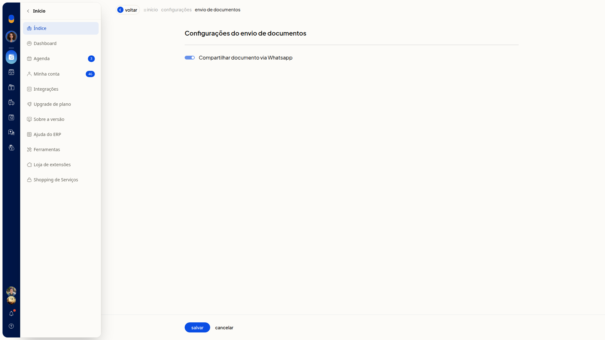
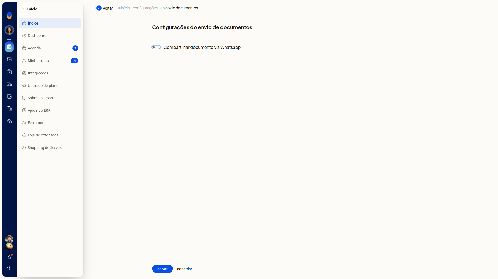

# Enviar documentos por WhatsApp

No ERP da Olist, você liga ou desliga o compartilhamento de documentos pelo WhatsApp. Em **Configurações do envio de documentos**, o interruptor **Compartilhar documento via Whatsapp** define se os documentos podem ser compartilhados por esse canal.

## Importante
- Marcar ou desmarcar **Compartilhar documento via Whatsapp** não abre outros campos.
- Se você clicar em **Voltar** sem salvar, a alteração não fica gravada.

## Instruções
1. Acesse **Configurações > Configurações ERP > Geral > Configurações do envio de documentos**.

   

2. Marque **Compartilhar documento via Whatsapp** para ligar o compartilhamento ou desmarque para desligar.

   

3. Clique em **Salvar**. O compartilhamento de documentos pelo WhatsApp fica ligado ou desligado conforme o interruptor. O envio do documento pelo WhatsApp não é feito nesta tela.

## Informações adicionais
### Não há regras de envio por email nesta tela

**Configurações do envio de documentos** não contém campos de regras de envio por email. O único controle é o interruptor **Compartilhar documento via Whatsapp**.
