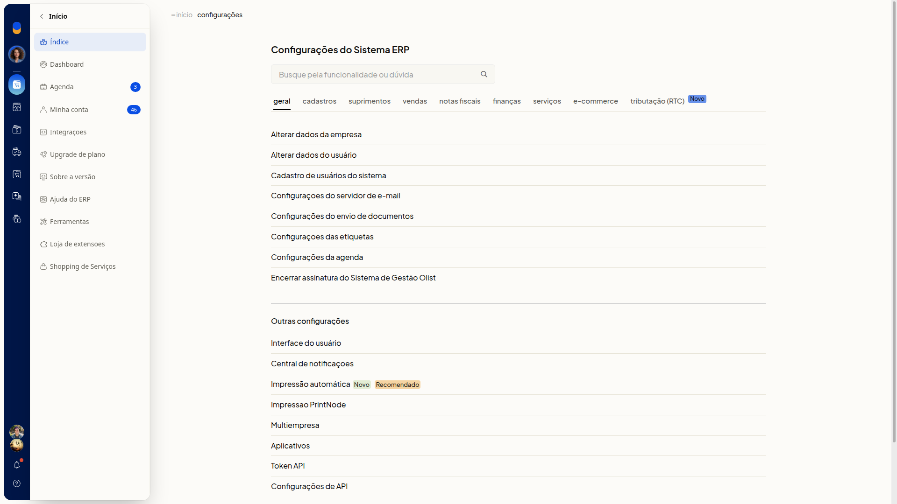
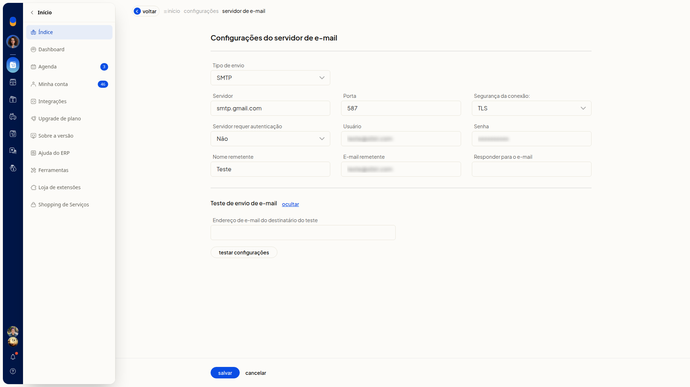
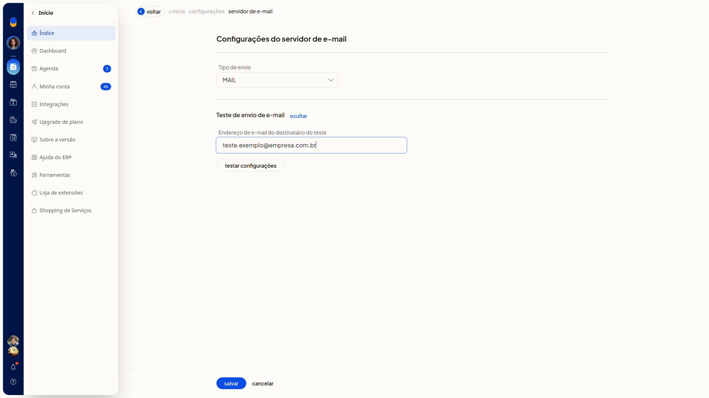

# Testar as configurações de e-mail

No ERP da Olist, a seção **Teste de envio de e-mail** dispara um email de teste para o destinatário que você informar. Ela fica na tela **Configurações do servidor de e-mail**.

## Instruções
1. Acesse **Configurações > Configurações ERP > Geral > Configurações do servidor de e-mail**.

   

2. Clique em **exibir**, na seção **Teste de envio de e-mail**.

   

3. Preencha **Endereço de e-mail do destinatário do teste**. O campo não é obrigatório.

   

4. Clique em **Testar configurações** para disparar um email ao destinatário informado.
